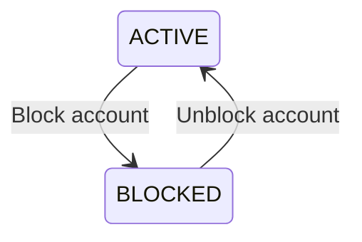

This console requires the instance-admin role.
Workspace administration configures one workspace.
Instance administration operates the deployment.

1. Open **Instance administration** at the bottom of the sidebar.

## Overview

The overview shows silent mode, configuration readiness, release information, workspace counts,
and recent authentication activity.

1. Before members sign in or you enable feedback, check readiness.
2. Use the [instance checks of First steps](./first-steps#5-check-the-instance) to resolve missing configuration.
3. Use the [configuration readiness reference](./configuration-readiness).

### Update checks

The **Release** card shows the release that this server reports from its lock ([runtime identity handoff](./release-image-lock#runtime-identity-handoff)).
It also shows whether GitHub published a newer release, with a link to its notes and whether it has schema migrations.
A failed, rate-limited, disabled or incomplete check shows as that state, never as up to date.

The server checks one minute after it starts, then once a day.
After a failure, it tries again after 15 minutes, and doubles the wait up to one day.
Each check is one unauthenticated HTTPS GET to `https://api.github.com/repos/hephaestus-build/Hephaestus/releases/latest` with the user agent `Hephaestus-release-check`.
It sends no version, credential, workspace data or configuration. GitHub sees the source IP address and the time.

On an air-gapped host, set `config.releaseCheckEnabled: false` in `site.yaml`, and upgrade the release with it.
The card then shows the release without a check.

The card also shows since when the running rollout is active.
**Show release history** lists the last ten rollouts of the server in this deployment environment, newest first, each with its revision.

Kubernetes numbers the rollouts of a Deployment: each one gets the next revision, and its ReplicaSet carries it in the annotation `deployment.kubernetes.io/revision`.
Each ready server reads the revision of its own ReplicaSet when it becomes ready and then every minute. It records each revision that it reads once, with the time of the database clock.
The revisions of one Deployment order its entries.
Compare them with `kubectl rollout history deployment/<release>-server`.

The history shows the revisions that a server read, not every revision of the Deployment:

- An entry can appear up to a minute late. This happens when a rollout revises a ReplicaSet whose Pods keep running.
- A revision that no server read is missing, and the revisions then have a gap. For example, an undo, a retried upgrade and a second undo can all happen within one minute. The surviving Pods then read only the last revision.
- The order assumes that Kubernetes keeps the revision sequence of the Deployment. If you delete every ReplicaSet but keep the Deployment, Kubernetes can number the next rollout 1 again. That rollout then adds no entry.

With the Kubernetes API, these rules apply:

- **A restart adds nothing.** A restarted server, also an old one during a rollout, reads the revision of its ReplicaSet, which is already recorded.
- **A rollback adds an entry.** `helm rollback` and `kubectl rollout undo` scale an earlier ReplicaSet up again, and Kubernetes gives it the next revision. The entry names the earlier release.
- **`kubectl rollout restart` adds an entry.** It changes the pod template, so it is a rollout with a new revision. The entry names the same release.
- **A new install starts a new order.** A fresh install has a new Deployment, whose revisions start at 1 again. A restore into a new cluster is one example. Its entries come after the entries of the earlier Deployment.
- **A stop adds nothing.** A scale to zero or a node restart starts the same ReplicaSet again.

The time of an entry is when its first server recorded it. If that server could not write at first, the time is later, but the entry keeps its place below the later revisions.
The history starts with this release. Entries from earlier releases are not shown.
The database keeps the 100 most recently recorded entries of each deployment environment, and the highest revision of each Deployment.

The server needs the Kubernetes API to read its revision.
The chart gives the server this access with `sandbox.enabled`, `postgresql.backup.enabled` or `networkPolicy.kubernetesApi` ([Helm chart](./helm-chart)).
Without it, for example outside Kubernetes, each server start adds one entry without a revision. A restart then adds an entry too.
Such an entry never sorts above the newest rollout, because a start without a revision cannot tell whether that rollout still runs. If the access comes back, later rollouts sort above those entries.

If the server logs `release.history.failed`, it could not read its revision or write its entry. It tries again a minute later.
Until a read succeeds, the card shows no start time for the running rollout, because the revision can have changed since the last read.

`deploymentEnvironment` in `site.yaml` names the deployment, such as `production` or `staging`, on the card, in log lines and in traces.
Use lowercase letters, digits, `.`, `_` or `-`, at most 64 characters: the server does not start with another value.
If you do not set it, the instance reports `local`.

## Users

You cannot demote yourself or remove the last instance admin.
Sensitive access changes require a recent sign-in.

1. Find the account.
2. Change its instance role or force sign-out of its sessions.

A connected provider account identifies a person. An instance role does not create workspace membership.

When an instance admin grants or removes the instance-admin role, Hephaestus sends an email to the affected person and to the other instance admins.
The email names who made the change, when, and links to the instance audit log.

An admin who grants a higher role to their own account receives an email too. Lowering your own role sends none. Only the first bootstrap administrator of a fresh instance is silent.

The `hephaestus.auth.bootstrap-admins` setting also grants the role. That email names the setting as the source.
The email goes only to a verified address, and only if the instance [sends email](./set-up-email).

A force sign-out ends the current sessions only.
The person can sign in again through their provider at once.

### Block an account

Block an account to stop a person from using the instance, for example after a security incident or when they leave.

1. In the row of the account, open the actions and select **Block account**.
2. Confirm.

Blocking ends every session of the account at once, including browser extension sessions.
Sign-in through any linked provider is refused until an instance admin unblocks the account.
The person sees that an admin blocked the account.
Workspace memberships, feedback and other data stay as they are.

You cannot block yourself or the last active instance admin.
Each block and unblock requires a recent sign-in.
Each writes an **Account blocked or unblocked** audit record with the admin and the status before and after.

Only active or blocked accounts can change between these states.
Unclaimed accounts and accounts whose deletion has started cannot be blocked or unblocked.

A block applies to the account and its linked identities.
A provider login that is not linked to the account creates a new account at sign-in.

### Unblock an account

1. In the row of the blocked account, open the actions and select **Unblock account**.
2. Confirm.

The person can sign in again.
If the account has a verified email address, Hephaestus sends a security notice that the account is unblocked.

## Workspaces

1. Inspect workspace metadata and status.
2. In the row of the workspace you need, select **Open administration**.
   The workspace administration opens on its settings.
   For a suspended workspace, the settings offer only **Resume workspace** and deletion, as [Resume a suspended workspace](/user/workspace#resume-a-suspended-workspace) describes.

Instance admins have ADMIN access to any active workspace, even without membership.
Elevation does not grant OWNER privileges.
Owner-only operations require explicit OWNER membership.
It does not give them Hephaestus or a member's private Practice profile in ordinary workspace navigation.

Hephaestus audits this access.
[Instance administration](/contributor/instance-admin#who-is-an-instance-admin) owns the authority.
See the [elevated-access audit policy](/contributor/instance-admin#elevated-workspace-access).

## Support shares

No console page shows a person's conversation, Practice profile or private feedback, and you cannot download a person's data.
A person can share one turn of their conversation with you: [Share a question with support](/user/privacy#share-a-question-with-support).
**Support shares** lists the shares that people addressed to you and that still run.

1. Open **Instance administration → Support shares**.
2. Select a share to read it.
   The read requires a recent sign-in.

A share shows the diagnostics of the turn and the name of the person who shared it:

- The turn ID and the run ID. Use the run ID to find the turn in the server logs and metrics.
- The surface, the status and the attempt of the turn.
- The failure reason as a closed kind, the failed model call and the status that the provider answered.
- The times when the turn was queued, started and finished.

A share shows the messages of the turn only if the person added them.
It hides them when the person deleted or changed one after the share, or when the message was erased.

Each read counts.
The person sees the count and the time of the last read.
A share runs for 7 days, and the person can revoke it at any time.
After that, it is no longer in your list.

## Audit

You cannot edit audit entries through the console.
For retention and access policy, use the [data-protection documentation](./dsms).

1. Read authentication events and configuration changes.
   Entries of type `USER_VIEW` record reads through the removed read-only user view. They stay as the record of those reads.
2. Use the available filters to find who changed a setting and when.

An entry keeps the type that it was written with.
A change to a workspace's model assignments is written as `MODEL_ASSIGNMENT`.
Entries from before 1.0 have the earlier type `AGENT_BINDING`, or `AGENT_CONFIG` or `AI_CONFIG_BINDING` from older releases.
The console shows all of these types as **Model assignment**.

## Usage

The instance admin sets or clears a workspace's cap on shared-model spend. A workspace admin sets the separate cap for that workspace's own provider.
A cap blocks new spend. It is not a refund or a guarantee that the provider's bill is correct.
[AI providers](./ai-providers) owns model setup, prices, model access, and assignments.

1. Inspect monthly AI usage by workspace.

The table of workspaces has one row for each workspace:

| Column                                   | What it shows                                                                                                                                                                                                                                                                                                                  |
| ---------------------------------------- | ------------------------------------------------------------------------------------------------------------------------------------------------------------------------------------------------------------------------------------------------------------------------------------------------------------------------------ |
| **Workspace**                            | The workspace's name and its short name.                                                                                                                                                                                                                                                                                       |
| **Shared models**: **Spend**, **Budget** | The month's spend on the instance's shared models. **Budget** shows the shared-model budget and the share of it that the month used. It also shows a state when it applies: **Paused**, **Near the budget**, or **No price set**. A workspace without a budget shows a dash, and still shows **No price set** when it applies. |
| **Own provider**: **Spend**, **Cap**     | The same figures for the workspace's own provider, against its provider cap. Its near state is **Near the cap**. Only the workspace's admins set this cap. These columns appear when at least one workspace uses its own provider in the month.                                                                                |
| **Uses**                                 | The month's review attempts and conversation answers.                                                                                                                                                                                                                                                                          |

The table shows the highest shared-model spend first.
Select **Workspace**, a **Spend** heading, or **Uses** to sort by that column.
The table filters by workspace name and shows 25 workspaces on each page.
The address keeps the filter, the sort, and the page, so you can share the view.

In the current month, **Set budget** or **Change budget** on a row sets the workspace's shared-model budget.
**Details** shows the usage of one workspace below the table, under its name and **Usage details**.
In those tables, **No price set** counts the uses that have usage without a price.
[Read AI usage](/user/ai-models#read-ai-usage) describes those tables.

## Person data

The person-data console handles access and erasure requests, including people who have never signed
in.
It previews and erases what Hephaestus holds about one person. It never hands you the records of an access request.

To answer a request, follow [Answer an access or erasure request](./person-data-requests).

The [personal-data map](./dsms/personal-data-map.mdx#git-repository-history-and-short-lived-attempts)
states the scope of database, attempt-copy and provider-mirror erasure.

Use the [data-protection documentation](./dsms) for identity verification, scope, retention, and
external-copy obligations. This console is separate from a member's own
[Danger zone](/user/user-settings#danger-zone).

## Silent mode

New instances start with silent mode on.
It blocks new writes to GitHub, GitLab, and Slack, and all email.
Inbound events, sync, practice reviews, and result storage continue.
[Contain an incident](./contain-an-incident) lists what silent mode stops and what it does not stop.

A stale settings view cannot turn off a newer silent mode setting.
If you turn silent mode off, Hephaestus does not replay feedback withheld while it was on.
After a deployment with silent mode on, follow [Prove silence, then turn off silent mode](./silent-deployment).

1. Open **Instance administration → Instance settings** to inspect or change silent mode.
2. Before you turn it off, read the current state.

## Provider removals

When a connection ends, Hephaestus removes what it created at the provider.
That is a GitHub App installation, a GitLab group webhook or project webhook, a Slack bot token, or an Outline webhook subscription.
If Hephaestus cannot be sure that a removal finished, it blocks the old resource, so that a new connection cannot use it.
Workspace admins see the blocks on their integration page, and only instance admins can release them.

A workspace removal sends these removals before it erases the credentials, for up to 30 seconds. A removal in progress then finishes.
A GitHub uninstall removes its workspace in the same way, so it also removes the workspace's Slack and Outline resources first.
A removal that is not complete keeps its block. Its credential is gone, so its removal waits for authorization.

1. Check at the provider that the old resource is gone and its removal is complete.
   A timeout, a `202` answer, or a missing resource alone does not prove it. GitHub answers `202` when it accepts an uninstall.
2. Open **Instance administration → Provider removals**, or the integration page of the workspace.
3. Select **Confirm removal** for the exact resource.
4. Select **I confirmed that the old resource is gone and its removal is complete.**
5. Select **Release block**.

The audit log of each workspace that used the resource records the release.
Releasing does not restore erased work. Start the connection again afterwards.
For Slack, release a waiting token removal before the block of its bot user.
A block stays under **Instance administration → Provider removals** after its connection or workspace is deleted.

## Call the API

Hephaestus has no API tokens.
A script calls the API with the access token of your own browser session:

1. Sign in to Hephaestus in a browser.
2. In the developer tools of the browser, find the cookie `__Host-HEPHAESTUS_AT` of the instance.
3. Put its value in a shell variable, for example `HEPHAESTUS_TOKEN`, and not in a command line or a file.
4. Send it in the header `Authorization: Bearer $HEPHAESTUS_TOKEN` to `https://<host>/api/…`.

The token has all the rights of your account.
It stops working when you sign out, when the browser renews it, and at the latest after 24 hours.
If a call answers `401`, copy the cookie again.
Keep the token out of logs, tickets and shared files.

## Bootstrap and recovery

Promotion occurs on sign-in.
This setting never demotes an existing admin.

1. Before first sign-in, set `HEPHAESTUS_AUTH_BOOTSTRAP_ADMINS` as [First steps](./first-steps#2-name-the-first-admin) describes.

The recovery endpoint promotes an account only while no admin exists.
Do not publish the token or keep it in shell history.

If no admin exists, use this recovery procedure:

1. Add the key `HEPHAESTUS_AUTH_BOOTSTRAP_TOKEN` to the release Secret that `secret.name` names.
   Generate its value as [Generation and rotation](./secret-custody#generation-and-rotation) gives it.
2. Restart the server, as [Restart a role](./secret-custody#restart-a-role) gives it.
3. Sign in with an account. In that session, get a CSRF token with `GET /api/auth/csrf`.
   The response body gives `token` and `headerName`, and the response sets the cookie `__Host-XSRF-TOKEN`.
4. In the same session, send `POST /api/auth/bootstrap-admin` with that cookie and the token in the header that `headerName` names.
   The JSON body must have a `token` field with the bootstrap token.
   Without a signed-in session, the endpoint returns `403`.
5. Remove the key from the Secret.
6. Restart the server again.

For normal bootstrap configuration, use provider-specific numeric IDs where possible.

Contributor details belong in [Instance administration implementation](/contributor/instance-admin).

## Accounts before sign-in

Roster sync can create an Unclaimed human account with membership before the person signs in.
It creates no sign-in credential and gives bots no account.
A verified sign-in claims the existing identity rather than creating another developer.
Account choices apply across connected identities and workspaces.
