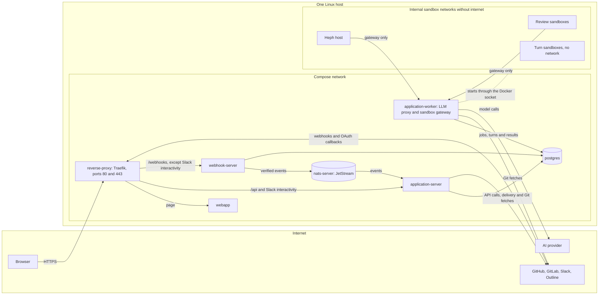

This guide is for people who run a Hephaestus deployment.
It has five parts:

- **Deploy** installs the supported stack.
- **Configure** connects providers, AI models, and practices.
- **Operate** covers upgrades, backups, troubleshooting, sizing, and incidents.
- **Security** covers the threat model, keys, release verification, and data protection.
- **Policies** state what a version number promises and which releases we support.

Developers who use Hephaestus need the [User guide](/user/overview).
People who change the code need the [Contributor guide](/contributor/overview).

## What a deployment consists of

A deployment uses one Docker Compose stack on a single 64-bit Linux host.
One application image starts in three runtime roles: `server`, `worker`, and `webhook`.
The stack also has PostgreSQL, a NATS event buffer, and Traefik for TLS.

Sign-in uses a GitHub or GitLab OAuth app that you register during installation.
The worker starts a sandboxed container for each practice review.
It does not keep that container active between reviews.
[Runtime roles](./runtime-roles) explains each role and why the webhook role has its own container.

## Architecture and network

The diagram shows the self-hosted Compose stack on one host.
Each box is a container, and each arrow is one of its main connections.
[Network egress](./network-egress) lists every outbound destination and when it is used, also the ones that the diagram leaves out.
The [threat model](./threat-model#system-and-data-flow) shows the trust boundaries of the same system.

Only `application-worker` starts containers through the Docker socket.
`reverse-proxy` mounts the socket read-only to discover its routes.

Only `reverse-proxy` publishes ports, 80 and 443.
Browsers, OAuth callbacks, and provider webhooks arrive there.
Each Java container has a management port, 9090, for health and metrics.
That port, PostgreSQL, and NATS stay on the internal Compose network.
[Runtime roles](./runtime-roles) explains what each role does.

## Two kinds of admin

- **Instance admin** — operates the whole deployment. This includes AI providers, instance-wide settings, and the practice catalog that workspaces can adopt from.
- **Workspace admin** — configures one workspace. This includes its repositories, practices, members, AI model, and cap on AI spend.

A person can be both.
[Instance admin](./instance-admin) covers the operator console.
[Integrations](./integrations) covers workspace connections.

## Set it up in this order

1. [Install](./install) the supported Compose stack. The guide covers required `.env` values and TLS.
2. [Connect a source](./integrations): a GitHub App or GitLab connection that supplies repository activity.
   [Integration settings](./production-setup) covers Slack and Outline.
3. [Connect an AI provider](./ai-providers) with an OpenAI-compatible endpoint.
4. Set a cap on AI spend.
5. [Choose practices](./practice-catalog) for the instance to include and the workspace to adopt.
   [Practice review](./practice-review) explains how a review runs.
6. [Publish the legal pages](./legal-pages) with imprint and privacy information for your deployment.
   The [data-protection documentation](./dsms) has the GDPR records.

## Keep it running

- [Upgrade](./upgrade) owns the upgrade procedure, failed-migration recovery, and rollback.
  Before an upgrade, read the [compatibility policy](./compatibility-policy) and the [migration guide](https://github.com/hephaestus-build/Hephaestus/blob/main/MIGRATION.md).
- [Backup & restore](./backup-restore) covers recovery.
- [Troubleshooting](./troubleshooting) lists common failures and their fixes.
- [Sizing and scaling](./sizing) gives the resource budget.
- The [production operations runbook](./production-operations-runbook) covers incident brakes, silent deployment, PostgreSQL × JetStream restore, and removal of external feedback.
- [Practice review operations](./practice-review-operations) and
  [webhook ingestion operations](./webhook-ingestion-operations) cover the two pipelines whose failures are most visible.

Hephaestus is pre-1.0.
A minor release can still require action.

## Repository scans

[Scan a repository](./practice-scans.mdx) explains default-branch review and SARIF export.
Scan reports separate judged, reused, withheld and unreviewed work.
They do not produce personal feedback or developer standing.
