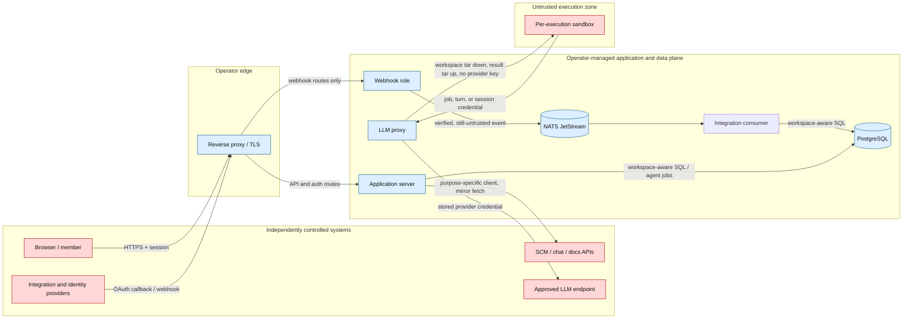

This model applies to the Helm deployment on Kubernetes.
It covers the four application trust boundaries below.
These separate control planes are outside its scope:

- Browser and identity-provider internals.
- Host and database administration.
- Backup custody.
- The CI/release supply chain.
- Edge DDoS protection.

The [Security Policy](https://github.com/hephaestus-build/Hephaestus/blob/main/SECURITY.md), [Integration settings](./production-setup), [Backup & Restore](./backup-restore), and [Release Image Lock](./release-image-lock) own those control planes.

## Security objectives and protected assets

Hephaestus must meet these security objectives:

1. Prevent one workspace from reading or changing another workspace's data.
2. Keep reusable integration, session, encryption, and model-provider credentials out of untrusted content and sandbox environments.
3. Contain execution influenced by repositories and models without trusting their instructions or output.
4. Authenticate public ingress.
5. Bound public ingress.
6. Restrict outbound destinations and side effects.

| Asset                       | Examples                                                                           |
| --------------------------- | ---------------------------------------------------------------------------------- |
| Reusable credentials        | Provider keys, OAuth secrets, integration tokens, webhook secrets, encryption keys |
| Workspace-confidential data | Repository content, issues, messages, documents, feedback, membership              |
| Untrusted content           | Webhook bodies, diffs, files, comments, chat, documents, model output              |
| Operational data            | Job and delivery identifiers, metrics, sanitized error categories                  |

## System and data flow

Arrows show permitted logical flows, not network-level reachability.
The [chart topology](./overview#architecture-and-network) shows the Pods and their connections.
[Network egress](./network-egress) lists every outbound destination.

Only the server role creates sandbox Jobs and Pods in the release's restricted sandbox namespace, and only with `sandbox.enabled`.
The webhook role has no sandbox RBAC.
No application role mounts a container daemon socket.

A deny-all NetworkPolicy covers that namespace.
Review sandboxes can reach the server's sandbox gateway.
Only the conversation loop, in the release namespace, can reach the conversation's tools Pods on TCP port 7100.
Review sandboxes reach nothing else, and tools Pods have no egress (SB-3).

Each server checks enforcement with real Pods before it starts a sandbox and at its configured probe interval (SB-7).
Its API serves meanwhile.
The native k3s CI and release smokes require every server to pass this probe.

Sandbox inputs arrive and results leave through the server's sandbox gateway, which also hosts the LLM proxy.
No server disk paths mount into a sandbox.
Runtime-role separation reduces reachable surface but is not authorization.
See [Runtime Roles](./runtime-roles).

## Attacker assumptions

An attacker can be any of these actors:

- An unauthenticated internet client that calls all routes exposed by the reverse proxy.
- A legitimate member who attempts horizontal or vertical privilege escalation.
- A compromised integration account that sends correctly signed malicious content.
- A repository contributor who puts prompt injection, malicious source, symlinks, or resource-exhaustion inputs in synchronized artifacts.
- A malicious or compromised model endpoint that returns crafted output.
- Code inside a sandbox, with full knowledge of the image and application design.

The model trusts these principals:

- Kubernetes control plane, container runtime and node root.
- Running application processes.
- PostgreSQL administrator.
- Instance encryption key.
- Configured instance admins.

Their compromise is outside the isolation guarantees described here.

## Mitigations index

Each table links threats to enforcement, verification, and residual risk.

### Boundary 1: public webhook ingress

| ID and threat                                   | Enforced control                                                                                                                                                 | Enforcement                                                                                                                                                                                                                                                                                                                                                                                                                                                                                                                     | Verification                                                                                                                                                                                                                                                                                                                                                                                               | Residual risk                                                                                                                                                                                                                                                        |
| ----------------------------------------------- | ---------------------------------------------------------------------------------------------------------------------------------------------------------------- | ------------------------------------------------------------------------------------------------------------------------------------------------------------------------------------------------------------------------------------------------------------------------------------------------------------------------------------------------------------------------------------------------------------------------------------------------------------------------------------------------------------------------------- | ---------------------------------------------------------------------------------------------------------------------------------------------------------------------------------------------------------------------------------------------------------------------------------------------------------------------------------------------------------------------------------------------------------- | -------------------------------------------------------------------------------------------------------------------------------------------------------------------------------------------------------------------------------------------------------------------- |
| WH-1 — forged or unsupported provider event      | Resolve a known integration kind and verify the provider-signed raw bytes before parsing. Missing routing, verifier, or subject derivation fails closed.         | [`IntegrationKindRouting`](https://github.com/hephaestus-build/Hephaestus/blob/main/server/application/src/main/java/de/tum/cit/aet/hephaestus/integration/core/webhook/IntegrationKindRouting.java), [`WebhookIngestPipeline`](https://github.com/hephaestus-build/Hephaestus/blob/main/server/application/src/main/java/de/tum/cit/aet/hephaestus/integration/core/webhook/WebhookIngestPipeline.java)                 | [`IntegrationKindRoutingTest`](https://github.com/hephaestus-build/Hephaestus/blob/main/server/application/src/test/java/de/tum/cit/aet/hephaestus/integration/core/webhook/IntegrationKindRoutingTest.java), [`WebhookIngestPipelineTest`](https://github.com/hephaestus-build/Hephaestus/blob/main/server/application/src/test/java/de/tum/cit/aet/hephaestus/integration/core/webhook/WebhookIngestPipelineTest.java), provider signature-verifier tests for [GitHub](https://github.com/hephaestus-build/Hephaestus/blob/main/server/application/src/test/java/de/tum/cit/aet/hephaestus/integration/scm/github/webhook/GitHubWebhookSignatureVerifierTest.java), [GitLab](https://github.com/hephaestus-build/Hephaestus/blob/main/server/application/src/test/java/de/tum/cit/aet/hephaestus/integration/scm/gitlab/webhook/GitLabRouteCredentialTest.java), [Slack](https://github.com/hephaestus-build/Hephaestus/blob/main/server/application/src/test/java/de/tum/cit/aet/hephaestus/integration/slack/webhook/SlackWebhookSignatureVerifierTest.java), and [Outline](https://github.com/hephaestus-build/Hephaestus/blob/main/server/application/src/test/java/de/tum/cit/aet/hephaestus/integration/outline/webhook/OutlineWebhookSignatureVerifierTest.java) | A valid signature does not make content safe and cannot detect a compromised provider account. Replay resistance differs by provider. GitHub and GitLab rely on bounded deduplication. After that bound expires, consumers can receive a replay again. |
| WH-2 — oversized input or queue overload         | Require a declared request size within the configured limit and fail startup when the broker cannot accept that size.                                            | [`WebhookPayloadSizeFilter`](https://github.com/hephaestus-build/Hephaestus/blob/main/server/application/src/main/java/de/tum/cit/aet/hephaestus/integration/core/webhook/WebhookPayloadSizeFilter.java), [`WebhookPayloadCapacityCheck`](https://github.com/hephaestus-build/Hephaestus/blob/main/server/application/src/main/java/de/tum/cit/aet/hephaestus/integration/core/webhook/WebhookPayloadCapacityCheck.java) | [`WebhookPayloadSizeFilterTest`](https://github.com/hephaestus-build/Hephaestus/blob/main/server/application/src/test/java/de/tum/cit/aet/hephaestus/integration/core/webhook/WebhookPayloadSizeFilterTest.java), [`WebhookPayloadCapacityCheckTest`](https://github.com/hephaestus-build/Hephaestus/blob/main/server/application/src/test/java/de/tum/cit/aet/hephaestus/integration/core/webhook/WebhookPayloadCapacityCheckTest.java)                                                                                                                                                                                                                                                                                                                                                                                                                                                                                                                                                                                                                                                                                                                                                                                                                                           | Volumetric filtering and rate limiting remain edge responsibilities.                                                                                                                                                                                   |
| WH-3 — acknowledged loss or duplicate processing | Events selected for durable processing return success only after JetStream accepts them. Per-kind stable keys use provider delivery identifiers where available. | [`WebhookIngestPipeline`](https://github.com/hephaestus-build/Hephaestus/blob/main/server/application/src/main/java/de/tum/cit/aet/hephaestus/integration/core/webhook/WebhookIngestPipeline.java)                                                                                                                                                                                                                       | [`WebhookIngestPipelineTest`](https://github.com/hephaestus-build/Hephaestus/blob/main/server/application/src/test/java/de/tum/cit/aet/hephaestus/integration/core/webhook/WebhookIngestPipelineTest.java), [`WebhookIngestionCannotFailSilentlyTest`](https://github.com/hephaestus-build/Hephaestus/blob/main/server/application/src/test/java/de/tum/cit/aet/hephaestus/integration/core/webhook/WebhookIngestionCannotFailSilentlyTest.java)                                                                                                                                                                                                                                                                                                                                                                                                                                                                                                                                                                                                                                                                                                                                                                                                                                   | Protocol challenges and deliberately filtered events respond without publishing. Deduplication expires with broker retention, so consumers must tolerate redelivery.                                                                                   |

1. Route only `/webhooks/**` to a separately exposed webhook role.
2. Operate its capacity and retry signals as [Webhook Ingestion Operations](./webhook-ingestion-operations) describes.

### Boundary 2: LLM agent sandbox

Repository, chat, and model content is untrusted and can influence tool use.
A practice review's agent has `bash` among its tools.
The image includes Bash and Git.

1. Treat a sandbox as capable of running any shell command that untrusted content can cause.

Conversation turns run in the conversation loop, a Deployment in the release namespace.
The loop serves the turns of many developers and workspaces at the same time.
It is trusted as the roles are, and it runs no shell, file, or code tool itself.

Node runs the loop under its permission model, without child processes. It reads its code and its own directory, `/tmp/heph-loop`, and writes only that directory.
The permission model limits mistakes. It is not a sandbox.
The loop has no service account token and no ingress. It reaches only the servers' gateway port and the tools port of tools Pods (SB-3).

The loop has fewer controls than a sandbox Pod. It runs in the release namespace, without a user namespace or the sandbox RuntimeClass, and the isolation probe does not check its policy.
It holds the credential for turn pulls and the token of each turn that it runs.
It parses model output and the output of commands in tools Pods. A flaw in that parsing could expose those tokens until their turns end.

Its credential for turn pulls reaches only the assignment path. Each turn attempt then has its own attempt token (SB-2).

The loop's tools are `search_conversation`, `link_result`, `link_problem`, and `show_feedback`.
When the server can start tools Pods, the loop also has `read`, `bash` and `load_context`.
The server answers each tool call for that turn only.

#### Conversation tools Pod

`bash`, `load_context`, and a `read` of a file other than the turn's documents run in a [tools Pod](/contributor/practice-review-glossary#runtime-terms) in the sandbox namespace, not in the loop.
The server serves `INDEX.md`, `FIELDS.md` and the context documents from the memory of the attempt.
Treat each `bash` command as untrusted code that the model wrote.
The tools Pod's container is the security boundary, as it is for the shell of a review.

- **Boundary.** One Job for each turn attempt, from the agent image, under the restricted container policy of a review sandbox.
  Its one container, `tools`, runs only the tools program of [tool protocol v1](/contributor/practice-review-glossary#runtime-terms), as user 1001.
  The program listens on TCP, so it runs without the socket filter of a review's tools side. It starts each command under that filter, so a command cannot open a network socket.
- **Lifetime.** PostgreSQL binds the Pod to one attempt. A server deletes the Job when the attempt ends or loses its lease. The Pod's files go with it. No server gives the Pod to another attempt.
- **Contents.** The [context folder](/contributor/practice-review-glossary#runtime-terms) of one developer in one workspace, in the tools workspace `/tmp/tools/workspace`.
  It holds the context documents under `inputs/` and the repositories that Hephaestus loaded under `repos/`.
- **Write access.** The tools program writes each put read-only. Commands write only to `/tmp`, which the Pod removes with it.
  `/tmp` is a volume on the node's disk with a size limit ([Sandboxes § Sandbox prerequisites](./sandboxes#sandbox-prerequisites)).
- **Network.** Only the conversation loop can connect to the Pod, on TCP port 7100. The Pod has no egress and no DNS.
  The server writes a fresh nonce into the Pod spec. The tools program's `hello` returns it, and the loop checks it.
  The loop puts each file into the Pod. The server prepares each load as an archive for the loop.
- **Credentials.** None: no service account token, no Git token, and no turn token. A command gets a fixed environment and Git's hardening settings.
- **Limits.** The [Pod-kind resource table](./sandboxes#sandbox-sizes) sets CPU, memory and disk bounds. The node sets the process limit. Each command has a 60-second deadline.

A load checks the workspace, the account and the purpose of the turn.
It loads only a repository that the workspace monitors on an active connection and that no team hides.
An unknown, hidden, or other workspace's repository gets the same error.
An erasure, a hidden repository, a change of monitored repositories, or a changed AI choice revokes every tools Pod of that workspace.

These risks remain:

- **Prompt injection.** Repository files, Git history, Slack messages and documents can carry instructions. Hephaestus treats them as data, but a model can still follow them. The injected content can change Hephaestus's answer to the developer. It cannot reach another workspace or the network.
- **Shared kernel.** Without an isolating RuntimeClass, the tools Pod shares the node kernel with other containers. A review sandbox has the same limit (SB-1).
- **One user ID.** Each command runs as user 1001, the user of the tools program. A command can stop or read the processes of its own Pod. It cannot reach another attempt.

The [Conversation runtime](/contributor/unified-pi-runtime#context-folder) gives the endpoints and the limits.

`show_feedback` is the only tool that delivers feedback.
The server accepts it only for ready conversation feedback about the developer of the running turn.
It refuses it after an erasure of that developer's person data is requested.

Model output remains untrusted.
Any operation that stores it or creates an external write must apply that operation's validation and authorization.

A link in model-written text stays a link only when it points to Hephaestus or to a host of the workspace's connections ([OWASP LLM05](https://genai.owasp.org/llmrisk/llm052025-improper-output-handling/)).
Any other link, image or bare address shows as inline code, and Slack mention or link syntax shows as code too.
The server applies this rule to Slack replies in [`ModelLinks`](https://github.com/hephaestus-build/Hephaestus/blob/main/server/application/src/main/java/de/tum/cit/aet/hephaestus/core/ModelLinks.java).
The web app applies it in `UntrustedMarkdown`, with the hosts of `linkHosts` on the workspace list.
A bare domain without a scheme or `www.` stays plain text, and a client could still turn it into a link.

| ID and threat                                   | Enforced control                                                                                                                                                 | Enforcement                                                                                                                                                                                                                                                                                                                                                                                                                                                                                                                     | Verification                                                                                                                                                                                                                                                                                                                                                                                               | Residual risk                                                                                                                                                                                                                                                        |
| ----------------------------------------------- | ---------------------------------------------------------------------------------------------------------------------------------------------------------------- | ------------------------------------------------------------------------------------------------------------------------------------------------------------------------------------------------------------------------------------------------------------------------------------------------------------------------------------------------------------------------------------------------------------------------------------------------------------------------------------------------------------------------------- | ---------------------------------------------------------------------------------------------------------------------------------------------------------------------------------------------------------------------------------------------------------------------------------------------------------------------------------------------------------------------------------------------------------- | -------------------------------------------------------------------------------------------------------------------------------------------------------------------------------------------------------------------------------------------------------------------- |
| SB-1 — privilege escalation, host escape, or resource exhaustion    | Sandbox Pods run under the Restricted Pod Security Standard, with no capabilities, no privilege escalation, a read-only root and seccomp. The Pod-kind resource table sets CPU, memory and disk bounds. The node sets the process limit. See [Sandbox sizes](./sandboxes#sandbox-sizes).                                                                                                                                                                                                                                                                                                                                                                                                                                                                                                                                                                                                                                                            | [`KubernetesPods`](https://github.com/hephaestus-build/Hephaestus/blob/main/server/application/src/main/java/de/tum/cit/aet/hephaestus/agent/sandbox/kubernetes/KubernetesPods.java)                                                                                                                                                                                                                                                                                                                                                                                                                                                                                                                                                                                                                                                                                                                                                                                                                                                                                                                                                                                                                                                                                                       | [`KubernetesSandboxRuntimeTest`](https://github.com/hephaestus-build/Hephaestus/blob/main/server/application/src/test/java/de/tum/cit/aet/hephaestus/agent/sandbox/kubernetes/KubernetesSandboxRuntimeTest.java), [`KubernetesSandboxLiveTest`](https://github.com/hephaestus-build/Hephaestus/blob/main/server/application/src/test/java/de/tum/cit/aet/hephaestus/agent/sandbox/kubernetes/KubernetesSandboxLiveTest.java)                                                                                                                                                                                                                                                                                                                                                                                                                                                                                                                                                                                                                                                                                                                                                                                                                                                                                                                                                                                                     | Without a RuntimeClass such as gVisor, sandboxes share the node kernel. Captured inputs remain read-only. Scratch stays writable. No sandbox receives a Docker socket or a secret-bearing host mount. The kubelet enforces disk limits by eviction after measurement, so a Pod can exceed its disk limit for some seconds. Keep free disk on sandbox nodes or use filesystem project quotas.                                                                                                                 |
| SB-2 — provider-secret theft or proxy abuse                      | Keep the provider key in the application catalog. The proxy accepts job credentials only while the job runs. Each conversation turn attempt gets an attempt token that is valid only for that attempt and its workspace. The token names no conversation or account: the server takes both from the turn's row. Any server accepts it for model calls and for the turn's own endpoints only while the attempt holds its live lease. The token expires shortly after the attempt's deadline. Each review sandbox gets a sandbox token that names the sandbox, its workspace and its subject. The gateway accepts it only while the sandbox is live, and it expires at the sandbox's shutdown time. Each call for a run also carries the run's claim (`X-Agent-Run`, `X-Agent-Epoch`), and the gateway answers it only while that claim holds the run. The server enforces every guardrail of a gateway write ([ADR 0079](https://github.com/hephaestus-build/Hephaestus/blob/main/docs/decisions/0079-one-agent-system.md#update--2026-11-09-a-tool-may-hold-the-sandbox-token)). Each server signs with a private key that stays in its memory, and any server verifies with the public keys in the database. A writer to that table can add a key, so database write access also reaches the gateway. The conversation loop's credential, `HEPHAESTUS_CONVERSATION_LOOP_SECRET`, reaches only the assignment path, and no other credential reaches that path. Only the server and the loop read it. The proxy binds requests to the admitted connection, model, API, and path. It serves requests only on the server's sandbox gateway connector. It bounds each connection peer's request rate before it reads a credential. It also bounds each authenticated principal's request rate and its open connections. It bounds the declared size of each request and of all requests in flight.                                                                                                                                                                                                                                                                                                                                                                                                                   | [ADR 0006](https://github.com/hephaestus-build/Hephaestus/blob/main/docs/decisions/0006-llm-proxy-on-coordinator-trust-model.md), [`JobTokenAuthenticationFilter`](https://github.com/hephaestus-build/Hephaestus/blob/main/server/application/src/main/java/de/tum/cit/aet/hephaestus/agent/proxy/JobTokenAuthenticationFilter.java), [`JobTokenAuthenticationProvider`](https://github.com/hephaestus-build/Hephaestus/blob/main/server/application/src/main/java/de/tum/cit/aet/hephaestus/agent/proxy/JobTokenAuthenticationProvider.java), [`LlmProxyController`](https://github.com/hephaestus-build/Hephaestus/blob/main/server/application/src/main/java/de/tum/cit/aet/hephaestus/agent/proxy/LlmProxyController.java), [`LlmProxySecurityConfig`](https://github.com/hephaestus-build/Hephaestus/blob/main/server/application/src/main/java/de/tum/cit/aet/hephaestus/agent/proxy/LlmProxySecurityConfig.java), [`HephTurns`](https://github.com/hephaestus-build/Hephaestus/blob/main/server/application/src/main/java/de/tum/cit/aet/hephaestus/agent/mentor/host/HephTurns.java), [`SandboxTokenAuthenticationFilter`](https://github.com/hephaestus-build/Hephaestus/blob/main/server/application/src/main/java/de/tum/cit/aet/hephaestus/agent/proxy/SandboxTokenAuthenticationFilter.java), [`AgentSandboxes`](https://github.com/hephaestus-build/Hephaestus/blob/main/server/application/src/main/java/de/tum/cit/aet/hephaestus/agent/sandbox/claim/AgentSandboxes.java) | [`JobTokenAuthenticationFilterTest`](https://github.com/hephaestus-build/Hephaestus/blob/main/server/application/src/test/java/de/tum/cit/aet/hephaestus/agent/proxy/JobTokenAuthenticationFilterTest.java), [`LlmProxyIntegrationTest`](https://github.com/hephaestus-build/Hephaestus/blob/main/server/application/src/test/java/de/tum/cit/aet/hephaestus/agent/proxy/LlmProxyIntegrationTest.java), [`TurnTokenAuthenticationIntegrationTest`](https://github.com/hephaestus-build/Hephaestus/blob/main/server/application/src/test/java/de/tum/cit/aet/hephaestus/agent/proxy/TurnTokenAuthenticationIntegrationTest.java), [`HephTurnsIntegrationTest`](https://github.com/hephaestus-build/Hephaestus/blob/main/server/application/src/test/java/de/tum/cit/aet/hephaestus/agent/mentor/host/HephTurnsIntegrationTest.java), [`LlmProxySecurityConfigTest`](https://github.com/hephaestus-build/Hephaestus/blob/main/server/application/src/test/java/de/tum/cit/aet/hephaestus/agent/proxy/LlmProxySecurityConfigTest.java), [`SandboxGatewayRateLimitFilterTest`](https://github.com/hephaestus-build/Hephaestus/blob/main/server/application/src/test/java/de/tum/cit/aet/hephaestus/agent/proxy/SandboxGatewayRateLimitFilterTest.java), [`PayloadSizeFilterTest`](https://github.com/hephaestus-build/Hephaestus/blob/main/server/application/src/test/java/de/tum/cit/aet/hephaestus/core/web/PayloadSizeFilterTest.java), [`SandboxEnvBlocklistTest`](https://github.com/hephaestus-build/Hephaestus/blob/main/server/application/src/test/java/de/tum/cit/aet/hephaestus/agent/sandbox/SandboxEnvBlocklistTest.java), [`AgentSandboxesIntegrationTest`](https://github.com/hephaestus-build/Hephaestus/blob/main/server/application/src/test/java/de/tum/cit/aet/hephaestus/agent/sandbox/claim/AgentSandboxesIntegrationTest.java), [`SandboxTokenOutOfTurnIntegrationTest`](https://github.com/hephaestus-build/Hephaestus/blob/main/server/application/src/test/java/de/tum/cit/aet/hephaestus/agent/sandbox/claim/SandboxTokenOutOfTurnIntegrationTest.java) | The worker-side application process holds catalog credentials. A third-party server is outside the supported topology. [ADR 0041](https://github.com/hephaestus-build/Hephaestus/blob/main/docs/decisions/0041-compose-1x-kubernetes-2.md) owns that decision. In a review sandbox, every tool can hold the sandbox token, because the loop and the tools run as one user in one container. The token permits no more than the loop itself can do. A server holds far more than any sandbox: the database login, every stored credential and each workspace's rows. Code execution in the server reaches all of them, so the design keeps that process out of a sandbox's reach. In the sandbox namespace, it reaches what the server's Role grants (SB-7). |
| SB-3 — network exfiltration or cross-execution access               | Each review runs in its own agent-sandbox `Sandbox`. Each tools Pod runs in a Job. A deny-all NetworkPolicy covers the sandbox namespace. Review sandboxes can reach only the server gateway. The conversation loop, in the release namespace, has no ingress and can reach only the server gateway and the tools port of tools Pods. Tools Pods have no egress, and only the conversation loop reaches them. The attempt credential bounds each tool call to its own workspace and attempt.                                                                                                                                                                                                                                                                                                                                                                                                                                                                                                                                                                                                                | [`server.yaml`](https://github.com/hephaestus-build/Hephaestus/blob/main/deploy/chart/hephaestus/templates/worker.yaml), [`conversation-loop.yaml`](https://github.com/hephaestus-build/Hephaestus/blob/main/deploy/chart/hephaestus/templates/conversation-loop.yaml), [`KubernetesIsolationProbe`](https://github.com/hephaestus-build/Hephaestus/blob/main/server/application/src/main/java/de/tum/cit/aet/hephaestus/agent/sandbox/kubernetes/KubernetesIsolationProbe.java) | [`KubernetesIsolationProbeTest`](https://github.com/hephaestus-build/Hephaestus/blob/main/server/application/src/test/java/de/tum/cit/aet/hephaestus/agent/sandbox/kubernetes/KubernetesIsolationProbeTest.java), [`KubernetesSandboxLiveTest`](https://github.com/hephaestus-build/Hephaestus/blob/main/server/application/src/test/java/de/tum/cit/aet/hephaestus/agent/sandbox/kubernetes/KubernetesSandboxLiveTest.java)                                                                                                                                                                                                                                                                                                                                                                                                                                                                                                                                                                                                                                                                                                                                                                                                                                                                                                                                                                                                     | The network plugin must enforce NetworkPolicy. The startup probe proves gateway reachability and refuses DNS, API and management access. Host development applies the same namespace denial and permits only its own host gateway address and port.                                                                                                                                                                                                                                                          |
| SB-4 — persistence after execution                                  | The sandbox reaper takes back each review sandbox past its shutdown time. It also takes back each one that stays idle while its subject has no queued or leased run. It deletes each sandbox claim that no row names. The server removes ended attempts' folders and repository snapshots from server storage. The end of a turn attempt removes its tools Pod. Every 60 seconds, each server removes each tools Pod whose attempt holds no live lease. It also removes each pooled tools Pod older than 1 hour, and each tools Job that PostgreSQL does not record.                                                                                                                                                                                                                                                                                                                                                                                                                                                                                                                                                                                                                | [`AgentSandboxReaper`](https://github.com/hephaestus-build/Hephaestus/blob/main/server/application/src/main/java/de/tum/cit/aet/hephaestus/agent/sandbox/claim/AgentSandboxReaper.java), [`JobEvidenceFiles`](https://github.com/hephaestus-build/Hephaestus/blob/main/server/application/src/main/java/de/tum/cit/aet/hephaestus/agent/context/JobEvidenceFiles.java), [`ConversationToolsPods`](https://github.com/hephaestus-build/Hephaestus/blob/main/server/application/src/main/java/de/tum/cit/aet/hephaestus/agent/mentor/sandbox/ConversationToolsPods.java)                                                                                                                                                                                                                                                                                                                                                                                                                                                                                                                                                                                                                                                                                                                                             | [`AgentSandboxesIntegrationTest`](https://github.com/hephaestus-build/Hephaestus/blob/main/server/application/src/test/java/de/tum/cit/aet/hephaestus/agent/sandbox/claim/AgentSandboxesIntegrationTest.java), [`JobEvidenceFilesTest`](https://github.com/hephaestus-build/Hephaestus/blob/main/server/application/src/test/java/de/tum/cit/aet/hephaestus/agent/context/JobEvidenceFilesTest.java), [`ConversationToolsPodsIntegrationTest`](https://github.com/hephaestus-build/Hephaestus/blob/main/server/application/src/test/java/de/tum/cit/aet/hephaestus/agent/mentor/sandbox/ConversationToolsPodsIntegrationTest.java)                                                                                                                                                                                                                                                                                                                                                                                                                                                                                                                                                                                                                                                                                                                                                                                                                                                           | Node or worker-process compromise is outside this cleanup control.                                                                                                                                                                                                                                                                                                                                                                                                                                           |
| SB-5 — hostile repository content during Git preparation         | Eclipse JGit parses repository bytes inside the application process. It is memory-safe and uses no `git` binary. It never executes a hook. JGit receives the fetch credential in memory for that fetch only. The credential never enters the mirror's configuration. `http.followRedirects=false`. A snapshot is a fresh repository under the fabric root, fetched from the local mirror with `core.symlinks=false`. It has no remote and no credentials. Before any write, the snapshot must pass the `GIT_MAX_SNAPSHOT_BYTES` check. An oversized snapshot fails as a whole. The process excludes submodule entries and unsafe paths and records these limitations. It reads the checkout into an attempt folder that never mounts into a sandbox. The sandbox receives it only through the workspace tar (SB-6). | [`GitRepositoryManager`](https://github.com/hephaestus-build/Hephaestus/blob/main/server/application/src/main/java/de/tum/cit/aet/hephaestus/integration/scm/domain/workdir/GitRepositoryManager.java), [`GitRepositoryLockManager`](https://github.com/hephaestus-build/Hephaestus/blob/main/server/application/src/main/java/de/tum/cit/aet/hephaestus/integration/scm/domain/workdir/GitRepositoryLockManager.java), [`JobEvidenceFiles`](https://github.com/hephaestus-build/Hephaestus/blob/main/server/application/src/main/java/de/tum/cit/aet/hephaestus/agent/context/JobEvidenceFiles.java)                                                                                                                                                                                                                                                                                                                                                                                                                                                                                                   | [`GitRepositoryManagerTest`](https://github.com/hephaestus-build/Hephaestus/blob/main/server/application/src/test/java/de/tum/cit/aet/hephaestus/integration/scm/domain/workdir/GitRepositoryManagerTest.java), [`JobEvidenceFilesTest`](https://github.com/hephaestus-build/Hephaestus/blob/main/server/application/src/test/java/de/tum/cit/aet/hephaestus/agent/context/JobEvidenceFilesTest.java)                                                                                                                                                                                                                                                                                                                                                                                                                                                                                                                                                                                                                                                                                                                                                                                                          | A JGit vulnerability executes with the fetching role's privileges, not inside a sandbox. The server fetches for commit ingestion. The server fetches for review preparation. `GIT_MAX_SNAPSHOT_BYTES` bounds only the snapshot, not the fetch. The mirror can exceed that bound under the container's fabric root. The bound refuses the snapshot taken from the mirror. The mirror is shared by every operation on that repository in one container. An in-process lock serializes a fetch against readers. |
| SB-6 — tampered or oversized workspace and result transport         | Exchange inputs and results only through the sandbox gateway. Each review attempt has one gateway session. The gateway serves it only to the sandbox token and run claim of the review's run, and only while that claim holds the run. The initializer program checks and extracts the staged tar as described in the [workspace ABI](/contributor/agent/agent-workspace-abi), before the runner and its tools start. At most one result upload commits per session. The server validates its archive and SHA-256 `Content-Digest` in memory. A duplicate `409` proves convergence only when its `ETag` matches the runner archive.                                                                                                                                                                                                                      | [`ReviewSandboxRuns`](https://github.com/hephaestus-build/Hephaestus/blob/main/server/application/src/main/java/de/tum/cit/aet/hephaestus/agent/job/ReviewSandboxRuns.java), [`ReviewSandboxController`](https://github.com/hephaestus-build/Hephaestus/blob/main/server/application/src/main/java/de/tum/cit/aet/hephaestus/agent/job/ReviewSandboxController.java), [`SandboxGatewaySessions`](https://github.com/hephaestus-build/Hephaestus/blob/main/server/application/src/main/java/de/tum/cit/aet/hephaestus/agent/gateway/SandboxGatewaySessions.java), [`review-measure.ts`](https://github.com/hephaestus-build/Hephaestus/blob/main/server/application/src/main/resources/agent/review-measure.ts), [`SandboxOutputArchive`](https://github.com/hephaestus-build/Hephaestus/blob/main/server/application/src/main/java/de/tum/cit/aet/hephaestus/agent/runtime/SandboxOutputArchive.java), [`gateway-init.ts`](https://github.com/hephaestus-build/Hephaestus/blob/main/docker/agents/pi/gateway-init.ts) | [`SandboxGatewaySessionsTest`](https://github.com/hephaestus-build/Hephaestus/blob/main/server/application/src/test/java/de/tum/cit/aet/hephaestus/agent/gateway/SandboxGatewaySessionsTest.java), [`SandboxOutputArchiveTest`](https://github.com/hephaestus-build/Hephaestus/blob/main/server/application/src/test/java/de/tum/cit/aet/hephaestus/agent/runtime/SandboxOutputArchiveTest.java)                                                                                                                                                                                                                                                                                                                                                                                                                                                                                                                                                                                                                                           | The initializer runs in the sandbox's one container, under the sandbox's security policy. Only gateway-init.ts runs before the runner and its tools start. The gateway uses HTTP. Node or server compromise can expose the transfer. The staged tar and extracted files coexist during initialization and count toward the sandbox's disk bound.                                                                                                                                                                                             |
| SB-7 — a Kubernetes cluster that does not hold the sandbox boundary | On Kubernetes, every sandbox is a Pod in the operator's sandbox namespace for one release, under the Restricted Pod Security Standard. Each of its containers runs as an unprivileged user with a read-only root, no capability and no service account token. It has `RuntimeDefault` or the shipped Localhost seccomp profile. It runs in a user namespace of its own and, if configured, in a RuntimeClass. A deny-all policy covers the namespace. One more policy lets review sandboxes reach only the servers' gateway port. One more lets only the conversation loop reach the tools port of tools Pods. Tools Pods have no egress. Each sandbox Pod waits until its policy is in force before its first process starts. Each server proves these controls with real Pods at its start and every 15 minutes, and starts no sandbox while one fails. The server's Role reaches only the sandbox namespace. There, a compromised server can create Jobs and Pods under the same Pod Security Standard, read their logs, and delete Jobs. It cannot patch a Pod, so it cannot change the image of a sandbox that runs. It cannot delete a Pod or run a command in one. | [`KubernetesIsolationProbe`](https://github.com/hephaestus-build/Hephaestus/blob/main/server/application/src/main/java/de/tum/cit/aet/hephaestus/agent/sandbox/kubernetes/KubernetesIsolationProbe.java), [`KubernetesPods`](https://github.com/hephaestus-build/Hephaestus/blob/main/server/application/src/main/java/de/tum/cit/aet/hephaestus/agent/sandbox/kubernetes/KubernetesPods.java), [`server.yaml`](https://github.com/hephaestus-build/Hephaestus/blob/main/deploy/chart/hephaestus/templates/worker.yaml) | [`KubernetesIsolationProbeTest`](https://github.com/hephaestus-build/Hephaestus/blob/main/server/application/src/test/java/de/tum/cit/aet/hephaestus/agent/sandbox/kubernetes/KubernetesIsolationProbeTest.java), [`KubernetesSandboxRuntimeTest`](https://github.com/hephaestus-build/Hephaestus/blob/main/server/application/src/test/java/de/tum/cit/aet/hephaestus/agent/sandbox/kubernetes/KubernetesSandboxRuntimeTest.java), [`kubernetes-chart-render.test.ts`](https://github.com/hephaestus-build/Hephaestus/blob/main/scripts/kubernetes-chart-render.test.ts), [`ci-kubernetes.yml`](https://github.com/hephaestus-build/Hephaestus/blob/main/.github/workflows/ci-kubernetes.yml) | Without a RuntimeClass that isolates the node kernel, a sandbox shares it. Kubernetes has no `noexec` for an `emptyDir`. The probe shows enforcement at the time it runs, not that the network plugin keeps it. Gateway traffic between nodes is plain text unless the network plugin encrypts it. A review's commands and programs can open only Unix sockets. Thus, they cannot reach the gateway, although they share the Pod's network. The isolation probe proves this as the tools user: it gets no connection. |

### Boundary 3: outbound egress

Destination policy limits where a client may connect. Delivery policy separately limits whether Hephaestus may create an external side effect.

| ID and threat                                   | Enforced control                                                                                                                                                 | Enforcement                                                                                                                                                                                                                                                                                                                                                                                                                                                                                                                     | Verification                                                                                                                                                                                                                                                                                                                                                                                               | Residual risk                                                                                                                                                                                                                                                        |
| ----------------------------------------------- | ---------------------------------------------------------------------------------------------------------------------------------------------------------------- | ------------------------------------------------------------------------------------------------------------------------------------------------------------------------------------------------------------------------------------------------------------------------------------------------------------------------------------------------------------------------------------------------------------------------------------------------------------------------------------------------------------------------------- | ---------------------------------------------------------------------------------------------------------------------------------------------------------------------------------------------------------------------------------------------------------------------------------------------------------------------------------------------------------------------------------------------------------- | -------------------------------------------------------------------------------------------------------------------------------------------------------------------------------------------------------------------------------------------------------------------- |
| EG-1 — LLM-provider SSRF or DNS rebinding          | Require a public HTTPS provider URL without userinfo, query, or fragment, unless the operator lists the private host. Apply the optional hostname allow-list. Repeat the private-address check on the DNS result used to connect. | [`EgressPolicy`](https://github.com/hephaestus-build/Hephaestus/blob/main/server/application/src/main/java/de/tum/cit/aet/hephaestus/agent/catalog/EgressPolicy.java), [`LlmProxyWebClientConfig`](https://github.com/hephaestus-build/Hephaestus/blob/main/server/application/src/main/java/de/tum/cit/aet/hephaestus/agent/proxy/LlmProxyWebClientConfig.java)                                  | [`EgressPolicyTest`](https://github.com/hephaestus-build/Hephaestus/blob/main/server/application/src/test/java/de/tum/cit/aet/hephaestus/agent/catalog/EgressPolicyTest.java), [`LlmProxyWebClientConfigTest`](https://github.com/hephaestus-build/Hephaestus/blob/main/server/application/src/test/java/de/tum/cit/aet/hephaestus/agent/proxy/LlmProxyWebClientConfigTest.java)                                | An allowed public service may itself proxy arbitrary destinations or become compromised. Keep the allow-list narrow. A private-hosts range admits every host and port in it. A range that covers the server's own address stops startup. The Kubernetes Service range is not detected. Keep that list to single hosts or narrow ranges. A failed connection test of a private host shows no status or cause.                                                                                                |
| EG-2 — unsafe integration origin                   | Reject non-HTTPS origins, embedded credentials, paths, queries, fragments, and literal non-public addresses for user-configured SCM, login-provider, and Outline origins.             | [`ServerUrlValidator`](https://github.com/hephaestus-build/Hephaestus/blob/main/server/application/src/main/java/de/tum/cit/aet/hephaestus/core/security/ServerUrlValidator.java)                                                                                                                                                                                                                 | [`ServerUrlValidatorTest`](https://github.com/hephaestus-build/Hephaestus/blob/main/server/application/src/test/java/de/tum/cit/aet/hephaestus/core/security/ServerUrlValidatorTest.java)                                                                                                                                                                                                                       | This validator performs no DNS lookup. GitLab preflight, Outline API, and Outline identity calls use guarded connect-time resolution. This is not a uniform guarantee for every configurable login-provider client. A Git provider on a private address needs an entry in the operator's list, which is empty by default. Clients check that list when they connect, and Git fetches check the connected address before they send the request. Loopback, link-local, known metadata addresses, and the process's own addresses stay refused. |
| EG-3 — unapproved external write                   | Route supported delivery adapters through the instance silent-mode guard and reject unregistered adapter shapes in architecture tests.                                                | [`OutboundEgressGuard`](https://github.com/hephaestus-build/Hephaestus/blob/main/server/application/src/main/java/de/tum/cit/aet/hephaestus/integration/core/egress/OutboundEgressGuard.java), [`@OutboundEgressGateway`](https://github.com/hephaestus-build/Hephaestus/blob/main/server/application/src/main/java/de/tum/cit/aet/hephaestus/integration/core/egress/OutboundEgressGateway.java) | [`OutboundEgressGuardTest`](https://github.com/hephaestus-build/Hephaestus/blob/main/server/application/src/test/java/de/tum/cit/aet/hephaestus/integration/core/egress/OutboundEgressGuardTest.java), [`OutboundEgressArchitectureTest`](https://github.com/hephaestus-build/Hephaestus/blob/main/server/application/src/test/java/de/tum/cit/aet/hephaestus/architecture/OutboundEgressArchitectureTest.java) | Silent mode governs supported writes. It is not a network kill switch and does not suppress reads or authentication traffic.                                                                                        |
| EG-4: disclosure of stored integration credentials | Versioned credential keys and row/purpose-bound AES-GCM protect stored integration tokens.                                                                                            | `CredentialBundleConverter`. See [credential key rotation](./credential-key-rotation)                                                                                                                                                                                                                                                                                                             | `CredentialBundleConverterTest`, `EncryptionContextTest`                                                                                                                                                                                                                                                                                                                                                        | Application or key compromise exposes decryptable values. Rotate upstream credentials after exposure. Key rotation alone cannot recall them.                                                                        |

Only an operator sets the GitHub API base URLs, so the GitHub clients check no address when they connect. A GitHub URL per workspace would need that check.

Application destination controls do not constrain a sandbox granted broad internet access. Enforce any such exception through an independent network egress policy.

### Boundary 4: SQL-layer workspace tenancy

Workspace authorization is the primary boundary. SQL inspection is a defect detector for recognized query shapes, not row-level authorization.

| ID and threat                                   | Enforced control                                                                                                                                                 | Enforcement                                                                                                                                                                                                                                                                                                                                                                                                                                                                                                                     | Verification                                                                                                                                                                                                                                                                                                                                                                                               | Residual risk                                                                                                                                                                                                                                                        |
| ----------------------------------------------- | ---------------------------------------------------------------------------------------------------------------------------------------------------------------- | ------------------------------------------------------------------------------------------------------------------------------------------------------------------------------------------------------------------------------------------------------------------------------------------------------------------------------------------------------------------------------------------------------------------------------------------------------------------------------------------------------------------------------- | ---------------------------------------------------------------------------------------------------------------------------------------------------------------------------------------------------------------------------------------------------------------------------------------------------------------------------------------------------------------------------------------------------------- | -------------------------------------------------------------------------------------------------------------------------------------------------------------------------------------------------------------------------------------------------------------------- |
| TN-1: object-ID substitution or role escalation | Workspace-scoped authorization checks tenant access. View as user permits GET-only reads, requires recent sign-in, and commits a USER_VIEW audit before access.  | `WorkspaceSecurityExpressions`, `UserViewAccessService`. See [user views](./instance-admin#view-as-user)                                                                                                                                                                                                                                                                                                                                                                                                                        | `CrossTenantIsolationIntegrationTest`, `UserViewArchitectureTest`                                                                                                                                                                                                                                                                                                                                          | Instance admins have an audited elevated read path. This does not make them workspace members or permit mutations as the viewed member.                                                                                                                              |
| TN-2 — query accidentally omits tenant scope    | With enforcement set to `throw`, reject recognized SQL shapes that reference dynamically inventoried workspace-scoped tables without a recognized tenancy shape. | [ADR 0004](https://github.com/hephaestus-build/Hephaestus/blob/main/docs/decisions/0004-sql-layer-tenancy-via-statement-inspector.md), [`TenancyConfiguration`](https://github.com/hephaestus-build/Hephaestus/blob/main/server/application/src/main/java/de/tum/cit/aet/hephaestus/core/tenancy/TenancyConfiguration.java), [`WorkspaceStatementInspector`](https://github.com/hephaestus-build/Hephaestus/blob/main/server/application/src/main/java/de/tum/cit/aet/hephaestus/core/tenancy/WorkspaceStatementInspector.java) | [`WorkspaceStatementInspectorTest`](https://github.com/hephaestus-build/Hephaestus/blob/main/server/application/src/test/java/de/tum/cit/aet/hephaestus/core/tenancy/WorkspaceStatementInspectorTest.java), [`WorkspaceScopedTablesTest`](https://github.com/hephaestus-build/Hephaestus/blob/main/server/application/src/test/java/de/tum/cit/aet/hephaestus/core/tenancy/WorkspaceScopedTablesTest.java) | Inserts, accepted primary-key shapes, explicit bypasses, and analysis failures are not rejected. Any SQL containing the word `workspace_id` is accepted without proving predicate binding. Object authorization and tenant-bound repository methods remain required. |
| TN-3 — unnecessary cross-workspace bypass       | Require an explicit `@WorkspaceAgnostic` on the method of reviewed instance-wide work. A marker on a type opens no bypass.                                         | [`@WorkspaceAgnostic`](https://github.com/hephaestus-build/Hephaestus/blob/main/server/application/src/main/java/de/tum/cit/aet/hephaestus/core/WorkspaceAgnostic.java), [`WorkspaceAgnosticAspect`](https://github.com/hephaestus-build/Hephaestus/blob/main/server/application/src/main/java/de/tum/cit/aet/hephaestus/core/tenancy/WorkspaceAgnosticAspect.java)                                                                                                                                                             | [`TenancyBypassTest`](https://github.com/hephaestus-build/Hephaestus/blob/main/server/application/src/test/java/de/tum/cit/aet/hephaestus/core/tenancy/TenancyBypassTest.java), [`MultiTenancyArchitectureTest`](https://github.com/hephaestus-build/Hephaestus/blob/main/server/application/src/test/java/de/tum/cit/aet/hephaestus/architecture/MultiTenancyArchitectureTest.java)                       | The annotation grants a deliberate bypass. Review its call path and query whenever it is added or changed.                                                                                                                                                           |
| TN-4 — SQL injection or a compromised role process takes over the database | The server and the server log in as `hephaestus_app`. It reads and writes rows only: it owns no object, and it is not a superuser, creates no role and does not bypass row-level security. Only the migration Job logs in as the schema owner, and no Hephaestus process logs in as the administrator. | [Database roles](./helm-chart#database-roles), [`database-roles.sql`](https://github.com/hephaestus-build/Hephaestus/blob/main/deploy/chart/hephaestus/files/database-roles.sql) | [`DatabaseRolesDatabaseTest`](https://github.com/hephaestus-build/Hephaestus/blob/main/server/application/src/test/java/de/tum/cit/aet/hephaestus/core/database/DatabaseRolesDatabaseTest.java). The integration tier runs the application as `hephaestus_app`. | The application role reads and writes every row of every workspace, so workspace isolation still depends on TN-1 to TN-3. |

`log` allows a detected violation to execute and `off` disables inspection. Neither is a production setting. Database backups and direct SQL access bypass application authorization and need separate access control and encryption.

## References and maintenance

- Threat modeling: [OWASP](https://owasp.org/www-community/Threat_Modeling) and [NIST SP 800-154](https://csrc.nist.gov/pubs/sp/800/154/ipd)
- AI systems: [NIST AI Risk Management Framework](https://www.nist.gov/itl/ai-risk-management-framework) and [OWASP Top 10 for LLM Applications](https://owasp.org/www-project-top-10-for-large-language-model-applications/)
- Webhooks: [GitHub](https://docs.github.com/en/webhooks/using-webhooks/validating-webhook-deliveries) and [Slack](https://docs.slack.dev/authentication/verifying-requests-from-slack/)
- Network boundaries: [OWASP SSRF Prevention Cheat Sheet](https://cheatsheetseries.owasp.org/cheatsheets/Server_Side_Request_Forgery_Prevention_Cheat_Sheet.html) and [Docker security guidance](https://docs.docker.com/engine/security/)

Update this page whenever a depicted flow, attacker assumption, boundary control, enforcement setting, or residual risk changes.
