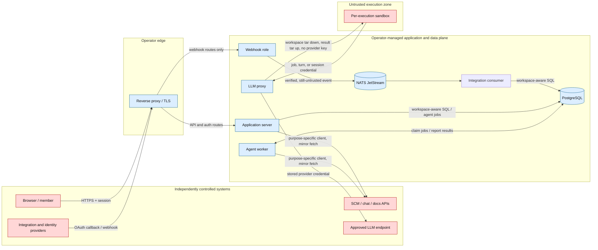

# Security threat model

This model applies to the Helm deployment on Kubernetes.
It covers the four application trust boundaries below.
These separate control planes are outside its scope:

- Browser and identity-provider internals.
- Host and database administration.
- Backup custody.
- The CI/release supply chain.
- Edge DDoS protection.

The [Security Policy](https://github.com/hephaestus-build/Hephaestus/blob/main/SECURITY.md), [Integration settings](./production-setup), [Backup & Restore](./backup-restore), and [Release Image Lock](./release-image-lock) own those control planes.

## Security objectives and protected assets

Hephaestus must meet these security objectives:

1. Prevent one workspace from reading or changing another workspace's data.
2. Keep reusable integration, session, encryption, and model-provider credentials out of untrusted content and sandbox environments.
3. Contain execution influenced by repositories and models without trusting their instructions or output.
4. Authenticate public ingress.
5. Bound public ingress.
6. Restrict outbound destinations and side effects.

| Asset                       | Examples                                                                           |
| --------------------------- | ---------------------------------------------------------------------------------- |
| Reusable credentials        | Provider keys, OAuth secrets, integration tokens, webhook secrets, encryption keys |
| Workspace-confidential data | Repository content, issues, messages, documents, feedback, membership              |
| Untrusted content           | Webhook bodies, diffs, files, comments, chat, documents, model output              |
| Operational data            | Job and delivery identifiers, metrics, sanitized error categories                  |

## System and data flow

Arrows show permitted logical flows, not network-level reachability.
The [chart topology](./overview#architecture-and-network) shows the Pods and their connections.
[Network egress](./network-egress) lists every outbound destination.

Only the worker role creates sandbox Jobs and Pods in the release's restricted sandbox namespace.
The server and webhook roles have no sandbox RBAC.
No application role mounts a container daemon socket.

A deny-all NetworkPolicy covers that namespace.
Review sandboxes and conversation hosts can reach only the worker's sandbox gateway.
Turn sandboxes have no network (SB-3).
Each worker checks enforcement with real Pods before it becomes ready and at its configured probe interval (SB-7).
The native k3s CI and release smokes require every worker to pass this probe.

Sandbox inputs arrive and results leave through the worker's sandbox gateway, which also hosts the LLM proxy.
No worker disk paths mount into a sandbox.
Runtime-role separation reduces reachable surface but is not authorization.
See [Runtime Roles](./runtime-roles).

## Attacker assumptions

An attacker can be any of these actors:

- An unauthenticated internet client that calls all routes exposed by the reverse proxy.
- A legitimate member who attempts horizontal or vertical privilege escalation.
- A compromised integration account that sends correctly signed malicious content.
- A repository contributor who puts prompt injection, malicious source, symlinks, or resource-exhaustion inputs in synchronized artifacts.
- A malicious or compromised model endpoint that returns crafted output.
- Code inside a sandbox, with full knowledge of the image and application design.

The model trusts these principals:

- Kubernetes control plane, container runtime and node root.
- Running application processes.
- PostgreSQL administrator.
- Instance encryption key.
- Configured instance admins.

Their compromise is outside the isolation guarantees described here.

## Mitigations index

Each table links threats to enforcement, verification, and residual risk.

### Boundary 1: public webhook ingress

| ID and threat                                   | Enforced control                                                                                                                                                 | Enforcement                                                                                                                                                                                                                                                                                                                                                                                                                                                                                                                     | Verification                                                                                                                                                                                                                                                                                                                                                                                               | Residual risk                                                                                                                                                                                                                                                        |
| ----------------------------------------------- | ---------------------------------------------------------------------------------------------------------------------------------------------------------------- | ------------------------------------------------------------------------------------------------------------------------------------------------------------------------------------------------------------------------------------------------------------------------------------------------------------------------------------------------------------------------------------------------------------------------------------------------------------------------------------------------------------------------------- | ---------------------------------------------------------------------------------------------------------------------------------------------------------------------------------------------------------------------------------------------------------------------------------------------------------------------------------------------------------------------------------------------------------- | -------------------------------------------------------------------------------------------------------------------------------------------------------------------------------------------------------------------------------------------------------------------- |
| WH-1 — forged or unsupported provider event      | Resolve a known integration kind and verify the provider-signed raw bytes before parsing. Missing routing, verifier, or subject derivation fails closed.         | [`IntegrationKindRouting`](https://github.com/hephaestus-build/Hephaestus/blob/main/server/application/src/main/java/de/tum/cit/aet/hephaestus/integration/core/webhook/IntegrationKindRouting.java), [`WebhookIngestPipeline`](https://github.com/hephaestus-build/Hephaestus/blob/main/server/application/src/main/java/de/tum/cit/aet/hephaestus/integration/core/webhook/WebhookIngestPipeline.java)                 | [`IntegrationKindRoutingTest`](https://github.com/hephaestus-build/Hephaestus/blob/main/server/application/src/test/java/de/tum/cit/aet/hephaestus/integration/core/webhook/IntegrationKindRoutingTest.java), [`WebhookIngestPipelineTest`](https://github.com/hephaestus-build/Hephaestus/blob/main/server/application/src/test/java/de/tum/cit/aet/hephaestus/integration/core/webhook/WebhookIngestPipelineTest.java), provider signature-verifier tests for [GitHub](https://github.com/hephaestus-build/Hephaestus/blob/main/server/application/src/test/java/de/tum/cit/aet/hephaestus/integration/scm/github/webhook/GitHubWebhookSignatureVerifierTest.java), [GitLab](https://github.com/hephaestus-build/Hephaestus/blob/main/server/application/src/test/java/de/tum/cit/aet/hephaestus/integration/scm/gitlab/webhook/GitLabWebhookSignatureVerifierTest.java), [Slack](https://github.com/hephaestus-build/Hephaestus/blob/main/server/application/src/test/java/de/tum/cit/aet/hephaestus/integration/slack/webhook/SlackWebhookSignatureVerifierTest.java), and [Outline](https://github.com/hephaestus-build/Hephaestus/blob/main/server/application/src/test/java/de/tum/cit/aet/hephaestus/integration/outline/webhook/OutlineWebhookSignatureVerifierTest.java) | A valid signature does not make content safe and cannot detect a compromised provider account. Replay resistance differs by provider. GitHub and GitLab rely on bounded deduplication. After that bound expires, consumers can receive a replay again. |
| WH-2 — oversized input or queue overload         | Require a declared request size within the configured limit and fail startup when the broker cannot accept that size.                                            | [`WebhookPayloadSizeFilter`](https://github.com/hephaestus-build/Hephaestus/blob/main/server/application/src/main/java/de/tum/cit/aet/hephaestus/integration/core/webhook/WebhookPayloadSizeFilter.java), [`WebhookPayloadCapacityCheck`](https://github.com/hephaestus-build/Hephaestus/blob/main/server/application/src/main/java/de/tum/cit/aet/hephaestus/integration/core/webhook/WebhookPayloadCapacityCheck.java) | [`WebhookPayloadSizeFilterTest`](https://github.com/hephaestus-build/Hephaestus/blob/main/server/application/src/test/java/de/tum/cit/aet/hephaestus/integration/core/webhook/WebhookPayloadSizeFilterTest.java), [`WebhookPayloadCapacityCheckTest`](https://github.com/hephaestus-build/Hephaestus/blob/main/server/application/src/test/java/de/tum/cit/aet/hephaestus/integration/core/webhook/WebhookPayloadCapacityCheckTest.java)                                                                                                                                                                                                                                                                                                                                                                                                                                                                                                                                                                                                                                                                                                                                                                                                                                           | Volumetric filtering and rate limiting remain edge responsibilities.                                                                                                                                                                                   |
| WH-3 — acknowledged loss or duplicate processing | Events selected for durable processing return success only after JetStream accepts them. Per-kind stable keys use provider delivery identifiers where available. | [`WebhookIngestPipeline`](https://github.com/hephaestus-build/Hephaestus/blob/main/server/application/src/main/java/de/tum/cit/aet/hephaestus/integration/core/webhook/WebhookIngestPipeline.java)                                                                                                                                                                                                                       | [`WebhookIngestPipelineTest`](https://github.com/hephaestus-build/Hephaestus/blob/main/server/application/src/test/java/de/tum/cit/aet/hephaestus/integration/core/webhook/WebhookIngestPipelineTest.java), [`WebhookIngestionCannotFailSilentlyTest`](https://github.com/hephaestus-build/Hephaestus/blob/main/server/application/src/test/java/de/tum/cit/aet/hephaestus/integration/core/webhook/WebhookIngestionCannotFailSilentlyTest.java)                                                                                                                                                                                                                                                                                                                                                                                                                                                                                                                                                                                                                                                                                                                                                                                                                                   | Protocol challenges and deliberately filtered events respond without publishing. Deduplication expires with broker retention, so consumers must tolerate redelivery.                                                                                   |

1. Route only `/webhooks/**` to a separately exposed webhook role.
2. Operate its capacity and retry signals as [Webhook Ingestion Operations](./webhook-ingestion-operations) describes.

### Boundary 2: LLM agent sandbox

Repository, chat, and model content is untrusted and can influence tool use.
A practice review's agent has `bash` among its tools.
The image includes Bash and Git.

1. Treat a sandbox as capable of running any shell command that untrusted content can cause.

Conversation turns run in one long-lived conversation host per worker.
The host serves the turns of many developers and workspaces at the same time.
It runs no shell, file, or code tool itself.
Node runs the host under its permission model, without child processes.
The host has its own internal network, unless its worker runs outside any container (SB-3).

The host's tools are `search_conversation`, `link_result`, `link_problem`, and `show_feedback`.
When the worker can start turn sandboxes, the host also has `read`, `bash` and `load_context`.
The worker answers each tool call for that turn only.

#### Conversation turn sandbox

`read`, `bash` and `load_context` run in a [turn sandbox](/contributor/practice-review-glossary#runtime-terms) on the worker, not in the host.
Treat each `bash` command as untrusted code that the model wrote.
The turn sandbox container is the security boundary, as it is for the shell of a review.

- **Boundary.** One Pod for each turn attempt, from the agent image, under the same restricted container policy as a review sandbox.
- **Lifetime.** The worker removes the container with its files when the attempt ends. It never gives it to another attempt.
- **Contents.** The [context folder](/contributor/practice-review-glossary#runtime-terms) of one developer in one workspace: `INDEX.md`, the context documents, and repositories that Hephaestus loaded.
- **Write access.** The folder is read-only. Commands write only to `/tmp`, which the container removes with it.
  `/tmp` is a volume on the node's disk with a size limit.
  The folder is on the node's disk too ([Kubernetes § Sandbox prerequisites](./kubernetes#sandbox-prerequisites)).
- **Network.** None. The worker stages each file through the Kubernetes exec API.
- **Credentials.** None: no Git token, no turn token, and no environment from the host or the worker.
- **Limits.** The [Pod-kind resource table](./kubernetes#sandbox-sizes) sets CPU, memory and disk bounds. The node sets the process limit. Each command has a 60-second deadline.

A load checks the workspace, the account and the purpose of the turn.
It loads only a repository that the workspace monitors on an active connection and that no team hides.
An unknown, hidden, or other workspace's repository gets the same error.
An erasure, a hidden repository, a change of monitored repositories, or a changed AI choice removes every turn sandbox of that workspace.

These risks remain:

- **Prompt injection.** Repository files, Git history, Slack messages and documents can carry instructions. Hephaestus treats them as data, but a model can still follow them. The injected content can change Hephaestus's answer to the developer. It cannot reach another workspace or the network.
- **Shared kernel.** Without an isolating RuntimeClass, the turn sandbox shares the node kernel with other containers. A review sandbox has the same limit (SB-1).
- **One user ID.** Each command runs as the one unprivileged user of the agent image. A command can stop or read the other processes of its own attempt, but no other attempt.

The [Conversation runtime](/contributor/unified-pi-runtime#context-folder) gives the endpoints and the limits.

`show_feedback` is the only tool that delivers feedback.
The worker accepts it only for ready conversation feedback about the developer of the running turn.
It refuses it after an erasure of that developer's person data is requested.

Model output remains untrusted.
Any operation that stores it or creates an external write must apply that operation's validation and authorization.

| ID and threat                                   | Enforced control                                                                                                                                                 | Enforcement                                                                                                                                                                                                                                                                                                                                                                                                                                                                                                                     | Verification                                                                                                                                                                                                                                                                                                                                                                                               | Residual risk                                                                                                                                                                                                                                                        |
| ----------------------------------------------- | ---------------------------------------------------------------------------------------------------------------------------------------------------------------- | ------------------------------------------------------------------------------------------------------------------------------------------------------------------------------------------------------------------------------------------------------------------------------------------------------------------------------------------------------------------------------------------------------------------------------------------------------------------------------------------------------------------------------- | ---------------------------------------------------------------------------------------------------------------------------------------------------------------------------------------------------------------------------------------------------------------------------------------------------------------------------------------------------------------------------------------------------------- | -------------------------------------------------------------------------------------------------------------------------------------------------------------------------------------------------------------------------------------------------------------------- |
| SB-1 — privilege escalation, host escape, or resource exhaustion    | Sandbox Pods run under the Restricted Pod Security Standard, with no capabilities, no privilege escalation, a read-only root and seccomp. The Pod-kind resource table sets CPU, memory and disk bounds. The node sets the process limit. See [Sandbox sizes](./kubernetes#sandbox-sizes).                                                                                                                                                                                                                                                                                                                                                                                                                                                                                                                                                                                                                                                            | [`KubernetesPods`](https://github.com/hephaestus-build/Hephaestus/blob/main/server/application/src/main/java/de/tum/cit/aet/hephaestus/agent/sandbox/kubernetes/KubernetesPods.java)                                                                                                                                                                                                                                                                                                                                                                                                                                                                                                                                                                                                                                                                                                                                                                                                                                                                                                                                                                                                                                                                                                       | [`KubernetesSandboxRuntimeTest`](https://github.com/hephaestus-build/Hephaestus/blob/main/server/application/src/test/java/de/tum/cit/aet/hephaestus/agent/sandbox/kubernetes/KubernetesSandboxRuntimeTest.java), [`KubernetesSandboxLiveTest`](https://github.com/hephaestus-build/Hephaestus/blob/main/server/application/src/test/java/de/tum/cit/aet/hephaestus/agent/sandbox/kubernetes/KubernetesSandboxLiveTest.java)                                                                                                                                                                                                                                                                                                                                                                                                                                                                                                                                                                                                                                                                                                                                                                                                                                                                                                                                                                                                     | Without a RuntimeClass such as gVisor, sandboxes share the node kernel. Captured inputs remain read-only. Scratch stays writable. No sandbox receives a Docker socket or a secret-bearing host mount. The kubelet enforces disk limits by eviction after measurement, so a Pod can exceed its disk limit for some seconds. Keep free disk on sandbox nodes or use filesystem project quotas.                                                                                                                 |
| SB-2 — provider-secret theft or proxy abuse                      | Keep the provider key in the application catalog. The proxy accepts job credentials only while the job runs. Each review or conversation turn attempt gets an attempt token that is valid only for that attempt and its workspace. The token names no conversation or account: the worker takes both from the turn that it claimed. The worker accepts it for model calls only while it holds the attempt's lease. It accepts it for the turn's own endpoints only while the attempt runs on that worker. The token expires shortly after the attempt's deadline. A conversation host's session token reaches only its own runtime: the discovery and workspace download of its initializer, and its command channel. The proxy binds requests to the admitted connection, model, API, and path. It serves requests only on the worker's sandbox gateway connector. It bounds each authenticated principal's request rate and declared request size.                                                                                                                                                                                                                                                                                                                                                                                                                   | [ADR 0006](https://github.com/hephaestus-build/Hephaestus/blob/main/docs/decisions/0006-llm-proxy-on-coordinator-trust-model.md), [`JobTokenAuthenticationFilter`](https://github.com/hephaestus-build/Hephaestus/blob/main/server/application/src/main/java/de/tum/cit/aet/hephaestus/agent/proxy/JobTokenAuthenticationFilter.java), [`JobTokenAuthenticationProvider`](https://github.com/hephaestus-build/Hephaestus/blob/main/server/application/src/main/java/de/tum/cit/aet/hephaestus/agent/proxy/JobTokenAuthenticationProvider.java), [`LlmProxyController`](https://github.com/hephaestus-build/Hephaestus/blob/main/server/application/src/main/java/de/tum/cit/aet/hephaestus/agent/proxy/LlmProxyController.java), [`LlmProxySecurityConfig`](https://github.com/hephaestus-build/Hephaestus/blob/main/server/application/src/main/java/de/tum/cit/aet/hephaestus/agent/proxy/LlmProxySecurityConfig.java)                                                                                                                                                                                                                                                                                                                                                                                         | [`JobTokenAuthenticationFilterTest`](https://github.com/hephaestus-build/Hephaestus/blob/main/server/application/src/test/java/de/tum/cit/aet/hephaestus/agent/proxy/JobTokenAuthenticationFilterTest.java), [`LlmProxyIntegrationTest`](https://github.com/hephaestus-build/Hephaestus/blob/main/server/application/src/test/java/de/tum/cit/aet/hephaestus/agent/proxy/LlmProxyIntegrationTest.java), [`TurnTokenAuthenticationIntegrationTest`](https://github.com/hephaestus-build/Hephaestus/blob/main/server/application/src/test/java/de/tum/cit/aet/hephaestus/agent/proxy/TurnTokenAuthenticationIntegrationTest.java), [`LlmProxySecurityConfigTest`](https://github.com/hephaestus-build/Hephaestus/blob/main/server/application/src/test/java/de/tum/cit/aet/hephaestus/agent/proxy/LlmProxySecurityConfigTest.java), [`SandboxGatewayRateLimitFilterTest`](https://github.com/hephaestus-build/Hephaestus/blob/main/server/application/src/test/java/de/tum/cit/aet/hephaestus/agent/proxy/SandboxGatewayRateLimitFilterTest.java), [`PayloadSizeFilterTest`](https://github.com/hephaestus-build/Hephaestus/blob/main/server/application/src/test/java/de/tum/cit/aet/hephaestus/core/web/PayloadSizeFilterTest.java), [`SandboxEnvBlocklistTest`](https://github.com/hephaestus-build/Hephaestus/blob/main/server/application/src/test/java/de/tum/cit/aet/hephaestus/agent/sandbox/SandboxEnvBlocklistTest.java) | The worker-side application process holds catalog credentials. A third-party worker is outside the supported topology. [ADR 0041](https://github.com/hephaestus-build/Hephaestus/blob/main/docs/decisions/0041-compose-1x-kubernetes-2.md) owns that decision.                                                                                                                                                                                                                                               |
| SB-3 — network exfiltration or cross-execution access               | Each review attempt runs in a Job. Each conversation host and turn sandbox runs in a Pod. A deny-all NetworkPolicy covers the sandbox namespace. Review Pods and conversation hosts can reach only the worker gateway. Turn sandboxes have no network. The attempt credential bounds each tool call to its own workspace and attempt.                                                                                                                                                                                                                                                                                                                                                                                                                                                                                                                                                                                                                | [`worker.yaml`](https://github.com/hephaestus-build/Hephaestus/blob/main/deploy/chart/hephaestus/templates/worker.yaml), [`KubernetesIsolationProbe`](https://github.com/hephaestus-build/Hephaestus/blob/main/server/application/src/main/java/de/tum/cit/aet/hephaestus/agent/sandbox/kubernetes/KubernetesIsolationProbe.java)                                                                                                                                                                                                                                                                                                                                                                                                                                                                                                                                                                                                                                                                                                                                                                                                                                                                                                                                                          | [`KubernetesIsolationProbeTest`](https://github.com/hephaestus-build/Hephaestus/blob/main/server/application/src/test/java/de/tum/cit/aet/hephaestus/agent/sandbox/kubernetes/KubernetesIsolationProbeTest.java), [`KubernetesSandboxLiveTest`](https://github.com/hephaestus-build/Hephaestus/blob/main/server/application/src/test/java/de/tum/cit/aet/hephaestus/agent/sandbox/kubernetes/KubernetesSandboxLiveTest.java)                                                                                                                                                                                                                                                                                                                                                                                                                                                                                                                                                                                                                                                                                                                                                                                                                                                                                                                                                                                                     | The network plugin must enforce NetworkPolicy. The startup probe proves gateway reachability and refuses DNS, API and management access. Host development applies the same namespace denial and permits only its own host gateway address and port.                                                                                                                                                                                                                                                          |
| SB-4 — persistence after execution                                  | The reconciler removes review Jobs and conversation host Pods that durable attempt or worker state no longer owns. It removes ended attempts' folders and repository snapshots from worker storage. Turn completion removes its turn Pod. A periodic sweep also removes abandoned turn Pods and preserves another live worker's Pods.                                                                                                                                                                                                                                                                                                                                                                                                                                                                                                                                                                                                                | [`SandboxReconciler`](https://github.com/hephaestus-build/Hephaestus/blob/main/server/application/src/main/java/de/tum/cit/aet/hephaestus/agent/sandbox/SandboxReconciler.java), [`JobEvidenceFiles`](https://github.com/hephaestus-build/Hephaestus/blob/main/server/application/src/main/java/de/tum/cit/aet/hephaestus/agent/context/JobEvidenceFiles.java), [`TurnSandboxes`](https://github.com/hephaestus-build/Hephaestus/blob/main/server/application/src/main/java/de/tum/cit/aet/hephaestus/agent/mentor/sandbox/TurnSandboxes.java)                                                                                                                                                                                                                                                                                                                                                                                                                                                                                                                                                                                                                                                                                                                                             | [`SandboxReconcilerTest`](https://github.com/hephaestus-build/Hephaestus/blob/main/server/application/src/test/java/de/tum/cit/aet/hephaestus/agent/sandbox/SandboxReconcilerTest.java), [`JobEvidenceFilesTest`](https://github.com/hephaestus-build/Hephaestus/blob/main/server/application/src/test/java/de/tum/cit/aet/hephaestus/agent/context/JobEvidenceFilesTest.java), [`TurnSandboxesTest`](https://github.com/hephaestus-build/Hephaestus/blob/main/server/application/src/test/java/de/tum/cit/aet/hephaestus/agent/mentor/sandbox/TurnSandboxesTest.java)                                                                                                                                                                                                                                                                                                                                                                                                                                                                                                                                                                                                                                                                                                                                                                                                                                                           | Node or worker-process compromise is outside this cleanup control.                                                                                                                                                                                                                                                                                                                                                                                                                                           |
| SB-5 — hostile repository content during Git preparation         | Eclipse JGit parses repository bytes inside the application process. It is memory-safe and uses no `git` binary. It never executes a hook. JGit receives the fetch credential in memory for that fetch only. The credential never enters the mirror's configuration. `http.followRedirects=false`. A snapshot is a fresh repository under the fabric root, fetched from the local mirror with `core.symlinks=false`. It has no remote and no credentials. Before any write, the snapshot must pass the `GIT_MAX_SNAPSHOT_BYTES` check. An oversized snapshot fails as a whole. The process excludes submodule entries and unsafe paths and records these limitations. It reads the checkout into an attempt folder that never mounts into a sandbox. The sandbox receives it only through the workspace tar (SB-6). | [`GitRepositoryManager`](https://github.com/hephaestus-build/Hephaestus/blob/main/server/application/src/main/java/de/tum/cit/aet/hephaestus/integration/scm/domain/workdir/GitRepositoryManager.java), [`GitRepositoryLockManager`](https://github.com/hephaestus-build/Hephaestus/blob/main/server/application/src/main/java/de/tum/cit/aet/hephaestus/integration/scm/domain/workdir/GitRepositoryLockManager.java), [`JobEvidenceFiles`](https://github.com/hephaestus-build/Hephaestus/blob/main/server/application/src/main/java/de/tum/cit/aet/hephaestus/agent/context/JobEvidenceFiles.java)                                                                                                                                                                                                                                                                                                                                                                                                                                                                                                   | [`GitRepositoryManagerTest`](https://github.com/hephaestus-build/Hephaestus/blob/main/server/application/src/test/java/de/tum/cit/aet/hephaestus/integration/scm/domain/workdir/GitRepositoryManagerTest.java), [`JobEvidenceFilesTest`](https://github.com/hephaestus-build/Hephaestus/blob/main/server/application/src/test/java/de/tum/cit/aet/hephaestus/agent/context/JobEvidenceFilesTest.java)                                                                                                                                                                                                                                                                                                                                                                                                                                                                                                                                                                                                                                                                                                                                                                                                          | A JGit vulnerability executes with the fetching role's privileges, not inside a sandbox. The server fetches for commit ingestion. The worker fetches for review preparation. `GIT_MAX_SNAPSHOT_BYTES` bounds only the snapshot, not the fetch. The mirror can exceed that bound under the container's fabric root. The bound refuses the snapshot taken from the mirror. The mirror is shared by every operation on that repository in one container. An in-process lock serializes a fetch against readers. |
| SB-6 — tampered or oversized workspace and result transport         | Exchange inputs and results only through the sandbox gateway. A per-attempt credential registers one session. A workspace initializer container checks and extracts the staged tar as described in the [workspace ABI](/contributor/agent/agent-workspace-abi). The runtime container then mounts `/workspace` read-only. It has separate writable `work/`, `out/`, `.pi/` and `.sessions/` volumes. These volumes are removed with the attempt. At most one result upload commits per session. The worker validates its archive and SHA-256 `Content-Digest` in memory. A duplicate `409` proves convergence only when its `ETag` matches the runner archive. A wrong credential and an unknown session are indistinguishable.                                                                                                                                                                                                                      | [`SandboxAttemptRunner`](https://github.com/hephaestus-build/Hephaestus/blob/main/server/application/src/main/java/de/tum/cit/aet/hephaestus/agent/sandbox/SandboxAttemptRunner.java), [`KubernetesSandboxBackend`](https://github.com/hephaestus-build/Hephaestus/blob/main/server/application/src/main/java/de/tum/cit/aet/hephaestus/agent/sandbox/kubernetes/KubernetesSandboxBackend.java), [`KubernetesPods`](https://github.com/hephaestus-build/Hephaestus/blob/main/server/application/src/main/java/de/tum/cit/aet/hephaestus/agent/sandbox/kubernetes/KubernetesPods.java), [`SandboxGatewaySessions`](https://github.com/hephaestus-build/Hephaestus/blob/main/server/application/src/main/java/de/tum/cit/aet/hephaestus/agent/gateway/SandboxGatewaySessions.java), [`SandboxWorkspaceController`](https://github.com/hephaestus-build/Hephaestus/blob/main/server/application/src/main/java/de/tum/cit/aet/hephaestus/agent/gateway/SandboxWorkspaceController.java), [`SandboxOutputArchive`](https://github.com/hephaestus-build/Hephaestus/blob/main/server/application/src/main/java/de/tum/cit/aet/hephaestus/agent/runtime/SandboxOutputArchive.java), [`gateway-init.ts`](https://github.com/hephaestus-build/Hephaestus/blob/main/docker/agents/pi/gateway-init.ts) | [`SandboxGatewaySessionsTest`](https://github.com/hephaestus-build/Hephaestus/blob/main/server/application/src/test/java/de/tum/cit/aet/hephaestus/agent/gateway/SandboxGatewaySessionsTest.java), [`SandboxWorkspaceControllerTest`](https://github.com/hephaestus-build/Hephaestus/blob/main/server/application/src/test/java/de/tum/cit/aet/hephaestus/agent/gateway/SandboxWorkspaceControllerTest.java), [`HephHostTest`](https://github.com/hephaestus-build/Hephaestus/blob/main/server/application/src/test/java/de/tum/cit/aet/hephaestus/agent/mentor/host/HephHostTest.java), [`SandboxOutputArchiveTest`](https://github.com/hephaestus-build/Hephaestus/blob/main/server/application/src/test/java/de/tum/cit/aet/hephaestus/agent/runtime/SandboxOutputArchiveTest.java)                                                                                                                                                                                                                                                                                                                                                                                                                                                                                                                                                                                                                                           | The initializer runs the agent image under the runtime's security policy. Only gateway-init.ts runs before the runtime starts. The gateway uses HTTP. Node or worker compromise can expose the transfer. The staged tar and extracted files coexist during initialization and count toward the Pod's disk bound.                                                                                                                                                                                             |
| SB-7 — a Kubernetes cluster that does not hold the sandbox boundary | On Kubernetes, every sandbox is a Pod in the operator's sandbox namespace for one release, under the Restricted Pod Security Standard. It runs as the agent image's unprivileged user with a read-only root, no capability, no service account token and `RuntimeDefault` or the shipped Localhost seccomp profile. It runs in a user namespace of its own and, if configured, in a RuntimeClass. A deny-all policy covers the namespace. One more policy lets review sandboxes and conversation hosts reach only the workers' gateway port. Turn sandboxes have no network. Each sandbox Pod waits until its policy is in force before its first process starts. Each worker proves these controls with real Pods at its start and every 15 minutes, and starts no sandbox while one fails. | [`KubernetesIsolationProbe`](https://github.com/hephaestus-build/Hephaestus/blob/main/server/application/src/main/java/de/tum/cit/aet/hephaestus/agent/sandbox/kubernetes/KubernetesIsolationProbe.java), [`KubernetesPods`](https://github.com/hephaestus-build/Hephaestus/blob/main/server/application/src/main/java/de/tum/cit/aet/hephaestus/agent/sandbox/kubernetes/KubernetesPods.java), [`worker.yaml`](https://github.com/hephaestus-build/Hephaestus/blob/main/deploy/chart/hephaestus/templates/worker.yaml) | [`KubernetesIsolationProbeTest`](https://github.com/hephaestus-build/Hephaestus/blob/main/server/application/src/test/java/de/tum/cit/aet/hephaestus/agent/sandbox/kubernetes/KubernetesIsolationProbeTest.java), [`KubernetesSandboxRuntimeTest`](https://github.com/hephaestus-build/Hephaestus/blob/main/server/application/src/test/java/de/tum/cit/aet/hephaestus/agent/sandbox/kubernetes/KubernetesSandboxRuntimeTest.java), [`kubernetes-chart-render.test.ts`](https://github.com/hephaestus-build/Hephaestus/blob/main/scripts/kubernetes-chart-render.test.ts), [`ci-kubernetes.yml`](https://github.com/hephaestus-build/Hephaestus/blob/main/.github/workflows/ci-kubernetes.yml) | Without a RuntimeClass that isolates the node kernel, a sandbox shares it. Kubernetes has no `noexec` for an `emptyDir`. The probe shows enforcement at the time it runs, not that the network plugin keeps it. Gateway traffic between nodes is plain text unless the network plugin encrypts it. |

### Boundary 3: outbound egress

Destination policy limits where a client may connect. Delivery policy separately limits whether Hephaestus may create an external side effect.

| ID and threat                                   | Enforced control                                                                                                                                                 | Enforcement                                                                                                                                                                                                                                                                                                                                                                                                                                                                                                                     | Verification                                                                                                                                                                                                                                                                                                                                                                                               | Residual risk                                                                                                                                                                                                                                                        |
| ----------------------------------------------- | ---------------------------------------------------------------------------------------------------------------------------------------------------------------- | ------------------------------------------------------------------------------------------------------------------------------------------------------------------------------------------------------------------------------------------------------------------------------------------------------------------------------------------------------------------------------------------------------------------------------------------------------------------------------------------------------------------------------- | ---------------------------------------------------------------------------------------------------------------------------------------------------------------------------------------------------------------------------------------------------------------------------------------------------------------------------------------------------------------------------------------------------------- | -------------------------------------------------------------------------------------------------------------------------------------------------------------------------------------------------------------------------------------------------------------------- |
| EG-1 — LLM-provider SSRF or DNS rebinding          | Require a public HTTPS provider URL without userinfo, query, or fragment, unless the operator lists the private host. Apply the optional hostname allow-list. Repeat the private-address check on the DNS result used to connect. | [`EgressPolicy`](https://github.com/hephaestus-build/Hephaestus/blob/main/server/application/src/main/java/de/tum/cit/aet/hephaestus/agent/catalog/EgressPolicy.java), [`LlmProxyWebClientConfig`](https://github.com/hephaestus-build/Hephaestus/blob/main/server/application/src/main/java/de/tum/cit/aet/hephaestus/agent/proxy/LlmProxyWebClientConfig.java)                                  | [`EgressPolicyTest`](https://github.com/hephaestus-build/Hephaestus/blob/main/server/application/src/test/java/de/tum/cit/aet/hephaestus/agent/catalog/EgressPolicyTest.java), [`LlmProxyWebClientConfigTest`](https://github.com/hephaestus-build/Hephaestus/blob/main/server/application/src/test/java/de/tum/cit/aet/hephaestus/agent/proxy/LlmProxyWebClientConfigTest.java)                                | An allowed public service may itself proxy arbitrary destinations or become compromised. Keep the allow-list narrow. A private-hosts range admits every host and port in it. A range that covers the server's own address stops startup. The Kubernetes Service range is not detected. Keep that list to single hosts or narrow ranges. A failed connection test of a private host shows no status or cause.                                                                                                |
| EG-2 — unsafe integration origin                   | Reject non-HTTPS origins, embedded credentials, paths, queries, fragments, and literal non-public addresses for user-configured SCM, login-provider, and Outline origins.             | [`ServerUrlValidator`](https://github.com/hephaestus-build/Hephaestus/blob/main/server/application/src/main/java/de/tum/cit/aet/hephaestus/core/security/ServerUrlValidator.java)                                                                                                                                                                                                                 | [`ServerUrlValidatorTest`](https://github.com/hephaestus-build/Hephaestus/blob/main/server/application/src/test/java/de/tum/cit/aet/hephaestus/core/security/ServerUrlValidatorTest.java)                                                                                                                                                                                                                       | This validator performs no DNS lookup. GitLab preflight, Outline API, and Outline identity calls use guarded connect-time resolution. This is not a uniform guarantee for every configurable login-provider client. |
| EG-3 — unapproved external write                   | Route supported delivery adapters through the instance silent-mode guard and reject unregistered adapter shapes in architecture tests.                                                | [`OutboundEgressGuard`](https://github.com/hephaestus-build/Hephaestus/blob/main/server/application/src/main/java/de/tum/cit/aet/hephaestus/integration/core/egress/OutboundEgressGuard.java), [`@OutboundEgressGateway`](https://github.com/hephaestus-build/Hephaestus/blob/main/server/application/src/main/java/de/tum/cit/aet/hephaestus/integration/core/egress/OutboundEgressGateway.java) | [`OutboundEgressGuardTest`](https://github.com/hephaestus-build/Hephaestus/blob/main/server/application/src/test/java/de/tum/cit/aet/hephaestus/integration/core/egress/OutboundEgressGuardTest.java), [`OutboundEgressArchitectureTest`](https://github.com/hephaestus-build/Hephaestus/blob/main/server/application/src/test/java/de/tum/cit/aet/hephaestus/architecture/OutboundEgressArchitectureTest.java) | Silent mode governs supported writes. It is not a network kill switch and does not suppress reads or authentication traffic.                                                                                        |
| EG-4: disclosure of stored integration credentials | Versioned credential keys and row/purpose-bound AES-GCM protect stored integration tokens.                                                                                            | `CredentialBundleConverter`. See [credential key rotation](./credential-key-rotation)                                                                                                                                                                                                                                                                                                             | `CredentialBundleConverterTest`, `EncryptionContextTest`                                                                                                                                                                                                                                                                                                                                                        | Application or key compromise exposes decryptable values. Rotate upstream credentials after exposure. Key rotation alone cannot recall them.                                                                        |

Application destination controls do not constrain a sandbox granted broad internet access. Enforce any such exception through an independent network egress policy.

### Boundary 4: SQL-layer workspace tenancy

Workspace authorization is the primary boundary. SQL inspection is a defect detector for recognized query shapes, not row-level authorization.

| ID and threat                                   | Enforced control                                                                                                                                                 | Enforcement                                                                                                                                                                                                                                                                                                                                                                                                                                                                                                                     | Verification                                                                                                                                                                                                                                                                                                                                                                                               | Residual risk                                                                                                                                                                                                                                                        |
| ----------------------------------------------- | ---------------------------------------------------------------------------------------------------------------------------------------------------------------- | ------------------------------------------------------------------------------------------------------------------------------------------------------------------------------------------------------------------------------------------------------------------------------------------------------------------------------------------------------------------------------------------------------------------------------------------------------------------------------------------------------------------------------- | ---------------------------------------------------------------------------------------------------------------------------------------------------------------------------------------------------------------------------------------------------------------------------------------------------------------------------------------------------------------------------------------------------------- | -------------------------------------------------------------------------------------------------------------------------------------------------------------------------------------------------------------------------------------------------------------------- |
| TN-1: object-ID substitution or role escalation | Workspace-scoped authorization checks tenant access. View as user permits GET-only reads, requires recent sign-in, and commits a USER_VIEW audit before access.  | `WorkspaceSecurityExpressions`, `UserViewAccessService`. See [user views](./instance-admin#view-as-user)                                                                                                                                                                                                                                                                                                                                                                                                                        | `CrossTenantIsolationIntegrationTest`, `UserViewArchitectureTest`                                                                                                                                                                                                                                                                                                                                          | Instance admins have an audited elevated read path. This does not make them workspace members or permit mutations as the viewed member.                                                                                                                              |
| TN-2 — query accidentally omits tenant scope    | With enforcement set to `throw`, reject recognized SQL shapes that reference dynamically inventoried workspace-scoped tables without a recognized tenancy shape. | [ADR 0004](https://github.com/hephaestus-build/Hephaestus/blob/main/docs/decisions/0004-sql-layer-tenancy-via-statement-inspector.md), [`TenancyConfiguration`](https://github.com/hephaestus-build/Hephaestus/blob/main/server/application/src/main/java/de/tum/cit/aet/hephaestus/core/tenancy/TenancyConfiguration.java), [`WorkspaceStatementInspector`](https://github.com/hephaestus-build/Hephaestus/blob/main/server/application/src/main/java/de/tum/cit/aet/hephaestus/core/tenancy/WorkspaceStatementInspector.java) | [`WorkspaceStatementInspectorTest`](https://github.com/hephaestus-build/Hephaestus/blob/main/server/application/src/test/java/de/tum/cit/aet/hephaestus/core/tenancy/WorkspaceStatementInspectorTest.java), [`WorkspaceScopedTablesTest`](https://github.com/hephaestus-build/Hephaestus/blob/main/server/application/src/test/java/de/tum/cit/aet/hephaestus/core/tenancy/WorkspaceScopedTablesTest.java) | Inserts, accepted primary-key shapes, explicit bypasses, and analysis failures are not rejected. Any SQL containing the word `workspace_id` is accepted without proving predicate binding. Object authorization and tenant-bound repository methods remain required. |
| TN-3 — unnecessary cross-workspace bypass       | Require an explicit `@WorkspaceAgnostic` scope for reviewed instance-wide work.                                                                                  | [`@WorkspaceAgnostic`](https://github.com/hephaestus-build/Hephaestus/blob/main/server/application/src/main/java/de/tum/cit/aet/hephaestus/core/WorkspaceAgnostic.java), [`WorkspaceAgnosticAspect`](https://github.com/hephaestus-build/Hephaestus/blob/main/server/application/src/main/java/de/tum/cit/aet/hephaestus/core/tenancy/WorkspaceAgnosticAspect.java)                                                                                                                                                             | [`TenancyBypassTest`](https://github.com/hephaestus-build/Hephaestus/blob/main/server/application/src/test/java/de/tum/cit/aet/hephaestus/core/tenancy/TenancyBypassTest.java), [`MultiTenancyArchitectureTest`](https://github.com/hephaestus-build/Hephaestus/blob/main/server/application/src/test/java/de/tum/cit/aet/hephaestus/architecture/MultiTenancyArchitectureTest.java)                       | The annotation grants a deliberate bypass. Review its call path and query whenever it is added or changed.                                                                                                                                                           |

`log` allows a detected violation to execute and `off` disables inspection. Neither is a production setting. Database backups and direct SQL access bypass application authorization and need separate access control and encryption.

## References and maintenance

- Threat modeling: [OWASP](https://owasp.org/www-community/Threat_Modeling) and [NIST SP 800-154](https://csrc.nist.gov/pubs/sp/800/154/ipd)
- AI systems: [NIST AI Risk Management Framework](https://www.nist.gov/itl/ai-risk-management-framework) and [OWASP Top 10 for LLM Applications](https://owasp.org/www-project-top-10-for-large-language-model-applications/)
- Webhooks: [GitHub](https://docs.github.com/en/webhooks/using-webhooks/validating-webhook-deliveries) and [Slack](https://docs.slack.dev/authentication/verifying-requests-from-slack/)
- Network boundaries: [OWASP SSRF Prevention Cheat Sheet](https://cheatsheetseries.owasp.org/cheatsheets/Server_Side_Request_Forgery_Prevention_Cheat_Sheet.html) and [Docker security guidance](https://docs.docker.com/engine/security/)

Update this page whenever a depicted flow, attacker assumption, boundary control, enforcement setting, or residual risk changes.
