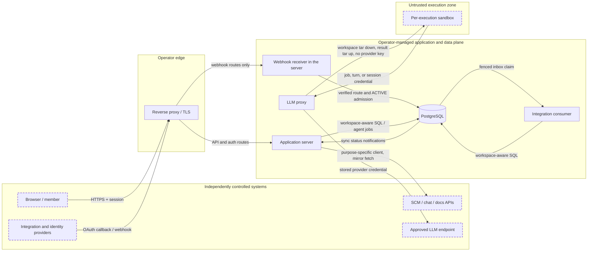

This model applies to the Helm deployment on Kubernetes.
It covers the four application trust boundaries below.
These separate control planes are outside its scope:

- Browser and identity-provider internals.
- Host and database administration.
- Backup custody.
- The CI/release supply chain.
- Edge DDoS protection.

The [Security Policy](https://github.com/hephaestus-build/Hephaestus/blob/main/SECURITY.md), [Integration settings](./production-setup), [Backup & Restore](./backup-restore), and [Release Image Lock](./release-image-lock) own those control planes.

## Security objectives and protected assets

Hephaestus must meet these security objectives:

1. Prevent one workspace from reading or changing another workspace's data.
2. Keep reusable integration, session, encryption, and model-provider credentials out of untrusted content and sandbox environments.
3. Contain execution influenced by repositories and models without trusting their instructions or output.
4. Authenticate public ingress.
5. Bound public ingress.
6. Restrict outbound destinations and side effects.

| Asset                       | Examples                                                                           |
| --------------------------- | ---------------------------------------------------------------------------------- |
| Reusable credentials        | Provider keys, OAuth secrets, integration tokens, webhook secrets, encryption keys |
| Workspace-confidential data | Repository content, issues, messages, documents, feedback, membership              |
| Untrusted content           | Webhook bodies, diffs, files, comments, chat, documents, model output              |
| Operational data            | Job and delivery identifiers, metrics, sanitized error categories                  |

## System and data flow

Arrows show permitted logical flows, not network-level reachability.
The [chart topology](./overview#architecture-and-network) shows the Pods and their connections.
[Network egress](./network-egress) lists every outbound destination.

Only the server role creates sandbox Jobs and Pods in the release's restricted sandbox namespace, and only with `sandbox.enabled`.
No application role mounts a container daemon socket.

A deny-all NetworkPolicy covers that namespace.
Review sandboxes can reach the server's sandbox gateway.
All sandbox kinds reach only the server gateway. No separate tools port remains (SB-3).

Each server checks enforcement with real Pods before it starts a sandbox and at its configured probe interval (SB-7).
Its API serves meanwhile.
The native k3s CI and release smokes require every server to pass this probe.

Sandbox inputs arrive and results leave through the server's sandbox gateway, which also hosts the LLM proxy.
No server disk paths mount into a sandbox.
Runtime-role separation reduces reachable surface but is not authorization.
See [Runtime Roles](./runtime-roles).

## Attacker assumptions

An attacker can be any of these actors:

- An unauthenticated internet client that calls all routes exposed by the reverse proxy.
- A legitimate member who attempts horizontal or vertical privilege escalation.
- A compromised integration account that sends correctly signed malicious content.
- A repository contributor who puts prompt injection, malicious source, symlinks, or resource-exhaustion inputs in synchronized artifacts.
- A malicious or compromised model endpoint that returns crafted output.
- Code inside a sandbox, with full knowledge of the image and application design.

The model trusts these principals:

- Kubernetes control plane, container runtime and node root.
- Running application processes.
- PostgreSQL administrator.
- Instance encryption key.
- Configured instance admins.

Their compromise is outside the isolation guarantees described here.

## Mitigations index

Each table links threats to enforcement, verification, and residual risk.

### Boundary 1: public webhook ingress

| ID and threat                                   | Enforced control                                                                                                                                                 | Enforcement                                                                                                                                                                                                                                                                                                                                                                                                                                                                                                                     | Verification                                                                                                                                                                                                                                                                                                                                                                                               | Residual risk                                                                                                                                                                                                                                                        |
| ----------------------------------------------- | ---------------------------------------------------------------------------------------------------------------------------------------------------------------- | ------------------------------------------------------------------------------------------------------------------------------------------------------------------------------------------------------------------------------------------------------------------------------------------------------------------------------------------------------------------------------------------------------------------------------------------------------------------------------------------------------------------------------- | ---------------------------------------------------------------------------------------------------------------------------------------------------------------------------------------------------------------------------------------------------------------------------------------------------------------------------------------------------------------------------------------------------------- | -------------------------------------------------------------------------------------------------------------------------------------------------------------------------------------------------------------------------------------------------------------------- |
| WH-1 — forged or unsupported provider event      | Resolve a known integration kind and verify the provider-signed raw bytes before parsing. Missing routing, verifier, or subject derivation fails closed.         | [`IntegrationKindRouting`](https://github.com/hephaestus-build/Hephaestus/blob/main/server/application/src/main/java/de/tum/cit/aet/hephaestus/integration/core/webhook/IntegrationKindRouting.java), [`WebhookIngestPipeline`](https://github.com/hephaestus-build/Hephaestus/blob/main/server/application/src/main/java/de/tum/cit/aet/hephaestus/integration/core/webhook/WebhookIngestPipeline.java)                 | [`IntegrationKindRoutingTest`](https://github.com/hephaestus-build/Hephaestus/blob/main/server/application/src/test/java/de/tum/cit/aet/hephaestus/integration/core/webhook/IntegrationKindRoutingTest.java), [`WebhookIngestPipelineTest`](https://github.com/hephaestus-build/Hephaestus/blob/main/server/application/src/test/java/de/tum/cit/aet/hephaestus/integration/core/webhook/WebhookIngestPipelineTest.java), provider signature-verifier tests for [GitHub](https://github.com/hephaestus-build/Hephaestus/blob/main/server/application/src/test/java/de/tum/cit/aet/hephaestus/integration/scm/github/webhook/GitHubWebhookSignatureVerifierTest.java), [GitLab](https://github.com/hephaestus-build/Hephaestus/blob/main/server/application/src/test/java/de/tum/cit/aet/hephaestus/integration/scm/gitlab/webhook/GitLabRouteCredentialTest.java), [Slack](https://github.com/hephaestus-build/Hephaestus/blob/main/server/application/src/test/java/de/tum/cit/aet/hephaestus/integration/slack/webhook/SlackWebhookSignatureVerifierTest.java), and [Outline](https://github.com/hephaestus-build/Hephaestus/blob/main/server/application/src/test/java/de/tum/cit/aet/hephaestus/integration/outline/webhook/OutlineWebhookSignatureVerifierTest.java) | A valid signature does not make content safe and cannot detect a compromised provider account. Replay resistance differs by provider. GitHub and GitLab rely on bounded deduplication. After that bound expires, consumers can receive a replay again. |
| WH-2 — oversized input or queue overload         | Require a declared request size within the configured limit and bound database admission and refuse a delivery when its inbox write cannot finish.                                            | [`WebhookPayloadSizeFilter`](https://github.com/hephaestus-build/Hephaestus/blob/main/server/application/src/main/java/de/tum/cit/aet/hephaestus/integration/core/webhook/WebhookPayloadSizeFilter.java) | [`WebhookPayloadSizeFilterTest`](https://github.com/hephaestus-build/Hephaestus/blob/main/server/application/src/test/java/de/tum/cit/aet/hephaestus/integration/core/webhook/WebhookPayloadSizeFilterTest.java)                                                                                                                                                                                                                                                                                                                                                                                                                                                                                                                                                                                                                                                                                                                                                                                                                                           | Volumetric filtering and rate limiting remain edge responsibilities.                                                                                                                                                                                   |
| WH-3 — acknowledged loss or duplicate processing | Admitted events return success after the PostgreSQL inbox commits. Stable provider keys deduplicate each delivery within its workspace. | [`WebhookIngestPipeline`](https://github.com/hephaestus-build/Hephaestus/blob/main/server/application/src/main/java/de/tum/cit/aet/hephaestus/integration/core/webhook/WebhookIngestPipeline.java)                                                                                                                                                                                                                       | [`WebhookIngestPipelineTest`](https://github.com/hephaestus-build/Hephaestus/blob/main/server/application/src/test/java/de/tum/cit/aet/hephaestus/integration/core/webhook/WebhookIngestPipelineTest.java), [`WebhookIngestionCannotFailSilentlyTest`](https://github.com/hephaestus-build/Hephaestus/blob/main/server/application/src/test/java/de/tum/cit/aet/hephaestus/integration/core/webhook/WebhookIngestionCannotFailSilentlyTest.java)                                                                                                                                                                                                                                                                                                                                                                                                                                                                                                                                                                                                                                                                                                                                                                                                                                   | Protocol challenges and deliberately dropped events respond without storage. Delivery keys expire after the replay window, so handlers still tolerate older redelivery. |
| WH-4 — work enters through an inactive connection | Admission takes the connection lifecycle lock and checks ACTIVE state before storing work. GitHub App deliveries also require an active source installation before PAT fan-out. | [`ProviderEventReceiver`](https://github.com/hephaestus-build/Hephaestus/blob/main/server/application/src/main/java/de/tum/cit/aet/hephaestus/integration/core/webhook/ProviderEventReceiver.java) | [`Signed adapter admission`](https://github.com/hephaestus-build/Hephaestus/blob/main/server/application/src/test/java/de/tum/cit/aet/hephaestus/integration/outline/OutlineFrameworkRegistrationIntegrationTest.java), [`Concurrent suspension and source checks`](https://github.com/hephaestus-build/Hephaestus/blob/main/server/application/src/test/java/de/tum/cit/aet/hephaestus/integration/core/webhook/ProviderEventReceiverIntegrationTest.java) | Refusals record a reason and store no payload. Validated GitHub installation controls use one serial system scope to create or repair connections. Upstream suspend cleanup remains a separate lifecycle responsibility. |

1. Route `/webhooks/**` to the server without rewriting the path.
2. Operate its capacity and retry signals as [Webhook Ingestion Operations](./webhook-ingestion-operations) describes.

### Boundary 2: LLM agent sandbox

Repository, chat, and model content is untrusted and can influence tool use.
Treat every sandbox as capable of arbitrary shell execution.
Reviews and conversation turns use one agent container per subject.
The driver, Pi, commands, search, Git, and custom programs share that container.
There is no conversation-loop Deployment or separate tools Pod.

A tool can read the sandbox token and alter files in the writable workspace.
The server checks the sandbox subject, current run epoch, unexpired lease, and turn state on every gateway write.
It checks review coverage against server-held evidence at admission.
The sandbox has no provider key or Kubernetes API credential.
NetworkPolicy limits it to the gateway.

The app receives transient answer updates through the live hub.
The final entries and end-run event form the interface for completed Slack delivery.
A sandbox does not call Slack.

| ID and threat                                   | Enforced control                                                                                                                                                 | Enforcement                                                                                                                                                                                                                                                                                                                                                                                                                                                                                                                     | Verification                                                                                                                                                                                                                                                                                                                                                                                               | Residual risk                                                                                                                                                                                                                                                        |
| ----------------------------------------------- | ---------------------------------------------------------------------------------------------------------------------------------------------------------------- | ------------------------------------------------------------------------------------------------------------------------------------------------------------------------------------------------------------------------------------------------------------------------------------------------------------------------------------------------------------------------------------------------------------------------------------------------------------------------------------------------------------------------------- | ---------------------------------------------------------------------------------------------------------------------------------------------------------------------------------------------------------------------------------------------------------------------------------------------------------------------------------------------------------------------------------------------------------- | -------------------------------------------------------------------------------------------------------------------------------------------------------------------------------------------------------------------------------------------------------------------- |
| SB-1 — privilege escalation, host escape, or resource exhaustion | Sandbox templates use the Restricted Pod Security Standard, a non-root user, no capabilities, no privilege escalation, a read-only root, and RuntimeDefault seccomp. Template requests and limits bound CPU, memory, and disk. The node bounds processes. See [Sandbox sizes](./sandboxes#sandbox-sizes). | [`sandbox-templates.yaml`](https://github.com/hephaestus-build/Hephaestus/blob/main/deploy/chart/hephaestus/templates/sandbox-templates.yaml) | [`sandbox-isolation.ts`](https://github.com/hephaestus-build/Hephaestus/blob/main/scripts/sandbox-isolation.ts), [`kubernetes-chart-render.test.ts`](https://github.com/hephaestus-build/Hephaestus/blob/main/scripts/kubernetes-chart-render.test.ts) | Without a kernel-isolating runtime, sandboxes share the node kernel. Tools can change workspace copies. the server must verify admission. No Docker socket or secret-bearing host mount is present. Disk enforcement follows measurement and can lag. Keep free node disk or use filesystem project quotas. |
| SB-2 — provider-secret theft or proxy abuse | Keep provider keys in the server catalog. Sandbox tokens identify the workspace and subject and expire at sandbox shutdown. Each model call and gateway write must hold the current run epoch and lease. A turn that ends cannot admit another call. The gateway records bounded call failures and usage in PostgreSQL. turn completion reads them there. | [HephTurnController](https://github.com/hephaestus-build/Hephaestus/blob/main/server/application/src/main/java/de/tum/cit/aet/hephaestus/agent/mentor/host/HephTurnController.java), [SandboxTokenAuthenticationFilter](https://github.com/hephaestus-build/Hephaestus/blob/main/server/application/src/main/java/de/tum/cit/aet/hephaestus/agent/proxy/SandboxTokenAuthenticationFilter.java) | [HephTurnGatewayIntegrationTest](https://github.com/hephaestus-build/Hephaestus/blob/main/server/application/src/test/java/de/tum/cit/aet/hephaestus/agent/mentor/host/HephTurnGatewayIntegrationTest.java) | A command can use its own sandbox token. Server-side admission must enforce every rule. hiding the token from a command is not a control. |
| SB-3 — network exfiltration or cross-execution access | Each subject runs in its own agent-sandbox Sandbox. A deny-all policy covers the sandbox namespace. Only gateway egress is admitted. The sandbox has no DNS, internet, API, database, or cross-sandbox route. Its token cannot access another subject. No loop-to-tools port remains. | [sandbox.yaml](https://github.com/hephaestus-build/Hephaestus/blob/main/deploy/chart/hephaestus/templates/sandbox.yaml), [sandbox-templates.yaml](https://github.com/hephaestus-build/Hephaestus/blob/main/deploy/chart/hephaestus/templates/sandbox-templates.yaml) | [sandbox-isolation.ts](https://github.com/hephaestus-build/Hephaestus/blob/main/scripts/sandbox-isolation.ts), [HephTurnGatewayIntegrationTest](https://github.com/hephaestus-build/Hephaestus/blob/main/server/application/src/test/java/de/tum/cit/aet/hephaestus/agent/mentor/host/HephTurnGatewayIntegrationTest.java) | Commands and the driver share the sandbox network. A compromised node or gateway is outside this network control. |
| SB-4 — persistence after execution | The DB-clock reaper deletes claims past shutdown or the applicable idle bound. Workspace context changes revoke conversation sandboxes. A copied-evidence erasure receipt binds the physical sandbox UUID. acknowledgement follows foreground deletion and removal of the local archive. Explicit deletion can retry a DELETING row. Claims use DeleteForeground at expiry. | [AgentSandboxReaper](https://github.com/hephaestus-build/Hephaestus/blob/main/server/application/src/main/java/de/tum/cit/aet/hephaestus/agent/sandbox/claim/AgentSandboxReaper.java), [ConversationSandboxRevocations](https://github.com/hephaestus-build/Hephaestus/blob/main/server/application/src/main/java/de/tum/cit/aet/hephaestus/agent/sandbox/claim/ConversationSandboxRevocations.java) | [AgentSandboxesIntegrationTest](https://github.com/hephaestus-build/Hephaestus/blob/main/server/application/src/test/java/de/tum/cit/aet/hephaestus/agent/sandbox/claim/AgentSandboxesIntegrationTest.java), [EvidenceFolderAccountErasureIntegrationTest](https://github.com/hephaestus-build/Hephaestus/blob/main/server/application/src/test/java/de/tum/cit/aet/hephaestus/core/privacy/EvidenceFolderAccountErasureIntegrationTest.java) | Volume deletion is not disk erasure. Encrypt node storage. A compromised running node is outside this cleanup control. |
| SB-5 — hostile repository content during Git preparation         | Eclipse JGit parses repository bytes inside the application process. It is memory-safe and uses no `git` binary. It never executes a hook. JGit receives the fetch credential in memory for that fetch only. The credential never enters the mirror's configuration. `http.followRedirects=false`. A snapshot is a fresh repository under the fabric root, fetched from the local mirror with `core.symlinks=false`. It has no remote and no credentials. Before any write, the snapshot must pass the `GIT_MAX_SNAPSHOT_BYTES` check. An oversized snapshot fails as a whole. The process excludes submodule entries and unsafe paths and records these limitations. It reads the checkout into an attempt folder that never mounts into a sandbox. The sandbox receives it only through the workspace tar (SB-6). | [`GitRepositoryManager`](https://github.com/hephaestus-build/Hephaestus/blob/main/server/application/src/main/java/de/tum/cit/aet/hephaestus/integration/scm/domain/workdir/GitRepositoryManager.java), [`GitRepositoryLockManager`](https://github.com/hephaestus-build/Hephaestus/blob/main/server/application/src/main/java/de/tum/cit/aet/hephaestus/integration/scm/domain/workdir/GitRepositoryLockManager.java), [`JobEvidenceFiles`](https://github.com/hephaestus-build/Hephaestus/blob/main/server/application/src/main/java/de/tum/cit/aet/hephaestus/agent/context/JobEvidenceFiles.java)                                                                                                                                                                                                                                                                                                                                                                                                                                                                                                   | [`GitRepositoryManagerTest`](https://github.com/hephaestus-build/Hephaestus/blob/main/server/application/src/test/java/de/tum/cit/aet/hephaestus/integration/scm/domain/workdir/GitRepositoryManagerTest.java), [`JobEvidenceFilesTest`](https://github.com/hephaestus-build/Hephaestus/blob/main/server/application/src/test/java/de/tum/cit/aet/hephaestus/agent/context/JobEvidenceFilesTest.java)                                                                                                                                                                                                                                                                                                                                                                                                                                                                                                                                                                                                                                                                                                                                                                                                          | A JGit vulnerability executes with the fetching role's privileges, not inside a sandbox. The server fetches for commit ingestion. The server fetches for review preparation. `GIT_MAX_SNAPSHOT_BYTES` bounds only the snapshot, not the fetch. The mirror can exceed that bound under the container's fabric root. The bound refuses the snapshot taken from the mirror. The mirror is shared by every operation on that repository in one container. An in-process lock serializes a fetch against readers. |
| SB-6 — tampered or oversized workspace and result transport         | Exchange inputs and results only through the sandbox gateway. Each review attempt has one gateway session. The gateway serves it only to the sandbox token and run claim of the review's run, and only while that claim holds the run. The initializer program checks and extracts the staged tar as described in the [workspace ABI](/contributor/agent/agent-workspace-abi), before the runner and its tools start. At most one result upload commits per session. The server validates its archive and SHA-256 `Content-Digest` in memory. A duplicate `409` proves convergence only when its `ETag` matches the runner archive.                                                                                                                                                                                                                      | [`ReviewSandboxRuns`](https://github.com/hephaestus-build/Hephaestus/blob/main/server/application/src/main/java/de/tum/cit/aet/hephaestus/agent/job/ReviewSandboxRuns.java), [`ReviewSandboxController`](https://github.com/hephaestus-build/Hephaestus/blob/main/server/application/src/main/java/de/tum/cit/aet/hephaestus/agent/job/ReviewSandboxController.java), [`SandboxGatewaySessions`](https://github.com/hephaestus-build/Hephaestus/blob/main/server/application/src/main/java/de/tum/cit/aet/hephaestus/agent/gateway/SandboxGatewaySessions.java), [`review-measure.ts`](https://github.com/hephaestus-build/Hephaestus/blob/main/server/application/src/main/resources/agent/review-measure.ts), [`SandboxOutputArchive`](https://github.com/hephaestus-build/Hephaestus/blob/main/server/application/src/main/java/de/tum/cit/aet/hephaestus/agent/runtime/SandboxOutputArchive.java), [`gateway-init.ts`](https://github.com/hephaestus-build/Hephaestus/blob/main/docker/agents/pi/gateway-init.ts) | [`SandboxGatewaySessionsTest`](https://github.com/hephaestus-build/Hephaestus/blob/main/server/application/src/test/java/de/tum/cit/aet/hephaestus/agent/gateway/SandboxGatewaySessionsTest.java), [`SandboxOutputArchiveTest`](https://github.com/hephaestus-build/Hephaestus/blob/main/server/application/src/test/java/de/tum/cit/aet/hephaestus/agent/runtime/SandboxOutputArchiveTest.java)                                                                                                                                                                                                                                                                                                                                                                                                                                                                                                                                                                                                                                           | The initializer runs in the sandbox's one container, under the sandbox's security policy. Only gateway-init.ts runs before the runner and its tools start. The gateway uses HTTP. Node or server compromise can expose the transfer. The staged tar and extracted files coexist during initialization and count toward the sandbox's disk bound.                                                                                                                                                                                             |
| SB-7 — a Kubernetes cluster that does not hold the sandbox boundary | Sandbox templates use the Restricted Pod Security Standard, a non-root user, no capabilities, RuntimeDefault seccomp, a read-only root, and no service account token. runc templates use hostUsers: false. gVisor templates use its kernel boundary and omit hostUsers. The platform isolation gate verifies the template and policy on the cluster. The server Role grants only get, list, watch, create, and delete on SandboxClaims in the sandbox namespace. | [KubernetesSandboxClaims](https://github.com/hephaestus-build/Hephaestus/blob/main/server/application/src/main/java/de/tum/cit/aet/hephaestus/agent/sandbox/kubernetes/KubernetesSandboxClaims.java), [sandbox.yaml](https://github.com/hephaestus-build/Hephaestus/blob/main/deploy/chart/hephaestus/templates/sandbox.yaml) | [sandbox-isolation.ts](https://github.com/hephaestus-build/Hephaestus/blob/main/scripts/sandbox-isolation.ts), [kubernetes-chart-render.test.ts](https://github.com/hephaestus-build/Hephaestus/blob/main/scripts/kubernetes-chart-render.test.ts) | A gate proves enforcement at its run time and on its selected nodes. Gateway traffic needs network encryption to protect it between nodes. Kubernetes has no noexec option for an emptyDir. |

### Boundary 3: outbound egress

Destination policy limits where a client may connect. Delivery policy separately limits whether Hephaestus may create an external side effect.

| ID and threat                                   | Enforced control                                                                                                                                                 | Enforcement                                                                                                                                                                                                                                                                                                                                                                                                                                                                                                                     | Verification                                                                                                                                                                                                                                                                                                                                                                                               | Residual risk                                                                                                                                                                                                                                                        |
| ----------------------------------------------- | ---------------------------------------------------------------------------------------------------------------------------------------------------------------- | ------------------------------------------------------------------------------------------------------------------------------------------------------------------------------------------------------------------------------------------------------------------------------------------------------------------------------------------------------------------------------------------------------------------------------------------------------------------------------------------------------------------------------- | ---------------------------------------------------------------------------------------------------------------------------------------------------------------------------------------------------------------------------------------------------------------------------------------------------------------------------------------------------------------------------------------------------------- | -------------------------------------------------------------------------------------------------------------------------------------------------------------------------------------------------------------------------------------------------------------------- |
| EG-1 — LLM-provider SSRF or DNS rebinding          | Require a public HTTPS provider URL without userinfo, query, or fragment, unless the operator lists the private host. Apply the optional hostname allow-list. Repeat the private-address check on the DNS result used to connect. | [`EgressPolicy`](https://github.com/hephaestus-build/Hephaestus/blob/main/server/application/src/main/java/de/tum/cit/aet/hephaestus/agent/catalog/EgressPolicy.java), [`LlmProxyWebClientConfig`](https://github.com/hephaestus-build/Hephaestus/blob/main/server/application/src/main/java/de/tum/cit/aet/hephaestus/agent/proxy/LlmProxyWebClientConfig.java)                                  | [`EgressPolicyTest`](https://github.com/hephaestus-build/Hephaestus/blob/main/server/application/src/test/java/de/tum/cit/aet/hephaestus/agent/catalog/EgressPolicyTest.java), [`LlmProxyWebClientConfigTest`](https://github.com/hephaestus-build/Hephaestus/blob/main/server/application/src/test/java/de/tum/cit/aet/hephaestus/agent/proxy/LlmProxyWebClientConfigTest.java)                                | An allowed public service may itself proxy arbitrary destinations or become compromised. Keep the allow-list narrow. A private-hosts range admits every host and port in it. A range that covers the server's own address stops startup. The Kubernetes Service range is not detected. Keep that list to single hosts or narrow ranges. A failed connection test of a private host shows no status or cause.                                                                                                |
| EG-2 — unsafe integration origin                   | Reject non-HTTPS origins, embedded credentials, paths, queries, fragments, and literal non-public addresses for user-configured SCM, login-provider, and Outline origins.             | [`ServerUrlValidator`](https://github.com/hephaestus-build/Hephaestus/blob/main/server/application/src/main/java/de/tum/cit/aet/hephaestus/core/security/ServerUrlValidator.java)                                                                                                                                                                                                                 | [`ServerUrlValidatorTest`](https://github.com/hephaestus-build/Hephaestus/blob/main/server/application/src/test/java/de/tum/cit/aet/hephaestus/core/security/ServerUrlValidatorTest.java)                                                                                                                                                                                                                       | This validator performs no DNS lookup. GitLab preflight, Outline API, and Outline identity calls use guarded connect-time resolution. This is not a uniform guarantee for every configurable login-provider client. A Git provider on a private address needs an entry in the operator's list, which is empty by default. Clients check that list when they connect, and Git fetches check the connected address before they send the request. Loopback, link-local, known metadata addresses, and the process's own addresses stay refused. |
| EG-3 — unapproved external write                   | Route supported delivery adapters through the instance silent-mode guard and reject unregistered adapter shapes in architecture tests.                                                | [`OutboundEgressGuard`](https://github.com/hephaestus-build/Hephaestus/blob/main/server/application/src/main/java/de/tum/cit/aet/hephaestus/integration/core/egress/OutboundEgressGuard.java), [`@OutboundEgressGateway`](https://github.com/hephaestus-build/Hephaestus/blob/main/server/application/src/main/java/de/tum/cit/aet/hephaestus/integration/core/egress/OutboundEgressGateway.java) | [`OutboundEgressGuardTest`](https://github.com/hephaestus-build/Hephaestus/blob/main/server/application/src/test/java/de/tum/cit/aet/hephaestus/integration/core/egress/OutboundEgressGuardTest.java), [`OutboundEgressArchitectureTest`](https://github.com/hephaestus-build/Hephaestus/blob/main/server/application/src/test/java/de/tum/cit/aet/hephaestus/architecture/OutboundEgressArchitectureTest.java) | Silent mode governs supported writes. It is not a network kill switch and does not suppress reads or authentication traffic.                                                                                        |
| EG-4: disclosure of stored integration credentials | Versioned credential keys and row/purpose-bound AES-GCM protect stored integration tokens.                                                                                            | `CredentialBundleConverter`. See [credential key rotation](./credential-key-rotation)                                                                                                                                                                                                                                                                                                             | `CredentialBundleConverterTest`, `EncryptionContextTest`                                                                                                                                                                                                                                                                                                                                                        | Application or key compromise exposes decryptable values. Rotate upstream credentials after exposure. Key rotation alone cannot recall them.                                                                        |

Only an operator sets the GitHub API base URLs, so the GitHub clients check no address when they connect. A GitHub URL per workspace would need that check.

Application destination controls do not constrain a sandbox granted broad internet access. Enforce any such exception through an independent network egress policy.

### Boundary 4: SQL-layer workspace tenancy

Workspace authorization is the primary boundary. SQL inspection is a defect detector for recognized query shapes, not row-level authorization.

| ID and threat                                   | Enforced control                                                                                                                                                 | Enforcement                                                                                                                                                                                                                                                                                                                                                                                                                                                                                                                     | Verification                                                                                                                                                                                                                                                                                                                                                                                               | Residual risk                                                                                                                                                                                                                                                        |
| ----------------------------------------------- | ---------------------------------------------------------------------------------------------------------------------------------------------------------------- | ------------------------------------------------------------------------------------------------------------------------------------------------------------------------------------------------------------------------------------------------------------------------------------------------------------------------------------------------------------------------------------------------------------------------------------------------------------------------------------------------------------------------------- | ---------------------------------------------------------------------------------------------------------------------------------------------------------------------------------------------------------------------------------------------------------------------------------------------------------------------------------------------------------------------------------------------------------- | -------------------------------------------------------------------------------------------------------------------------------------------------------------------------------------------------------------------------------------------------------------------- |
| TN-1: object-ID substitution or role escalation | Workspace-scoped authorization checks tenant access. View as user permits GET-only reads, requires recent sign-in, and commits a USER_VIEW audit before access.  | `WorkspaceSecurityExpressions`, `UserViewAccessService`. See [user views](./instance-admin#view-as-user)                                                                                                                                                                                                                                                                                                                                                                                                                        | `CrossTenantIsolationIntegrationTest`, `UserViewArchitectureTest`                                                                                                                                                                                                                                                                                                                                          | Instance admins have an audited elevated read path. This does not make them workspace members or permit mutations as the viewed member.                                                                                                                              |
| TN-2 — query accidentally omits tenant scope    | With enforcement set to `throw`, reject recognized SQL shapes that reference dynamically inventoried workspace-scoped tables without a recognized tenancy shape. | [ADR 0004](https://github.com/hephaestus-build/Hephaestus/blob/main/docs/decisions/0004-sql-layer-tenancy-via-statement-inspector.md), [`TenancyConfiguration`](https://github.com/hephaestus-build/Hephaestus/blob/main/server/application/src/main/java/de/tum/cit/aet/hephaestus/core/tenancy/TenancyConfiguration.java), [`WorkspaceStatementInspector`](https://github.com/hephaestus-build/Hephaestus/blob/main/server/application/src/main/java/de/tum/cit/aet/hephaestus/core/tenancy/WorkspaceStatementInspector.java) | [`WorkspaceStatementInspectorTest`](https://github.com/hephaestus-build/Hephaestus/blob/main/server/application/src/test/java/de/tum/cit/aet/hephaestus/core/tenancy/WorkspaceStatementInspectorTest.java), [`WorkspaceScopedTablesTest`](https://github.com/hephaestus-build/Hephaestus/blob/main/server/application/src/test/java/de/tum/cit/aet/hephaestus/core/tenancy/WorkspaceScopedTablesTest.java) | Inserts, accepted primary-key shapes, explicit bypasses, and analysis failures are not rejected. Any SQL containing the word `workspace_id` is accepted without proving predicate binding. Object authorization and tenant-bound repository methods remain required. |
| TN-3 — unnecessary cross-workspace bypass       | Require an explicit `@WorkspaceAgnostic` on the method of reviewed instance-wide work. A marker on a type opens no bypass.                                         | [`@WorkspaceAgnostic`](https://github.com/hephaestus-build/Hephaestus/blob/main/server/application/src/main/java/de/tum/cit/aet/hephaestus/core/WorkspaceAgnostic.java), [`WorkspaceAgnosticAspect`](https://github.com/hephaestus-build/Hephaestus/blob/main/server/application/src/main/java/de/tum/cit/aet/hephaestus/core/tenancy/WorkspaceAgnosticAspect.java)                                                                                                                                                             | [`TenancyBypassTest`](https://github.com/hephaestus-build/Hephaestus/blob/main/server/application/src/test/java/de/tum/cit/aet/hephaestus/core/tenancy/TenancyBypassTest.java), [`MultiTenancyArchitectureTest`](https://github.com/hephaestus-build/Hephaestus/blob/main/server/application/src/test/java/de/tum/cit/aet/hephaestus/architecture/MultiTenancyArchitectureTest.java)                       | The annotation grants a deliberate bypass. Review its call path and query whenever it is added or changed.                                                                                                                                                           |
| TN-4 — SQL injection or a compromised role process takes over the database | The server and the server log in as `hephaestus_app`. It reads and writes rows only: it owns no object, and it is not a superuser, creates no role and does not bypass row-level security. Only the migration Job logs in as the schema owner, and no Hephaestus process logs in as the administrator. | [Database roles](./helm-chart#database-roles), [`database-roles.sql`](https://github.com/hephaestus-build/Hephaestus/blob/main/deploy/chart/hephaestus/files/database-roles.sql) | [`DatabaseRolesDatabaseTest`](https://github.com/hephaestus-build/Hephaestus/blob/main/server/application/src/test/java/de/tum/cit/aet/hephaestus/core/database/DatabaseRolesDatabaseTest.java). The integration tier runs the application as `hephaestus_app`. | The application role reads and writes every row of every workspace, so workspace isolation still depends on TN-1 to TN-3. |

`log` allows a detected violation to execute and `off` disables inspection. Neither is a production setting. Database backups and direct SQL access bypass application authorization and need separate access control and encryption.

## References and maintenance

- Threat modeling: [OWASP](https://owasp.org/www-community/Threat_Modeling) and [NIST SP 800-154](https://csrc.nist.gov/pubs/sp/800/154/ipd)
- AI systems: [NIST AI Risk Management Framework](https://www.nist.gov/itl/ai-risk-management-framework) and [OWASP Top 10 for LLM Applications](https://owasp.org/www-project-top-10-for-large-language-model-applications/)
- Webhooks: [GitHub](https://docs.github.com/en/webhooks/using-webhooks/validating-webhook-deliveries) and [Slack](https://docs.slack.dev/authentication/verifying-requests-from-slack/)
- Network boundaries: [OWASP SSRF Prevention Cheat Sheet](https://cheatsheetseries.owasp.org/cheatsheets/Server_Side_Request_Forgery_Prevention_Cheat_Sheet.html) and [Docker security guidance](https://docs.docker.com/engine/security/)

Update this page whenever a depicted flow, attacker assumption, boundary control, enforcement setting, or residual risk changes.
