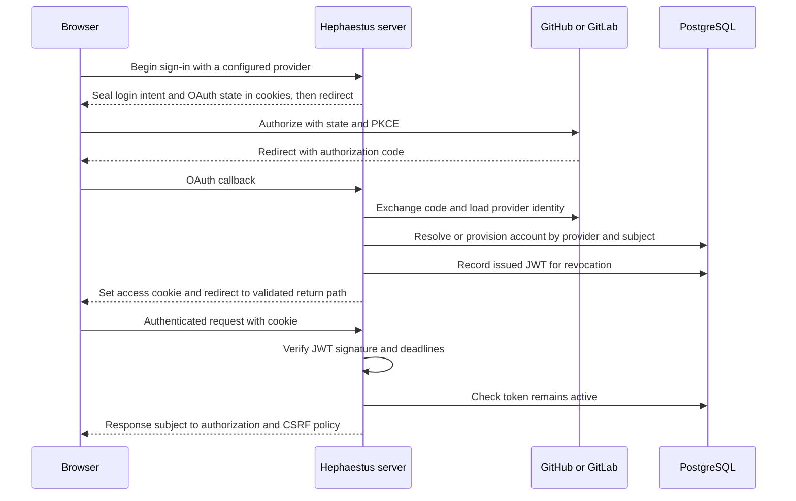
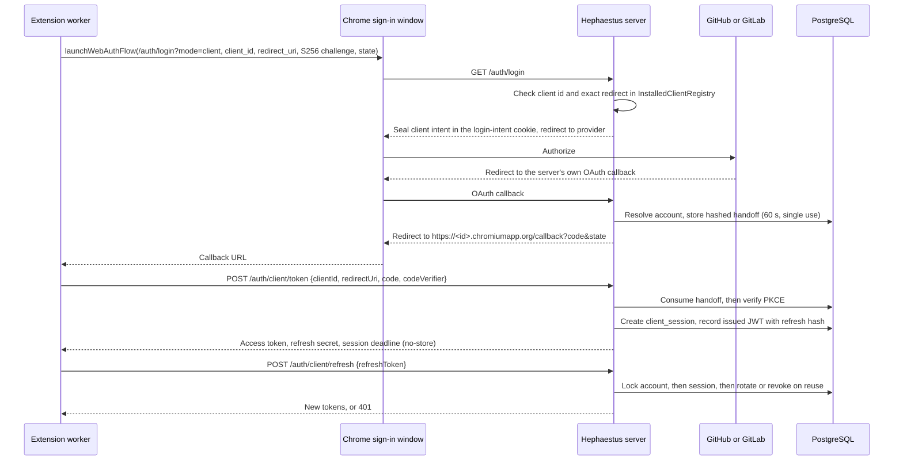

# Auth architecture

Authentication components and request flow. [The auth glossary](auth-glossary.md) defines the domain
and token claims; [ADR 0017](decisions/0017-replace-keycloak-with-spring-native-auth.md) records the
architecture decision.

## Request flow

Identity linking uses the same OAuth exchange but binds its sealed intent to the already
signed-in account. It cannot create an authenticated link from an anonymous request. Slack and
Outline support linking only, not sign-in.

Each [`identity`](./auth-glossary.md) row keys an account to one provider user by
`(provider_id, provider_user_key, team_key)`. Roster sync creates an unclaimed account for each new
provider user, and sign-in claims it. User views, Slack identity resolution and account erasure use
this key rather than comparing login names.

## Key properties

- **No HTTP sessions.** Revocation state lives in PostgreSQL. The browser holds one `__Host-HEPHAESTUS_AT`
  cookie carrying an ES256 JWT;
  [session deadlines](./admin/configuration-readiness.mdx#session-deadlines) define
  its lifetime. OAuth-flow state rides AES-GCM cookies, not a
  session — so login works across pods without sticky sessions.
- **Application-issued tokens.** After federating to the upstream IdP, Hephaestus issues its own JWT. Claim
  shape combines standard JWT/OIDC claims with Hephaestus claims, defined in
  [the auth glossary](./auth-glossary.md#jwt-claim-shape) and emitted by `HephaestusJwtIssuer`. The public signing keys are published at `/.well-known/jwks.json`; there is
  no full OIDC discovery document.
- **Two kinds of session, one revocation store.** The web app holds a cookie session; installed
  clients hold a bearer [client session](#installed-clients). Both are rows in `issued_jwt`.
- **Database-backed revocation.** Every issued JWT has a `jti` row in `issued_jwt`. Logout /
  refresh / sign-out-everywhere / account-delete set `revoked_at`; `RevocationAwareJwtDecoder`
  re-checks `issued_jwt(jti)` on every request, so revocation takes effect on every pod within
  DB visibility lag. The cache is a *negative* cache (REVOKED verdicts only) that merely sheds
  replay load; no cross-pod cache invalidation is needed.
- **Account lookup is `(provider, subject)`, never email.** This is the structural defence
  against the nOAuth (Descope 2023) account-takeover class. `IdentityRepository` has no
  `findByEmail`.
- **Login providers are instance-scoped.**
  A sign-in option — GitHub, GitLab.com, or a self-hosted GitLab — is a row in the instance
  `login_provider` table (`core.auth.provider`), **one per SCM instance** (`UNIQUE(type, base_url)`),
  env-seeded on first boot and managed at runtime by an instance admin. The client secret is sealed
  by `EncryptedStringConverter` (AES-256-GCM). This is **authentication** only; a workspace's SCM
  data source is a separate per-workspace `Connection` + group token/PAT. ADR 0017 records why the
  two are separate.
- **A user view never switches authentication.** An instance administrator reads a workspace
  member's private pages as themselves, even when the viewed user has no account — see
  [read-only user views](./contributor/instance-admin.md#read-only-user-views).
- **GDPR.** `auth_event` is an append-only, monthly RANGE-partitioned (self-managed in-app by
  `pg_partman`, 12-month retention; see ADR 0018)
  audit log. Account deletion is a 48-hour soft-delete cooldown → hard cascade +
  pseudonymization of the git-provider mirror (Art. 17(3) — preserves activity-graph integrity on
  other users' work).

## Installed clients

An *installed client* — the Chrome extension, later a mobile app — cannot hold the web app's cookie,
so it signs in to a session of its own. [ADR 0048](decisions/0048-installed-clients-sign-in-with-a-pkce-handoff.md)
records the decision and the options it rejected; `core.auth.clientsession` implements it.

- **One door.** `GET /auth/login` with `mode=client` is the web login with extra, sealed parameters,
  so the provider callback and login providers are shared. An unknown client id or redirect ends on a
  server error page, never a redirect. `GET /auth/dev-login/client` exists only with dev login.
- **Exact redirects from one list.** `InstalledClientRegistry` reads
  `hephaestus.auth.browser-extension-ids`; each id yields one redirect,
  `https://<id>.chromiumapp.org/callback`, and one CORS origin, `chrome-extension://<id>`. An id is a
  routing restriction, not an attestation: ids and their public keys are public.
- **Handoff.** `client_sign_in_handoff` stores only the code's hash, expires after 60 seconds and is
  consumed atomically before the PKCE check, so a wrong verifier burns it. The exchange must present the
  same client id and redirect URI.
- **Session and lineage.** `client_session.id` is the JWT's `sid`. `issued_jwt` rows carry
  `session_id` and a unique `refresh_token_hash` for as long as the session exists, so any refresh
  secret, JTI or logout secret the session ever issued resolves the family.
- **Strict rotation.** Only the current refresh secret renews. Presenting an earlier one revokes the
  session (`REFRESH_REUSE`) and records an auth event; there is no grace window. Copying a secret is
  detected only when a stale one is presented.
- **Lock order account → session → issued_jwt.** Every issuance takes `account FOR SHARE` and
  re-checks the account is active; refresh, logout and single-session revoke then lock the session.
  `SessionRevocation` takes `account FOR UPDATE` before ending client sessions and bulk-revoking issued
  JWTs, so an account-wide revocation cannot race a refresh into a surviving token.
- **Boundaries.** The client endpoints are exact `POST` matchers, CSRF-exempt only without the auth
  cookie, refuse requests that carry it, bound their bodies by pattern and answer `no-store`. The cookie
  `/auth/refresh` refuses `sid` tokens; `/auth/logout` with a `sid` bearer ends the client session.
  User view mints nothing for installed clients.
- **Visible and revocable.** The session list shows a client session once, as its client kind, with its
  latest JTI; revoking any JTI of the family ends the session. Cleanup removes expired handoffs and
  sessions past their deadline or revoked for a day, with their token rows.

## Browser session coordination

Renewal and logout use the browser's
[Web Locks API](https://developer.mozilla.org/en-US/docs/Web/API/Web_Locks_API) to serialize requests
and responses that replace the shared session cookie. Generated SDK operations own HTTP requests;
TanStack Query mutation options retain their lifecycle and error handling. Without Web Locks, an
IndexedDB record grants a five-second lease. Waiting tabs retry every 100 ms for at most five seconds;
they hold no database transaction across the network request. Lease expiry lets another tab continue
when a tab closes or its request stalls. A holder releases only its own lease. If storage fails or the
wait expires, the request runs without a lock. A browser with neither API still renews.
Client coordination reduces duplicate requests; the server's bounded reissue rule handles concurrent
responses from different origins. These origins cannot share a browser lock.

### Rotation contract

A renewal (`POST /auth/refresh`) issues a successor token. It does not revoke the presented token.
The successor row records the presented token in `issued_jwt.predecessor_jti`.
A reload or a navigation can cut the renewal response before the browser stores the new cookie.
The browser then still holds a valid token, so the session continues.
[Auth.js issue 8897](https://github.com/nextauthjs/next-auth/issues/8897) shows this cookie-response hazard.

- **The predecessor ends first at its own expiry or at the successor's first use.**
  `AccessTokenAdmission` admits the successor. In the same transaction, it revokes the predecessor
  with reason `ROTATE` and sets `issued_jwt.used_at`. The predecessor link stays in place so a
  logout that was admitted before first use can still revoke the chain.
  Refresh and first use lock the account, then the predecessor, then the successor.
  Concurrent refreshes therefore leave one unused successor.
- **The predecessor returns within 30 seconds of its unused successor's issuance.** The renewal
  re-signs that same successor. Its JTI, expiry, and `issued_jwt` row stay the same. `auth_event` records
  `TOKEN_REFRESH` with the details `{"reason":"SUCCESSOR_REISSUED"}`. Reissue is idempotent within this
  window: concurrent refreshes from any origin set equivalent cookies, in any response order.
- **The unused successor is at least 30 seconds old, or has expired.** The renewal revokes it with
  reason `SUPERSEDED`, issues a new successor, and records `TOKEN_REFRESH` with the details
  `{"reason":"SUCCESSOR_UNUSED_REPLACED"}`. A later renewal thus removes a successor that another
  holder pre-fetched. The window covers concurrent responses and does not extend either token's expiry.
  A partial unique index permits one unrevoked successor for each predecessor.
- **The predecessor returns after its successor was used.** The server answers 401.
  A renewal attempt records `JWT_REVOKED` `FAILURE` with the reason `browser_token_reuse` and logs
  a warning without the token. Other requests record `rotated_token_presented`, without a reuse warning.
- **Any other revoked browser token** records `revoked_token_presented`, with the revocation reason
  in the details. The revoked-verdict cache dedupes both events: each server instance records one
  event for each token and refusal reason for each cache entry (up to 15 minutes). Eviction or a restart permits a new
  event. Expired and unknown tokens add no event. Installed-client tokens record their reuse
  through their refresh secret, so the decoder records none for them. A late request and a later renewal
  replay use separate deduplication keys, so the first cannot hide the second.
- **Logout, single-session revocation, and passkey step-up** revoke the browser chain through
  `revokeBrowserSession`. The account write lock stops issuance and first use while revocation follows
  the retained predecessor links. This also ends successors that were used before logout took the lock. Step-up records `PASSKEY_STEP_UP`; an inactive account
  records `ACCOUNT_INACTIVE`. They do not raise a rotation-reuse warning. The session list shows one
  browser once while its successor is unused.
- **A renewal that loses the race to the successor's first use** neither issues nor clears a cookie.
  The browser already holds the successor.

A queued renewal reads the last completed renewal's identifier after it takes the lock. If another
renewal completed while this caller waited, it shares that result. An identity read never counts as a
renewal. A later caller can renew again without waiting for an arbitrary renewal window.
The server cannot distinguish two holders of a valid bearer cookie. The predecessor remains usable
only until its own expiry or its successor's first use; this does not add a grace period after either
boundary. Installed-client refresh-secret rotation keeps its separate reuse contract.

### Late refusals

A request that left with the predecessor can arrive after the successor's first use and get a 401.
The web app does not renew for such a late refusal:

1. Only a successful renewal starts the shared recovery cooldown of 10 seconds. All tabs of one
   origin share it through `localStorage`. Identity checks are throttled within each tab separately;
   they never suppress keep-alive renewal. A 401 during the recovery cooldown changes nothing.
2. After the cooldown, a 401 first reads `GET /user`. If the identity holds, the web app refetches
   its queries and does not renew.
3. Only a refused identity read leads to a renewal. A refused renewal leads to sign-in.

Only an authentication refusal triggers sign-in. Network and server failures preserve the page;
revocation-store failures deny access as server errors. Failed mutations are not automatically
replayed. Logout navigates away only after success or confirmation that the session is already
unauthenticated; otherwise the existing notification surface offers a retryable error.

[Spring Security's `csrf.spa()`](https://docs.spring.io/spring-security/reference/servlet/exploits/csrf.html#csrf-integration-javascript-spa)
handles SPA CSRF tokens. Cookie-authenticated mutations require CSRF protection, including requests
with an Authorization header; pure bearer requests are exempt. The final filter uses this policy
explicitly because Spring's resource-server exemption also matches cookie-resolved tokens.
Authenticating an existing JWT preserves the CSRF cookie rather than treating each request as a
new sign-in.

Public login-provider discovery ignores credentials so revoked cookies cannot block sign-in.
Locally invalid cookies are ignored without a clearing response that could erase a newer sign-in;
protected endpoints still reject the resulting unauthenticated request.

## Module boundaries

`core.auth` owns accounts, login-provider configuration, OAuth exchange, token issuance and
revocation. Spring Security owns the OAuth and resource-server protocols. The browser uses the
generated API client rather than a second authentication transport.

Login client registrations are built from the instance-scoped `login_provider` store. Integration
adapters must not reach into `core.auth.provider`: they resolve the associated provider record
through `GitProviderRegistry`, an auth SPI. A login provider grants authentication; it does not
supply a workspace's integration credentials.

Workspace, SCM integration and notification modules consume auth read interfaces and events;
auth does not depend on their implementations. HTTP-wide enforcement belongs to `core.security`,
outside individual provider adapters.
