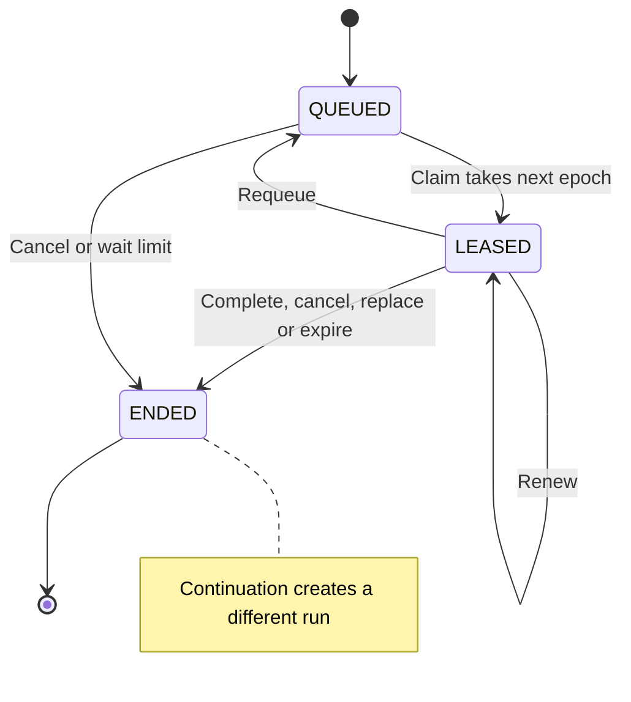
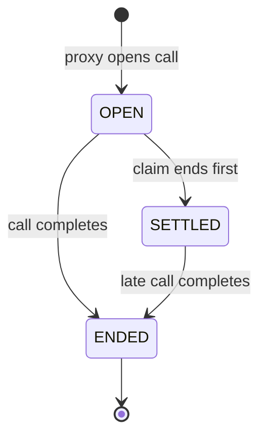

# Agent runs

An agent run (`agent_run`) is the lease of one piece of agent work on one subject.
A subject is the review, conversation or action that the work belongs to, such as `review:<id>`.
Each kind's domain row points to its run and keeps its own lifecycle.
Review jobs and conversation turns are on runs. `AgentRuns` in `agent.run` is the only writer of a run.

## States

| State | Meaning | Next states |
| --- | --- | --- |
| `QUEUED` | The run waits for a claim. | `LEASED`, `ENDED` |
| `LEASED` | One holder drives the run under the current `lease_epoch`, until `leased_until`. | `LEASED` (renewal), `QUEUED`, `ENDED` |
| `ENDED` | Final. Work that must go on gets a new run (`AgentRuns.continueAfter`). | none |

`AgentRunState` holds this table. The trigger `guard_agent_run` refuses every other transition, and every change of a run's identity.
Only a queued run may move to another subject (`AgentRuns.moveQueued`), as when an account absorption merges two conversations.
A claim takes the next epoch. No other write changes the epoch.
`attempt` counts only the claims that spent the kind's retry budget: a lost lease, or a requeue that the holder charges.

At most one run of a subject is `LEASED`. The partial unique index `uq_agent_run_leased_subject` enforces this.
The runs of a subject are claimed in the order they were queued.

## Holds

A queued run can wait for a reason that is not a retry's backoff. `hold_reason` (`AgentRunHold`) names it:

| Hold | The run waits until |
| --- | --- |
| `BUDGET` | the workspace's model budget allows a review again. Raising or clearing a cap releases the workspace's budget holds at once (`AgentRuns.releaseHolds`). |
| `SANDBOX_ROOM` | the sandbox runtime has room for its sandbox. Nothing of the attempt ran, so it spends no retry. |

Only a queued run has a hold, and the claim clears it. The checks `ck_agent_run_hold_reason` and `ck_agent_run_hold_queued` enforce both rules.
A retry's backoff is a later `available_at` with no hold, and no release brings it forward.

## Claim

`AgentRuns.claim` leases the next run that is due, with `FOR UPDATE SKIP LOCKED`.
The order is: band (`INTERACTIVE`, then `BATCH`, then `BACKGROUND`), then the workspace with the fewest leased runs, then age.
A run that waited `hephaestus.agent.capacity.band-aging` (10 minutes) since it was due orders one band higher, and one more for each further wait.
It never rises into `INTERACTIVE`. Thus scheduled work waits a bounded time behind steady requested work, and no review overtakes a person.
A run of a workspace that is not active is not offered.

A queued run sends a PostgreSQL notification on the channel `agent_run`, which wakes an idle claimer.

`AgentRuns.claimCapped` leases no run of a kind beyond a cap, such as the installation's turns (`hephaestus.agent.capacity.turns`).
The capped claims of one kind take an advisory lock in turn, so the cap holds across workers.

A claim leases a turn for `hephaestus.agent.capacity.turn-lease-ttl` (60 seconds), and any other run for `lease-ttl`.
A person waits for a turn, so a lost turn is taken back sooner.

## Clocks

A run has two clocks, and the reaper enforces both:

- **Start window** (`start_within_seconds`): how long a run may wait for room once it is due.
  If no run of its subject is leased or queued earlier, a queued run past this window ends as `NOT_STARTED`.
  Otherwise it waits for its subject.
  A requeue makes the run due again, so a retry gets the same window.
- **Deadline** (`deadline`): it bounds the current claim.
  A leased run is not renewed past it, and the reaper ends it there, even while its lease is live.
  Within a claim it only moves earlier (`AgentRuns.endBy`). A review or turn requeue clears it, so the next claim sets its own.
  The trigger `guard_agent_run` refuses any other change.

  A composition sets its deadline at creation: its due time plus its work window and closing reserve.
  Its retries continue on new runs, so the old deadline stays fixed. A free requeue keeps that deadline.

## Model call permits

A model call takes a permit of its call pool (`llm_call_permit`) in the band of its work, with the same aging rule.
Its aging is `hephaestus.agent.capacity.permit-aging` (30 seconds), because a call waits seconds where a run waits minutes.
`LlmCallPermitRepository.grantRound` grants a round in one statement.
[Runtime roles § Call pools](../admin/runtime-roles#call-pools) owns the grant order and the interactive reserve.

## Fence

A holder writes under its `AgentRunFence`: the run, its workspace and the epoch of its claim.
`AgentRuns.requireCurrent` holds the lease until the caller's transaction ends.
It refuses a stale epoch, and a lease whose `leased_until` passed, whatever its epoch.
Every write that a holder makes for the run calls it, or fences its own update on the run and the epoch.
Lock a domain row before its run: every writer of both takes them in that order.

## Reaper

`AgentRunReaper` runs on every server replica, every `hephaestus.agent.capacity.lease-renewal`, without a leader.
For each expired lease, it locks the domain row through the kind's `AgentRunHandler`.
For a requeue or end, the handler first moves the domain row, while the run still reads as its lost holder left it.
Last, one conditional write takes the run back. When another replica or a renewal won meanwhile, the transaction rolls back.
A continuation takes the run back and relinks the domain inside the handler, as its outcome describes.

`AgentRunHandler.lost` returns one of three `LossOutcome` records:

- `Requeue()`: the handler queued the domain row. The reaper requeues the same run and spends one attempt.
- `End()`: the handler ended the domain row. The reaper ends the run at the retry limit.
- `Continued(next)`: the handler replaced the run and relinked the domain row in this transaction.
  The reaper records the successor and makes no second run write.

Composition owns the retry delay and execution window.
`AgentRuns.continueExpired` conditionally ends the expired `LEASED` run as `CANCELLED`, by workspace, id and epoch on the database clock.
It settles that epoch's open calls, then creates a successor of the same kind, band and subject.
The successor carries the spent attempt count plus one and continues the claim epochs.

Its due time is database time plus the retry delay.
Its deadline is that due time plus the execution window.
The domain relink commits with these writes or all roll back.

A conditional fence that loses to another reaper or a renewal throws `StaleRunException`.
The reaper treats that transaction's rollback as an expected no-op, without a failure signal.
Other failures keep their failure signal.
At the kind's limit, or past its deadline, a run ends.
A queued run past its deadline or start window also ends.
A run whose take-back fails is skipped until the next tick, so it cannot hold back the runs behind it.

`agent.run.continued` and the `continued` reaper outcome count a committed continuation. The event also names `run.next_id`.
Each take-back writes one event that names `run.id`, `run.epoch` and `subject.key` ([Log records](/admin/log-records#agent-run-and-outbox-events)).
The holder of a review run puts the same three fields in its thread-scoped log context, and on its execution span.

## Model calls

Each model call of a run has one row in `llm_usage_event`. The row names the run and the epoch of the claim that made the call.

The row keeps the first call failure in `call_failure`, with only its kind and optional HTTP status.
`failed_at` uses the database clock when that failure is recorded.
The failure read selects the newest failure by this time within the exact workspace, run and epoch.
Late usage and repricing do not change either field.
No provider response body is stored.

- **Open.** The proxy writes the row `OPEN` before the call leaves. It records the model, frozen rates for the model kind, and upper bound (`cost_bound_usd`). The same transaction calls `AgentRuns.requireCurrent`, so a claim that ended cannot open a call. The transaction commits before the provider works.
- **Complete.** The end of the call measures the row (`LlmUsageRecorder.complete`). A call without reported usage ends `UNVERIFIABLE` and `UNPRICED`, never at zero cost.
- **Settle.** A claim's end settles its open rows in the transaction that writes the run. `AgentRuns.end`, `cancel`, `cancelAll`, `requeue` and the reaper's take-back perform this settlement. A settled row is `SETTLED`, `UNVERIFIABLE` and `UNPRICED`. `llm.usage.unverifiable` counts it.
- **Late completion.** A call that returns after its claim ended measures its settled row again. The row keeps its date, initial price mode and frozen rates. A known price applies at once, including a free call. Only a price that was unknown needs the repricing pass.
- **Deleted run.** The trigger `agent_run_settles_calls` settles a run's open rows before deletion. A turn deletion also deletes its run. The foreign key then clears `run_id` (`ON DELETE SET NULL (run_id)`), and the rows keep their accounting.

An open or unpriced row counts at its upper bound. Thus neither settlement nor missing reported usage makes a cap or a review unverifiable.

For a run's call, `ck_llm_usage_event_open_call` requires its run and epoch.
Runless calls use the same ledger with explicit source guards:

- An instance report draft has its outbox action and a settlement deadline.
- A synthetic model capability probe has a settlement deadline and no run, epoch or action.
  Instance probes have no workspace; workspace probes keep their real workspace and workspace funding.
  A probe keeps its exact catalog model ID, including before a price is set.
  Repricing never substitutes another model with the same provider alias.

The shared recovery pass settles expired probe calls by the database clock.
It also settles a report draft whose outbox claim no longer holds.
Late completion uses the same frozen-price rule as a run's call.
The trigger `llm_usage_event_guards_call_transition` permits only these transitions and keeps `initial_pricing_state` immutable:

Anthropic opening and intermediate usage counts do not measure the whole call. Its terminal usage does.
A received final usage block remains valid when the connection fails after it.
[LLM cost vocabulary](llm-cost-vocabulary#rule-10--each-model-call-is-one-ledger-row) owns the pricing and reporting rules of the rows, and [Rule 11](llm-cost-vocabulary#rule-11--an-unmeasured-call-counts-at-its-upper-bound) the upper bound.

## Reviews

`ReviewRunKind` is the handler of review jobs. A job's attempt number is its run's epoch less one (`ReviewRunKind.attempt`). For a waiting job, it is the number of its next claim.
The constraint trigger `review_job_run_agrees` refuses a commit where a job and its run disagree:
a queued job needs a queued run. A running job needs a leased run. An ended job needs an ended run.

A claim that a budget holds runs nothing and spends no attempt. The claim rolls back. The queued run waits until the budget hold ends.
A composition that resumes after its run ended continues on a new run (`AgentRuns.continueAfter`).
The new run goes on with the epochs of the ended one and spends one more attempt. The retry limit thus bounds how often a composition resumes.

### A review in its sandbox

A review's `REVIEW` run is measured in the review's own sandbox (`ReviewSandboxRuns`):

1. The dispatch requests the sandbox of the due run's subject, `review:<id>`.
2. The sandbox pulls the run. Its claim starts the job in the lease's transaction (`ReviewJobClaimService.claimLeased`), with the same checks as before.
3. The first request of the run prepares the attempt (`ReviewAttemptPreparation`): it captures the work, records its provenance and marks the execution started. The attempt's inputs are held until the run ends (`ReviewAttemptCustody`).
4. The driver's `REVIEW` kind (`agent/review-measure.ts`) downloads the workspace from `…/runs/{runId}/runtime/workspace` and runs the image's review programs in one container. Its model and review calls carry the sandbox token and the run's claim.
   The kind first empties `/workspace`. Thus, a requeued attempt that the same sandbox pulls starts from its own captured workspace, not from the files that an earlier attempt left in `/workspace`.
5. The runner's result arrives at `…/runs/{runId}/runtime/result`, with the runner's exit. `ReviewAttemptResults` then ends the attempt, requeues it, or hands an admitted review on to its `REVIEW_COMPOSE` run (`ReviewRunKind.continueToCompose`), which the same sandbox pulls next.

## Turns

`TurnRunKind` is the handler of conversation turns. A turn's run uses its conversation as its subject: `conversation:<id>`. The conversation's sandbox uses the same subject.
So one turn of a conversation runs at a time, and the conversation's questions start in order.
A turn's attempt number is its run's epoch.

The constraint trigger `mentor_turn_run_agrees` refuses a commit where a turn and its run disagree:
a queued turn needs a queued run. A running turn needs a leased run. A stopped turn needs a leased or an ended run. An ended turn needs an ended run.

- **End.** The holder's end ends the turn and its run in one transaction. A repeated end reads `EndOutcome.ALREADY_ENDED`.
- **Stop.** A queued turn's run ends at once. A running turn's run stays leased. Its deadline moves to 30 seconds later. The holder can still end the turn with what it wrote.
- **Deadline.** A claim's deadline is the turn's work deadline plus the same 30 seconds. Past it, the reaper ends the turn: stopped, or failed for taking too long.
- **Lost holder.** A running turn returns to the queue for one retry, then fails.
- **Start window.** A turn waits at most 3 minutes for a free Hephaestus.

## Sandboxes

A subject's sandbox is one agent-sandbox `Sandbox`, and its row in `agent_sandbox` is the single owner of its `SandboxClaim` (ADR 0079 § Subject and sandbox).
`AgentSandboxes` in `agent.sandbox.claim` writes the rows, and `KubernetesSandboxClaims` writes the claims. The claim is the only agent-sandbox object that the server writes. The controller owns the `Sandbox` and its Pod.

| State | Meaning | Next states |
| --- | --- | --- |
| `REQUESTED` | The row exists, and its claim exists or is being created. The sandbox has not called the gateway yet. | `READY`, `DELETING` |
| `READY` | The sandbox called the gateway. Each run that it leases moves `last_used_at`. | `DELETING` |
| `DELETING` | The claim is being deleted. The sandbox's token no longer works. | none: the row is deleted with its claim |

The trigger `guard_agent_sandbox` refuses every other transition, and every change of a sandbox's identity.
A subject has at most one live sandbox (`REQUESTED` or `READY`). The partial unique index `uq_agent_sandbox_live_subject` enforces this.

`AgentSandboxes.ensure` commits the row before it creates the claim, outside any transaction. Thus a claim never exists without its row.
The claim names the zero-replica warm pool of its kind, and it carries two variables:

- `HEPHAESTUS_SANDBOX_TOKEN`: the sandbox token. It names the sandbox, its workspace and its subject, and it expires at the sandbox's shutdown time.
- `HEPHAESTUS_GATEWAY_URL`: the gateway address. The server resolves the gateway Service to its address, because a sandbox has no DNS.

The gateway accepts a sandbox token only on `/internal/agent/**` on the gateway port. It checks the signature, then checks that the sandbox is live and before its shutdown. A token stops at once when its sandbox is taken back.
The first call makes the sandbox `READY`. A later call that leases no run is no use of the sandbox, so a sandbox that only polls still goes idle.
A sandbox token expires at the sandbox's shutdown time, which is at most the life of the key that signs it.

`POST /internal/agent/next` leases the subject's next run to the sandbox with `AgentRuns.claimSubject`: the same rule and order as a claim, within one subject. It holds the sandbox's row in the same transaction, so the reaper cannot take the sandbox back between the check and the lease.
It offers only the run kinds that the sandbox's kind drives.

Each run kind that a sandbox drives has one `SandboxRunKind` bean in `agent.gateway`:

- `sandbox()` names the sandbox kind that drives it. The pull of a sandbox of that kind offers its runs, and no other pull does.
- `claimed(run)` runs in the transaction of the lease. The kind moves its domain row with the run, so the two always agree. The kind can instead end or requeue the run, for example after erasure. That pull gives the sandbox no run.
- `context(run)` answers `GET …/runs/{runId}/context`, and `end(run, outcome)` ends the run with its domain row.
- `attempt(run)` names the attempt that the model gateway bills the run's model calls to. The gateway takes the sandbox token with the run's `X-Agent-Run` and `X-Agent-Epoch` headers. It answers `409` when the claim no longer holds the run, and `401` for a run of another subject.

Two kinds are registered: `REVIEW` measures a review, and `REVIEW_COMPOSE` composes its feedback.
A `REVIEW_COMPOSE` run continues the `REVIEW` run of its review (`AgentRuns.continueAs`). Its epochs go on from the ended run, and it spends no attempt, because it is the next step of the work, not a retry.

### Sandbox dispatch

`SandboxDispatcher` starts the sandboxes that queued runs need. It runs where the sandbox owner is. It runs when a run is queued and every `hephaestus.agent.capacity.lease-renewal`.
It reads the runs that the claim would offer next, in the claim's order (`AgentRuns.due`), for each run kind that a `SandboxRunKind` registers.
For each run whose subject has no live sandbox, it requests one (`AgentSandboxes.ensure`), while the live sandboxes of that kind stay within their limit.
It leases nothing: the sandbox claims its own run when it pulls.

Two replicas that read the same run both ask for the subject's sandbox. The partial unique index on a subject's live sandbox gives both the same one.

The limit of review sandboxes is `hephaestus.sandbox.max-concurrent-containers` for now, the count that the chart gives each worker.
A failed pass counts `agent_sandbox_dispatch_failure_total` and tries again at the next pass.
Each pass also releases the inputs of review attempts whose run no longer holds them (`ReviewAttemptCustody.releaseEnded`).

### Sandbox driver

The agent image's entrypoint is the driver, `agent/driver.ts`. A sandbox's container runs it, and the kind of each run is its parameter (`agent/driver-kinds.ts`).
The driver pulls the subject's next run, keeps its lease, and ends it with `POST …/runs/{runId}/end`. A kind runner never renews the lease and never ends the run.
Every tool in the sandbox can hold the sandbox token. Each gateway write therefore enforces its own guardrails on the server ([ADR 0079 § Update — a tool may hold the sandbox token](https://github.com/hephaestus-build/Hephaestus/blob/main/docs/decisions/0079-one-agent-system.md#update--2026-11-09-a-tool-may-hold-the-sandbox-token)).

The driver starts no kind before the sandbox's network policy holds (isolation gate G6).
A new Pod can reach the Kubernetes API before its node applies the namespace's NetworkPolicy, and the template has no init container that could wait.
At its start, the driver connects to the API Service again and again (`agent/driver-isolation.ts`). A refused connection shows that the policy holds. So does a connection that does not open in 300 ms.

If the API still answers after 10 seconds, the driver ends its run as `unisolated` and pulls no more.
The server then hands the run on and takes the sandbox back in one transaction (`AgentSandboxes.revoke`).
Its token stops at the commit, and the reaper deletes its claim.
The alert `HephaestusAgentSandboxUnisolated` fires on each such sandbox.

### Sandbox reaper

`AgentSandboxReaper` runs where the sandbox namespace's Kubernetes client is, every `hephaestus.agent.capacity.lease-renewal`, without a leader. One statement on the database clock takes back a live sandbox when one of these is true:

- Its shutdown time passed.
- It did not call the gateway within `hephaestus.agent.capacity.sandbox-start` (2 minutes) of its request.
- Its subject has no queued or leased run, and it leased no run for `hephaestus.agent.capacity.sandbox-idle` (1 minute). For a conversation, the limit is `conversation-sandbox-idle` (15 minutes).

Then the reaper deletes the claims of the `DELETING` rows, and the rows after them. A claim that the API refuses stays for the next pass.
Last, the reaper deletes each claim with the label `hephaestus.build/sandbox-id` that no row names, as after a workspace purge. Claims without the label, such as the isolation gate's, are not the server's.
