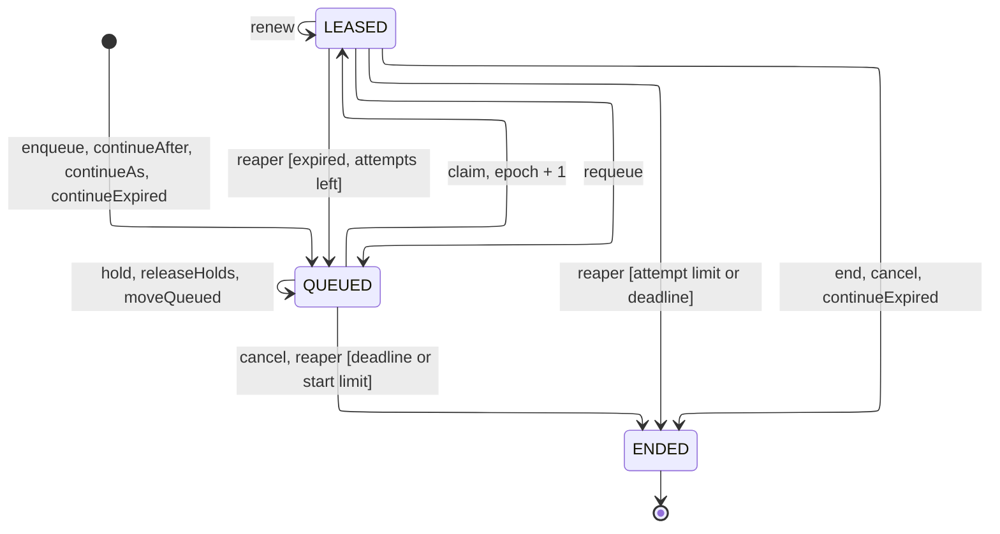
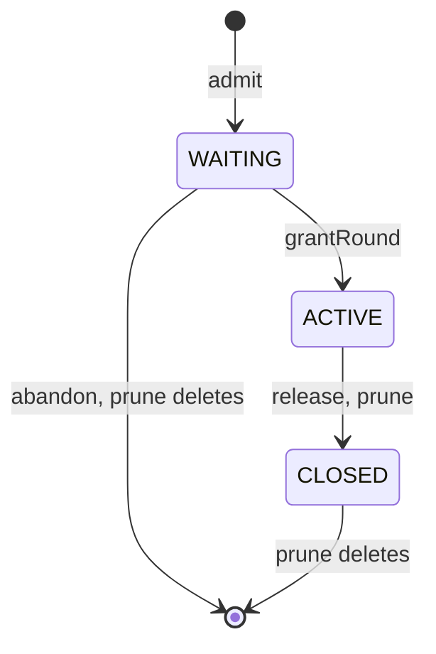
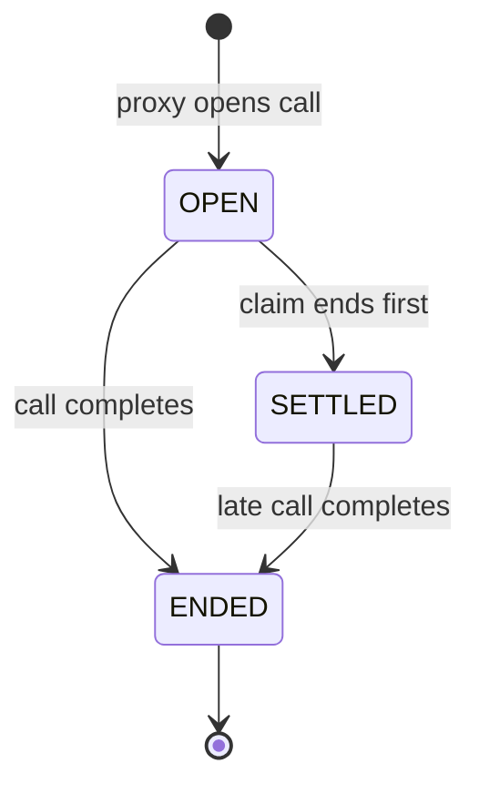
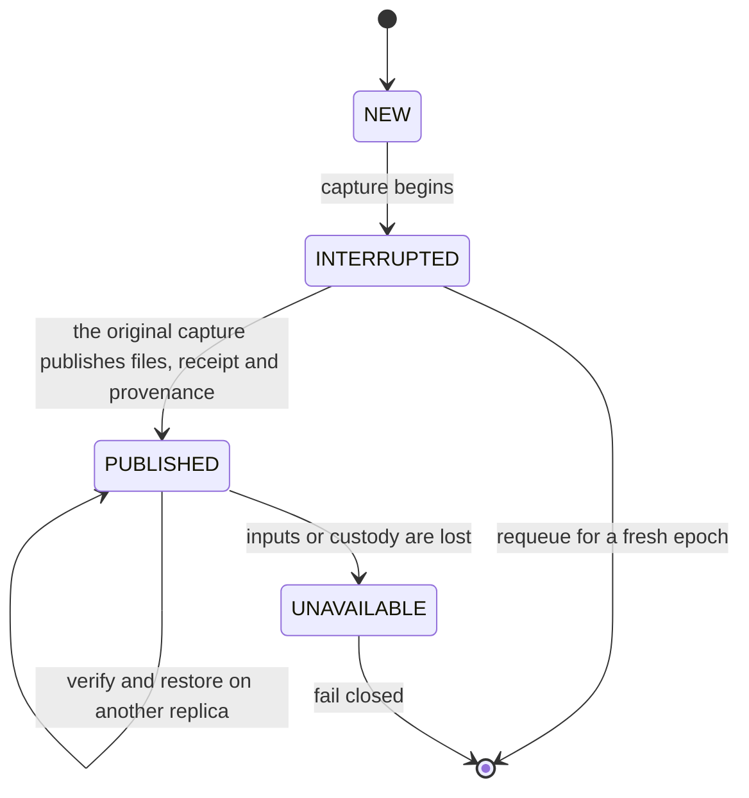

# Agent runs

An agent run (`agent_run`) is the lease of one piece of agent work on one subject.
A subject is the review, conversation or action that the work belongs to, such as `review:<id>`.
Each kind's domain row points to its run and keeps its own lifecycle.
Review jobs and conversation turns are on runs. `AgentRuns` in `agent.run` is the only writer of a run.

## Proactive digests

`DIGEST` is proactive conversation work in the `BACKGROUND` band.
Its subject is `conversation:<id>`, the same subject as a requested `TURN`.
The subject's unique lease prevents both from writing to the conversation at the same time.
Both kinds share the conversation capacity limit, sandbox runner, admission and turn lifecycle.
Queued digests yield to questions of the same conversation.
A leased digest keeps its fence until it ends.
A pull takes the physical sandbox write lock without waiting.
Other pulls return no work while that claim commits.

`DigestSchedule` selects opted-in accounts on Monday and enqueues one turn per workspace and week.
The turn has the surface `SYSTEM` and a real `DIGEST` stimulus with its captured fact membership.
It has no developer question.
The context source renders that membership under the current evidence permissions.

`DigestAdmission` checks the subscription, membership, delivery window and available facts before work starts, before each model call and at completion.
Every captured feedback item and profile change must still be eligible, even when other facts remain.
A refused completion stores no answer and sends no note.
The digest stays out of the timeline until its turn is `DONE`.
The answer and notification actions then commit together.
The outbox owns the Slack or email send.

## States

| State | Meaning | Next states |
| --- | --- | --- |
| `QUEUED` | The run waits for a claim. | `LEASED`, `ENDED` |
| `LEASED` | One holder drives the run under the current `lease_epoch`, until `leased_until`. | `LEASED` (renewal), `QUEUED`, `ENDED` |
| `ENDED` | Final. Work that must go on gets a new run (`AgentRuns.continueAfter`). | none |

This state diagram shows the lifecycle of one agent run, with every transition that `AgentRunState` allows.
Each label names the `AgentRuns` method or the reaper that makes the transition. A condition in brackets is the guard of that transition.
A loop on one state changes the run's row, not its state. The holder's `renew`, `requeue` and `end` hold only with the current epoch.
The diagram has no edge from `ENDED`: work that goes on gets a new run. Retirement and erasure delete rows outside this lifecycle.

`AgentRunState` holds this table. The trigger `guard_agent_run` refuses every other transition, and every change of a run's identity.
Only a queued run may move to another subject (`AgentRuns.moveQueued`), as when an account absorption merges two conversations.
A claim takes the next epoch. No other write changes the epoch.
`attempt` counts only the claims that spent the kind's retry budget: a lost lease, or a requeue that the holder charges.

At most one run of a subject is `LEASED`. The partial unique index `uq_agent_run_leased_subject` enforces this.
The runs of a subject are claimed in the order they were queued.

## Holds

A queued run can wait for a reason that is not a retry's backoff. `hold_reason` (`AgentRunHold`) names it:

| Hold | The run waits until |
| --- | --- |
| `BUDGET` | the workspace's model budget allows a review again. Raising or clearing a cap releases the workspace's budget holds at once (`AgentRuns.releaseHolds`). |
| `SANDBOX_ROOM` | the sandbox runtime has room for its sandbox. Nothing of the attempt ran, so it spends no retry. |

Only a queued run has a hold, and the claim clears it. The checks `ck_agent_run_hold_reason` and `ck_agent_run_hold_queued` enforce both rules.
A retry's backoff is a later `available_at` with no hold, and no release brings it forward.

## Claim

`AgentRuns.claim` leases the next run that is due, with `FOR UPDATE SKIP LOCKED`.
The order is: band (`INTERACTIVE`, then `BATCH`, then `BACKGROUND`), then the workspace with the fewest leased runs, then age.
A run that waited `hephaestus.agent.capacity.band-aging` (10 minutes) since it was due orders one band higher, and one more for each further wait.
It never rises into `INTERACTIVE`. Thus scheduled work waits a bounded time behind steady requested work, and no review overtakes a person.
A run of a workspace that is not active is not offered.

A queued run sends a PostgreSQL notification on the channel `agent_run`, which wakes an idle claimer.

`AgentRuns.claimCapped` leases no run of a kind beyond a cap, such as the installation's turns (`hephaestus.agent.capacity.turns`).
The capped claims of one kind take an advisory lock in turn, so the cap holds across workers.

A claim leases a turn for `hephaestus.agent.capacity.turn-lease-ttl` (60 seconds), and any other run for `lease-ttl`.
A person waits for a turn, so a lost turn is taken back sooner.

## Clocks

A run has two clocks, and the reaper enforces both:

- **Start window** (`start_within_seconds`): how long a run may wait for room once it is due.
  If no run of its subject is leased or queued earlier, a queued run past this window ends as `NOT_STARTED`.
  Otherwise it waits for its subject.
  A requeue makes the run due again, so a retry gets the same window.
- **Deadline** (`deadline`): it bounds the current claim.
  A leased run is not renewed past it, and the reaper ends it there, even while its lease is live.
  Within a claim it only moves earlier (`AgentRuns.endBy`). A review or turn requeue clears it, so the next claim sets its own.
  The trigger `guard_agent_run` refuses any other change.

  A composition sets its deadline at creation: its due time plus its work window and closing reserve.
  Its retries continue on new runs, so the old deadline stays fixed. A free requeue keeps that deadline.

## Model call permits

A model call takes a permit of its call pool (`llm_call_permit`) in the band of its work, with the same aging rule.
Its aging is `hephaestus.agent.capacity.permit-aging` (30 seconds), because a call waits seconds where a run waits minutes.
`LlmCallPermitRepository.grantRound` grants a round in one statement.
[Call pools](#call-pools) gives the grant order and the interactive reserve.

## Call pools

A call pool represents one provider quota boundary across servers, models, and workspaces.
Every model is in a pool. The database gives each model a pool of its own.
An instance admin can move models into a shared pool.
A shared host name alone does not establish a shared quota.
[AI providers](/admin/ai-providers#6-sharing-provider-capacity) gives the setup procedure.

Every call takes a database grant before it reaches the provider.
Each call has a band, which is its priority: `interactive`, `batch` or `background`.
A conversation call is interactive.
A composition call and the calls of a requested or event review are batch.
The calls of a scheduled or backfill review and product feedback are background.

Review calls and composition share the capacity outside the interactive reserve.
Interactive calls can also use the interactive reserve.
The reserve is never lent to batch or background calls.
Both the total limit and the limit outside the reserve apply independently.

### The learned limit

The pool row holds the limit, so all servers share it and a restart keeps it.
No server holds a database connection while its call waits for a grant or for the provider.

| Event | Effect |
| --- | --- |
| New pool | The limit starts at 4 calls in flight |
| A served call ended while the limit was full. It did not wait in the provider's queue, and the limit did not fall in the last 10 minutes | The limit rises by 1, so it doubles in about one call duration |
| Such a call ended, and the limit fell in the last 10 minutes | The limit rises by 1 for each limit's worth of such calls |
| The provider answers 429, 529, or 503 | The limit falls to 70%, and never below 2. No call starts until the provider's `Retry-After` has passed, or for 5 seconds without one |
| Even the fastest first token of a window of calls exceeds twice the baseline plus 1 second | The limit falls in proportion to that delay, to 70% at most and never below 2. Calls continue with no pause |
| A served stream ends with no content and no usage. The provider ended it, or sent no content for `hephaestus.mentor.turn.model-idle-timeout`, or the call waited past twice the baseline plus 1 second | The limit falls to 70%, and never below 2. Calls continue with no pause. Such a call never raises the limit |

A model server such as vLLM queues calls by default and refuses none, so a limit that learns only from refusals keeps rising.
The pool measures the time from each streamed call's request to its first content event: text, reasoning, or a tool call.
A role, an error event, or an SSE comment does not count, as a gateway can send one at once and then serve nothing.
A window holds at least 4 such samples, and half of the limit when that is more.
The baseline is the fastest first token that the pool knows.
A queue delays every call behind it, and a long prompt delays only itself, so the pool compares only the fastest call of a window.

A call without a stream, such as a feedback composition, gives no sample. It cannot raise a limit that first tokens watch.
A model that only such calls use learns from refusals only.
A failed answer gives no sample either, as it can arrive at once even behind a queue.

A provider can also fail without an error: it sends its head, and then nothing.
A stream without content and usage is such a call, also when it carries only an error event.
The proxy cuts a stream whose provider sends nothing for `hephaestus.mentor.turn.model-idle-timeout`, and the limit falls then.
A provider that sends only SSE comments is not cut. A call without content for that long still lowers the limit, also before the pool knows a baseline.
A caller that ends such a call sooner lowers the limit only if the call waited longer than the baseline allows.

The baseline is one value for all calls of a pool.
Short prompts can set it, and only long prompts that miss the cache can follow.
Then the limit falls to the floor once, takes their first token as the new baseline, and rises again.

At a limit of 2, these calls alone cannot make a queue. If the window is still late, the pool takes that window as its new baseline, and the limit can rise again.
Thus, a provider that became slower, or another tenant on the same server, cannot hold the limit at the floor.
Tokens per second of one stream give no such signal. They fall while a batch fills and more calls still add throughput, and they stop falling at the point where the queue starts.

A burst of refusals or late calls lowers the limit once: only a call that started under the current limit can lower it.
The same rule applies to a served call that raises it.
The limit does not rise while calls do not fill it.
An instance admin's maximum is a ceiling on the limit.

A release grants waiting calls immediately.
Servers send a pool-id hint through PostgreSQL after a release or grant.
Each server keeps one dedicated database connection for these notifications.
The database owns admission.
A hint does not grant capacity.
If a hint is lost, a two-second check recovers it and checks rate refills, cooldowns and expired permits.

The interactive reserve is a quarter of the limit, rounded up, and the limit always leaves one call outside it.
A limit of 32 has a reserve of 8. A limit of 8 has a reserve of 2.
When the limit falls, calls in flight continue. A conversation can still use its reserve while they end.

A new provider pause applies to conversations too, as the provider would refuse their calls.
A queue at the provider delays them too, which is why the limit stays below it.

### What a caller sees

A provider's refusal does not reach the caller when the call can wait for it.
The proxy releases the grant, and the call joins the queue again.
The call asks the provider again after the pause. A conversation call waits up to 30 seconds and another call up to 2 minutes.

The refusal reaches the caller as the provider's own answer, with its status, in these cases:

- The provider asks for a longer pause than the call can wait.
- The answer says that the account has no quota left (`insufficient_quota` or `enforced_spend_limit_reached`).
- The answer is a 503 without `Retry-After`, which can be an outage. The connection's breaker also counts it.
- A workspace-controlled credential was refused in a shared pool.

A call that ends while it waits gets a capacity refusal. Hephaestus records this as its own stop, and it says nothing about the reviewed work.
[Decisions and withholdings](./practice-review-pipeline#decisions-and-withholdings) explains how a stop affects the feedback.

Product feedback is a background call.
It starts only when no other call waits in that endpoint pool, whatever the band of that call.
At most one drafting call can be active in each pool, and it cannot use the interactive reserve.
A later call does not revoke an active draft: it can wait for that draft's transport to close.

A pool grants the waiting calls in this order:

1. The band. Each waiting interactive call gets its grant before a batch call, and each batch call before a background call.
2. The workspace with the fewest granted calls in the pool.
3. In that workspace, the review attempt with the fewest granted calls.
4. The oldest call.

Thus, a wide review cannot hold more than its share while another review waits. It uses free capacity while none waits.
A review's composition does not wait behind the measurements of a wider review.
If two workspaces have the same number of granted calls, the workspace whose last grant in that band is older goes first.
Every physical call joins this queue, including composition.

A batch or background call that waits rises one band for each `hephaestus.agent.capacity.permit-aging`, 30 seconds by default.
It never rises into the interactive band.
Thus, the call of a scheduled review waits behind a steady stream of other reviews' calls for a limited time only.

Each server runs one admission round per pool for each 250 milliseconds while calls wait, and a new call starts one at once.
A round can grant any server's call, in queue order, up to the limit. The call's own server finds the grant in its next round.
Thus, the database load does not grow with the number of waiting calls.
One database statement grants all the calls of a round. Interactive calls are granted first in each round.

Before a review starts capture or creates a Pod, its claim checks the review quota and its model's endpoint pool.
The parent review and its job start in one transaction after those checks pass.
The claim stays queued while the quota has no room or the pool has a live review call waiting.
A review call is a batch or background call that has a workspace.
It is a call of a requested, event, scheduled or backfill review, or of a composition.
Conversation and product feedback waiters do not block a review claim.

An unavailable observation leaves the review queued.
The Kubernetes readiness check also fails while a namespace informer cannot list or watch its resources.

This check takes no provider grant and adds no pool waiter.
A pool whose calls are all active can admit a review when it has no review call waiting.
The review's actual calls join the pool queue when they run.
A new waiter or another server can use room after the observation.
The Kubernetes quota and the pool enforce capacity when the Pod and call start.

After a backlog refusal, the same poll scans other endpoint pools before it sleeps.
The job retains its original readiness time.
Claims prefer started work, then workspaces with fewer running reviews.
Each batch also counts the positions already offered to a workspace.
Within that order, requested reviews precede event, scheduled, and backfill reviews.
Each ten minutes of waiting offsets one origin priority step, so old backfill can pass new requests.

The pool also accounts for request and token rates across servers.
Each physical request, including a protocol retry, consumes a rate debit.

A configured per-call token bound reserves the provider's maximum input-plus-output charge on the pool's combined and input token rates.
An output token rate has no reservation, because providers count output as the model writes it.
When a call ends, the usage that its provider reported replaces that bound.
The reservation remains conservative when usage is absent or the call is cancelled.
Closed calls retain their debit for a full minute after closure.
Background calls keep their share of the limit in the rate account too, and at least one call.

A live server cancels a call after three quarters of the permit lease without renewal.
The proxy also checks that local lease before it starts or retries a provider call, without waiting for the next periodic check.

The proxy releases capacity only after the response completes or the cancelled transport closes.
Cancellation also closes a JSON response body after its headers arrive.
The request UUID fences renewal and release.
A late release cannot affect another call.
An ended attempt cannot start a provider call after a capacity wait.

Admission and administration reclaim grants that the server has not renewed within `hephaestus.llm.call-pools.permit-lease` (one minute by default).
This lease is the bound on a provider connection that nobody can see anymore:

- When a server process ends, its sockets close.
- A server that loses its database cancels its calls after three quarters of the lease. Their connections close before the grant expires.
- A server cancels a call within two renewal intervals after its hard end and stops renewing it. Its grant then expires.

The hard end is the deadline of the work, such as a review attempt's work deadline.
A conversation call has no such deadline, so its hard end comes 32 minutes after its grant.

A suspended server is the one exception.
It can keep a provider connection open after its grant expires.
The connection closes when the server resumes and cancels the call, or when its liveness probe restarts the container.
A cancellation that cannot close the transport can do the same.
The pool limit can then be exceeded until those connections close.

The expired grant cannot renew or debit a retry.
Its provider rate debit remains for one minute after lease expiry.
Pool edits, deletion, and membership changes wait for open requests, retained rate debits, and cooldowns to end.

The cooldown follows the retry headers and never shortens an existing pause.
A workspace-controlled connection can lower the limit and pause only a pool that its model has alone.

### Model calls in flight for each attempt

The server limits the model calls that one attempt has in flight at the same time, on every model:

- A conversation turn has at most 2: one call, and one that a stop left open.
- A practice review has at most 170.

The review limit protects the server's memory, because a call that waits for a grant keeps its body in the server.
The limit does not share the provider. A [call pool](#call-pools) does that with its fair grants.

A review's runner does not reach this limit. It starts a session only while its 256 MiB heap has room for that session.
A session holds about 3 MiB, so the heap holds at most 85 sessions.
Each session has one call open and one that an abort left closing.
Only a sandbox that the runner no longer controls can reach the limit.

The proxy notices that a client went away only at its next write to that client.
Thus, a call that a stalled session left open still counts for a time.
A model call ends when its provider sends nothing for 5 minutes.

The proxy refuses a call past the limit with HTTP 429 and `Retry-After: 1`.
It refuses the call before the call reaches the provider.
`llm_proxy_refused_total` with `refusal="calls_in_flight"` counts these refusals.

A refused call is not lost:

- The review's sessions and Hephaestus ask again with their own retries.
- The feedback composition of a review counts against the same limit, because it is a call of the same attempt. It starts after the review's sandbox ends. Then, only calls that a stalled session left open can fill the limit. The composition treats a refusal as a provider pause and tries again.

### Stalled model calls

The server's LLM proxy cuts a conversation model call, or a streamed model call of a practice review, whose provider stays silent too long.
Two bounds apply:

- `hephaestus.mentor.turn.model-first-byte-timeout` (default 5 minutes) bounds the wait for the response headers.
  A provider can queue a request before it answers, so this bound is the longer one.
- `hephaestus.mentor.turn.model-idle-timeout` (default 2 minutes) bounds each gap in the stream after the headers.

Any byte counts, also an SSE comment that a gateway sends to keep the connection alive.
The turn's deadline also bounds both, because the stop at the deadline cancels the call.
The turn fails with **Hephaestus's AI model stopped responding, so Hephaestus could not finish this reply. Try again in a moment.**
The server logs the cut call and the failure with the reason `STALLED` and the bound that was passed.

For a practice review, the review runner retries the cut call up to 5 times.
When two sessions in a row end with their calls unanswered, the review starts no new session.
The attempt then ends early.
If no call of the attempt was answered, the review runs again under the normal retry rules.
`llm_proxy_upstream_stalled_total` counts each cut call.

`LlmCallPermitState` owns the transition table of a permit.
Each move is one native statement in `LlmCallPermitRepository`, and its `WHERE` names the legal source state, so two servers cannot both move one permit.
`LlmCallPermitSqlTest` holds those statements to the table.

## Fence

A holder writes under its `AgentRunFence`: the run, its workspace and the epoch of its claim.
`AgentRuns.requireCurrent` holds the lease until the caller's transaction ends.
It refuses a stale epoch, and a lease whose `leased_until` passed, whatever its epoch.
Every write that a holder makes for the run calls it, or fences its own update on the run and the epoch.
Lock a domain row before its run: every writer of both takes them in that order.

## Reaper

`AgentRunReaper` runs on every server replica, every `hephaestus.agent.capacity.lease-renewal`, without a leader.
For each expired lease, it locks the domain row through the kind's `AgentRunHandler`.
For a requeue or end, the handler first moves the domain row, while the run still reads as its lost holder left it.
Last, one conditional write takes the run back. When another replica or a renewal won meanwhile, the transaction rolls back.
A continuation takes the run back and relinks the domain inside the handler, as its outcome describes.

`AgentRunHandler.lost` returns one of three `LossOutcome` records:

- `Requeue()`: the handler queued the domain row. The reaper requeues the same run and spends one attempt.
- `End()`: the handler ended the domain row. The reaper ends the run at the retry limit.
- `Continued(next)`: the handler replaced the run and relinked the domain row in this transaction.
  The reaper records the successor and makes no second run write.

Composition owns the retry delay and execution window.
`AgentRuns.continueExpired` conditionally ends the expired `LEASED` run as `CANCELLED`, by workspace, id and epoch on the database clock.
It settles that epoch's open calls, then creates a successor of the same kind, band and subject.
The successor carries the spent attempt count plus one and continues the claim epochs.

Its due time is database time plus the retry delay.
Its deadline is that due time plus the execution window.
The domain relink commits with these writes or all roll back.

A conditional fence that loses to another reaper or a renewal throws `StaleRunException`.
The reaper treats that transaction's rollback as an expected no-op, without a failure signal.
Other failures keep their failure signal.
At the kind's limit, or past its deadline, a run ends.
A queued run past its deadline or start window also ends.
A run whose take-back fails is skipped until the next tick, so it cannot hold back the runs behind it.

`agent.run.continued` and the `continued` reaper outcome count a committed continuation. The event also names `run.next_id`.
Each take-back writes one event that names `run.id`, `run.epoch` and `subject.key` ([Log records](/admin/log-records#agent-run-and-outbox-events)).
The holder of a review run puts the same three fields in its thread-scoped log context, and on its execution span.

## Model calls

Each model call of a run has one row in `llm_usage_event`. The row names the run and the epoch of the claim that made the call.

The row keeps the first call failure in `call_failure`, with only its kind and optional HTTP status.
`failed_at` uses the database clock when that failure is recorded.
The failure read selects the newest failure by this time within the exact workspace, run and epoch.
Late usage and repricing do not change either field.
No provider response body is stored.

- **Open.** The proxy writes the row `OPEN` before the call leaves. It records the model, frozen rates for the model kind, and upper bound (`cost_bound_usd`). The same transaction calls `AgentRuns.requireCurrent`, so a claim that ended cannot open a call. The transaction commits before the provider works.
- **Complete.** The end of the call measures the row (`LlmUsageRecorder.complete`). A call without reported usage ends `UNVERIFIABLE` and `UNPRICED`, never at zero cost.
- **Settle.** A claim's end settles its open rows in the transaction that writes the run. `AgentRuns.end`, `cancel`, `cancelAll`, `requeue` and the reaper's take-back perform this settlement. A settled row is `SETTLED`, `UNVERIFIABLE` and `UNPRICED`. `llm.usage.unverifiable` counts it.
- **Late completion.** A call that returns after its claim ended measures its settled row again. The row keeps its date, initial price mode and frozen rates. A known price applies at once, including a free call. Only a price that was unknown needs the repricing pass.
- **Deleted run.** The trigger `agent_run_settles_calls` settles a run's open rows before deletion. A turn deletion also deletes its run. The foreign key then clears `run_id` (`ON DELETE SET NULL (run_id)`), and the rows keep their accounting.

An open or unpriced row counts at its upper bound. Thus neither settlement nor missing reported usage makes a cap or a review unverifiable.

For a run's call, `ck_llm_usage_event_open_call` requires its run and epoch.
Runless calls use the same ledger with explicit source guards:

- An instance report draft has its outbox action and a settlement deadline.
- A synthetic model capability probe has a settlement deadline and no run, epoch or action.
  Instance probes have no workspace; workspace probes keep their real workspace and workspace funding.
  A probe keeps its exact catalog model ID, including before a price is set.
  Repricing never substitutes another model with the same provider alias.

The shared recovery pass settles expired probe calls by the database clock.
It also settles a report draft whose outbox claim no longer holds.
Late completion uses the same frozen-price rule as a run's call.
The trigger `llm_usage_event_guards_call_transition` permits only these transitions and keeps `initial_pricing_state` immutable:

Anthropic opening and intermediate usage counts do not measure the whole call. Its terminal usage does.
A received final usage block remains valid when the connection fails after it.
[LLM cost vocabulary](llm-cost-vocabulary#rule-10--each-model-call-is-one-ledger-row) owns the pricing and reporting rules of the rows, and [Rule 11](llm-cost-vocabulary#rule-11--an-unmeasured-call-counts-at-its-upper-bound) the upper bound.

## Reviews

`ReviewRunKind` is the handler of review jobs. A job's attempt number is its run's epoch less one (`ReviewRunKind.attempt`). For a waiting job, it is the number of its next claim.
The constraint trigger `review_job_run_agrees` refuses a commit where a job and its run disagree:
a queued job needs a queued run. A running job needs a leased run. An ended job needs an ended run.

A claim that a budget holds runs nothing and spends no attempt. The claim rolls back. The queued run waits until the budget hold ends.
A composition that resumes after its run ended continues on a new run (`AgentRuns.continueAfter`).
The new run goes on with the epochs of the ended one and spends one more attempt. The retry limit thus bounds how often a composition resumes.

### A review in its sandbox

A review's `REVIEW` run is measured in the review's own sandbox (`ReviewSandboxRuns`):

1. The dispatch requests the sandbox of the due run's subject, `review:<id>`.
2. The sandbox pulls the run. Its claim starts the job in the lease's transaction (`ReviewJobClaimService.claimLeased`), with the same checks as before.
3. The first request of the run prepares the attempt (`ReviewAttemptPreparation`): it captures the work, records its provenance and marks the execution started. The attempt's inputs are held until the run ends (`ReviewAttemptCustody`).
4. The driver's `REVIEW` kind (`agent/review-measure.ts`) downloads the workspace from `…/runs/{runId}/runtime/workspace` and runs the image's review programs in one container. Its model and review calls carry the sandbox token and the run's claim.
   The kind first empties `/workspace`. Thus, a requeued attempt that the same sandbox pulls starts from its own captured workspace, not from the files that an earlier attempt left in `/workspace`.
5. The runner's result arrives at `…/runs/{runId}/runtime/result`, with the runner's exit. `ReviewAttemptResults` then ends the attempt, requeues it, or hands an admitted review on to its `REVIEW_COMPOSE` run (`ReviewRunKind.continueToCompose`), which the same sandbox pulls next.

### Review preparation recovery

ADR [0079](https://github.com/hephaestus-build/Hephaestus/blob/main/docs/decisions/0079-one-agent-system.md) keeps the sandbox as the lease writer.
A server restart does not assign a new epoch by itself.
`JobEvidenceFiles.Preparation` classifies the durable checkpoint before a replica prepares the attempt.
One `ClusterLock` serializes this work by workspace, run and epoch.
The PostgreSQL session releases that lock if the server dies.
No database transaction stays open while a provider is read.

| Checkpoint | Durable proof | Next action |
| --- | --- | --- |
| `NEW` | No input rows or copy receipt for the attempt | Capture once |
| `INTERRUPTED` | Capture began, but its files, READY receipt and attempt-bound provenance did not all publish | Requeue through `ReviewRunKind`. The next claim assigns a fresh epoch |
| `PUBLISHED` | Frozen files, a live READY receipt and provenance for this run and attempt | Restore the same snapshot and verify its digests |
| `UNAVAILABLE` | Published provenance remains, but its files or receipt no longer vouch for the snapshot | Fail closed |

A replica never inserts a second snapshot under the same immutable input keys.
It checks each recorded file path, digest and permission set before reuse.
A conflicting local file is rejected without an overwrite.
Temporary preparation contention returns HTTP 503 with `Retry-After` and does not change the claim.
It checks each checkout's content digest and the runner program digest before it serves a restored workspace.
The checkpoint stores the image, command, stable environment and input scaffolding, with their program digest.
Credentials and request trace context are separate from that identity.
Git pack files and index metadata are rebuilt, so the original full snapshot digest remains provenance.
It is not recomputed from those transport bytes.
The existing checkout key pins the commit and tree.
The capture's branch and tag inventory stays a recorded file.
A replica reuses that published program even if a deploy changes its live runner settings.
Erasure holds the existing copy fence against restoration.
Preparation reads its start from the database clock after capture.
It builds the credential and spec before it commits that start with the frozen Program.
A credential is not exposed before that transaction commits.
A failure before publication stays a preparation failure.
The persisted start fixes the signed work deadline on every replica.
Recovery does not reset it.
If a publication reply is lost, a direct database read resolves the outcome.
A committed Program returns HTTP 503 so the same claim can restore it.
A confirmed rollback records the stage and cause.
An unreadable outcome returns HTTP 503 without a terminal write.
If completion without execution fails after provenance publishes, the same checkpoint read confirms the publication.
The failure records one preparation stop with its cause; it does not repeat on HTTP 503.
The published checkpoint also keeps the ended-practice count from before execution.
A result that reaches a cold replica uses that baseline and the normal result-admission guards.
It does not prepare a workspace or capture inputs again.
Transcript retention takes copy admission before a short local folder lease.
A cold replica can keep the admitted transcript without restoring the workspace.
An erased receipt permits no write.
Proxy routing reads that start from PostgreSQL and does not depend on a replica's preparation cache.
Custody cleanup removes the local cache entry with its folder and gateway session, including on replicas that did not receive the result.

## Turns

`TurnRunKind` is the handler of conversation turns. A turn's run uses its conversation as its subject: `conversation:<id>`. The conversation's sandbox uses the same subject.
So one turn of a conversation runs at a time, and the conversation's questions start in order.
A turn's attempt number is its run's epoch.

The constraint trigger `mentor_turn_run_agrees` refuses a commit where a turn and its run disagree:
a queued turn needs a queued run. A running turn needs a leased run. A stopped turn needs a leased or an ended run. An ended turn needs an ended run.

- **End.** The holder's end ends the turn and its run in one transaction. A repeated end reads `EndOutcome.ALREADY_ENDED`.
- **Stop.** A queued turn's run ends at once. A running turn's run stays leased. Its deadline moves to 30 seconds later. The holder can still end the turn with what it wrote.
- **Deadline.** A claim's deadline is the turn's work deadline plus the same 30 seconds. Past it, the reaper ends the turn: stopped, or failed for taking too long.
- **Lost holder.** A running turn returns to the queue for one retry, then fails.
- **Start window.** A turn waits at most 3 minutes for a free Hephaestus.

## Sandboxes

A subject's sandbox is one agent-sandbox `Sandbox`, and its row in `agent_sandbox` is the single owner of its `SandboxClaim` (ADR 0079 § Subject and sandbox).
`AgentSandboxes` in `agent.sandbox.claim` writes the rows, and `KubernetesSandboxClaims` writes the claims. The claim is the only agent-sandbox object that the server writes. The controller owns the `Sandbox` and its Pod.

| State | Meaning | Next states |
| --- | --- | --- |
| `REQUESTED` | The row exists, and its claim exists or is being created. The sandbox has not called the gateway yet. | `READY`, `DELETING` |
| `READY` | The sandbox called the gateway. Each run that it leases moves `last_used_at`. | `DELETING` |
| `DELETING` | The claim is being deleted. The sandbox's token no longer works. | none: the row is deleted with its claim |

The trigger `guard_agent_sandbox` refuses every other transition, and every change of a sandbox's identity.
A subject has at most one live sandbox (`REQUESTED` or `READY`). The partial unique index `uq_agent_sandbox_live_subject` enforces this.

`AgentSandboxes.ensure` commits the row before it creates the claim, outside any transaction. Thus a claim never exists without its row.
The claim names the zero-replica warm pool of its kind, and it carries two variables:

- `HEPHAESTUS_SANDBOX_TOKEN`: the sandbox token. It names the sandbox, its workspace and its subject, and it expires at the sandbox's shutdown time.
- `HEPHAESTUS_GATEWAY_URL`: the gateway address. The server resolves the gateway Service to its address, because a sandbox has no DNS.

The gateway accepts a sandbox token only on `/internal/agent/**` on the gateway port. It checks the signature, then checks that the sandbox is live and before its shutdown. A token stops at once when its sandbox is taken back.
The first call makes the sandbox `READY`. A later call that leases no run is no use of the sandbox, so a sandbox that only polls still goes idle.
A sandbox token expires at the sandbox's shutdown time, which is at most the life of the key that signs it.

`POST /internal/agent/next` leases the subject's next run to the sandbox with `AgentRuns.claimSubject`: the same rule and order as a claim, within one subject. It holds the sandbox's row in the same transaction, so the reaper cannot take the sandbox back between the check and the lease.
It offers only the run kinds that the sandbox's kind drives.

Each run kind that a sandbox drives has one `SandboxRunKind` bean in `agent.gateway`:

- `sandbox()` names the sandbox kind that drives it. The pull of a sandbox of that kind offers its runs, and no other pull does.
- `claimed(run)` runs in the transaction of the lease. The kind moves its domain row with the run, so the two always agree. The kind can instead end or requeue the run, for example after erasure. That pull gives the sandbox no run.
- `context(run)` answers `GET …/runs/{runId}/context`, and `end(run, outcome)` ends the run with its domain row.
- `attempt(run)` names the attempt that the model gateway bills the run's model calls to. The gateway takes the sandbox token with the run's `X-Agent-Run` and `X-Agent-Epoch` headers. It answers `409` when the claim no longer holds the run, and `401` for a run of another subject.

Two kinds are registered: `REVIEW` measures a review, and `REVIEW_COMPOSE` composes its feedback.
A `REVIEW_COMPOSE` run continues the `REVIEW` run of its review (`AgentRuns.continueAs`). Its epochs go on from the ended run, and it spends no attempt, because it is the next step of the work, not a retry.

### Sandbox dispatch

`SandboxDispatcher` starts the sandboxes that queued runs need. It runs where the sandbox owner is. It runs when a run is queued and every `hephaestus.agent.capacity.lease-renewal`.
It reads the runs that the claim would offer next, in the claim's order (`AgentRuns.due`), for each run kind that a `SandboxRunKind` registers.
For each run whose subject has no live sandbox, it requests one (`AgentSandboxes.ensure`), while the live sandboxes of that kind stay within their limit.
It leases nothing: the sandbox claims its own run when it pulls.

Two replicas that read the same run both ask for the subject's sandbox. The partial unique index on a subject's live sandbox gives both the same one.

The limit of review sandboxes is `hephaestus.sandbox.max-concurrent-containers` for now, the count that the chart gives each worker.
A failed pass counts `agent_sandbox_dispatch_failure_total` and tries again at the next pass.
Each pass also releases the inputs of review attempts whose run no longer holds them (`ReviewAttemptCustody.releaseEnded`).

### Sandbox driver

The agent image's entrypoint is the driver, `agent/driver.ts`. A sandbox's container runs it, and the kind of each run is its parameter (`agent/driver-kinds.ts`).
The driver pulls the subject's next run, keeps its lease, and ends it with `POST …/runs/{runId}/end`. A kind runner never renews the lease and never ends the run.
Every tool in the sandbox can hold the sandbox token. Each gateway write therefore enforces its own guardrails on the server ([ADR 0079 § Update — a tool may hold the sandbox token](https://github.com/hephaestus-build/Hephaestus/blob/main/docs/decisions/0079-one-agent-system.md#update--2026-11-09-a-tool-may-hold-the-sandbox-token)).

The driver starts no kind before the sandbox's network policy holds (isolation gate G6).
A new Pod can reach the Kubernetes API before its node applies the namespace's NetworkPolicy, and the template has no init container that could wait.
At its start, the driver connects to the API Service again and again (`agent/driver-isolation.ts`). A refused connection shows that the policy holds. So does a connection that does not open in 300 ms.

If the API still answers after 10 seconds, the driver ends its run as `unisolated` and pulls no more.
The server then hands the run on and takes the sandbox back in one transaction (`AgentSandboxes.revoke`).
Its token stops at the commit, and the reaper deletes its claim.
The alert `HephaestusAgentSandboxUnisolated` fires on each such sandbox.

### Sandbox reaper

`AgentSandboxReaper` runs where the sandbox namespace's Kubernetes client is, every `hephaestus.agent.capacity.lease-renewal`, without a leader. One statement on the database clock takes back a live sandbox when one of these is true:

- Its shutdown time passed.
- It did not call the gateway within `hephaestus.agent.capacity.sandbox-start` (2 minutes) of its request.
- Its subject has no queued or leased run, and it leased no run for `hephaestus.agent.capacity.sandbox-idle` (1 minute). For a conversation, the limit is `conversation-sandbox-idle` (15 minutes).

Then the reaper deletes the claims of the `DELETING` rows, and the rows after them. A claim that the API refuses stays for the next pass.
Last, the reaper deletes each claim with the label `hephaestus.build/sandbox-id` that no row names, as after a workspace purge. Claims without the label, such as the isolation gate's, are not the server's.
