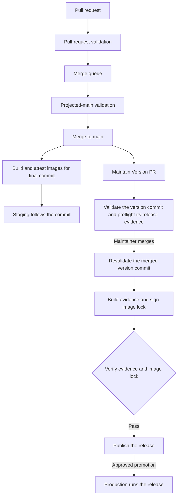

# CI/CD Architecture

Hephaestus uses trunk-based delivery through GitHub's merge queue. Pull requests provide early
feedback, merge groups validate projected `main`, and pushes to `main` produce release images.
Staging follows successful builds of `main` under the [automatic promotion policy](../admin/pull-based-deployment). Production runs a release only after an approved promotion.

:::note[Chart-only release]
These instructions describe the chart-only release.
For a 0.95.x deployment, use that release's versioned instructions and signed assets.
The [0.x upgrade path](/admin/upgrade-to-1-0) requires 0.95.1 and its installed reconciler tooling before the cutover.
:::

## Architecture overview



## Release flow

Every push to `main` publishes signed multi-architecture images for that commit and maintains the
Version PR. Merging the Version PR cuts a release that promotes those images by digest —
[Release management](./release-management.mdx). A pull request builds `linux/amd64` only, so a
push to it does not pay for a second architecture. A merge group builds `linux/amd64` and
`linux/arm64`, so an arm64 build failure or finding is found once per merge, before `main`.
The merge queue squashes, so a merge group's SHA is the commit its push to `main` carries.
That push reuses the images the merge group built and tested instead of building them again —
[Merge-queue image reuse](#merge-queue-image-reuse).

The Version PR's branch is the exception.
Every run builds every release image itself on both architectures, regardless of its start event.
The branch's release evidence preflight requires each image on both published platforms.
It can capture evidence only for images that its run published.

## Quality gates

The local pre-push hook runs the focused checks in `check:push`.
It does not replace the full quality gate or any CI check.
[Local verification](./local-verification.mdx#pre-push-hook) defines its scope and exclusions.

| Job                                                                     | Checks                                                                                                                                                                                                    | Local command                                                            |
| ------------------------------------- | ----------------------------------------------------------------------------- | -------------------------------------------------------------------------------------------------------------------------------------------------------------------------------------------------------------------------------- |
| Quality → App Server | Spotless and PMD, NullAway policy, the test analysis (`gate:server-test-analysis`), the PMD canary when PMD inputs changed, source-use contracts, setting delivery per runtime role. On a pull request that changes Gradle inputs, the verification metadata check | `vp run gate:server`, `gate:java-nullness`, `gate:contracts`, `gate:env`, `node scripts/check-gradle-verification-metadata.ts` |
| Quality → Tooling and Docs                                              | toolchain and agent-runtime pins, the runner and lint contracts, `gate:agents`, load-test format and syntax, agent specs, instruction mirrors, docs format and `docs:lint`, Mermaid parse. The pinned ShellCheck on the shell scripts of `deploy/platform/` | `vp run gate:agents`, `gate:docs`, `test:agents`, `gate:shell`           |
| Quality → Webapp                                                        | `vp check`, presentational components, story prose, docs color tokens, unit tests, Vite build with a `routeTree.gen.ts` diff and the bundle budget                                                                                   | `vp run check:webapp`, `test:webapp`, `build:webapp`                     |
| Quality → Webapp: Stories                                               | Storybook interaction tests, `export:assets` diff, Storybook build, Chromatic                                                                                                                             | `vp run test:webapp:stories`                                             |
| Quality → Extension                                                     | `vp check` for `extension/`, format, unit and story tests, the production zip and its manifest check. Keeps the zip as `extension-chrome-*`                                                               | `vp run ci:extension`                                                    |
| Quality → Windows                                                       | Every gate that needs neither Gradle, Docker nor the agent sandbox, on `windows-latest`, uncached                                                                                                         | `vp run --no-cache ci:windows`                                           |
| Quality → Clean install                                                 | `vp install --frozen-lockfile` on a runner with Node and the launcher and nothing else, then `gate:toolchain` and the hooks path                                                                          | `vp install`                                                             |
| Build → App Server: Package                                             | `./gradlew :application:bootJar :application:testClasses`. Uploads the classes and JARs once                                                                                                              | —                                                                        |
| Build → App Server: Generated artifacts                                 | `generate:api` diff against the packaged JAR. [API compatibility](#api-compatibility) with the previous stable release. `db:check-drift`, which replays `master.xml` and diffs the JPA model. ERD diff | `vp run generate:api`, `gate:api-compatibility`, `db:check-drift`, `db:generate-erd-docs` |
| Build → App Server: Database                                            | Gradle `databaseTest` task against PostgreSQL                                                                                                                                                             | —                                                                        |
| Build → App Server: PostgreSQL drills                                   | `test:postgres-restore`, then `test:postgres-pitr`, in one job beside `databaseTest`. **Re-run failed jobs** repeats both drills                                                                          | `vp run test:postgres-restore`, `test:postgres-pitr`                     |
| Build → Webapp: E2E                                                     | Playwright against the packaged JAR                                                                                                                                                                       | `vp run --filter webapp test:e2e`                                        |
| Build → Extension: E2E                                                  | Playwright with the extension's `e2e` build — not the production zip — against the packaged JAR                                                                                                           | `vp run test:extension:e2e`                                              |
| Test → App Server: Unit and architecture, App Server: Integration       | the package job's compiled classes, without compiling again                                                                                                                                               | `vp run test:server:verification`, `test:server:integration`             |
| Dependency review → New dependency risk                                          | informational dependency review. Pull requests that change a dependency input. Independent of CI Status Gate                                                                                                                                                           | —                                                                        |
| Security → Dependencies, secrets, and policy                            | Trivy filesystem scan, dependency vulnerability gate, TruffleHog, changelog immutability and compatibility guards, legacy-reference guards                                                            | —                                                                        |
| Changesets → Verify changesets                                          | policy tests, verified-revert detection, release-note presence, `MIGRATION.md` freeze                                                                                                                     | `vp run gate:changesets`                                                 |
| Docker → Images, Tag unchanged images                                   | One build job per platform builds every image of the run and scans it. The Dockerfile images use `docker buildx bake`. The App Server image uses `pack build` from the packaged JAR. One manifest job merges, attests and signs them. Aliases for unchanged images           | —                                                                        |
| Actionlint, Zizmor                                                      | workflow lint with ShellCheck warnings. Zizmor at medium confidence                                                                                                                                       | —                                                                        |
| PR → Validate PR                                                        | Conventional Commit title. Every commit’s primary author resolves to the PR author’s GitHub account (including bot accounts) or a listed review-policy maintainer. The PR body follows attribution policy | —                                                                        |

`Build → App Server: Database`, the PostgreSQL drills, both E2E rows and the integration shards are
the queue tier ([Two verification tiers](#two-verification-tiers)).

The browser jobs retain `webapp-e2e-results` and `extension-e2e-results`, each including
`e2e-server.log`, for seven days on success as well as failure. Inspect server startup and shutdown output even when browser assertions
pass. A passing suite does not prove that background work started correctly. Its coverage summary
names credential-gated live checks and their skipped reasons. The ordinary suite is not evidence
of live-provider behavior.

Test checks show totals and failed suites/cases, not an inventory of successful tests. Source-file
lookup runs only when failure annotations are needed. The complete unit, integration, database and
Storybook JUnit reports remain downloadable for fourteen days, including successful runs.

Chromatic
prints warnings/errors alongside the structured visual-coverage summary. Its JUnit report is retained
with the Storybook reports. Do not publish its debug log or diagnostics file: they can contain
credential-bearing signed URLs even when the project token is masked.

Reporter action inputs read `job.status` and explicit continued-step outcomes: status-check functions
such as `failure()` are valid in a step's `if` condition, not in its `with` inputs. The CI contract
parses those input expressions without status functions and tests successful and failed outcomes.

Image builds retain the complete `buildpacks-log` artifact for fourteen days. The console shows a
first example and totals for repeated JVM archive-eligibility exclusions (unsupported location,
already-linked class, signed JAR, JFR event class). These describe classes CDS cannot archive, not
failed application operations. All preload and verification failures remain visible, including
optional framework adapters: a previously investigated class can fail for a different reason after
an update. Unfamiliar diagnostics and archive failures also remain visible. The reporting pipe cannot
change the image build's exit status.

The five quality legs call `ci-quality-leg.yml` independently. Job-level conditions omit unchanged
legs before a runner is allocated. In a pull request, selected legs do not cancel each other on failure.
In a merge group, a failed leg cancels the run: [Fail fast in the merge queue](#fail-fast-in-the-merge-queue).

Each runs `vp run ci:<leg>`, then pipes `vp run --last-details` through `scripts/report-task-run.ts`.
Each task that did not pass gets an error annotation with its reproduction command.
The job summary contains the report, including cache hits and miss reasons.

A leg runs when the change
detection in `cicd.yml` says its scope changed. The Windows leg uses the tooling scope.
Both it and the tooling leg prove the hook dispatcher on rejected and accepted commits.

A pull request that changes only server files, documentation, changesets or `AGENTS.md` and `CLAUDE.md` files usually defers the Windows leg.
This includes the practice catalog and guidance.
Changes to [queue-tier inputs](#two-verification-tiers) still select it before the queue.
Other paths select it when the tooling scope runs.

The merge group keeps the complete Windows leg for that scope.
The `ci:full` label also runs it on the pull request.
An unreadable label or a missing selection output runs it too.
A Windows failure first found in the merge group removes the entry from the queue.

### API compatibility

A browser tab can run the SPA of one release against the server of the next release for days.
The Chrome extension can be older.
Thus, `server/openapi.yaml` must stay compatible with the previous stable release.
`vp run gate:api-compatibility` compares the two specs with
[`oasdiff breaking`](https://github.com/oasdiff/oasdiff/blob/main/docs/BREAKING-CHANGES.md).
It fails on each change at the `ERR` level.
It shows `WARN` changes, but they do not fail it.

- **Where it runs.** `Build → App Server: Generated artifacts` runs it on the spec that the job generates from the packaged JAR.
  The job runs for each pull request and merge group that changes the contracts.
  It also runs for the push of each version commit, which [gates the release](./release-management.mdx#the-flow).
  The release workflow does not run the check again.
- **The base.** The base is the highest `vX.Y.Z` tag on `origin`.
  A release creates its tag only when it is published.
  The pattern does not select a pre-release tag such as `v0.10.0-rc.1`.
  The CI checkout has one commit and no tags, so the script fetches the base tag with `--depth=1`.
  To compare with a different release, add `--base vX.Y.Z`.
- **The tool.** The script downloads oasdiff from its GitHub release into a cache directory that Git ignores.
  Before each use, it verifies the archive against the SHA-256 that `scripts/check-api-compatibility.ts` pins for each platform.
  To update oasdiff, change the version and all checksums together.
  Compare each checksum in the release's `checksums.txt` with the asset digest on the release page.

A new value in a response enum is an `ERR` change, because an older tab cannot show it.
Its vocabulary maps have no text for the value, and its generated schemas reject a Hephaestus live event that carries it.
oasdiff accepts the removal of an operation or parameter that the base release marks `deprecated`.
This agrees with the [deprecation policy](/admin/compatibility-policy#deprecation-policy).

#### Accept a deliberate break

Before 1.0, a release can break the API deliberately.
From 1.0, a break needs a major release.
When the base is `v1.0.0` or later, the gate fails on an entry that accepts a break, unless the change heads for a major release.

Before the Version PR, a pending changeset with `"hephaestus": major` marks the major release.
From the Version PR on, the major of the `package.json` version is higher than the major of the base.
The changeset stays on `main` until the Version PR consumes it.
Thus, other changes can accept breaks for the same major release.

To accept a break:

1. Add the break's line to `server/openapi-accepted-breaks.txt`.
   The line is the message of the gate's annotation in CI: `in API <method> <path> <change text>`.
   The local report shows the same parts on two lines.
   Above it, write a `#` comment with the reason and the pull request.
2. Write a changeset that tells API clients what changed.
   See [Writing changesets](./release-management.mdx#writing-changesets).
   - Before 1.0, use `minor`.
   - From 1.0, use `major`.
     The break must obey the [version numbers](/admin/compatibility-policy#version-numbers) and the [deprecation policy](/admin/compatibility-policy#deprecation-policy) of the compatibility policy.

The diff of the file shows each accepted break in review.

An entry is obsolete when no break against the current base has that line.
This occurs when the release that contains the break is published, because that release becomes the base.
The gate then shows one warning that lists them.
Remove them in your next change to the file.
They do not fail the gate, so a published release does not stop unrelated pull requests.
The Version PR cannot remove them, because its own runs still compare with the previous release.

A published release moves the base, so a run that passed can fail when it runs again, for example in the merge queue.
This occurs when `main` removes an endpoint that the new base added.
List the break or restore the endpoint, then run the job again.

### Merge policy

Pull requests targeting `main` merge through GitHub's merge queue after these GitHub
Actions contexts pass: `CI Status Gate`, `Actionlint`, and `Zizmor`. Required
workflows run again for the merge group, which includes the current base and queued changes ahead of
the pull request. Each required context is bound to the GitHub Actions integration rather than
accepting a same-named external status.

A merge group is a diff, so it selects its jobs from the paths it touches —
[Path filters](#path-filters). It has no `preview` label, so `Build` and `Docker` are filtered there too.
`any-code` is the union of source filters and reaches `docs/**` through the tooling filter.
Thus, a documentation-only group starts `Quality`, `Security`, `Build`, and `Docker`, even when their internal jobs skip.

Read the `CI Status Gate` summary for each prerequisite's result.
It lists every leg, including skipped legs.
Read the `Detect changes` log for filters matched by the diff.

A required context may be filtered because a ruleset accepts a skipped check as satisfied. The check
still reports `skipped`, not `success`. A workflow that never triggers reports nothing.
A pending required context blocks the queue indefinitely.
`merge_group` supports no `paths:` filter, so each job's `if` supplies the filter.

The repository ruleset controls how many merge groups the queue builds in parallel through
`max_entries_to_build`. Read the active value in the ruleset's
[merge queue configuration](https://github.com/hephaestus-build/Hephaestus/rules).
Each group starts a `CI/CD` run. GitHub's
[runner concurrency limits](https://docs.github.com/en/actions/reference/limits#job-concurrency-limits-for-github-hosted-runners)
apply across workflows, so queue parallelism competes with pull-request validation for capacity.

A failed merge group drops its pull requests from the queue without failing their checks.
Thus, CI updates a comment with the run link on the pull request named by the merge group's head ref. It
does not requeue automatically: the result does not say whether the failure was transient or
deterministic. Regrouping the queue cancels the runs it dissolves, and a canceled run is reported
to nobody. A failed group also cancels its own run, but its gate verdict stays `failure`, so CI reports it.

Review is a native ruleset requirement with stale approvals dismissed on every push. Authors listed
in `REVIEW_POLICY_MAINTAINERS` receive an automated approval. Every other author needs a human with
write access, including Renovate. Green checks and Dependency Dashboard approval do not satisfy this
review requirement. Renovate includes that reminder in each pull request's body.

Repository
administrators own the allow-list. Do not add dependency bots to it. Remove the automation when
independent maintainer review is available.

After approving the current commit, the workflow attempts
to minimize superseded automatic reviews. A minimization failure is a warning, not a failed approval.

The approval workflow runs on `pull_request_target` with `pull-requests: write`. It loads the evaluator
from `scripts/` on the default branch, reads current pull-request metadata and reviews from GitHub,
and executes no pull-request code. An empty allow-list approves nobody.

It has no `branches:` filter.
A stacked layer gets approval while it still targets the layer below.
After that layer merges, retargeting to `main` must not depend on another event. The `edited` trigger also
re-evaluates explicit base changes.

A merge group uses a synthetic ref, not the Version PR branch name. If its aggregate tree changes `package.json`'s version relative to the group's base, it is a release candidate.
It builds every release image on both platforms and must pass release evidence preflight on that exact tree.
Missing base/version data fails detection rather than silently skipping release validation.

The Version PR is maintained after CI/CD succeeds for the current tip of `main`. Failed or
overtaken main runs do not update it. It carries checks like any other pull request.
Its updates use `GITHUB_TOKEN`. GitHub creates approval-required workflow runs for
[`pull_request` opened, synchronize and reopened events triggered by that token](https://docs.github.com/en/actions/how-tos/write-workflows/choose-when-workflows-run/trigger-a-workflow#triggering-a-workflow-from-a-workflow).
Nothing dispatches CI/CD onto the Version PR automatically.

When GitHub requests approval for the pull request's run, approve that run.
If a run fails, rerun its failed jobs. Nothing retries a failure automatically.

Maintaining an unchanged head need not start another run.
If the current head has no run, or only cancelled runs, dispatch one deliberately:

```bash
gh workflow run cicd.yml --ref changeset-release/main -f release-preflight=true
```

A cancelled run cannot authorize a release.
The pull request's run and a dispatch on its branch share one concurrency lane, so a newer run cancels an active one.
Dispatch only when no run for the head is active or awaiting approval.

Either run reports `CI Status Gate` on the branch head, which is the pull request's head commit, and requires its own release evidence preflight.
Thus, validation precedes the merge that cuts a release.

`Verify changesets`
is the one leg it skips, and deliberately: the Version PR is the pull request that consumes
changesets rather than adding one. [Release management](./release-management.mdx#the-flow).

### Fail fast in the merge queue

The queue removes an entry only when a required check fails.
`CI Status Gate` needs every leg, so it cannot fail before the slowest leg ends.
Two rules end a failed merge group early and free its runners.
Neither rule applies to a pull request, which still reports the failure of every leg.

**A failed worker cancels the run.**
Each build, test and quality worker has a dependent job that calls `fail-fast.yml` if the worker fails in a merge group.
That job needs only its worker, so it starts without waiting for other workers in the workflow.
The test, image-platform and cluster matrices are on the reusable-workflow callers.
Each invocation has one selected worker, so a failed matrix entry can cancel the run before the other entries finish.

The caller's matrix uses `fail-fast: false`.
The isolated helper cancels a merge group, and other events collect every result.
Matrix callers have explicit shard or platform names.
Artifact lookup and latency reporting recognize both the previous names and these names.
They require the caller and worker to identify the same shard or platform.

- The condition starts with `always()`. Without a status function, GitHub adds `success()`, which is false after a failed worker.
- The helper runs `gh run cancel` on its own run. Queued jobs do not start, and running jobs stop.
- `CI Status Gate` has `if: always()`, so it still runs after the cancel and fails.
- A cancelled reusable caller can contain a failed worker. The gate reads native job conclusions for the current run attempt to preserve the failure verdict. If this read fails, the gate fails.
- The outer `fail-fast-<leg>` jobs in `cicd.yml` also cover failures at a caller boundary. The gate does not wait for cancel jobs. The ruleset requires `CI Status Gate`, `Actionlint` and `Zizmor`.
- `Security` and `Changesets` never run in a merge group, so they have no cancel job.

After the cancel, `cancelled()` is true for the whole run.
Thus, `Report unsuccessful merge group` reads the gate's `verdict` output, not `cancelled()`.
A leg can also fail while a regroup cancels the run. Thus, the reporter comments only after the queue dropped the entry, and it waits up to two minutes for that.
A run that cancelled itself after a failed leg has the verdict `failure`, so the reporter is meant to comment on the pull request.
A run that a regroup cancelled has the verdict `cancelled`, and CI does not comment.

The merge-queue experiment did not exercise the reporter after a cancel. The first failed merge group on `main` confirms it.
The gate does not publish the `All CI Passed` status after a cancel.
No ruleset requires that status.

**The cheap legs run first.**
In a merge group, the heavy legs start only after `Security / Dependencies, secrets, and policy` succeeded or skipped.
The heavy legs are `App Server: Package`, `Quality`, `Test` and `Docker`.
`Build`, `Kubernetes` and `Release evidence preflight` wait through `App Server: Package` or `Docker`.
Thus, an advisory against the whole base ends the group before a heavy leg takes a runner.
`Actionlint`, `Zizmor`, `Image advisory database` and `Pinned upstream images` run beside `Security`.

A `needs` list cannot change with the event.
Thus, the scan has two jobs with the same name, `Security`.
The `Security` job runs in every event except a merge group, and no leg waits for it.
The `Security-merge-group` job runs only in a merge group, and the heavy legs need it.
In other events it skips when `Detect changes` ends, so a pull request or a push does not wait.
A healthy merge group pays the duration of `Security` on its critical path, about 1 to 2 minutes.

**Never force-cancel a merge-group run.**
A force-cancel skips the `always()` jobs, so `CI Status Gate` never reports.
The queue then keeps the entry with no verdict until its check timeout.
Use only the graceful cancel of `fail-fast.yml`.

**Only the cancel jobs can write to Actions.**
The `actions: write` permission also lets a job dispatch workflows, rerun runs and delete caches.
Reusable-workflow callers forward this permission to the helper.
A call job sets a permission ceiling.
Each build and test worker sets its own narrower permissions.
Only the worker in `fail-fast.yml` receives a token that can cancel runs.

That job runs on `ubuntu-slim`, with no checkout and no action, so no other code holds the token.
Each workflow keeps `permissions: {}` at the top level.
`ACTIONS_WRITE_GRANTS` in `scripts/ci-contract.test.ts` lists each other job with this permission, and the reason.

The cancel job needs a runner, so a busy runner pool adds its wait to the eviction time.

**Eviction time.**
In the merge-queue experiment, the time from the first failed leg to the removal of the entry was 1 minute 27 seconds.
With a busy runner pool it was 4 minutes 9 seconds, because the cancel job waited for a runner.
Without the cancel jobs it was about 6 minutes, and on `main` the gate failed 13 to 19 minutes after the first failed leg.
The time on `main` is not measured yet.
Record it here from the first merge group that fails after this rule reached `main`.

`scripts/ci-contract.test.ts` holds each rule:

- Each leg that runs in a merge group has its cancel job, for merge groups only.
  The job's condition has `always()` and the leg's `failure` result.
- No workflow, action or script force-cancels a run.
- Only the cancel jobs, and the listed exceptions, have `actions: write`.
- The heavy legs wait for `Security-merge-group` in a merge group, and for no scan in other events.
- The reporter reads the gate's `verdict` output.

## Security and supply-chain controls

[Supply-chain security in CI](./supply-chain-security.md) lists each control, when it runs, what it blocks, and where it reports.

### Gradle dependency inventory and the Vulnerabilities exclusion

[Supply-chain security in CI](./supply-chain-security.md#gradle-dependency-inventory-and-the-vulnerabilities-exclusion) owns this exclusion.

## Environments

| Environment       | Eligibility                                 | Deploys on                        | Approval          |
| ----------------- | ------------------------------------------- | --------------------------------- | ----------------- |
| Staging           | qualified commits of `main`                 | automatic promotion policy        | none              |
| Production        | a published release                         | manual promotion                  | required reviewer |

After each successful `main` push, `continuous-staging.yml` dispatches one automatic **Release / Promote** run for Staging and ends.
That run decides, signs, publishes and observes the promotion in one job, so a promotion waits for one runner.
Its conclusion and the Staging deployment record report the outcome.
GitHub notifies nobody of a run that `GITHUB_TOKEN` dispatched.
Thus, a failed automatic promotion opens the **Staging did not follow main** issue, or comments on it while it is open.
Close it after triage.

### GitHub environment setup

1. **Settings → Environments → New environment**
2. Create `Staging`. Limit its deployment branches to protected branches.
3. Create `Production` with **Required reviewers**. Limit its deployment branches to protected branches.
4. Do not add a custom deployment protection rule.
   `promote.yml` records its own deployment and sets `deployment: false`.
   A custom rule needs the record that this setting stops, so the job would fail.

The reconciler applies one Helm chart.
The chart's [migration Job](/admin/runtime-roles#database-migrations) applies the schema. The server and worker roles wait until the database holds their change sets. The webhook role does not wait. Helm does not enforce a stopped cutover: [Recover a stopped cutover](/admin/pull-based-deployment#recover-a-stopped-cutover) gives that procedure.
The [one-host platform](/admin/kubernetes#install-on-one-host-k3s) owns ports 80 and 443.

## The `preview` label

The label builds images only.
There is no deployed preview until previews move to the staging cluster.

On a same-repository pull request, the label makes CI build, scan and publish every image at the head commit.
Without it, CI builds a pull request's images only for the Kubernetes cluster jobs or release evidence.
The merge group builds every other changed image before it lands.
Thus, the label shows an image build or scan failure on the pull request, before the merge queue finds it.
`Detect changes` reads the label live, as for `ci:full` ([Two verification tiers](#two-verification-tiers)).
If it cannot read the label, a pull request that is not a draft builds its images.

If you add the label after the run started, use **Re-run all jobs** on that run, or push a commit.
**Re-run failed jobs** keeps the earlier `Detect changes` result, so it does not see the label.

`Docker` rebuilds images whose inputs changed.
Its `Tag unchanged images` job aliases the base commit's verified digests for the rest.
Thus, every image exists at the head SHA.

An alias is never release evidence.
If the base commit's image is still publishing, it uses the merged pull request's candidate, which carries only `linux/amd64`.
Either way, the alias is an image that another commit's run built.
That is why the Version PR's branch builds every image itself instead.

A draft with the label also builds its images.

## Workflows

Each display name starts with its area: `CI`, `Release`, `Security`, `Docs`, `Cache` or `Repo`, as in `Release / Promote`.
The Actions sidebar sorts by name, so it groups each area.
A workflow that a `workflow_run` trigger names keeps its name, because the trigger matches the display name. So `cicd.yml` stays `CI/CD`.
The required checks are job names, so a display name does not change them.

| Workflow                              | Trigger                                                                       | Purpose                                                                                                                                                                                                                          |
| ------------------------------------- | ----------------------------------------------------------------------------- | -------------------------------------------------------------------------------------------------------------------------------------------------------------------------------------------------------------------------------- |
| `cicd.yml`                            | PR, merge group, push to main, manual                                         | Validates changes before merge and publishes final-SHA images after merge. The release evidence gate runs over the images the run built on the Version PR's branch, and wherever the `release-preflight` dispatch input asks for it |
| `review-policy.yml`                   | PR opened, reopened, synchronized, ready for review, edited                   | Approves a listed maintainer's pull request so the ruleset's required approval is met. Does nothing for anyone else                                                                                                              |
| `pull-request.yml`                    | PR opened, edited, synchronized, reopened, ready for review                   | Validates the title against the exported policy in `commitlint.config.ts`, without installing the workspace. Applies the commit identity policy in the checks table above. Assigns the author when the pull request opens        |
| `ci-quality-gates.yml`                | Called by cicd.yml                                                            | Selects quality legs, clean-install verification and story tests                                                                                                                                                                 |
| `ci-quality-leg.yml`                  | Called by ci-quality-gates.yml                                                | Shared formatting, lint, type-check and unit-test execution for each selected task-graph leg                                                                                                                                     |
| `cache-toolchain.yml`                 | Main push changing install inputs or setup                                    | Seeds trusted Linux and Windows install caches without repeating quality gates                                                                                                                                                   |
| `cache-gradle.yml`                    | Main push changing Gradle inputs, or dispatch                                 | The only Gradle cache producer: builds what the server jobs restore                                                                                                                                                              |
| `ci-build.yml`                        | Called by cicd.yml                                                            | Runs the OpenAPI, schema, database and browser E2E gates against the server artifact packaged by cicd.yml                                                                                                                        |
| `ci-tests.yml`                        | Called by cicd.yml                                                            | The server unit, architecture and integration suites, on the package job's compiled classes                                                                                                                                     |
| `ci-docker-build.yml`                 | Called by cicd.yml                                                            | Every image build of the run (App Server, webapp, agent, PostgreSQL) and aliases for unchanged images                                                                                                                            |
| `reusable-docker-build.yml`           | Called by ci-docker-build.yml                                                 | Builds every requested image in one job per platform, natively, and blocks on the release vulnerability policy there. One job merges each index, attests, signs and tags it                                                       |
| `ci-security-scan.yml`                | Called by cicd.yml                                                            | Trivy dependency scan, secret detection and repository policy checks                                                                                                                                                             |
| `dependency-review.yml`               | PR changing a dependency input                                                | Reports introduced dependency advisories independently of the required CI verdict                                                                                                                                                |
| `dependency-graph.yml`                | PR changing a dependency input, push to main                                  | Resolves and uploads the verified Gradle dependency graph with read-only permissions                                                                                                                                             |
| `submit-dependency-graph.yml`         | Successful dependency-graph workflow                                          | Submits snapshot data without executing code from the originating run                                                                                                                                                            |
| `verify-changesets.yml`               | Called by cicd.yml                                                            | Tests changeset and version-sync policy and enforces release-note presence                                                                                                                                                       |
| `fail-fast.yml`                       | Called by cicd.yml when a leg of a merge group fails                          | Cancels the run gracefully, so the gate still fails and the queue removes the entry. See [Fail fast in the merge queue](#fail-fast-in-the-merge-queue)                                                                           |
| `openapi-autocommit.yml`              | `autocommit-openapi` label                                                    | Regenerates the OpenAPI spec and client and commits them to the pull request                                                                                                                                                     |
| `security-mutation.yml`               | PR touching the suite's inputs, manual                                        | Runs the security mutation suite                                                                                                                                                                                                 |
| `practice-guidance-links.yml`         | PR touching practice guidance, weekly, manual                                 | Checks the web links in bundled practice guides                                                                                                                                                                                  |
| `scorecard.yml`                       | Push to main, branch-protection change, weekly                                | Publishes the OpenSSF Scorecard                                                                                                                                                                                                  |
| `semgrep.yml`                         | Pull request, push to main                                                    | Tests and scans the repository's own TLS rule pack                                                                                                                                                                               |
| `kubernetes-nightly.yml`              | Nightly, manual                                                               | Runs every Kubernetes leg and the sandbox footprint benchmark on the newest main build that passed CI, with its chart and agent image. Reports a failure on one tracking issue                                              |
| `rescan-images.yml`                   | Weekly, manual                                                                | Rescans main's published images against the release vulnerability policy and keeps one tracking issue in step with the findings. A second job rescans the latest published release's images and reports drift on the vulnerability response issue|
| `ci-diagnostics.yml`                  | Completed CI/CD runs                                                          | Reports exact-attempt job and step timings without changing the required CI verdict                                                                                                                                              |
| `ci-profile.yml`                      | Weekly, manual                                                                | Reports advisory performance budgets and profiles server test tiers                                                                                                                                                              |
| `delivery-metrics.yml`                | Weekly, manual                                                                | Reports lead time, deployment frequency, and change fail, recovery and rework proxies. See [Delivery Metrics](./delivery-metrics.mdx)                                                                                                 |
| `ci-server-clean-reference.yml`       | Weekly, manual                                                                | Records cold server phases and compares generated JARs                                                                                                                                                                           |
| `scorecard-ratchet.yml`               | Push to main, branch-protection change, weekly, manual                        | Fails when a Scorecard check drops below the committed baseline. A push fails only for the checks its own commit decides                                                                                                         |
| `cd-docs.yml`, `cd-docs-teardown.yml` | `docs/**` on push and pull requests. PR closed                                | Publishes the docs site and its pull-request previews                                                                                                                                                                            |
| `version-pr.yml`                      | Successful CI/CD completion for the current main tip                          | Maintains the accumulating Version PR (changesets). Its own pull-request CI/CD run, release evidence preflight included, validates it                                                                                            |
| `release.yml`                         | Successful CI/CD push on `main`                                               | Publishes the release and promotes the moving series and latest image tags                                                                                                                                                       |
| `release-upgrade.yml`                 | Called by `release.yml`, weekly                                               | Boots the previous stable release with seeded data, then the candidate against the same database. See [Seeded release upgrade](./database-migration#ci-validation) |
| `promote.yml`                         | Manual dispatch, or automatically for staging                                 | Records the GitHub deployment of the promoted source and signs the channel a host follows. Hosts pull and apply it themselves                                                                                                    |

### Commits a workflow makes

Actions holds no signing key, so a commit pushed with `git` from a workflow is unsigned and a
required-signature rule rejects it. Every automated commit here uses GitHub's `createCommitOnBranch` mutation, which GitHub signs.
`changesets/action` uses the same path for the Version PR, and Renovate uses it for dependency bumps.
`scripts/commit-via-api.ts` is the one caller: `openapi-autocommit.yml` commits the regenerated spec
and client to the pull request's branch through it, and `promote.yml` commits the channel to
`deploy-state`. `scripts/ci-contract.test.ts` fails any workflow that pushes to a real ref.

The mutation carries whole file contents, not a diff.
Thus, the script enumerates every added, modified, or deleted work-tree path and sends each complete file. A rename is its source
deleted and its destination added. It commits against the head used for the work-tree comparison.
If the branch has moved, the run fails instead of overwriting the new changes. The
credential is still `GITHUB_TOKEN`, so these commits start no further workflow run.

### Shared setup actions

| Action                         | Contract                                                                                                                                                                                                                                                                                                                                                                                                                                               |
| ---------------- | ------------------------------------------------------------------------------------------------------------------------------------------------------------------------------------------------------------ |
| `setup-toolchain`              | Installs the Node.js version pinned in `package.json`. With `install` set to `none`, it installs nothing else, so `node scripts/…` jobs reach no package registry. `frozen` adds pinned pnpm and restores its store cache. It caches the pnpm executable by platform and version, with two download retries on a miss. After the frozen install, it checks that the installed `vite-plus` is the version that `package.json` pins. Then it puts the lockfile's `vp` on `PATH`. Only the clean-install job installs the global launcher |
| `setup-caches`                 | Sets up the JDK from `.java-version`, validates the wrapper and uses the official Gradle action for dependency and build caches. The trusted package job publishes caches. Consumers are read-only                                                                                                                                                                                                                                                     |
| `restore-server-build`         | Downloads and validates the packaged JARs, compiled tests and resources. Outputs the executable JAR path without recompiling or installing local artifacts                                                                                                                                                                                                                                                                                             |
| `setup-browsers`               | Restores the exact Playwright browser version and installs Chromium system dependencies                                                                                                                                                                                                                                                                                                                                                                |
| `setup-release-security-tools` | Installs Cosign, Trivy, and optionally Syft for release-evidence jobs                                                                                                                                                                                                                                                                                                                                                                                  |
| `download-trivy-db`            | Downloads with retries and mirror fallback, or restores the CI run's immutable advisory artifact. Checks freshness at consumption and records metadata as requested — [database identity](./vulnerability-remediation.mdx#advisory-database-identity) owns the rerun contract                                                                                                                                                                          |
| `ghcr-login`                   | Authenticates Docker to GHCR                                                                                                                                                                                                                                                                                                                                                                                                                           |

Browser jobs install Playwright's system dependencies using the runner's Ubuntu package sources,
with APT configuration scoped to that installation process. Unrelated vendor repositories do not
participate. Repository signatures and package hashes remain enforced. The pinned Playwright CLI
then installs Chromium as the runner user so the browser cache retains its normal ownership.

Repository-local actions require checkout first. Jobs without checkout use the external SHA-pinned
action directly rather than checking out the repository only to reach a wrapper. The reusable
image builder also uses the external login action because its registry is a caller input, whereas
`ghcr-login` intentionally authenticates only to GHCR.

Browser E2E boots the packaged JAR without
Gradle, so it sets up Java directly. OpenAPI autocommit builds the JAR and uses `setup-caches`.

Commit, branch and pull request image tags are published only after their immutable digest passes
signature and provenance verification. Index assembly uses a run-specific staging tag. Final tag
publication preserves the verified digest.

Image verification stays beside publishing. The merge job signs recursively, then verifies the
index. The alias job verifies each immutable subject before moving its tags. Merge and alias jobs
need no checkout or repository toolchain just to verify registry evidence.
Provenance verification reads attestation bundles from the image registry and keeps the existing
identity and predicate policy.

`scripts/ci-provenance.test.ts` executes all three shell paths and pins
the same repository/workflow signature identity, GitHub OIDC issuer and owner-constrained
attestation verification, including rejection before alias publication. Signing remains in
`reusable-docker-build.yml`, so a refactor cannot silently change the certificate identity.

### Caches

A run restores caches from its own branch and from `main`, never from a sibling branch. Task-cache
entries are content-addressed, so a pull request saves them for its own reruns.

`cache-gradle.yml` is the only Gradle cache producer. Every other job is a read-only consumer.
The producer runs after a main push changes a Gradle input. The inputs are the build scripts, the
lockfiles, the version catalog, the wrapper, the generated-client sources and the JDK pin.

The producer resolves every dependency configuration of the server build. It also runs the Gradle work of the
server jobs: packaging, the test classes, Spotless, PMD and a test inventory that does not execute tests.
The Gradle action keeps only what a job used, so this producer uses everything a consumer can need.

A main push does not build the server, because it reuses the merge group's packaged server (§ Build once).
Thus, without this producer, nothing would refresh the dependencies that consumers restore.
Consumers would download them from Maven Central in every job.

The Gradle action prefers an older entry of the same job to a newer entry of another job
([restore order](https://github.com/gradle/actions/blob/v6.3.0/docs/setup-gradle.md#finding-a-matching-cache-entry)).
Thus, a second writer would pin consumers to its stale snapshot, even if it writes only when reuse fails.

The pnpm executable cache also saves only from `main`. The JDK is pinned once, in `.java-version`.

The package store and pnpm's lockfile-verification cache are separate. `setup-toolchain` also restores
`lockfile-verified.jsonl` from the directory reported by `pnpm cache path`. Without it, a warm store
still needs registry metadata for release-age and resolution checks. Only successful default-branch
push installs publish this record, keyed by platform, pnpm
version, lockfile, workspace policy and any repository `.npmrc`. pnpm's [native verification cache](https://github.com/pnpm/pnpm/blob/v12.3.4/pnpm/crates/lockfile-verification/src/cache.rs)
validates the content and policy before reusing a verdict.

The frozen install still runs with scripts
disabled and package integrity checks intact. A miss performs normal verification, not an offline
fallback.

The action verifies the native cache file exists on each runner, including Windows. A
changed upstream cache contract must be reviewed rather than silently losing reuse.

Registry
metadata itself is not cached by this action. A dependency update is cold under its new key. Only
later runs with the same inputs can reuse the default branch's verdict.

`cache-toolchain.yml` performs a frozen install on Linux and Windows after a main-branch push changes
these inputs or the setup workflow/action. Ordinary main CI skips quality legs, so this dedicated
producer keeps both platforms warm without duplicating their gates. It is separate from release
validation: a failed or expired cache is a normal cold install, not a reason to block a release.

Rerunning the original main-push cache workflow can replenish an expired entry. Manual dispatch and
pull requests cannot publish verification verdicts.

Java quality verdicts are not stored in the Vite task cache: Gradle owns their task inputs and outputs.
GraphQL generation opts into Gradle's build cache using the plugin's declared inputs and outputs.
Its optional timestamped `@Generated` class marker is disabled so unchanged schemas produce identical
sources and compilation can also be restored. Test tasks always execute. Their results are not cached.
The [local verification contract](./local-verification.mdx#java-checks-and-caching) describes the shared
local/CI command and how to distinguish Vite, Gradle build and Gradle configuration caches.

Gradle's official action explicitly uses its [enhanced cache provider](https://github.com/gradle/actions/blob/v6.3.0/docs/setup-gradle.md#enhanced-caching).
Its proprietary caching helper is [free for public repositories](https://github.com/gradle/actions/blob/v6.3.0/DISTRIBUTION.md).
It retains dependency fallback and deduplicated build outputs. The OSS basic provider's immutable,
exact-match cache cannot refresh build outputs after source-only changes. Configuration-cache
reuse remains within a job: no encryption key is configured, so the
action does not persist configuration-cache entries across jobs.

## Two verification tiers

A pull request runs the **fast tier**. A merge group, a push and a dispatch also run the **queue tier**.
`detect-changes` publishes the decision once as `queue-tier`, and each queue-tier job adds it to its path condition.

| Tier | Jobs |
| ---------------- | ------------------------------------------------------------------------------------------------------------------------------------------------------------------------------------------------------------ |
| Fast (pull request and queue) | Detect changes, the quality legs, unit and architecture tests, packaging, generated-artifact drift, [the images it needs](#the-preview-label), Security, Changesets, Actionlint, Zizmor |
| Queue (merge group, push, dispatch) | the integration shards, the database contract tests, the PostgreSQL drills, webapp and extension E2E |

Path filters and the main-push rules in [Path filters](#path-filters) still select within each tier.
Kubernetes qualification stays on same-repository pull requests, because it boots this run's own images. A draft does not select it.

Main changes only through the merge queue, and the queue runs the required checks on the merged result
([GitHub: managing a merge queue](https://docs.github.com/en/repositories/configuring-branches-and-merges-in-your-repository/configuring-pull-request-merges/managing-a-merge-queue)).
bors and Prow's Tide apply the same rule. They test the merge candidate and advance the branch only when it passes
([Rust forge: bors and rollups](https://forge.rust-lang.org/release/rollups.html),
[Tide](https://docs.prow.k8s.io/docs/components/core/tide/maintainers/)).
Thus, the queue tier guards main for every change, and a pull request does not repeat it.

Google's presubmit applies the same split. It runs only fast, reliable tests before submission and the larger tests after
([Software Engineering at Google, ch. 23](https://abseil.io/resources/swe-book/html/ch23.html)).

When both tiers ran on each pull request, a merged change paid for the queue tier twice.
The queue tier is most of a run's runner time, and GitHub's runner concurrency limit is shared by the queue and every pull request.

A queue-tier failure removes the entry from the queue, and the failure comment links the run.
So does an image build or scan failure, because a pull request builds images only for the `preview` label, Kubernetes qualification or release evidence.
Fix the failure and queue the pull request again.

A draft pull request runs the fast tier and builds no image. So it gets no cluster qualification and no image
scan. The `preview` label still builds its images, and a release candidate always builds its evidence.

For a draft, the automatic queue tier for the tier's own inputs is off, but `ci:full` still opts in.
`CI Status Gate` still reports, so required checks resolve on a draft.
Marking the pull request ready for review (`ready_for_review`) starts an ordinary pull-request run,
with the images that such a run builds ([The `preview` label](#the-preview-label)). That run is never skipped as a duplicate of the draft's run.
A re-run replays the event of its run, so a re-run of a draft's run builds no image, even after
the pull request is ready. Re-run the ready run instead.

A pull request that is not a draft also runs the queue tier when it changes the tier's own inputs.
These inputs are the workflows and actions that define the tier and the database migrations.
They also include the server build script, which defines the shards and test tasks, and the browser
suites' specs and configuration. A changed integration test or server class is not such an input, so its integration
tests first run in the merge queue.

To get the queue tier for any other change before you queue it, add the `ci:full` label to the pull request.
Then push, or use **Re-run all jobs** on the latest CI/CD run.
**Re-run failed jobs** keeps the earlier `Detect changes` result, so it does not see the label.
`Detect changes` reads the label from the pull request when it runs, not from the event.
A label read that fails runs the queue tier.

There is no `labeled` trigger, because a label event would cancel the running CI.
A run whose jobs all skip would also report **CI Status Gate** as passed on the head commit.
That report would replace the verdict of the run that it cancelled.
Locally, these commands run the queue tier's suites:

- `vp run test:server:integration` for the integration shards.
- The database contract tests: from `server/`, `./gradlew :application:databaseTest` with the `SPRING_DATASOURCE_*` settings of a running PostgreSQL (`server/AGENTS.md` § Test tiers).
- `vp run test:postgres-restore` and `vp run test:postgres-pitr` for the drills.
- `vp run --filter webapp test:e2e` and `vp run test:extension:e2e` for the browser suites.

**Revert criterion.** [`report:ci-latency`](#full-verification-latency) reports the share of merge
groups in the last 14 days in which a queue-tier job failed. It counts the groups in which only
fast-tier jobs failed apart, and it gives no share for fewer than 20 groups. If the queue-tier share exceeds 10 %, the queue tier is catching too much that a pull request
should have caught. Then run the queue tier on pull requests again: change `queue-tier` in
`detect-changes` to `true` for every event.

## Path filters

The `kubernetes` filter includes `docker/**`, `application*.yml`, `*Properties.java` and `Application.java`.
`ci-contract.test.ts` checks that it covers every configuration-binding source.

`detect-changes` in `cicd.yml` selects legs from changed paths for two diff events.
A pull request compares with its base.
A merge group compares `merge_group.base_sha..head_sha`. A
push to `main` and a dispatch publish `unfiltered` selection flags rather than filtering a diff.

Selection does not override outer event guards.
Ordinary main pushes omit Quality, Test, Security, Actionlint, and Zizmor.
They skip API, schema, database, and browser jobs inside `Build`.

Release-version pushes repeat those checks. Main still packages and publishes images.

A same-repository pull request with the `preview` label, or with Kubernetes qualification, also runs `Build` and `Docker` regardless of paths.
The label and the cluster tests need every image at the head SHA. No other event reads the label.
Any other pull request builds no image. The merge group builds every changed image before it lands.

| Selects                    | Paths                                                                                                                                                                                                                                                                                                                                                                                                                             |
| ---------------- | ------------------------------------------------------------------------------------------------------------------------------------------------------------------------------------------------------------ |
| Quality → Webapp           | `webapp/**`, `docs/images/readme/**`, `docs/src/css/custom.css`, the root oxlint and oxfmt configs, the four `scripts/check-*` files it runs, root package files                                                                                                                                                                                                                                                                  |
| Quality → Extension        | `extension/**`. Webapp files imported by path: vocabulary registries, trace formatting, status definitions, sign-in providers, text helpers, and their imports. Webapp lint plugin and stylesheet. Root oxlint and oxfmt configs, `scripts/install-browser-deps.ts`, and root package files                                                                                                                                       |
| Quality → App Server       | `server/**` except `AGENTS.md` and `CLAUDE.md`, `scripts/run-gradlew.ts`, `scripts/check-gradle-verification-metadata.ts`, root package files                                                                                                                                                                                                                                                                                     |
| Quality → Tooling and Docs | `scripts/**`, `docker/agents/**`, `load-tests/**`, `docs/**`, tsconfigs, oxlint and oxfmt configs, `.changeset/**`, `commitlint.config.ts`, instruction files, `.github/renovate.json`                                                                                                                                                                                                                               |
| Every quality leg          | `vite.config.ts`, `scripts/lib/push-gates.ts`, `.vite-hooks/**`, `.java-version`, `cicd.yml`, `ci-quality-gates.yml`, `ci-quality-leg.yml` and the setup actions: the task graph, the hooks and the JDK decide every leg's verdict, so a change to one runs all of them                                                                                                                                                                                        |
| Build artifact gates       | contracts: the App Server paths, `docker/postgres/**`, or either generated client and its generator config (`api-clients`). E2E: webapp source and the server main sources. Extension E2E: `extension/**`, the vocabulary registries and the server main sources. Image: `server/application/src/main/**`, the Gradle build scripts, catalog, locks and wrapper, `server/application/project.toml`, `server/generated-clients/**` |
| Docker images              | `webapp-image`: the webapp build inputs and non-test source. `agent-images`: `docker/agents/**`. `postgres-image`: `docker/postgres/**`                                                                                                                                                                                                                                                                                           |
| CI config                  | one filter per leg naming its own workflow files and actions. Any `.github/workflows/**` or `.github/actions/**` change runs Actionlint and Zizmor                                                                                                                                                                                                                                                                                |

`docker/agents/**` is in both the tooling and the agent-image filters: `test:agents` and
`typecheck:agents` cover the practice script tree, and the same tree builds the agent image.

## Docker layer caching

The Dockerfile images are targets of `docker/docker-bake.hcl`, built for one platform in one `docker buildx bake` call.
Each imports `<image>:cache-main-<platform>` from `ghcr.io`.
Only pushes to `main` and merge groups write it, with every intermediate layer.
A pull request reuses those layers and writes nothing.

amd64 builds on `ubuntu-24.04`, arm64 on `ubuntu-24.04-arm`. No emulation. The App Server
image, built with Buildpacks, does not use this cache. Dockerfile builds always bypass the cache for
the `os-packages` and exported `runtime` stages. [OS package updates](vulnerability-remediation.mdx#os-package-updates-in-first-party-images)
owns that contract and the local build commands.

## Registry authentication

Image builds authenticate to `ghcr.io` with the workflow's `GITHUB_TOKEN`. Base images are pulled from
Docker Hub anonymously, which
[GitHub-hosted runners may do without a rate limit](https://docs.github.com/en/actions/reference/limits).
A job that reads a first-party image back — the scan, the preflight, the cluster tests — logs in as
well, because `packages: read` alone buys nothing.

A pull request from a fork gets a read-only `GITHUB_TOKEN`, so `cicd.yml` passes `publish: false`
to both image workflows. That build compiles the image and stops: no login, no push, no signature,
no attestation, no policy scan and no alias moves. Forks therefore get no published images and no cluster qualification.
The release path exercises their code once it is on `main`.

When release preflight is required, it owns image vulnerability scanning for both architectures.
The image-build workflows omit their duplicate scans. Other published builds scan every platform
they built. Each platform retains its own report and policy result. The final gate rejects a required preflight that is skipped, canceled or unsuccessful.

Each platform's build job scans the digest it pushed, on its own runner, before it hands that digest to the manifest job.
The manifest job needs every build, so only scanned digests reach an index.
Before publishing verified tags, it checks that the final index leaves equal those scanned subjects.
A scan therefore costs no job and no runner queue wait of its own.
It does not run in the manifest job, because that job holds the signing token and runs no repository code.

The build matrix does not fail fast, so one platform's refusal keeps the other platform's scan and evidence.
A broken build thus lets its sibling finish, which costs a runner for that time.

The scan resolves the immutable image reference through
`scripts/resolve-image-scan-subject.ts`, using the same platform resolver in `scripts/lib/image-scan.ts` as scheduled rescans. An index must
contain the requested platform. A missing platform or malformed index fails instead of falling back
to whichever architecture the scanner's host would choose. A single manifest is resolved through
that same immutable reference.

## Image identity

Every consumer resolves an image through its build commit.
`reusable-docker-build.yml` publishes exactly that tag for the run's start event.
Pushes, dispatches, and merge groups use `github.sha`.
A push that reuses its merge group's image publishes the same digest under that tag.
Pull requests use their head SHA because `github.sha` is a merge commit with no image tag.

Within a run, the vulnerability scan ignores tags.
It reads the digest that its own build job exported.
Re-running a failed build job builds and scans the platform again, and the manifest job reads that new digest.

`ci-contract.test.ts` asserts the whole contract.
The build must publish every consumer-resolved tag for that consumer's event.
No job resolves an image by the run that built it. A run-scoped tag names the attempt rather than the artifact, and GitHub's *re-run failed jobs*
gives the retried job a new attempt number.

## Build once

`App Server: Package` in `cicd.yml` packages the server once and uploads its JARs, compiled tests and resources. OpenAPI and
browser checks boot that executable JAR. Buildpacks consume it without another build. Schema gates,
database contract tests and the `Test` suites use the restored classes with `-PpackagedServer=true`,
which bypasses compilation. `ci-tests.yml` sets it as `ORG_GRADLE_PROJECT_packagedServer`, because
its commands are `vp run` tasks. Thus, every server suite tests the classes that the JAR ships.

The suites never compile. Test compilation is the slowest server build step, and it is rarely a
cache hit. A change alters the test sources or the main classes they compile against.
So the suites wait for packaging rather than compile the same sources in each of their jobs.
The package artifact is kept for one day, so a failed job re-run after that day fails on its download.
Re-run all jobs instead.

The package job compiles the tests without Error Prone and NullAway (`-PtestAnalysis=false`).
The analysis can fail the build, but it does not change the bytecode that javac writes.
Thus, the suites start sooner and still test the same classes.

The server quality leg compiles the tests with the analysis (`gate:server-test-analysis`), and a finding fails that leg.
That leg runs whenever a Java compile input can change: `server/**`, `.java-version` or the setup actions.
A push to `main` runs Quality only for a version bump. Its merge group ran the analysis on the same tree.
Locally, every server test task compiles the tests with the analysis.

The PostgreSQL backup-restore and PITR drills apply the migrations from that same executable JAR.
Spring Boot's launcher runs the Liquibase bundled in the JAR against the changelog in the JAR, from an empty directory and with a minimal environment.
Thus, a drill restores the schema that the release ships, not the checkout's resources.
In CI, a drill without the JAR fails before it starts a container.
A local drill without `HEPHAESTUS_APPLICATION_JAR` migrates through Gradle from the checkout.

API and ERD drift checks use `scripts/assert-generated-clean.ts` against their own generated paths.
It includes added, modified, deleted and staged files without staging anything or refreshing the Git
index. Unrelated changes cannot contaminate either verdict. The API and schema steps still report
independently, and a failure in either fails the artifact gate.

The application image and `Build` artifact gates depend on packaging independently. The Kubernetes cluster jobs
and release preflight wait for the image producers, not the API, database or browser checks. The
final CI gate still requires all of them. An early image verdict cannot approve a failed artifact gate.

A default-branch push reuses the packaged server when a successful merge group
validated the exact same commit. The source must be this repository's `cicd.yml` run.
Its artifact gates, tests, security checks, both platform image builds and final gate must have succeeded.
Its `Create manifests` job must have attested the App Server image. Release preflight
does not change the packaged Java artifact, so its absence in ordinary merge groups does not force
a rebuild. Release candidates still require release preflight.

The latest attempt of each job counts, so an arm64 image build that flaked and passed on a
re-run does not block reuse. A queue run whose arm64 build stays failed fails its gate, so its
commit does not merge. `main` packages the server again when the merge group did not rebuild the
App Server image, because that queue run attested no App Server image.

The immutable artifact ID and its SHA-256 digest bind the download to that run. Missing, expired or
unavailable source evidence falls back to packaging. A corrupt download fails rather than being used.
Main still runs its own validation and publishes its images under main-only tags.
Release publication still generates fresh vulnerability evidence and signatures.

### Merge-queue image reuse

A default-branch push reuses each image that its successful merge group published for the same commit.
`detect-changes` resolves that run with `scripts/resolve-queue-run.ts`.
The run must have a successful `CI Status Gate`, which covers its image builds and per-platform scans.
The `Create manifests` job in `reusable-docker-build.yml` accepts the image at `<image>:<commit>` only when all these checks pass:

- Its platform leaves are exactly the platforms that the push requests.
- Its cosign signature comes from `reusable-docker-build.yml` on the queue branch, with the `merge_group` trigger, at this commit.
- Its build provenance attestation names this commit and was made by that queue run.

The push then signs the index and each leaf again, verifies them, and moves the `main` tags forward. They stay when they already name a newer commit.
It does not rebuild, re-attest, or rescan the image.
The release verifier accepts only the default-branch signing identity, so the push signs the image again.
The provenance stays the queue run's, because that run built the image.

A keyless signature fetches a GitHub OIDC token, and that request can fail with a passing 5xx.
The manifest job signs each image up to three times, because verification accepts any valid signature.
`scripts/keyless-sign.ts` signs the release evidence and the staging channel.
It retries a token 5xx and the two transparency-log failures that its tests name.

An image that the queue run did not publish is built and scanned as before.
Examples are a direct push, an image that the merge group did not rebuild, and a lookup that failed.
An image that the queue run published but that fails a check fails the push, which then publishes no image.
Thus, `main` never ships a different image in place of one that its merge group built and tested.

After a transient failure, such as a registry or API timeout, **Re-run failed jobs** repeats the manifest job and the jobs that follow it.
After a persistent failure, merge a new commit through the queue.
Its merge group builds, scans and signs the images again, and its push publishes them for `main`, staging and the release.

`resolve-queue-run.ts` also lists the images whose attestation step succeeded in the queue run's `Create manifests` job.
The push reuses only those images, and its build jobs build the rest at once.
When the queue run published every image, a push that is not a version bump builds and scans nothing.
It then skips `App Server: Package` and `Image advisory database`.
It runs `Detect changes`, `Docker / Images / Create manifests` and `CI Status Gate`.
Thus, it holds few of the runners that a waiting merge group needs.

A merge group adds one arm64 build job, which builds and scans that platform for every image that it rebuilds.
The push reuses those images and no longer builds or scans them on either architecture.
It still builds and scans both platforms of each image that the merge group did not rebuild, as before.
The webapp records its branch at build time, so a merge group builds it with the default branch's name.
Merge groups also write the Dockerfile layer cache, because the push no longer refreshes it for reused images.

An unchanged pull-request image is not rebuilt.
`Tag unchanged images` verifies an earlier run's published digest and retags it to this run's head SHA. It aliases from the nearest default-branch commit found through the chain of bases.
A stacked pull-request layer uses another branch's head, which published nothing.
If no such default-branch commit exists, the run builds every image itself. `detect-changes` resolves that commit once, with
`scripts/resolve-alias-base.ts`, and hands it to the image jobs as `alias_base`.

A pull request aliases only from a commit whose `CI/CD` push run has succeeded, because that run publishes the images under the commit's tag.
Right after a merge, that run is still building, so the pull request builds every image itself.

## Parallelism and concurrency

- `Quality` legs start from source. `Test` suites and `Build` gates start when `App Server: Package`
  uploads its artifact. In a merge group, `Quality` and `App Server: Package` start after `Security`:
  [Fail fast in the merge queue](#fail-fast-in-the-merge-queue).
- `App Server: Integration` has four shards.
  `providers` selects the `integration` package.
  `runtime-and-startup` selects the `core.database`, `agent.job` and `core.privacy` packages, plus `StartupBudgetIntegrationTest`.
  `practices-and-agent` selects the `practices` and `agent` packages.
  It excludes the `runtime-and-startup` selection, so `agent.job` stays in that shard.
  Package patterns include their subpackages. `application` excludes the selections of all other shards.
  All shards retain the `integration` tag
  filter and run in separate JVMs and Testcontainers databases. The startup test and the
  `core.database` tests own databases separate from other Spring contexts. Gradle's native test filters partition
  the tier. `vp run test:server:selection` checks coverage through JUnit dry-run reports before
  unit/architecture verification. Discovery reports stay separate from execution results.
  The caller matrix uses `fail-fast: false`.
  A failed merge-group worker calls the isolated cancel helper.
  `CI Status Gate` requires the aggregate result. Locally
  the tier runs whole. The weekly [server profiles](#server-profiles) run the same shards.
- Pull requests build `linux/amd64`. Merge groups, pushes to `main`, dispatches, and every run on
  the Version PR's branch build `linux/amd64` and `linux/arm64`. Both lists take the same build,
  merge, signing, attestation and per-platform scan path. Pull requests build only changed images
  and alias the rest. Merge groups build only changed images and alias nothing. A merge group that
  runs the Kubernetes legs builds every image. Those legs install every image under the group's
  commit. The Version PR's branch builds them all. `detect-changes` decides both once, as
  `platforms` and `all-images`, and hands them to every image build in the run.
  A run that builds every image also packages the server for the App Server image.
  It does so even when its diff holds no code, such as a bot's pin bump in `ci-kubernetes.yml`.
  `scripts/ci-image-set.test.ts` evaluates the workflow's own conditions and path filters.
  It covers every event and every change of up to three representative files.
  It also covers a push that reuses part of its merge group's images.
  It covers a dispatch for the release preflight.
  It covers a fork, a draft with and without its `preview` label, and a skipped run.
  It also covers a failed package and a failed image build.
  A job that installs every image must run where its event needs it.
  It must not run while some image is not built, reused or aliased.
  No image may be both built and aliased, because the alias would replace the build's tag.
  The Kubernetes legs also wait for `App Server: Package`, so a failed package is reported once.
- A Kubernetes cluster leg is named for its distribution, minor and architecture, such as
  `k3s 1.37 amd64`. Its check history thus survives an image update. The job summary names the
  pinned node image. Renovate updates the image within its minor. A new minor is a workflow change.
  Before cluster creation, each leg removes unused SDKs from its GitHub-hosted runner.
  `scripts/prepare-kubernetes-runner.ts` checks free space on Docker's filesystem before each cluster starts.
- A pull request that matches the `kubernetes` filter runs `Chart` and the latest k3s on amd64.
  The merge queue also runs the lowest supported minor on amd64 and arm64, `kind 1.37 Calico` and
  the backup drill. It tests the commit that `main` receives, so a pull request does not repeat
  them. A dispatch runs the same legs as the queue.
  arm64 runs only the lowest minor, the minor of the arm64 host.
  A push to `main` that a merge group tested runs no leg, because its commit is the group's commit.
  A push with no merge-group run, such as a direct push, runs every leg.
  `kubernetes-nightly.yml` runs every leg each night on the newest `main` build that passed CI.
  It catches a change that the `kubernetes` filter does not select.
  Such a change reaches staging, and can reach a release, up to a day before the nightly run tests it.
  A failed nightly run updates one tracking issue.
- The same workflow's `Sandbox footprint` job measures the review sandbox's memory.
  `ReviewFootprintStagingLiveTest` stages a review of a large repository at a pinned change: SwiftFormat, 37 practices.
  `scripts/sandbox-footprint.ts` then runs two reviews at once on the agent image that the tested `main` build published.
  It pulls that image by its digest. Only the model is a stand-in, so the job needs no credential.
  The sampler container runs privileged in the host's process namespace, because it reads every container's cgroup and processes.
  The job has no secret that this could expose.
  A run fails unless each review submitted every practice, finished, uploaded its result and was sampled.
  The memory result is informational: no budget is enforced until the sandbox requests file holds the measured need.
  The two reviews start together. The concurrent peak sums their samples per tick, so drift between them lowers it.
  A busy merge queue skips the night with a notice, because a busy queue is not a defect in `main`.
  The job waits for the queue for up to 45 minutes. Then it works for about 15–20 minutes, inside a 90-minute limit.
  A failed run updates its own tracking issue, "The nightly sandbox footprint run failed".
- To read a footprint failure, open the run's `sandbox-footprint` artifact:
  1. Read `verdict.reasons` in `footprint.json`. Each reason names the review, counted from 0, and the check that failed.
  2. A runtime exit of 137 means that the kernel killed the container. Usually it reached its memory limit.
  3. Open the review's container logs: `reviews[].initializeLog` and `reviews[].log` give their paths in the artifact.
  4. Compare the review's `runtime` peak and processes with an earlier green run to find what grew.
- A job's `timeout-minutes` is a hang detector of at least 15 minutes.
  This holds whatever the job's usual duration is.
  GitHub documents only that it cancels a job that runs longer than its limit
  ([`jobs.<job_id>.timeout-minutes`](https://docs.github.com/en/actions/reference/workflows-and-actions/workflow-syntax#jobsjob_idtimeout-minutes)).
  On 2026-10-24, the steps of one job finished in seconds.
  About 6 minutes later, the job was marked cancelled for exceeding its 5-minute limit.
  The cause is unknown.
  A cancelled prerequisite fails `CI Status Gate` and removes a pull request from the merge queue.
  The gate cannot tell that cancellation from a real hang.
  The floor of 15 minutes is a chosen margin over that one delay, not a value that GitHub documents.
  Revisit it when more delays are measured.
  The 15-minute limit of `ubuntu-slim` jobs
  ([GitHub-hosted runners](https://docs.github.com/en/actions/reference/runners/github-hosted-runners))
  is a ceiling for those jobs, not the basis of the floor.
  This rule covers job limits only. A step limit stops the step's process on the runner.
  `ci-contract.test.ts` holds every job to the floor, and every number in an expression limit too.
- Action and composite setup steps run sequentially within each job. The runner writes the shared
  event file before each action. The action SDK reads that file. Concurrent action starts can expose
  incomplete event data. Jobs and matrix entries still run independently. Standalone shell work
  that does not read action context can use native `background: true` with a join before its consumer.

- `Security` starts from `Detect changes`. Only `Pinned upstream images` reads the advisory
  snapshot, so only it waits for `Image advisory database`.
- Quality legs run independently. In a merge group, a failed leg cancels the run.
  The platform matrix in `ci-docker-build.yml` uses `fail-fast: false`.
  A failed platform cancels a merge group through the isolated helper. Other events collect both scans.
- All images of a run share one build job per platform and one manifest job.
  Each job pays a runner's setup.
  The App Server image is built from the packaged JAR.
  Thus, the build jobs start when `App Server: Package` uploads it, and the Dockerfile images wait with them.
- A push to a pull request cancels the earlier runs of that pull request, and no other runs.
  A superseded run validates a commit that nobody merges, and it holds runners that other pull requests wait for.
  Each workflow that runs on `pull_request` or `pull_request_target` declares this at the top level:

  ```yaml
  concurrency:
    group: ${{ github.workflow }}-${{ github.event.pull_request.number || github.ref }}
    cancel-in-progress: ${{ github.event_name == 'pull_request' }}
  ```

  Equivalent groups are permitted. A `pull_request_target` run has the base branch as its ref, so its group must name the pull request number, as in `pull-request.yml`.
  A group must not use the head branch name alone, because two forks can push branches with the same name.
  A reusable workflow declares no lane of its own.
  In a called workflow, `github.workflow` is the caller's name, so a group there would join the caller's lane.
  The caller's lane covers the jobs that it calls.

  Some workflows do not cancel, because a run cancelled halfway leaves state that no later run replaces.
  That state is a deploy, a teardown, a commit, or an approval.
  A sticky comment that the next run rewrites is not such state, so `pull-request.yml` cancels.
  `UNCANCELLED_PULL_REQUEST_RUNS` in `scripts/ci-contract.test.ts` lists the workflows that do not cancel, with their reasons.

  The test evaluates each group. It fails when a workflow lacks the rule or when one pull request cancels another.
  It also fails when a run can cancel a run on `main` or in the merge queue.
  It also fails when a workflow-level or job-level lane of a listed workflow cancels a pull-request run.

- `release.yml` never cancels. The same-repository
  Version PR shares a concurrency lane with a dispatch on its branch. A racing trigger replaces redundant validation. Either survivor must pass release preflight. The merge queue separately validates
  the final merge tree. Ordinary PRs, forks, main pushes and merge groups retain separate lanes.
- A run on `main` that leaves a per-commit record — `semgrep.yml`, `scorecard.yml`,
  `scorecard-ratchet.yml` — does not cancel an in-progress predecessor when another commit arrives.
  A missing record can become a gap in a later score. Those workflows write
  `cancel-in-progress: ${{ github.ref != 'refs/heads/main' }}`, and `scripts/ci-contract.test.ts`
  holds every `main` push to it. A workflow whose newest run simply replaces the last, such as the
  docs deploy, is named there as the exception. GitHub can still replace a **pending** run in the
  same [concurrency group](https://docs.github.com/en/actions/how-tos/write-workflows/choose-when-workflows-run/control-workflow-concurrency):
  `cancel-in-progress: false` protects running work, not every queued commit. Post-merge verification
  must use the actual completed run for the converged main head, not infer success from this setting.
  GitHub's native `queue: max` can retain more pending runs, but the required Actionlint parser
  [does not yet support it](https://github.com/rhysd/actionlint/issues/657). Adopt it when a supported
  validator release is available. Do not suppress workflow syntax checks or add a custom queue.
- `cicd.yml` gives each push to `main` a lane of its own, so no push run waits for or replaces
  another. A replaced pending run left its commit without a verdict. It also showed as the latest
  completed run, and the status badge counts a cancelled run as failing. Push runs on `main` can
  thus finish out of order. Two rules keep that safe. A staging promotion for an older build promotes
  the newest successful build that descends from it. A replaced promotion thus strands no build. The
  image build moves the `main` tags only forward, and never leaves them behind a published commit.

## Workflow validation

The required `Actionlint` check runs two validators in one job.

1. `scripts/check-workflows.ts` loads GitHub's workflow parser and language service.
   It validates every workflow and composite action: schema, expressions, contexts, `needs`,
   step references, and the native `background`, `wait`, `wait-all`, `cancel` and `parallel` steps.
   A warning fails the check.
   It compares each local `./` action step with the inputs that the action declares.
   It gives the `steps` context the outputs that a local action declares.
   It reads a workflow, an action or a local reusable workflow only inside this repository,
   through links as well.
   It runs ShellCheck at warning severity on the `bash` and `sh` scripts of composite actions and of
   workflows that use native steps. It runs Pyflakes on their `python` scripts.
   It does not check PowerShell.
2. Actionlint checks the workflows that use no native steps, because it cannot read native steps.
   It keeps its own ShellCheck and its metadata for popular remote actions.

For a workflow that uses native steps, the first validator also reads the `action.yml` of each
public action pinned to a commit from `raw.githubusercontent.com`, without credentials.
It checks that action's inputs and outputs, and fails when the file is unavailable.
Thus, this check needs network access. Nothing it reads is stored in the repository.
`vp run test:tooling` runs the validator's own tests.

## Monitoring CI

Use GitHub's organization-level [Actions metrics](https://docs.github.com/en/actions/concepts/metrics)
for workflow and job run time, queue time, failure rate, and runner usage.
`CI Status Gate` evaluates every direct prerequisite and the required release evidence preflight.
It publishes the required commit status without checking out source.
Its logs and local summary retain each prerequisite result.
A local summary write failure does not change the verdict.

After CI finishes, `CI / Diagnostics` reads that run's exact attempt with read-only Actions permissions.
It reports the completed verdict, job times, and step times in a separate workflow summary.

Attempt-to-gate time starts when that attempt starts, so it excludes earlier attempts.
Creation-to-start time includes dependency waiting.
Missing timestamps remain unavailable.
A reporting failure cannot change CI, Version PR maintenance, or release eligibility.
JUnit results appear as `Test Results - …` check runs.

### Full-verification latency

The full-verification target is a six-minute median and a seven-minute p90, measured from workflow
creation to completion of **CI Status Gate**. A merge group always runs both
[verification tiers](#two-verification-tiers), so the sample is merge groups.
On the default branch, `CI / Profile` lists every completed merge-group run created in the last 28 days.
It selects the ten most recent successful first-attempt runs with full server and browser verification.
Lightweight changes and release-candidate groups, which also generate release evidence, cannot
satisfy this cohort.

The report also selects the ten most recent successful first-attempt pull-request runs of the fast
tier: the server suites ran, and no queue-tier job ran. It reports their median and p90 as an
observation, with no target. It counts the merge groups of the last 14 days in which a queue-tier
job failed, for the [revert criterion](#two-verification-tiers).

Budget misses produce warnings and a job summary, not workflow failures. Fewer than ten
qualifying runs produces an insufficient-data notice, not a pass or a regression.

All observations
retain the JSON report. Historical latency includes runner waiting and earlier commits, so it is
not a correctness verdict on the profiled commit.

Performance observations are advisory in this diagnostic workflow. Test failures, unreadable
recordings, invalid metrics, and reporting/API errors still fail it. Do not use `continue-on-error`
to hide those failures. Investigate sustained warnings using the retained run timelines and profiles.

A blocking performance gate needs a comparable workload and runner environment, an established noise model, and an attributable regression.
A historical fleet-wide target miss is insufficient. This separation
follows [SRE guidance on actionable, low-noise monitoring](https://sre.google/sre-book/monitoring-distributed-systems/)
and uses native [GitHub warnings and job summaries](https://docs.github.com/en/actions/reference/workflows-and-actions/workflow-commands).

Reproduce the observer with an authenticated GitHub CLI:

```bash
GITHUB_REPOSITORY=owner/repository vp run report:ci-latency
```

To inspect one completed run, download its metadata and every page of jobs for the same attempt.
Replace `RUN_ID` and `ATTEMPT` in both requests:

```bash
mkdir -p tmp/ci-timings
gh api repos/{owner}/{repo}/actions/runs/RUN_ID/attempts/ATTEMPT > tmp/ci-timings/run.json
gh api --paginate 'repos/{owner}/{repo}/actions/runs/RUN_ID/attempts/ATTEMPT/jobs?per_page=100' |
  jq -s '{total_count: .[0].total_count, jobs: [.[].jobs[]]}' > tmp/ci-timings/jobs.json
vp run report:ci-timings tmp/ci-timings/run.json tmp/ci-timings/jobs.json
```

The report separates time before job creation, time before the first runner, per-job start delay,
and execution time. Start delay includes dependency waiting, so it is not a pure runner-queue
metric. Summed execution times overlap: they measure runner demand, not verdict latency. Retries
retain the original run creation time and must not enter first-attempt percentiles. Unlike the
gate's in-flight summary, this report uses its completed verdict and rejects incomplete job lists
or mixed attempts. Keep raw API evidence under `tmp/`, not in committed performance snapshots.

### Flaky tests

`CI / Flaky test report` runs every Monday and on dispatch.
It covers the CI/CD runs of the last 14 days.
It lists the jobs and tests that failed in one attempt of a run and then passed in a later attempt.

A test that fails again in the run's last attempt is a real failure, so the report leaves it out.
If a job that never passed does not fail again in the last attempt's own rerun, the run's tests stay unknown.

The report reads run attempts and the retained JUnit reports, and it retains `flakes.json` for 90 days.
Reproduce it with an authenticated GitHub CLI:

```bash
GITHUB_REPOSITORY=owner/repository vp run report:flakes
```

[Testing Guide § Flaky tests](testing.mdx#flaky-tests) has the policy.

### Server profiles

PR and merge-queue test jobs retain JUnit XML reports for 14 days, separately for each suite,
shard and attempt. Use those reports and GitHub's step timings before rerunning tests with instrumentation.
Deep profiling stays in the manual/weekly workflow, not on the PR critical path. Select
`integration`, `verification` (unit and architecture, including coverage), or `all` when dispatching
`CI / Profile`. Weekly runs profile both tiers sequentially so diagnostics do not occupy two heavy
runners at once.

The integration tier is profiled one shard at a time, with the shards that
[Parallelism and concurrency](#parallelism-and-concurrency) defines.
A run of the whole tier no longer fits in one test task's timeout.
The shard list is mirrored in both weekly workflows and pinned to the CI matrix by `scripts/ci-contract.test.ts`.

Each tier retains its JFR recording, Gradle task profile, resource usage and JUnit
results for 14 days. Verification profiles are diagnostic artifacts, not integration-history samples.

Profile invocations use a single-use Gradle process (`--no-daemon`) for repeatable JVM startup.
Gradle streams test output only in these profiles so Spring context diagnostics reach the retained log.
History uses one `ci-profile-history-gradle-jfr-<shard>` artifact for each shard and compares wall time,
test time and context measurements. Each sample names its shard. A baseline accepts only samples of the
same shard, so the earlier whole-tier history is not used.

GNU time's CPU/RSS accounting does not reliably include Gradle's detached JVMs, so those
values are not reported as suite metrics or compared against budgets. Inspect the retained JFR recordings
for JVM CPU, allocation and GC diagnostics instead.

The manual `runner-comparison` selection runs the application integration shard twice each on standard
Ubuntu 24.04 x64 and ARM64 runners, one job at a time. Preparation is a separate step so cold dependency
and compilation caches are not mistaken for test execution speed. Each sample retains runner hardware,
JUnit results and Gradle task profiles. Compare actual job ordering, test counts and execution time as
well as end-to-end latency. Matrix declaration order is not a scheduling guarantee. These samples do
not enter profile history and do not change the runners used for required CI.

The integration profile also records Spring context-cache metrics. It warns about
a sustained regression after three consecutive profiles exceed variance limits against five earlier
default-branch profiles or absolute Spring-context limits. Only successful test runs with a readable
JFR recording and valid summaries enter history, including out-of-budget samples.

History is restored from this repository's default-branch JFR history artifacts, retained for
90 days. A rerun replaces its own sample. Uninstrumented runs are not baseline candidates.

Without seven earlier
profiles, the sustained-regression check has no verdict. Branch dispatches produce diagnostic
artifacts without changing or comparing against the baseline.

The workflow's `Run integration shard with JFR` step owns the invocation. Additional test-JVM flags
use `-PtestJvmArgs=...`. Gradle composes them with the configured memory limits and JaCoCo agent.
`-PprofileTests=true` writes a separate JFR recording for each test task, so unit and architecture
recordings never overwrite each other.

Missing recordings, Gradle reports or resource metrics
fail the profile rather than becoming zero-valued baselines. Integration profiles also require
Spring-context measurements. Unit/architecture profiles do not require a Spring application to boot.

For local shard profiling, use the same `HEPHAESTUS_INTEGRATION_SHARD` selector as the CI matrix
and the Java version pinned in `.java-version`. Compare the same suite, runtime and cache state.
Compare a local shard only with the weekly history of the same shard.

`SpringTestContextArchitectureTest` enforces the reviewed Spring context keys. The weekly
**CI / Server clean-build reference** workflow profiles generation, compilation, and unit and architecture execution
in one job, with the build cache disabled. It compares two clean generated-client JARs.
When that job ends, each integration shard runs in a separate job, one at a time.
Each shard job compiles from source with the build cache disabled.
The Gradle profile (`--profile`) of each job is the phase breakdown: it lists the time of every task.

## Running CI locally

```bash
vp run format && vp run check
```

When relevant to the change, also run `vp run build:webapp`, `vp run test:server:verification`
and `vp run test:server:integration`. `vp run verify` runs the credential-free set.

```bash
# Webapp
vp run check:webapp          # vp check: format and lint; the lint is type-aware and type-checks
vp run fix:webapp           # check:webapp, applying every safe fix
vp run test:webapp           # Unit tests

# Chrome extension
vp run check:extension       # vp check for extension/
vp run test:extension        # Unit tests; test:extension:stories for the stories
vp run verification:extension-build  # Production zip, then its manifest check

# Application Server (Java)
vp run format:java:check     # Check formatting
vp run test:server:unit      # Unit tests

# Agent runtime (Node) — the Pi runner and the practice scripts
vp run test:agents           # Runner + practice script specs
vp run check:agents           # Format check, oxlint, both typechecks, release-image inventory, scripts/*.test.ts
vp run fix:agents            # check:agents, applying every safe fix
vp run typecheck:agents      # Agent + practice script TypeScript
```

| Issue                                                     | Solution                                       |
| ---------------- | ------------------------------------------------------------------------------------------------------------------------------------------------------------------------------------------------------------ |
| Formatting errors                                         | Run `vp run format`                            |
| Lint errors (agent runtime, practice scripts, `scripts/`) | Run `vp run fix:agents`, then fix what remains |
| TypeScript errors                                         | Run `vp run typecheck` to see details          |
| OpenAPI out of sync                                       | Run `vp run generate:api`                      |
| Breaking API change                                       | See [API compatibility](#api-compatibility)    |
| Database schema drift                                     | Run `vp run db:draft-changelog`                |

## Adding a new service

[Add a service to CI](./add-a-ci-service.md) gives the steps.

## Static preview comments

Storybook and documentation previews list every published story or page from changed source files.
They use the built Storybook index and Docusaurus metadata, not guessed routes. The lists are
not a dependency-impact report: changing a component without changing its story file does not add
that component's stories. Unpublished or deleted entries cannot link to a preview page.

Stories are grouped by their full Storybook component title (including its sidebar path), and pages
by their source directory. Each group shows its count and all its links, with no collapsed sections
or item cap. Headings and wrapping link paragraphs keep the paths readable without repeating them
for every variant or introducing a wide table.

`scripts/render-preview-comment.ts` writes a JSON array of complete Markdown comments. The shared
renderer keeps whole links together and repeats the group heading when a group spans comments.
Large lists continue in numbered comments below GitHub's 65,536-character limit. Every part retains
the preview link, total count, checked-out commit and build logs. An individual link too large to fit
fails explicitly rather than dropping content.

`scripts/publish-preview-comments.ts` uses the GitHub SDK provided by `actions/github-script` to
update the preview's existing bot comments in place. It validates the entire artifact before
writing, paginates existing comments, skips unchanged bodies, and deletes surplus parts only after
publishing every current part. GitHub does not offer atomic multi-comment updates. A failed run
fails the publication step and a retry converges without duplicate comments. Teardown replaces the
main comment and deletes continuation parts for both previews. A delayed publisher that observes a
closed pull request also retires its comments instead of restoring live links.

## Chromatic visual coverage

The Stories job reports visual coverage separately from interaction tests and the
**Preview / Storybook** publication link. Visual coverage never decides the job.
Storybook interaction tests are the gate.
Chromatic's verdict appears in a step summary, with a warning for unverified coverage. Neither a preview link nor a passing job is visual approval. Review the linked build.

| Verdict          | Meaning and action                                                                                                                                                                                           |
| ---------------- | ------------------------------------------------------------------------------------------------------------------------------------------------------------------------------------------------------------ |
| `tested-build`   | The returned build has captured snapshots and a terminal successful JUnit report with no unfinished or failed test cases. It may be a reused approved build, not new captures in this CI run.                |
| `inherited`      | The returned build reused baseline snapshots without new captures. Valid TurboSnap coverage, but not a newly tested recovery baseline.                                                                       |
| `quota-skipped`  | An account limit blocked coverage. The job still passes with a warning. An account owner resolves the limit.                                                                                                 |
| `failed`         | Visual differences or component/interaction errors need review. Fix errors. Accept only intentional, inspected differences.                                                                                  |
| `unavailable`    | Chromatic failed or returned insufficient coverage evidence, for example an unfinished build after an account limit. The job still passes with a warning. Inspect the build, action logs and account limits. |
| `policy-skipped` | Fork PRs and `dependabot/` or `renovate/` branches do not run credentialed visual tests. Interaction tests still run. This is not visual approval.                                                           |

`scripts/report-chromatic.ts` requires both the action's public outputs and its fresh JUnit report.
The workflow removes the previous report before invoking Chromatic and uses one explicit report
filename for validation and artifact upload. The report must identify the same returned build,
have status `PASSED` or `ACCEPTED`, and contain only successful terminal test cases with no reported
failures. Missing, malformed, mismatched, incomplete, or nonterminal evidence is reported as unverified.

[CLI exit codes](https://www.chromatic.com/docs/cli/#exit-codes) and positive capture counters alone
are insufficient: publish-only mode can return zero even after an account-limit warning, while
snapshot records are still `IN_PROGRESS`. Check project UI testing/review settings as well as billing
when the log says no UI tests or UI review are enabled. Publication is not a completed visual run.

Counts describe the returned build, which Chromatic can reuse. They do not establish when snapshots
were captured. Accepted builds can retain nonzero change counts. Chromatic's JUnit writer marks both
skipped and preserved records as skipped, so that marker alone does not reject a successful inherited
baseline. Nor do snapshot and test counts share a promised equality: the gate checks terminal
structured evidence instead of subtracting counters. Review this contract when updating the action.

For visual verification of a fork contribution, a maintainer can review it and run a trusted
same-repository branch. Do not expose project secrets to forks or use `pull_request_target`
to bypass the policy.

### Recovering quota and the baseline

[Recover the Chromatic baseline](./recover-the-chromatic-baseline.md) gives the steps.

### Snapshot consumption and global changes

[TurboSnap](https://www.chromatic.com/docs/turbosnap/) reuses unchanged baseline snapshots.
`webapp/chromatic.config.json` owns external-file invalidation: global styles, public files, assets
and build configuration intentionally trigger full snapshots. Budget for those runs. Do not narrow
`externals` or broaden `untraced` to reduce quota use or latency. Follow
[Chromatic's external-file guidance](https://www.chromatic.com/docs/turbosnap/setup/#configure-external-files)
when changing these boundaries, and preserve dependency stats from the single Storybook build.
