> **Code decides when Hephaestus speaks and who may read it. A model only chooses the words.**

Hephaestus is an AI mentor. The conversation core is where that thesis becomes code.

The core gives Hephaestus one model for every input. Each input to a thread is an inbox item. One turn at a time consumes the inbox items of a thread.
Two rules keep it correct. A turn commits all its writes in one transaction, and a turn reads only what every reader of its output may read.

:::note
This page describes the accepted design of the conversation core. Its decisions are accepted ADRs, and the code does not have all of it yet.
A box or a state with the keyword `«planned»` is a part that the design adds.
[System design](./system-design.mdx) and [Conversation runtime](./unified-pi-runtime.mdx) describe what the server does today.
:::

[Pull request #4862](https://github.com/hephaestus-build/Hephaestus/pull/4862) proposes ADRs 0120 to 0123, 0131, 0150 and 0151. They hold the decisions behind this page.
This page cites a decision by its ADR and number, such as "ADR 0120 decision 5".
The [review glossary](./practice-review-glossary.mdx) and the [product vocabulary](./practice-feedback-language.mdx) own the terms of the design.

## The constraint

Many inputs can reach one thread at the same time. Examples are a message, a finished review, a due schedule, a reply on the work and a deadline.
Each of them can need an answer, a message or a write on the work. A model can stop at any step, and a server replica can stop at any step.
Thus no input can get lost, no input can start two answers, and no output can reach a reader who must not see its sources.

## Concepts and the two rules

The core has six concepts, two rules and four policy tables: place kinds, routes, start policy and collisions. Each concept has one table.

| Concept | What it is | Table |
| --- | --- | --- |
| Thread | The unit of order. Every thread has one inbox and one audience: private or shared. A private thread also has one transcript. A shared thread has none. | `conversation` |
| Inbox item | One input for a thread: a message or an inbox event. It has a dedupe key, a start policy, a custody and IDs only. | `inbox_item` `«planned»` |
| Turn | One leased model run on one thread. It consumes inbox items. A turn that holds a person's message is interactive. Every other turn is a background turn. | `agent_run` (kind `TURN`) and `conversation_turn` |
| Entry | One row of the append-only transcript of a private thread | `conversation_entry` |
| Effect | One write that other people or other systems read, with one delivery key | `agent_action`, and `feedback` with `feedback_copy` for a copy on the work |
| Task | Background work that a turn requests. It runs as its own run. When it is done or fails, it inserts an inbox event for the thread that requested it. | `task` `«planned»` |

An **inbox event** is an inbox item that no person typed, such as a finished review, a finished task or a due schedule. "Event" alone keeps its glossary meaning: one change to an item.
The table `conversation` holds every thread, shared threads too. In the product, "conversation" means only the person's private threads in one workspace.

**The commit rule.** A turn writes its entries, consumes its inbox items, and inserts its effects and tasks in one transaction. If the transaction fails, the turn writes nothing.
No tool call writes outside this transaction.
One application transaction coordinator owns the commit and calls each owner's port for the ordered locks and staged writes (ADR 0138, proposed in #4867).

**The audience rule.** A turn reads only the sources that every reader of its output may read.
A private turn changes a shared place only through a typed command that the person confirms. A command carries IDs and enumerated values, never a reason.
The rule has one stated exception: the person's Slack grant (see [Routes](#routes)).

Three words name who reads, and they do not conflict. The audience of a thread decides which agent runs its turns. The reader set of a route names who reads one turn's output.
`Readers` is the value type that resolves a record or a route to concrete people (ADR 0127, proposed in #4863). The audience rule compares these concrete readers, never labels.

### Place kinds

A thread has one of five place kinds:

| Thread | Audience | Key | Agent that runs its turns |
| --- | --- | --- | --- |
| Main thread | Private | Workspace and account | Conversation agent |
| Message thread | Private | Workspace, account and parent entry | Conversation agent |
| Work thread | Private | Workspace, account and item | Conversation agent |
| Work place | Shared | Workspace and the provider target of one pull request or merge request | Composer |
| Channel thread | Shared | Workspace, Slack team, channel and thread `ts` | Composer |

A shared thread belongs to the workspace and has no entries. The provider thread or the Slack thread is the record of its visible conversation.
A work place exists only for a pull request or a merge request. In 1.0, an issue gets no work place and no copy on the work. Its results reach the person only on private surfaces: the item card, the practice page and the conversation.

### Routes

Each turn has one output route, and the route has a reader set:

| Route | Readers | What the turn may read |
| --- | --- | --- |
| `APP` | The person | Every entry of the thread, and the person's own records |
| `SLACK_DM` | The person, and the Slack owner by export | The entries that Slack shows, and the person's language and answer length. Under the Slack grant also the person's other help settings, goals and noted records of this workspace. |
| `WORK` | Everyone who reads the pull request or merge request | The scoped projections of its work place |
| `CHANNEL` | Every member of the Slack channel, guests, Slack Connect people and the export reader included | The Slack thread, public repository data, and catalog entries marked channel-readable that every channel reader may read. Without proof of that coverage, public repository data only. The server checks it at read and at send. |

The Slack grant is the person's choice of the **Full** Slack detail level, after the export notice. It is the one stated exception to the audience rule (ADR 0123 decision 5).
At every level, a Slack turn reads the person's language and answer length. They shape the form of an answer, and they are no record of work.
A Slack turn never reads an app-only entry. No Slack text counts app-only entries or hints at their time or presence.

### Runs

The run table is the proof table of the audience rule.
Each kind of run declares its untrusted input, its personal records and its external effect.
The full matrix of run kind, target and client comes from the run descriptors, and a missing cell refuses the run.

| Run | Untrusted input | Personal records | External effect | Structural break |
| --- | --- | --- | --- | --- |
| Review | Captured work, a repository checkout | None | None: candidate observations | Admission and the seal on the server |
| Private check | The person's own draft | None | None: a private check outcome | The outcome has one reader, the owner |
| Research task | Read-only archives of items that the person can read | None | None: a report | No allowed actions |
| Conversation agent | Messages, quoted work, results | The account's own, filtered by the [route](#routes) | Entries, tasks, personal records | No write on the work. A shared place changes only by a typed command. |
| Composer on a work place | Captured work, its own provider thread | None | The copy on the work, and replies in Automatic mode | Scoped reads, the composer's guardrails, the action outbox, isolation tests |
| Composer on a channel thread | Other people's Slack messages | None | One answer in that Slack thread | One person per batch. Its only tool answers in that thread. |

### Start policy

The start policy is a table in code (ADR 0120 decision 4). For each kind of inbox item, it names the thread, the custody and the route.
It also says whether and when the item starts a turn.
A gate, such as active hours, holds items, never a whole thread. A workspace or a person can make the policy quieter, never louder.

Ingest routes each input. The model does not route. A message goes to the thread that its surface names.
An inbox event goes to the thread that requested the work, or to the person's main thread. An inbox event about a shared place goes to that shared thread.
The fourth table, [Collisions](#collisions), decides what happens when an input meets a running turn.

The item card, Activity and the task status card are projections of rows. The dispatcher and the turn never read them to decide work, and a card changes without a model.

### Two zones, one wall, one bridge

This picture answers where private text can go. Look at the one arrow between the zones: only a typed command crosses, and the person confirms it.

```mermaid
flowchart LR
    accTitle: Two zones, one wall, one bridge
    accDescr: The private zone holds one account's private threads and the conversation agent. The shared zone holds the work places and channel threads and the composer. The audience rule is the wall between them. The only bridge is a typed command that the person confirms on the item card, with IDs and enumerated values only.
    subgraph privateZone ["Private zone: one account"]
        direction TB
        privateThreads["Main thread, message threads, work threads"] --> agent["Conversation agent"]
        agent -- "offers a control" --> card["Item card"]
    end
    subgraph sharedZone ["Shared zone: the workspace"]
        direction TB
        places["Work place, channel thread"] --> composer["Composer"]
    end
    card -- "Bridge: typed command, IDs only, after a preview" --> places
    composer --> outside["Copy on the work, answer in a channel"]
```

The wall is the audience rule. The composer reads only scoped projections of its place, so no private row is in its reach.
The bridge carries "post now" or "leave problem p301 out", never the person's reason.

### From ingest to commit

This picture answers how one input becomes an effect. Look at the two ends of an inbox item: a turn commit, or the sweep without a model.

```mermaid
flowchart LR
    accTitle: From ingest to commit
    accDescr: A source writes an inbox item in its own transaction. The start policy decides its thread, custody, route and due time. A claim freezes a batch for one live turn. The turn reads only what its route's readers may read. The commit writes entries, consumes items and inserts effects and tasks in one transaction. The action outbox delivers each effect. At its deadline, the sweep settles a required item without a model.
    source["Source: message, provider event, seal, schedule, command"] --> item["Inbox item: IDs only, dedupe key"]
    item --> policy["Start policy: thread, custody, route, due time"]
    policy --> claim["Claim: one live turn, frozen batch, one route"]
    claim --> turn["Turn: reads what the route's readers may read"]
    turn --> commit["Commit: entries, consumed items, effects, tasks"]
    commit --> outbox["Action outbox: delivery key, first write, readback"]
    policy -- "required item, deadline passed" --> sweep["Sweep: fixed disposition, no model"]
```

## Who works with the conversation core

This view shows who works with Hephaestus on their work, and where each exchange starts.
Look at the developer: the developer reaches the private conversation in the web app and in Slack. A reply on the work goes to the shared work place, not to the conversation.

<SystemDiagram name="context-developer" title="System context: Hephaestus for a developer" alt="Context diagram: a developer, a reviewer and a workspace admin, Hephaestus as one box, and GitHub or GitLab, Slack, Outline and the model provider.">

| From | To | What crosses |
| --- | --- | --- |
| Developer | Hephaestus | Questions, reads of feedback and item cards, confirmations of typed commands |
| Developer | Slack | Direct messages, and mentions of Hephaestus in a channel thread |
| Developer | GitHub, GitLab | Pushed work, replies on the work |
| Reviewer | GitHub, GitLab | Reviews, replies on the work |
| Workspace admin | Hephaestus | The feedback mode, and approvals of copies on the work |
| Slack | Hephaestus | Direct messages for the private conversation, and mentions for a shared channel thread, as provider events |
| Hephaestus | Slack | Answers and cards |
| GitHub, GitLab | Hephaestus | Work events, and replies on the work for the shared work place, as provider events |
| Hephaestus | GitHub, GitLab | Reads of the work, copies on the work and replies |
| Outline | Hephaestus | Document events |
| Hephaestus | Outline | Reads of documents |
| Hephaestus | Model provider | Model calls |

</SystemDiagram>

The [admin overview](/admin/overview#what-a-deployment-consists-of) shows the same system for an operator, with the email server.
The conversation core adds no container. The [container view](./system-design.mdx#containers-and-trust-boundaries) stays as it is: the server, PostgreSQL, the sandbox and the agent-sandbox controller.
A composer runs in a sandbox of the same kind as the conversation agent, with a sandbox token for its own subject.

## Components of the conversation core

This view opens the server and shows the parts that carry an inbox item from ingest to an effect.
Look at the inbox: five parts use `InboxItems`, and only the conversation part consumes inbox items.
The view is a UML component diagram. Every part is a set of Java packages in the Spring Boot server.
It opens parts of the [server component view](./system-design.mdx#components-of-the-server) and keeps their names. It shows the LLM proxy and the seal, which that view keeps inside the sandbox gateway, as parts of their own.

A ball is a provided interface. A socket is a required interface. A dashed arrow from a socket to a ball is the same connection, routed.
A small square on the frame is a port: it passes a request from outside to the part that handles it.
`«planned»` marks a part that the design adds. The interfaces of a planned part are planned too.

<SystemDiagram name="conversation-core-components" title="Component view: the conversation core in the server" alt="Component diagram of the conversation core: ingest, inbox, dispatcher, sweep, agent control, gateway, turns, composer, seal, LLM proxy and action outbox.">

| Part | Requires | From |
| --- | --- | --- |
| Ingest, through the ports `/webhooks` and `/api` | `InboxItems` | Inbox |
| Dispatcher | `InboxItems`, `AgentRuns` | Inbox, agent control |
| Sweep | `InboxItems`, `AgentRuns` | Inbox, agent control |
| Seal, through the port `/internal/llm` | `InboxItems` | Inbox |
| Sandbox gateway, through the port `/internal/agent` | `AgentRuns`, `SandboxRunKind`, `CompositionSessions` | Agent control, conversation, composer tools and guardrails |
| Conversation | `InboxItems`, `FeedbackGate`, `AgentActions` | Inbox, composer tools and guardrails, action outbox |
| LLM proxy, through the port `/internal/llm` | The model API, through a port | — |
| Action outbox | Provider APIs, through a port | — |

</SystemDiagram>

| Part | What it owns | Code |
| --- | --- | --- |
| Ingest | It turns each provider event, message and typed command into one inbox item for each recipient thread, in the transaction of its source. A message is also a `USER` entry, so the person sees it at once. | `integration.core.consumer`, `conversation`, `integration.slack.events` |
| Inbox `«planned»` | The `inbox_item` rows, the custody of each item and the thread timer `next_turn_at`. | planned |
| Dispatcher `«planned»` | One `TURN` run for each thread whose timer passed, if the thread has no live turn. It runs on every replica and has no leader. | planned |
| Sweep | Due dispositions of required inbox items, expired leases, and the copy deadline. | `agent.run` (`AgentRunReaper`), extended |
| Agent control | The `agent_run` rows behind `AgentRuns`, the lease and the lease epoch ([Agent runs](./agent-runs.mdx)). | `agent.run` |
| Sandbox gateway | Port 8081 for sandbox tokens. Long-poll `next`, the tools of each place kind, the steering inputs and the end of a turn. | `agent.gateway`, `agent.conversation.host` |
| Conversation | The turn of a thread: its frozen batch, its context and its commit. It provides the tools of the conversation agent as a `SandboxRunKind`. | `agent.conversation` |
| Composer tools and guardrails | The tools of a shared thread, and the composer's guardrails that check each tool call. The guardrails are the destination rules, observation reference validation, the required Critical and Major problems, and Markdown sanitization. | `agent.composer`, `practices.feedback` (`FeedbackGate`) |
| Seal | Result admission. The seal writes the results, the copy on the work with its deadline, and the `REVIEW_FINISHED` inbox items in one transaction. | `agent.proxy` (`ResultAdmissionController`), `agent.handler` |
| LLM proxy | The model API keys and the call permits. It refuses a call of a run that is not current. | `agent.proxy` |
| Action outbox | Every effect on the outside world: the first-write transaction, the provider write and the readback ([The outbox](./outbox.mdx)). | `core.action` (`ActionExecutor`) |

The view leaves out the integration adapters behind the provider APIs, and the connection from every part to PostgreSQL.

## Where turns run

This deployment view shows the sandbox Pods that run turns, reviews and tasks, and what each Pod may reach.
Look at the four sandbox Pods: each one reaches only port 8081 of the server. Only the server reaches PostgreSQL and the services outside the cluster.

<SystemDiagram name="deployment-turns" title="Deployment view: the turns of the conversation core on a cluster" alt="Deployment diagram: server and PostgreSQL Pods, and one sandbox Pod each for a private thread, a shared thread, a review and a task, with their paths.">

| From | To | Protocol | What crosses |
| --- | --- | --- | --- |
| Private thread Pod | Server Pods | HTTP 8081 | `next`, the tools of the conversation agent, model calls, the end of a turn |
| Shared thread Pod | Server Pods | HTTP 8081 | `next`, the tools of the composer, model calls, the end of a turn |
| Review Pod | Server Pods | HTTP 8081 | `next`, the review tools, model calls, the results for the seal |
| Task Pod | Server Pods | HTTP 8081 | `next`, the task tools, model calls, the result of the task |
| Server Pods | PostgreSQL Pod | TCP 5432 | Every row |
| Server Pods | Model provider | HTTPS | Model calls, with an API key |
| Server Pods | GitHub, GitLab, Slack, Outline | HTTPS | Effects, readbacks and reads, with a provider token |

</SystemDiagram>

A sandbox Pod serves one subject. The subject of a turn is `conversation:<thread id>`, so each thread gets its own Pod. A shared thread is a work place or a channel thread, and its Pod runs the composer.
`«planned»` marks a Pod that the design adds.
The [deployment view of the cluster](/admin/helm-chart#where-each-part-runs-on-a-managed-cluster) shows the agent-sandbox controller that creates the Pods, and the API server.
An idle person costs rows, not a Pod: the sandbox reaper deletes an idle sandbox, and the next turn starts a sandbox from PostgreSQL.

## The data model

This diagram shows the core tables and the keys that join them.
Look at `conversation`: every thread, private or shared, has its inbox items and turns, and only a private thread has entries.
A solid line is a foreign key. A dashed line is a plain ID or a projection. `thread_id` and `requesting_thread_id` are keys to `conversation`.

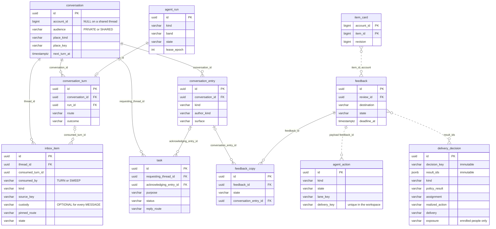

Every table carries `workspace_id`, so the diagram leaves it out.
An inbox item holds IDs only, never text. A shared thread has inbox items and turns, but no entries.
`agent_action.delivery_key` comes from source facts, and the provider marker carries it (ADR 0151 decision 1).
`item_card` holds only what no other row holds: its revision, which Slack card posts update by, and the person's Mark card done and Mute card notifications.

`delivery_decision` holds the delivery decisions of ADR 0139 decision 18 (proposed in #4865). ADR 0149 (proposed in #4868) owns its outcome and experiment columns.

## Lifecycles

### An inbox item

This state machine shows how an inbox item ends. Look at the custody: a required item ends only with its disposition, and only an optional item can expire or stop.
A message is never required: ingest always inserts it as optional. Only an obligation with a deadline is required (ADR 0120 decision 12).

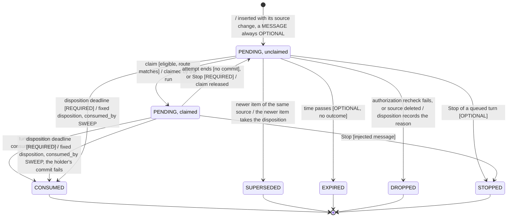

Claimed and unclaimed are both `PENDING` in `inbox_item.state`. A claimed item has `claimed_by_run` set.
`consumed_by` records who settled a `CONSUMED` item: `TURN` for a commit, `SWEEP` for a disposition. A disposition is a withheld copy, a skipped check-in or a fixed message.

A required item ends `CONSUMED`, `SUPERSEDED` or `DROPPED`, with its disposition in the same transaction. It never ends `EXPIRED` or `STOPPED` (ADR 0120 decision 12).
The sweep and the commit are complements under the same locks, also for a claimed item. If the sweep wins, the holder's commit writes nothing (ADR 0120 decision 10).

A superseded required item hands its disposition to the newer item, with the earlier deadline. A dropped required item records the reason, for example a copy withheld as `ITEM_GONE`, and writes no message.
An optional item expires when its time passes with no outcome, for example after its pull request merges.

The thread timer `next_turn_at` is the earliest eligible time of the pending, unclaimed items that start a turn.
The eligible time of an item is the later of its due time and its gate hold. Thus a quiet-hours gate holds an item, not the thread.

### A turn

This state machine shows the run of one turn, with its outcome on `conversation_turn`. Look at the two ways that a person ends a turn: a message cancels a background turn, and Stop ends any turn.

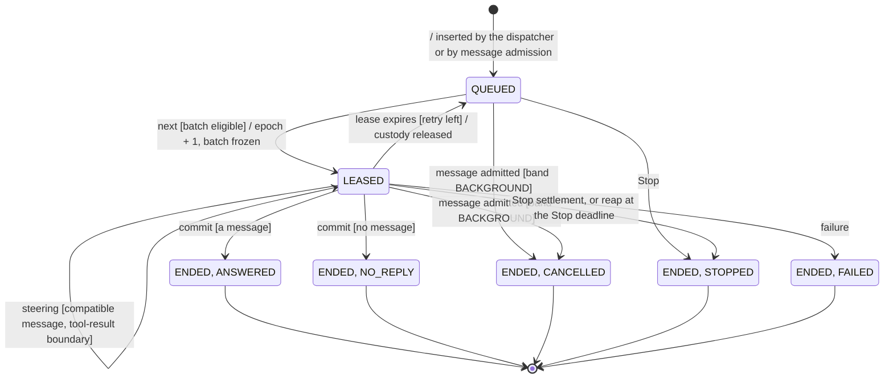

`agent_run` keeps the states of `main`: `QUEUED`, `LEASED` and `ENDED`. Each end state is `ENDED` with one value of `conversation_turn.outcome`.
A message that ends a background run also inserts an interactive run in the same transaction.
Stop ends the turn's messages as `STOPPED`. It releases every required item, which waits for its next turn or its deadline.
The band of a run never changes, so a message replaces a background run and does not change it.

The band decides priority, not streaming. Only an answer to the owner in the app streams. A Slack answer and a channel answer post as one complete message (ADR 0120 decision 6).

### A task

This state machine shows a task from the commit that requests it to the inbox event that reports it. Look at the end: a task ends exactly once, and cancel and end exclude each other.

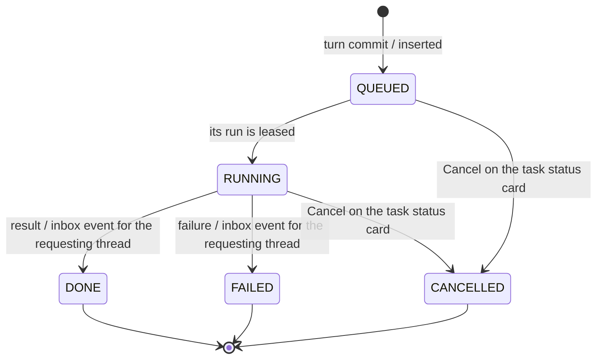

A task reads only what every reader of its result route may read. In 1.0, a task is a private check of a draft or a research task (ADR 0120 decision 16).
Each task kind names its permitted request and result routes. A private check result is app-only, so a request from Slack gets a fixed Slack acknowledgement with an app link.

Cancel and end are complements under the same lock, so exactly one of them wins. A cancel inserts no inbox event, and the task status card shows it.
Times on the task status card are targets, not promises.

### A copy on the work

This state machine shows the delivery of the copy on the work, with the states of `feedback.state`. Look at `WITHHELD`: each cause has its own guard, and "Request a new copy" starts the copy again.

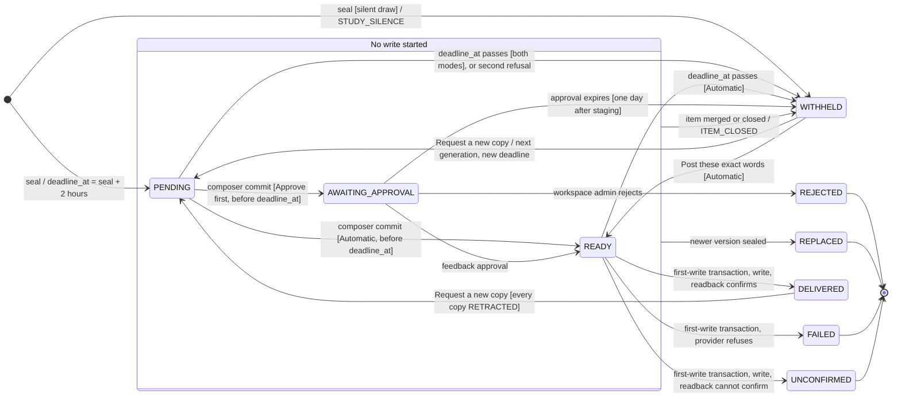

`PENDING` is the one state that the design adds to `feedback.state`, and `DEADLINE_PASSED` and `STUDY_SILENCE` are the two stop reasons that it adds.

At the deadline, the sweep withholds every `PENDING` copy that the composer did not stage, in both modes. The stop reason is `DEADLINE_PASSED`.
The deadline also withholds a `READY` Automatic copy whose write did not start (ADR 0122 decision 4).

Approve first keeps its own clock after staging: a copy that waits for approval expires after main's one day (ADR 0122 decision 5). A second refusal of the composer's guardrails withholds with the refusal reason.
A merge, a close or a newer version acts on each of the three states in "No write started". A write that started ends that state.

Before the provider call, the first-write transaction checks the create predicate again. It marks the action and each of its native parts started (ADR 0151 decision 2).
Each operation names its readback proof: the marker for a create, the expected revision for an edit, and authorized absence for a delete.
A result that no readback can prove ends in reconciliation, never in a retry (ADR 0151 decision 3).

A silent draw of a delivery experiment withholds the copy at the seal with `STUDY_SILENCE`, and no composer turn starts. ADR 0149 (proposed in #4868) decision 7 owns that disposition.
"Request a new copy" also takes the next generation, and the composer writes a fresh copy.
Withdraw retracts the copy at the provider: its `feedback_copy` rows end `RETRACTED`, and the `feedback` row stays `DELIVERED`.
The review stays Complete in every case. A withheld copy is a delivery fact, never missing evidence.

## Collisions

Every transaction takes its locks in one order: source locks, the sandbox row, threads, runs, then effects.
In the sequences below, each `critical` fragment is one database transaction, and its title names it.
The commit and a cancel use complementary predicates under the same locks, so exactly one of them wins.
If the commit wins, its effects and tasks are valid. If the cancel wins, the commit writes nothing.

The collision table has six cases (ADR 0120 decision 9):

| Case | What happens |
| --- | --- |
| A message arrives while a background turn is queued or leased. | Admission ends that turn `CANCELLED` and inserts an interactive turn, in one transaction. The LLM proxy cancels the call in flight. No attempt is charged. |
| A compatible message arrives during an interactive turn. | It steers. After each tool batch, the runner takes it before the next model call. |
| A message arrives while the final answer is written, or it does not fit the turn's route or actor. | It waits and starts the next turn. |
| An inbox event arrives during any turn. | It waits. Inbox events never interrupt and never join a turn in progress. |
| The person selects Stop. | The run gets a short settlement deadline. The holder can store only complete text. It stores no effect and no task. |
| The holder does not settle in time. | The reaper ends the run and stores no entry. Injected messages end `STOPPED` and stay visible as questions. |

A message never cancels a composer turn, because no person's private message reaches a shared thread.

### A message during a background turn

This sequence shows a message that arrives while a background turn works on a review result.
Look at the admission transaction: it ends the background run and inserts the interactive run together. The new turn takes both inputs, because both fit the route `APP`.

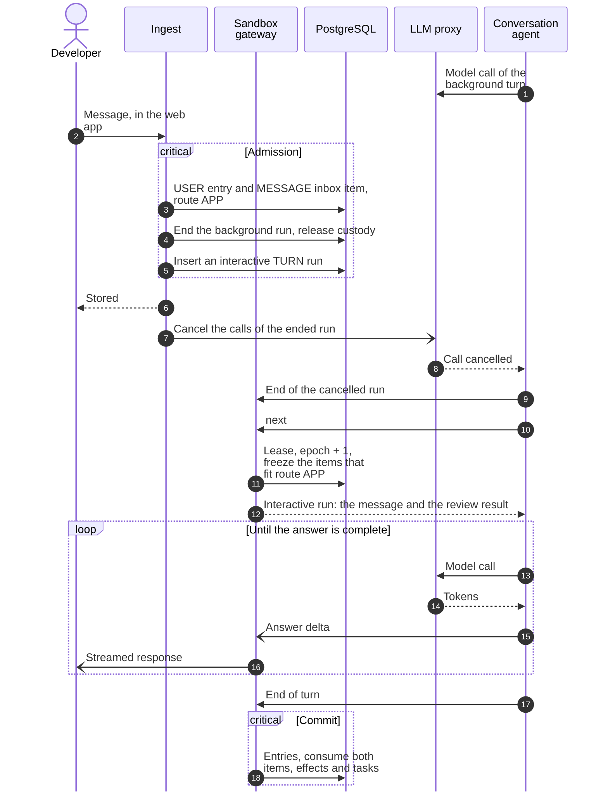

An item whose pinned route or reader set does not fit `APP` stays `PENDING` and starts its own turn.

### Steering at a tool-result boundary

This sequence shows a second message during an interactive turn.
Look at the tool-result boundary: the runner asks for new input only between tool batches. The gateway marks each message for one run and epoch.

The guard `Fits` means that the message has the route of the turn and an actor that fits it. On a channel thread, one turn takes the mentions of one person only.
On a Slack route, the turn must also have coverage left under its bound of 10 source keys (ADR 0120 decision 7).
A message on the same route from another actor, or one that overflows the bound, does not fit, and it stays pending.

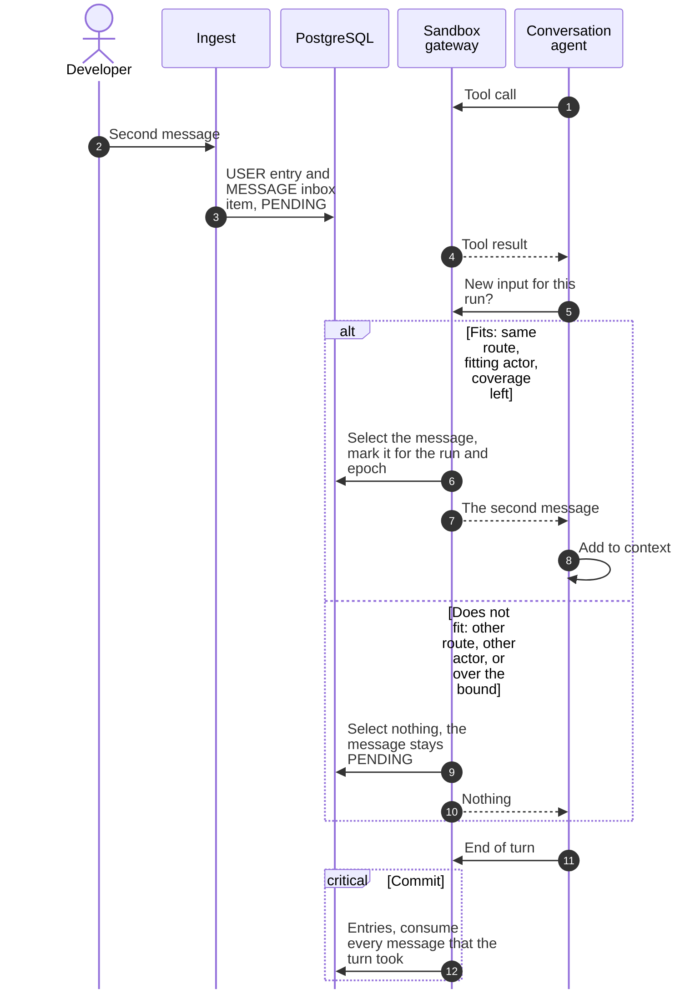

## The copy on the work

The [product vocabulary](./practice-feedback-language.mdx) defines the copy on the work.
The composer writes it. It runs turns on the work place of the pull request or merge request, and it reads only scoped projections of that place.
A scoped projection binds the workspace, the audience, the place kind and the place together in SQL, so no private row is in its reach.

- **The composer's guardrails.** Each composer tool call passes the destination rules, observation reference validation, the required Critical and Major problems, and Markdown sanitization. The commit runs them again.
- **Staged results.** `publish_package`, `edit_own` and `reply_on_work` return a staged draft. The commit admits it.
- **The action outbox.** The commit inserts one effect on the target's ordering key. The first-write transaction checks the create predicate and marks the write started. Then the outbox writes with its marker and reads the provider back.
- **One delivery key.** The `delivery_key` comes from source facts. Replay, readback and restore use the same key, so a write happens once.
- **Typed commands.** The conversation agent can offer a command, such as "Leave this problem out", on the item card. Only the person issues it, after a preview. The composer gets the command and its IDs, never the person's reason.
- **The practice-page copy.** The server projects it from the composed copy. It is no second route of the work-place turn (ADR 0121 decision 11).

### A review seals

This sequence shows one review from its seal to the copy on the work, in the Automatic feedback mode.
Look at the two threads: the composer publishes on the work place, and the conversation agent tells the person on the main thread. Neither reads the other's rows.
Under Approve first, the composer commit makes the copy `AWAITING_APPROVAL`, and the write waits for the approval.

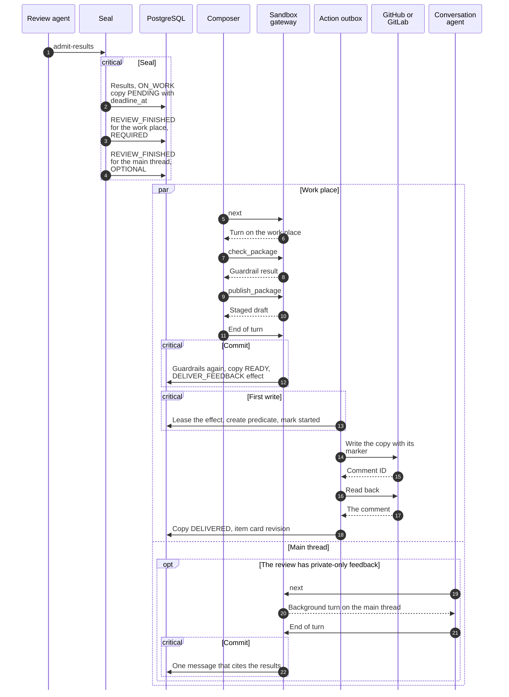

### The deadline withholds a copy

The copy deadline is 2 hours after the seal. No template comment exists: an uncomposed copy is withheld, and the item card offers "Request a new copy" at once.
This sequence starts when no composer turn committed before the deadline, for example during a model outage. The workspace uses Automatic.
Look at the sweep: it withholds the copy without a model, and the person's confirmation starts a new copy.

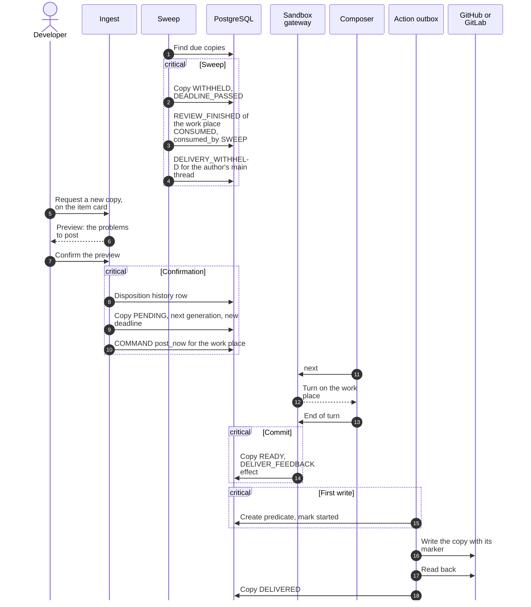

A merge or a close withholds the copy earlier, with `ITEM_CLOSED`. A newer version moves it to `REPLACED`.

Every withheld copy, except a silent draw, inserts a required `DELIVERY_WITHHELD` inbox event, and the item card shows the reason.
Like every required kind, this inbox event has a disposition deadline and a fixed disposition (ADR 0122 decision 8).
A private message follows only for a Critical or Major problem withheld by the deadline, a second refusal or an expired approval. The contact policy can still block it (ADR 0122 decision 8).
Without a message, the sweep ends the inbox event with its fixed disposition.

## Slack

Slack is a channel into the same conversation. Each entry has one origin, and no entry that the person types in the app goes to Slack.

- **The route is fixed at claim.** A message from Slack pins its batch to `SLACK_DM`. A Slack turn takes at most 10 source keys, at claim and by steering. The rest waits for the next turn.
- **What a Slack turn reads.** At every level, it reads the entries that Slack shows and the person's language and answer length. Under the Slack grant, it also reads the person's other help settings, goals and noted records.
- **Direct messages.** A top-level direct message goes to the main thread. A reply in a direct-message thread goes to its message thread.
- **Channel mentions.** The first mention in a Slack channel thread opens a channel thread, which is shared. Its composer reads only what every channel reader may read (see [Routes](#routes)). Its answer has a "Continue privately" button.
- **Cards go one way.** A Slack post that carries a card shows one card revision. A card change updates the post by its revision, and Slack never changes the card.
- **Every Slack render is rebuilt at send.** This includes card updates, notices and action responses. Each reads only sources that the route's readers may read, or that a current Full grant covers.
- **The Slack detail level.** Full gives the message and its cards, and it is the Slack grant. Notice gives a fixed notice line and an "Open in app" button, and it is the default.
- **A level change fences.** It bumps the Slack level epoch, which fences queued Slack effects and Full-derived runs. Slack messages already posted stay (ADR 0123 decision 5).

This sequence shows a direct message and a channel mention.
Look at the two threads. The direct message reaches the person's private main thread. The mention reaches a shared channel thread, and its composer has no private reads.

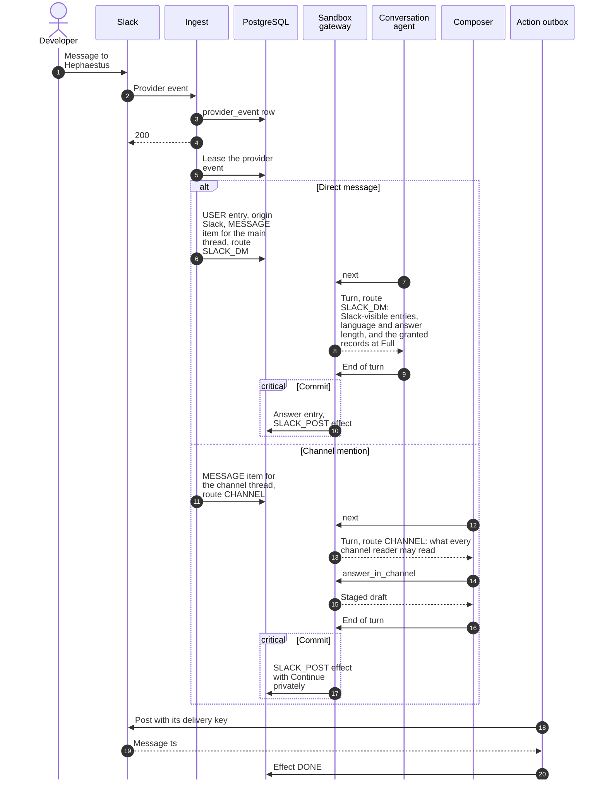

## Example: pull request #412

This example follows one review of pull request #412 across both threads. Sam is its author.
The review finds p301, a Major problem on the retry policy. The workspace uses Automatic. The model provider is down from 09:58 to 12:10.

| Time | What happens | Work place of #412 | Sam's main thread |
| --- | --- | --- | --- |
| 10:00 | The review seals. The seal writes the copy and one delivery decision row. | Copy `PENDING`, generation 1, deadline 12:00. Item A, `REVIEW_FINISHED`, required, `PENDING`. | Item B, `REVIEW_FINISHED`, optional, `PENDING`. |
| 10:01 | A composer turn claims A. The LLM proxy answers that the provider is down. | The attempt ends. A is `PENDING` and unclaimed again. | — |
| 12:00 | The sweep withholds the copy. | Copy `WITHHELD`, `DEADLINE_PASSED`. A is `CONSUMED` by `SWEEP`. | Item C, `DELIVERY_WITHHELD`, required, `PENDING`. |
| 12:10 | The model is back. One background turn takes B and C. Its message cites p301 and carries the control "Request a new copy". | — | B and C are `CONSUMED` by `TURN`. One entry. |
| 12:15 | Sam confirms "Request a new copy" on the item card. | Copy `PENDING`, generation 2, deadline 14:15. Item D, `COMMAND`, `PENDING`. | — |
| 12:16 | A composer turn takes D and commits. The action outbox writes the copy and reads it back. The item card gets a new revision. | D is `CONSUMED` by `TURN`. Copy `READY`, then `DELIVERED`. | No message |

The composer never reads B, C or Sam's entry. The conversation agent never reads A or D.

**Item A at 10:00.** An inbox item holds IDs and enumerated values only:

```text
inbox_item  thread_id     work place of PR #412
            kind          REVIEW_FINISHED
            source_key    review r7 sealed
            custody       REQUIRED
            pinned_route  WORK
            state         PENDING, unclaimed
```

**The delivery decision at 10:00.** Code writes one row before any model runs (ADR 0139 decision 18, proposed in #4865):

```text
delivery_decision  decision key     copy on the work of review r7, generation 1
                   result IDs       p301
                   kind             COPY_ON_THE_WORK
                   practice         retry policy
                   item, version    PR #412, head 9f3c2e1
                   severity         Major
                   policy result    may speak
                   assignment       SPOKE
                   realized action  empty until the copy posts or is withheld
                   delivery         empty until the first write
```

The key, the result IDs and the assignment never change. At 12:00, the sweep fills the realized action: withheld, `DEADLINE_PASSED`.
Sam is not enrolled in a delivery experiment. So the row has no probability, no draw and no exposure, and no dataset exports it.

**The inbox events at 12:10.** The turn's context gets B and C as one user-role message with a provenance mark (ADR 0120 decision 14):

```text
System events. Not the person's words.
- REVIEW_FINISHED: review r7 of PR #412, head 9f3c2e1, result p301
- DELIVERY_WITHHELD: copy on the work of PR #412, generation 1, DEADLINE_PASSED
```

The text of an inbox event cannot authorize a command or a consent. Only Sam's act can.

**The citation token in the 12:10 message.** The entry stores a reference to the result at its version, never the outcome (ADR 0150 decision 4).
The syntax below is an illustration. The server renders the token from current rows each time that the message shows:

```text
Stored:          The retry loop has no upper bound. [result p301, review r7]
Shown at 12:10:  p301 · Major · Retry policy · not met · withheld from PR #412
Shown at 12:16:  p301 · Major · Retry policy · not met · posted on PR #412
```

The stored message does not change. Only the render follows the rows.

**The typed command at 12:15.** The preview and its receipt bind the confirmation (ADR 0121 decision 8):

```text
Preview:  Post 1 problem on PR #412
Receipt:  operation op-5b9e, place work place of PR #412, review r7,
          head 9f3c2e1, generation 1, selection p301
Command:  COMMAND post_now, copy of review r7, generation 2
```

If a fact of the receipt changed before Sam confirms, the server returns a fresh preview and writes nothing.
The composer gets the command with its IDs. It never learns why Sam asked.

## Durability

- **Every input is a row first.** A provider event is a `provider_event` row before the provider gets its answer ([Ingest durability](./ingest-durability.mdx)). A message is a `USER` entry and an inbox item before the server answers.
- **A lost attempt changes nothing.** The lease epoch fences every write. A turn that lost its lease cannot commit, and its inbox items go back to `PENDING`.
- **Required items always end with their disposition.** Each required kind has a disposition deadline. At that deadline, the sweep applies the disposition with no model call. It takes the commit's locks, also for a claimed item.
- **Any replica serves any step.** No part keeps conversation state in memory between turns. The dispatcher and the sweep run on every replica and have no leader.
- **Restore holds the outbox.** After a restore, the outbox waits until the delivery keys and generations are rebuilt from the provider markers.
- **Failover fails closed.** During a database failover, admission and every commit fail, and no partial turn is visible.
- **Workspaces stay apart.** Every row in the core carries `workspace_id`, and the scoped projections of a shared thread bind it.

## Invariants

These rules always hold. Each one has the ADR decision that states it and the test that the implementation adds for it.

| Invariant | Decision | Test |
| --- | --- | --- |
| A thread has at most one live turn. A claim and a message admission never both win. | ADR 0120 decision 5 | `ClaimAgainstAdmitTest` |
| A commit and a cancel never both win. A won cancel leaves no executable action. | ADR 0120 decision 10 | `CommitAgainstCancelTest` |
| A holder cannot settle after its Stop deadline. | ADR 0120 decision 9 | `StopSettlementAfterDeadlineTest` |
| A required item ends only with its disposition, also while the model is down or a run holds its claim. | ADR 0120 decision 12 | `RequiredDispositionWithoutModelTest`, `RequiredItemEndsWithDispositionTest` |
| A gate holds only its own items. | ADR 0120 decision 4 | `GateHoldsOnlyItsItemsTest` |
| A task ends once, and it reads only what the readers of its result route may read. | ADR 0120 decision 16 | `TaskCancelAgainstEndTest`, `TaskReadsRouteScopeTest` |
| A composer turn reads no private row, and a foreign ID resolves to nothing. | ADR 0121 decisions 4 and 5 | The composer isolation tests, `PackagedIsolationTest` |
| A stale or repeated confirmation writes nothing. | ADR 0121 decision 8 | `PreviewDriftTest`, `RepeatedConfirmationTest` |
| No copy posts after its deadline, also while the executor is stopped. | ADR 0122 decision 4 | `ExpiredReadyWithStoppedExecutorTest` |
| Every withheld copy, except a silent draw, inserts a `DELIVERY_WITHHELD` inbox event. | ADR 0122 decision 8 | `WithheldDispositionTest` |
| A Slack turn never uses an app-only entry. At every level it reads language and answer length. It reads other personal records only under the Slack grant, from a closed list. | ADR 0123 decisions 4 and 5 | `AppCanaryNotInSlackTest`, `SlackGrantReadsTest` |
| A started write is never retried without proof of presence or of non-acceptance. | ADR 0151 decision 2 | `UncertainLaneWaitsForProofTest`, `CrashBetweenStartAndCopyFenceTest` |
| An item card changes without a turn. A message says "posted" only for a delivered copy. | ADR 0150 decisions 1 and 5 | `CardWithoutModelTest`, `PostedClaimTest` |

## Counters

Nine counters fence stale work.
ADRs 0128 and 0134 are in #4863, and ADRs 0135 and 0140 are in #4867.

| Counter | Owner | What bumps it | What it fences |
| --- | --- | --- | --- |
| Lease epoch | `agent_run` ([Agent runs](./agent-runs.mdx)) | Each lease of the run | A commit, a tool call or a model call of an attempt that lost its lease (ADR 0120 decision 10) |
| Copy generation | The copy on the work of one target | Request a new copy (ADR 0122 decision 9) | A preview receipt, a staged copy or a delivery key of an older generation. ADR 0121 decision 8, ADR 0122 decision 2 and ADR 0151 decision 1 state these fences. |
| Person authorization generation | The person's relationship (ADR 0134 decision 1) | An authority narrowing of the person, such as "Keep out of this space" on a record | A context read, a model request or a send of a run or action with an older stamp |
| Workspace authorization generation | The workspace (ADR 0134 decision 1) | A membership change, or a change of the Slack binding | The same three boundaries, for every run and action of the workspace |
| Slack level epoch | The person's Slack route (ADR 0123 decision 5) | A change of the Slack detail level | A queued Slack effect or a Full-derived run, before the model call, the commit and the send |
| Revocation generation | A revoked source (ADR 0128 decision 2) | The revocation of that source | A derived record that cites it. It is stale at the next read and never shapes an answer. |
| Scope epoch | The account stream (ADR 0134 decision 7, ADR 0135 decision 5) | An authority narrowing | Every stream frame carries it. The gateway drops an answer delta of an older epoch, and the next feed frame evicts what the client holds. |
| Feed epoch | The change feed (ADR 0135 decision 5) | A restore replaces every feed epoch (ADR 0140) | A client resume across a restore. The client gets `must-refetch` and reads again. |
| Card revision | The item card (ADR 0150 decision 2) | Each change of the rows behind the card | A Slack card post. An update goes only to a post with a lower revision (ADR 0123 decision 6). |

A contact change, such as Pause or quiet hours, bumps no counter. The contact policy checks it at send.

## Trade-offs

- **No fallback comment.** A template comment at the deadline would put text on the work that no composer checked. The design withholds the copy and gives the person "Request a new copy".
- **A composer for each shared place.** One agent for the person and the work could read private rows while it writes in public. A separate composer with scoped projections makes that boundary a SQL fact that isolation tests check.
- **Two writers for one review.** The composer writes for the team, and the conversation agent writes for the person. Citation tokens keep the outcomes equal, but not the emphasis.
- **Cancel, not merge.** A background turn has no committed output, so a message cancels it and loses nothing. Merging a message into a running background turn would need two routes in one turn.
- **Inbox events never interrupt.** An inbox event that steers a turn could change an answer that the person is reading. Inbox events wait for the next turn.

## Next steps

- [System design](./system-design.mdx) shows the server, its containers and one conversation turn as it runs today.
- [Conversation runtime](./unified-pi-runtime.mdx) owns the runner, the context of a turn and the turn lifecycle.
- [Agent runs](./agent-runs.mdx) owns the agent control, the lease and the reapers.
- [The outbox](./outbox.mdx) owns effects, the executor and readback.
- The mentoring framework page, proposed in #4866, explains what the person experiences.
