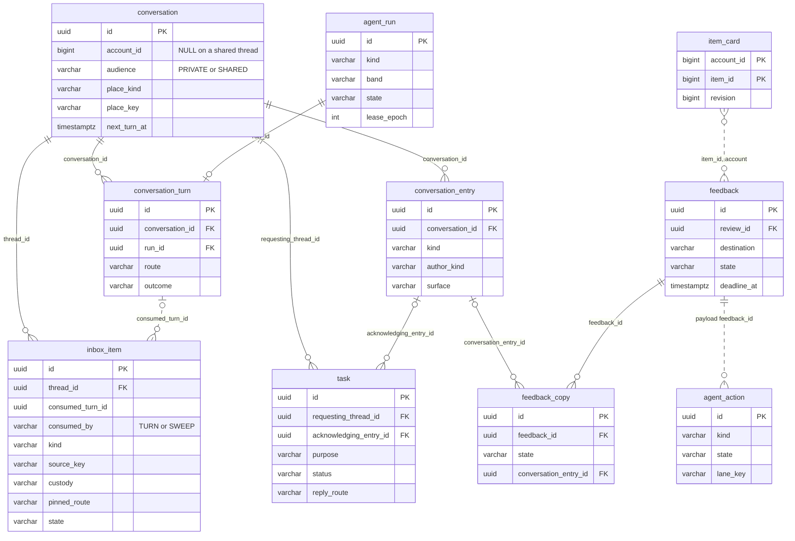
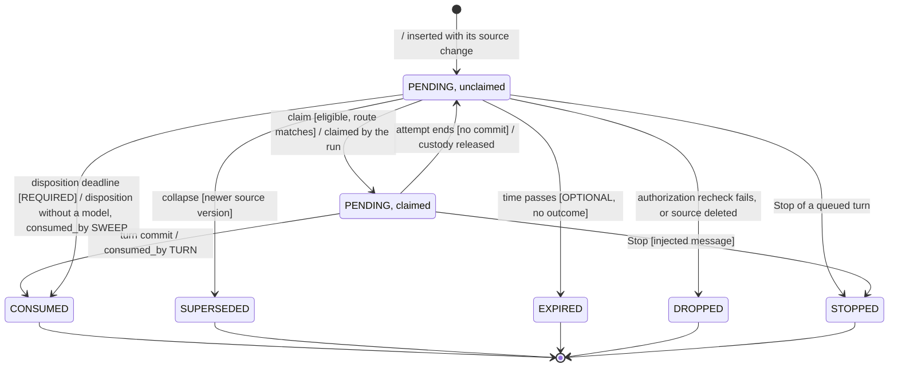
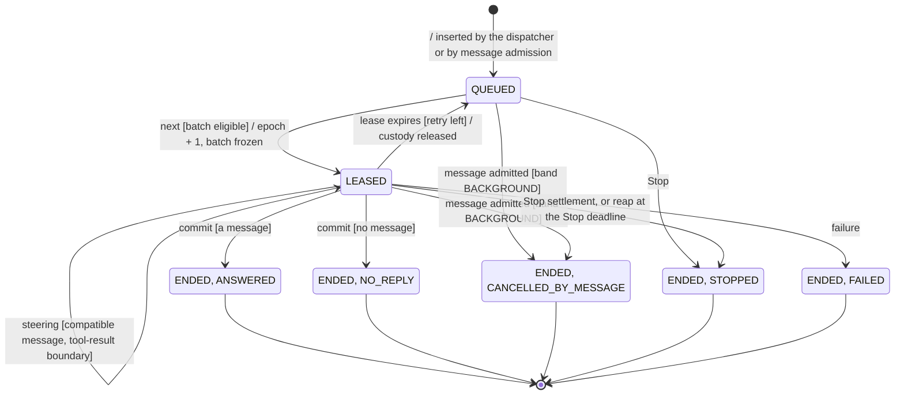
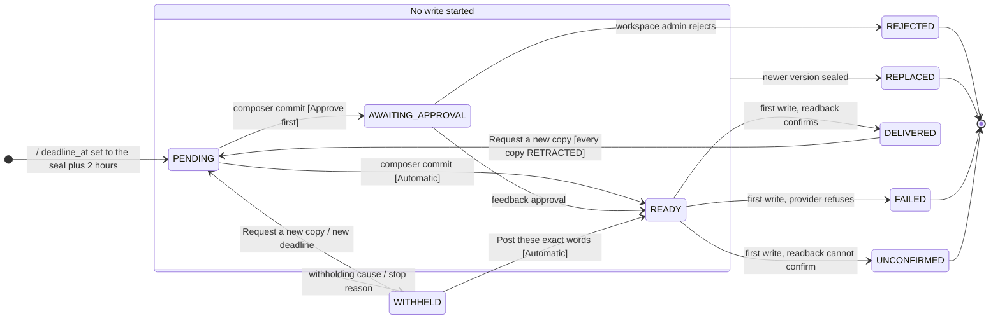
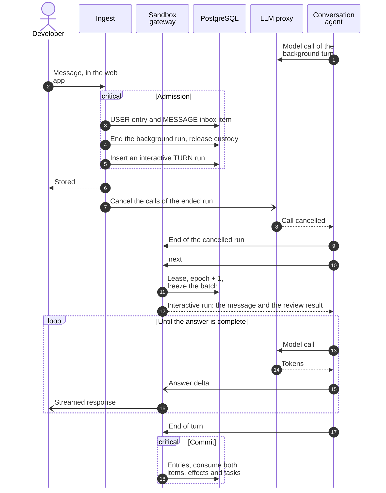
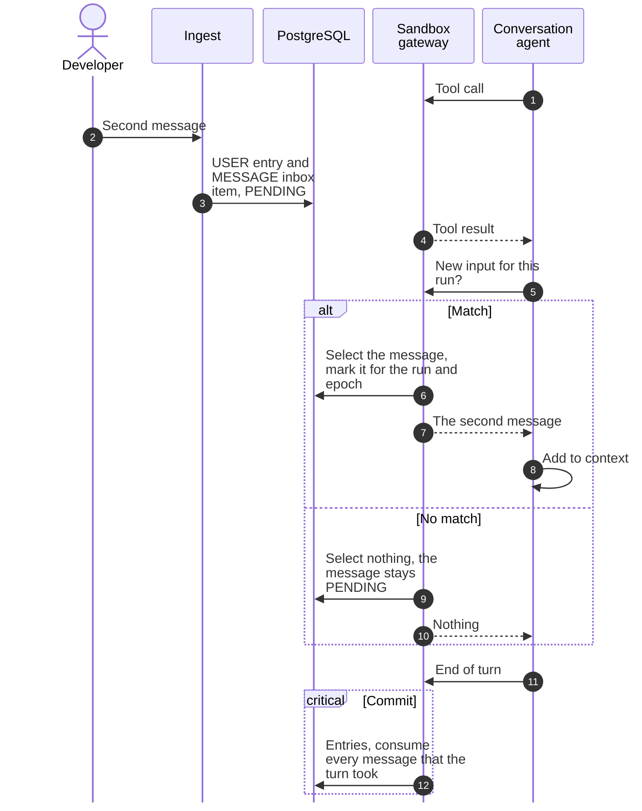
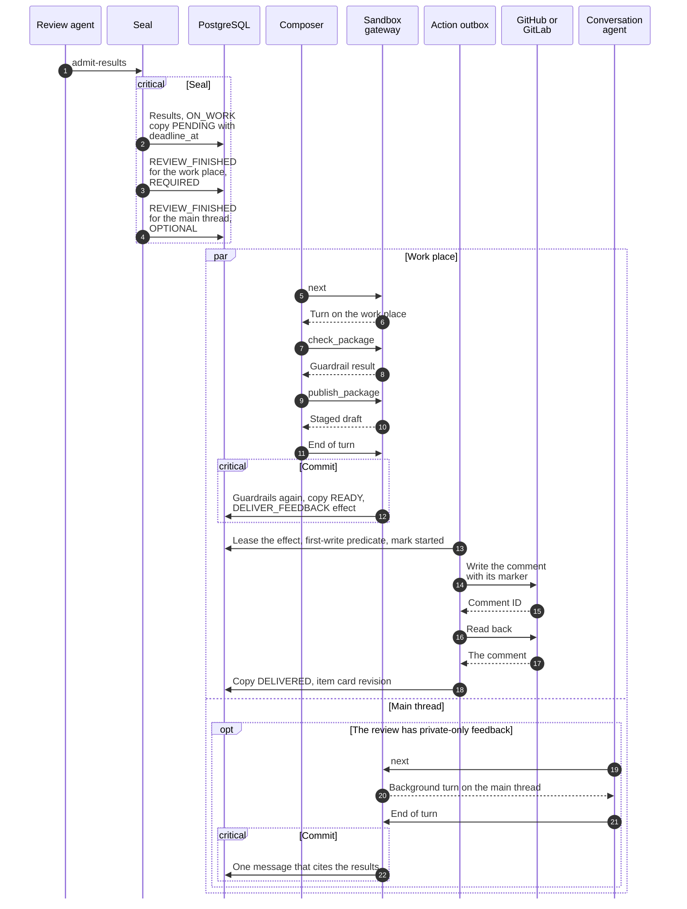
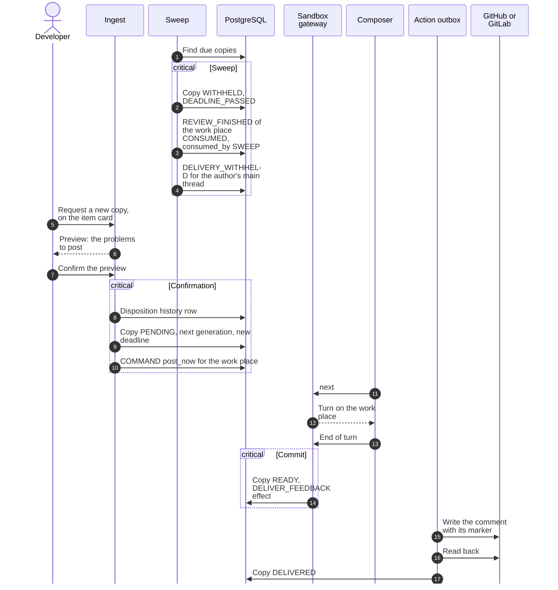
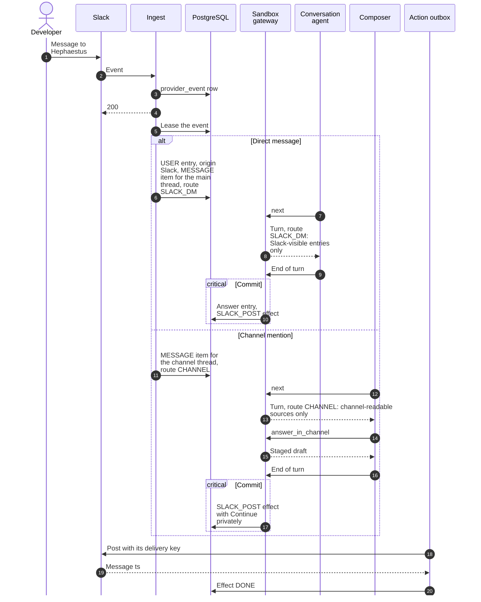

> **Code decides when Hephaestus speaks and who may read it. A model only chooses the words.**

Hephaestus is an AI mentor. The conversation core is where that thesis becomes code.

The core gives Hephaestus one model for every input. Each input to a thread is an inbox item. One turn at a time consumes the inbox items of a thread.
Two rules keep it correct. A turn commits all its writes in one transaction, and a turn reads only what every reader of its output may read.

:::note
This page describes the proposed design of the conversation core. Its decisions are proposed ADRs, and the code does not have all of it yet.
A box or a state with the keyword `«planned»` is a part that the design adds.
[System design](./system-design.mdx) and [Conversation runtime](./unified-pi-runtime.mdx) describe what the server does today.
:::

## The constraint

Many inputs can reach one thread at the same time. Examples are a message, a finished review, a due schedule, a reply on the work and a deadline.
Each of them can need an answer, a message or a write on the work. A model can stop at any step, and a server replica can stop at any step.
Thus no input can get lost, no input can start two answers, and no output can reach a reader who must not see its sources.

## Concepts and the two rules

The core has six concepts. Each concept has one table.

| Concept | What it is | Table |
| --- | --- | --- |
| Thread | The unit of order. It has one inbox, one transcript and one audience: private or shared. | `conversation` |
| Inbox item | One input for a thread: a message or an event. It has a dedupe key, a start policy, a custody and IDs only. | `inbox_item` `«planned»` |
| Turn | One leased model run on one thread. It consumes inbox items. A turn that holds a person's message is interactive. Every other turn is a background turn. | `agent_run` (kind `TURN`) and `conversation_turn` |
| Entry | One row of the append-only transcript of a private thread | `conversation_entry` |
| Effect | One write that other people or other systems read, with one delivery identity | `agent_action`, and `feedback` with `feedback_copy` for a copy on the work |
| Task | Background work that ends with an inbox item for the thread that requested it | `task` `«planned»` |

**The commit rule.** A turn writes its entries, consumes its inbox items, and inserts its effects and tasks in one transaction. If the transaction fails, the turn writes nothing.
No tool call writes outside this transaction.

**The audience rule.** A turn reads only the sources that every reader of its output may read.
A private turn changes a shared place only through a typed command that the person confirms. A command carries IDs and enumerated values, never a reason.

A thread has one of five place kinds:

| Thread | Audience | Key | Agent that runs its turns |
| --- | --- | --- | --- |
| Main thread | Private | Workspace and account | Conversation agent |
| Message thread | Private | Workspace, account and parent entry | Conversation agent |
| Work thread | Private | Workspace, account and item | Conversation agent |
| Work place | Shared | Workspace and the provider target of one pull request or merge request | Composer |
| Channel thread | Shared | Workspace, Slack team, channel and thread `ts` | Composer |

A shared thread belongs to the workspace and has no entries. The provider thread or the Slack thread is the record of its visible conversation.

Each turn has one output route, and the route has a reader set:

| Route | Readers | What the turn may read |
| --- | --- | --- |
| `APP` | The person | Every entry of the thread |
| `SLACK_DM` | The person, and the Slack owner by export | The entries that Slack shows |
| `WORK` | Everyone who reads the pull request or merge request | The scoped projections of its work place |
| `CHANNEL` | Every member of the Slack channel | Public repository data and the practice catalog entries that a workspace admin marks as channel-readable |

Ingest routes each input. The model does not route. A message goes to the thread that its surface names. An event goes to the thread that requested the work, or to the person's main thread. An event about a shared place goes to that shared thread.

The item card, Activity and the task status card are projections of rows. The dispatcher and the turn never read them to decide work, and a card changes without a model.

## Who works with the conversation core

This view shows who works with Hephaestus on their work, and where each exchange starts.
Look at the developer: the developer reaches the same conversation in the web app, in Slack, and through replies on the work.

<SystemDiagram name="context-developer" title="System context: Hephaestus for a developer" alt="Context diagram: a developer, a reviewer and a workspace admin, Hephaestus as one box, and GitHub or GitLab, Slack, Outline and the model provider.">

| From | To | What crosses |
| --- | --- | --- |
| Developer | Hephaestus | Questions, reads of feedback and item cards, confirmations of typed commands |
| Developer | Slack | Direct messages, and mentions of Hephaestus in a channel thread |
| Developer | GitHub, GitLab | Pushed work, replies on the work |
| Reviewer | GitHub, GitLab | Reviews, replies on the work |
| Workspace admin | Hephaestus | The feedback mode, and approvals of copies on the work |
| Slack | Hephaestus | Messages and mentions, as events |
| Hephaestus | Slack | Answers and cards |
| GitHub, GitLab | Hephaestus | Work events and replies, as events |
| Hephaestus | GitHub, GitLab | Reads of the work, comments on the work |
| Outline | Hephaestus | Document events |
| Hephaestus | Outline | Reads of documents |
| Hephaestus | Model provider | Model calls |

</SystemDiagram>

The [admin overview](/admin/overview#what-a-deployment-consists-of) shows the same system for an operator, with the email server.
The conversation core adds no container. The [container view](./system-design.mdx#containers-and-trust-boundaries) stays as it is: the server, PostgreSQL, the sandbox and the agent-sandbox controller.
A composer runs in a sandbox of the same kind as the conversation agent, with a sandbox token for its own subject.

## Components of the conversation core

This view opens the server and shows the parts that carry an inbox item from ingest to an effect.
Look at the inbox: five parts use `InboxItems`, and only the conversation part consumes inbox items.
The view is a UML component diagram. Every part is a set of Java packages in the Spring Boot server.
It opens parts of the [server component view](./system-design.mdx#components-of-the-server) and keeps their names. It shows the LLM proxy and the seal, which that view keeps inside the sandbox gateway, as parts of their own.

A ball is a provided interface. A socket is a required interface. A dashed arrow from a socket to a ball is the same connection, routed.
A small square on the frame is a port: it passes a request from outside to the part that handles it.
`«planned»` marks a part that the design adds. The interfaces of a planned part are planned too.

<SystemDiagram name="conversation-core-components" title="Component view: the conversation core in the server" alt="Component diagram of the conversation core: ingest, inbox, dispatcher, sweep, agent control, gateway, turns, composer, seal, LLM proxy and action outbox.">

| Part | Requires | From |
| --- | --- | --- |
| Ingest, through the ports `/webhooks` and `/api` | `InboxItems` | Inbox |
| Dispatcher | `InboxItems`, `AgentRuns` | Inbox, agent control |
| Sweep | `InboxItems`, `AgentRuns` | Inbox, agent control |
| Seal, through the port `/internal/llm` | `InboxItems` | Inbox |
| Sandbox gateway, through the port `/internal/agent` | `AgentRuns`, `SandboxRunKind`, `CompositionSessions` | Agent control, conversation, composer tools and guardrails |
| Conversation | `InboxItems`, `FeedbackGate`, `AgentActions` | Inbox, composer tools and guardrails, action outbox |
| LLM proxy, through the port `/internal/llm` | The model API, through a port | — |
| Action outbox | Provider APIs, through a port | — |

</SystemDiagram>

| Part | What it owns | Code |
| --- | --- | --- |
| Ingest | It turns each provider event, message and typed command into one inbox item for each recipient thread, in the transaction of its source. A message is also a `USER` entry, so the person sees it at once. | `integration.core.consumer`, `conversation`, `integration.slack.events` |
| Inbox `«planned»` | The `inbox_item` rows, the custody of each item and the thread timer `next_turn_at`. | planned |
| Dispatcher `«planned»` | One `TURN` run for each thread whose timer passed, if the thread has no live turn. It runs on every replica and has no leader. | planned |
| Sweep | Due dispositions of required inbox items, expired leases, and the copy deadline. | `agent.run` (`AgentRunReaper`), extended |
| Agent control | The `agent_run` rows behind `AgentRuns`, the lease and the lease epoch ([Agent runs](./agent-runs.mdx)). | `agent.run` |
| Sandbox gateway | Port 8081 for sandbox tokens. Long-poll `next`, the tools of each place kind, the steering inputs and the end of a turn. | `agent.gateway`, `agent.conversation.host` |
| Conversation | The turn of a thread: its frozen batch, its context and its commit. It provides the tools of the conversation agent as a `SandboxRunKind`. | `agent.conversation` |
| Composer tools and guardrails | The tools of a shared thread, and the guardrails that check each tool call. The guardrails are the destination rules, observation reference validation, the required Critical and Major problems, and Markdown sanitization. | `agent.composer`, `practices.feedback` (`FeedbackGate`) |
| Seal | Result admission. The seal writes the results, the copy on the work with its deadline, and the `REVIEW_FINISHED` inbox items in one transaction. | `agent.proxy` (`ResultAdmissionController`), `agent.handler` |
| LLM proxy | The model API keys and the call permits. It refuses a call of a run that is not current. | `agent.proxy` |
| Action outbox | Every effect on the outside world: the write fence, the provider write and the readback ([The outbox](./outbox.mdx)). | `core.action` (`ActionExecutor`) |

The view leaves out the integration adapters behind the provider APIs, and the connection from every part to PostgreSQL.

## Where turns run

This deployment view shows the sandbox Pods that run turns, reviews and tasks, and what each Pod may reach.
Look at the four sandbox Pods: each one reaches only port 8081 of the server. Only the server reaches PostgreSQL and the services outside the cluster.

<SystemDiagram name="deployment-turns" title="Deployment view: the turns of the conversation core on a cluster" alt="Deployment diagram: server and PostgreSQL Pods, and one sandbox Pod each for a private thread, a shared thread, a review and a task, with their paths.">

| From | To | Protocol | What crosses |
| --- | --- | --- | --- |
| Private thread Pod | Server Pods | HTTP 8081 | `next`, the tools of the conversation agent, model calls, the end of a turn |
| Shared thread Pod | Server Pods | HTTP 8081 | `next`, the tools of the composer, model calls, the end of a turn |
| Review Pod | Server Pods | HTTP 8081 | `next`, the review tools, model calls, the results for the seal |
| Task Pod | Server Pods | HTTP 8081 | `next`, the task tools, model calls, the result of the task |
| Server Pods | PostgreSQL Pod | TCP 5432 | Every row |
| Server Pods | Model provider | HTTPS | Model calls, with an API key |
| Server Pods | GitHub, GitLab, Slack, Outline | HTTPS | Effects, readbacks and reads, with a provider token |

</SystemDiagram>

A sandbox Pod serves one subject. The subject of a turn is `conversation:<thread id>`, so each thread gets its own Pod. A shared thread is a work place or a channel thread, and its Pod runs the composer.
`«planned»` marks a Pod that the design adds.
The [deployment view of the cluster](/admin/helm-chart#where-each-part-runs-on-a-managed-cluster) shows the agent-sandbox controller that creates the Pods, and the API server.
An idle person costs rows, not a Pod: the sandbox reaper deletes an idle sandbox, and the next turn starts a sandbox from PostgreSQL.

## The data model

This diagram shows the core tables and the keys that join them.
Look at `conversation`: every thread, private or shared, has its inbox items and turns, and only a private thread has entries.
A solid line is a foreign key. A dashed line is a plain ID or a projection. `thread_id` and `requesting_thread_id` are keys to `conversation`.

Every table carries `workspace_id`, so the diagram leaves it out.
An inbox item holds IDs only, never text. A shared thread has inbox items and turns, but no entries.
`item_card` holds only what no other row holds: its revision, which Slack card posts update by, and the person's Mark card done and Mute card notifications.

## Lifecycles

### An inbox item

This state machine shows how an inbox item ends. Look at the custody: a required item always ends `CONSUMED`, by a turn or by the sweep. Only an optional item can expire.

Claimed and unclaimed are both `PENDING` in `inbox_item.state`. A claimed item has `claimed_by_run` set.
`consumed_by` records who settled a `CONSUMED` item: `TURN` for a commit, `SWEEP` for a disposition. The disposition is a withheld copy, a skipped check-in or a fixed message.
A required item never ends `EXPIRED`. An optional item expires when its time passes with no outcome, for example after its pull request merges.

The thread timer `next_turn_at` is the earliest eligible time of the pending, unclaimed items that start a turn.
The eligible time of an item is the later of its due time and its gate hold. Thus a quiet-hours gate holds an item, not the thread.

### A turn

This state machine shows the run of one turn, with its outcome on `conversation_turn`. Look at the two ways that a person ends a turn: a message cancels a background turn, and Stop ends any turn.

`agent_run` keeps the states of `main`: `QUEUED`, `LEASED` and `ENDED`. Each end state is `ENDED` with one value of `conversation_turn.outcome`.
A message that ends a background run also inserts an interactive run in the same transaction. Stop on a queued run ends its messages as `STOPPED`.
The band of a run never changes, so a message replaces a background run and does not change it.

### A copy on the work

This state machine shows the delivery of the copy on the work, with the states of `feedback.state`. Look at `WITHHELD`: the deadline withholds an uncomposed copy, and "Request a new copy" starts it again.

`PENDING` is the one state that the design adds to `feedback.state`, and `DEADLINE_PASSED` is the one stop reason that it adds.
A withholding cause is the passed deadline, a second refusal of the guardrails, an expired approval, or a merged or closed item. The stop reason names it: `DEADLINE_PASSED`, the refusal reason, the approval expiry, or `ITEM_CLOSED`.
"Request a new copy" also takes the next generation, and the composer writes a fresh copy.
The seal inserts the copy. A transition from "No write started" applies to each of its three states, and a write that started ends that state.

Withdraw retracts the copy at the provider: its `feedback_copy` rows end `RETRACTED`, and the `feedback` row stays `DELIVERED`.
The review stays Complete in every case. A withheld copy is a delivery fact, never missing evidence.

## Collisions

Every transaction takes its locks in one order: source locks, the sandbox row, threads, runs, then effects.
In the sequences below, each `critical` fragment is one database transaction, and its title names it.
The commit and a cancel use complementary predicates under the same locks, so exactly one of them wins.
If the commit wins, its effects and tasks are valid. If the cancel wins, the commit writes nothing.

| Case | What happens |
| --- | --- |
| A message arrives during a queued background turn | Admission ends the queued run and inserts an interactive run, in one transaction. |
| A message arrives during a leased background turn | Admission ends the run with `CANCELLED_BY_MESSAGE` and inserts an interactive run. The LLM proxy cancels the call in flight. The new turn takes the message and the background items that its route allows. |
| A compatible message arrives during an interactive turn | Steering: the runner takes the message at the next tool-result boundary. |
| A message arrives while the model writes its final answer | It stays `PENDING` and starts the next turn. |
| A message for another route arrives during a turn | It does not steer. It starts its own turn after the commit. |
| An event arrives during any turn | It waits. Events never interrupt a turn. |
| The person selects Stop | The run gets a short deadline. The holder can commit only a stop settlement. Else the reaper ends the run, and no entry is stored. |

A message never cancels a composer turn, because a shared thread gets no person's message on a private route.

### A message during a background turn

This sequence shows a message that arrives while a background turn works on a review result.
Look at the admission transaction: it ends the background run and inserts the interactive run together, and the new turn takes both inputs.

### Steering at a tool-result boundary

This sequence shows a second message during an interactive turn.
Look at the tool-result boundary: the runner asks for new input only between tool batches. The gateway marks each message for one run and epoch.
The guard `Match` means that the route of the message is the route of the turn.

## The comment on the work

The composer writes the comment on the work. It runs turns on the work place of the pull request or merge request, and it reads only scoped projections of that place.
A scoped projection binds the workspace, the audience, the place kind and the place together in SQL, so no private row is in its reach.

- **Guardrails.** Each composer tool call passes the destination rules, observation reference validation, the required Critical and Major problems, and Markdown sanitization. The commit runs them again.
- **Staged results.** `publish_package`, `edit_own` and `reply_on_work` return a staged draft. The commit admits it.
- **The outbox.** The commit inserts one effect on the target's ordering key. The action outbox checks the first-write predicate, marks the write started, writes with its marker, and reads the provider back.
- **One delivery identity.** The `delivery_key` comes from source facts. Replay, readback and restore use the same key, so a write happens once.
- **Typed commands.** The conversation agent can offer a command, such as "Leave this problem out", on the item card. Only the person issues it, after a preview. The composer gets the command and its IDs, never the person's reason.

### A review seals

This sequence shows one review from its seal to the comment on the work.
Look at the two threads: the composer publishes on the work place, and the conversation agent tells the person on the main thread. Neither reads the other's rows.

### The deadline withholds a copy

The copy deadline is 2 hours after the seal. No template comment exists: an uncomposed copy is withheld, and the item card offers "Request a new copy" at once.
This sequence starts when no composer turn committed before the deadline, for example during a model outage.
Look at the sweep: it withholds the copy without a model, and the person's confirmation starts a new copy.

A merge or a close withholds the copy earlier, with `ITEM_CLOSED`. A newer version moves it to `REPLACED`.
When a withheld copy holds a Critical or Major problem, the `DELIVERY_WITHHELD` item starts a background turn. The conversation agent then tells the person and offers the same controls.

## Slack

Slack is a channel into the same conversation. Each entry has one origin, and nothing that the person types in the app goes to Slack.

- **The route is fixed at claim.** A message from Slack pins its batch to `SLACK_DM`. The turn then reads only the entries that Slack shows.
- **Direct messages.** A top-level direct message goes to the main thread. A reply in a direct-message thread goes to its message thread.
- **Channel mentions.** The first mention in a Slack channel thread opens a channel thread, which is shared. Its composer reads the Slack thread, public repository data and the catalog entries that are channel-readable. Its answer has a "Continue privately" button.
- **Cards go one way.** A Slack post that carries a card shows one card revision. A card change updates the post by its revision, and Slack never changes the card.
- **The Slack detail level.** Full gives the message and its cards. Notice gives the notice line only.

This sequence shows a direct message and a channel mention.
Look at the two threads. The direct message reaches the person's private main thread. The mention reaches a shared channel thread, and its composer has no private reads.

## Durability

- **Every input is a row first.** A provider event is a `provider_event` row before the provider gets its answer ([Ingest durability](./ingest-durability.mdx)). A message is a `USER` entry and an inbox item before the server answers.
- **A lost attempt changes nothing.** The lease epoch fences every write. A turn that lost its lease cannot commit, and its inbox items go back to `PENDING`.
- **Required items always end.** Each required kind has a disposition deadline. The sweep applies the disposition under the thread lock, with no model call, and the item ends `CONSUMED` with `consumed_by = SWEEP`.
- **Any replica serves any step.** No part keeps conversation state in memory between turns. The dispatcher and the sweep run on every replica and have no leader.
- **Restore holds the outbox.** After a restore, the outbox waits until the delivery identities and generations are rebuilt from the provider markers.
- **Failover fails closed.** During a database failover, admission and every commit fail, and no partial turn is visible.
- **Workspaces stay apart.** Every row in the core carries `workspace_id`, and the scoped projections of a shared thread bind it.

## Trade-offs

- **No fallback comment.** A template comment at the deadline would put text on the work that no composer checked. The design withholds the copy and gives the person "Request a new copy".
- **A composer for each shared place.** One agent for the person and the work could read private rows while it writes in public. A separate composer with scoped projections makes that boundary a SQL fact that isolation tests check.
- **Cancel, not merge.** A background turn has no committed output, so a message cancels it and loses nothing. Merging a message into a running background turn would need two routes in one turn.
- **Events never interrupt.** An event that steers a turn could change an answer that the person is reading. Events wait for the next turn.

## Next steps

- [System design](./system-design.mdx) shows the server, its containers and one conversation turn as it runs today.
- [Conversation runtime](./unified-pi-runtime.mdx) owns the runner, the context of a turn and the turn lifecycle.
- [Agent runs](./agent-runs.mdx) owns the agent control, the lease and the reapers.
- [The outbox](./outbox.mdx) owns effects, the executor and readback.
