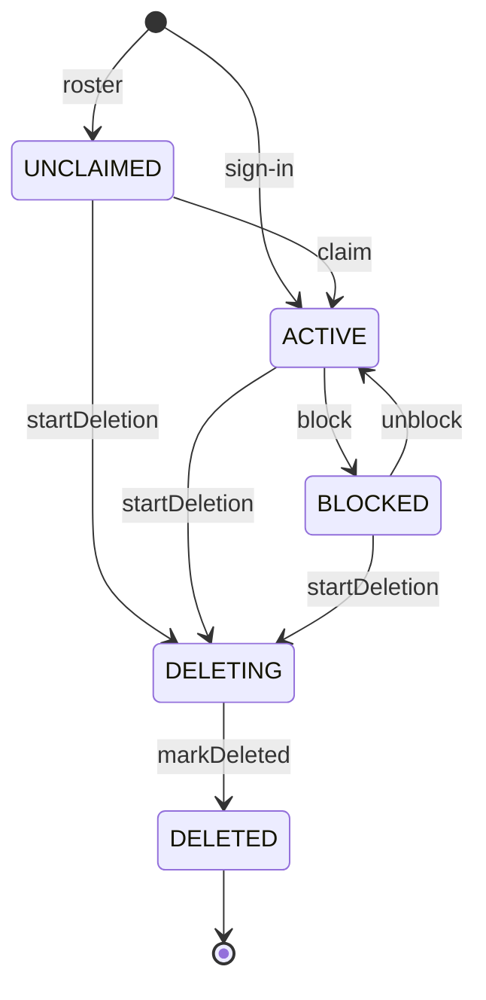
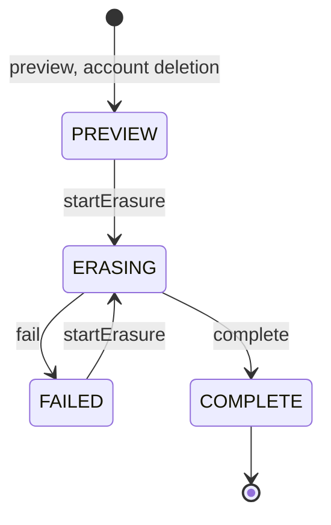

A lifecycle is a value that moves through states over time.
It can be a status enum, a set of nullable timestamps, or booleans that together mean a state.
These rules apply to the server.
[ADR 0078](https://github.com/hephaestus-build/Hephaestus/blob/main/docs/decisions/0078-lifecycles-are-explicit-and-rigor-follows-the-damage.md) records why we chose them.
Some code that is older than ADR 0078 does not obey all the rules yet.
Do not copy it.

## Add a lifecycle

1. Use one enum column for the state. Do not hide a state in a JSON key or in a combination of booleans.
2. Add a CHECK for the closed set of values, in the same migration as the column.
3. Add a CHECK for each column that a state implies, such as a reason or a completion time.
4. Implement `Lifecycle<S>` and put the legal transitions in one table beside the enum. `IntegrationState` shows the form.
5. Write each transition as a compare-and-set on the expected state, as `AgentActionRepository.claim` does.
6. Refuse an illegal transition, and record the reason.
7. Decide what a crash, a replay and a retry do to each state. State the answer in a test.

Use a plain enum. Do not add a state machine framework.

[`Lifecycle`](https://github.com/hephaestus-build/Hephaestus/blob/main/server/application/src/main/java/de/tum/cit/aet/hephaestus/core/Lifecycle.java)
is the shared transition contract.
`AgentRunState`, `ActionState`, `IntegrationState`, `ReviewStatus` and `WorkspaceStatus` implement it.
`LifecycleContractTest` discovers every production enum that implements the contract.
Each enum has explicit initial and terminal states in that test.
The test checks that a terminal state has no exit and that each state is reachable from an initial state.

`LifecycleSetterArchTest` refuses an entity method named `set*` that takes a `Lifecycle` value.
Its remaining exceptions name one owner per field.
The list includes lifecycle fields that do not yet use the contract, including the String state of `LlmCallPermit`.
Remove an entry when its field uses the contract and its entity has no lifecycle setter.
[ADR 0099 § Confirmation](https://github.com/hephaestus-build/Hephaestus/blob/main/docs/decisions/0099-aggregates-own-their-lifecycle-and-module-boundaries.md#confirmation)
owns the release gate for this list.
[Promote the qualified candidate](./release-management.mdx#promote-the-qualified-candidate)
gives the preflight command.

## Choose the rigor

Rank a lifecycle by the damage of a wrong transition: trust, tenancy, data loss, then stuck work.
The levels add up. Levels 1 to 3 follow the rank. Levels 4 and 5 apply only where their condition holds.

| Level | Add | When |
| --- | --- | --- |
| 1 | CHECK constraints | Each stored lifecycle |
| 2 | A transition table and table-driven tests | More than one writer |
| 3 | Seeded random walks over events | A wrong transition costs trust, crosses a tenant, or loses data |
| 4 | Optional: a small TLA+ model, outside CI | A concurrent protocol that is hard to reason about: a lease, a permit or a fence |
| 5 | An invariant query with a metric and an alert | A rule across tables, which a CHECK cannot express |

## Close what you own

Most defects sit where one lifecycle hands over to another, not inside one.
When a parent ends, end its children with the parent's reason.
Do this in the same transaction inside one module, and through a durable event across modules ([Transactions and side effects](./transactions.md)).
Do not leave a child in a state that only an active parent can move on.
Do not report a child as finished when nothing measured it.

## Repair old rows first

A CHECK validates each existing row.
Rows from before the 1.0 cutover can break a rule that today's code keeps.
Count them on staging and in production first. Then repair them in the same migration.

## Review status

The [review glossary](./practice-review-glossary.mdx) defines the statuses.
[`ReviewStatus`](https://github.com/hephaestus-build/Hephaestus/blob/main/server/application/src/main/java/de/tum/cit/aet/hephaestus/practices/spi/ReviewStatus.java)
owns the executable transition table.
`Review` changes its lifecycle through `start`, `requeue`, `requestCancel` and `end`.
These methods refuse illegal moves.

`ReviewClosure` closes the children, freezes a scan report, records the end and publishes its notifications in the caller's transaction.
Every end path uses this closure, including selection refusal and replacement by a newer update.

The database trigger `guard_review` also refuses a change to a terminal status.
It permits metadata updates that keep that status, such as freezing the report.

A requeue keeps the first start time in `checks.startedAt`.
Terminal reviews do not reopen, including when feedback repair resumes a composition run.

## Scheduled review batches

`ReviewBatchStatus` owns the terminal states.
A terminal batch cannot resume.
Its transition table is beside the enum in
[`ReviewBatchStatus`](https://github.com/hephaestus-build/Hephaestus/blob/main/server/application/src/main/java/de/tum/cit/aet/hephaestus/practices/spi/ReviewBatchStatus.java).
A scheduled batch with no selected targets left completes before the driver checks its budget.

`BUDGET_EXHAUSTED` records a normal end at the run limit.
It has a completion time and no pause reason.
It does not block the next scheduled batch.
An existing scheduled batch paused at its fixed cap takes this transition on the next driver tick.
The driver first waits for any scan already in flight to end.

Unknown cost information keeps a pause.
It does not prove that the fixed cap is spent.
Some costs need operator correction before the run can continue.

A manual dated-work batch has no fixed run cap.
It keeps its budget pause until workspace funding permits another review.
Its API rejects a fixed scan budget.
The `review_batch` status CHECK includes `BUDGET_EXHAUSTED`.

## Account status

`Account.Status` owns the transition table of an account.
`Account` changes its status only through `unclaimed`, `claim`, `block`, `unblock`, `startDeletion` and `markDeleted`.
These methods refuse an illegal move.

A repeated purge finds the account deleted and leaves it so.
The erasure in `PersonDataService` starts a deletion with SQL, because it locks the account row itself.
That statement moves the account only to `DELETING` and raises its version, so a stale entity save fails instead of writing back an earlier status.
The database trigger `guard_account` also refuses any move from `DELETING` other than to `DELETED`, and any change of a deleted account's status.

## Workspace status

`Workspace.WorkspaceStatus` owns the transition table: a workspace is active or suspended, and a purge is final.
`Workspace` changes its status through `suspend`, `resume` and `markPurged`.
These methods refuse a change of a purged workspace.
Only `WorkspaceLifecycleService.purgeWorkspace` calls `markPurged`, after every purge contributor erased the workspace's data.

`Workspace.create` is the one way to build a workspace.
`WorkspaceCreationArchTest` refuses a call of the constructor outside `Workspace`.

The database trigger `guard_workspace` also refuses a change of a purged workspace's status.

## Person data requests

`PersonDataRequest.State` owns the transition table of an erasure request.
`PersonDataRequest` changes its state only through `startErasure`, `fail` and `complete`.
These methods refuse an illegal move.

A preview expires by its `expires_at` time and keeps the state `PREVIEW`.
A temporary store failure keeps the request in `ERASING` with the failure code `STORE_ERASURE_RETRY_PENDING`, and the next run retries it.
`complete` removes the identifying scope and the selections, so the receipt keeps only counts and times.

The database trigger `guard_person_data_request` also refuses a change to a completed request's state.
