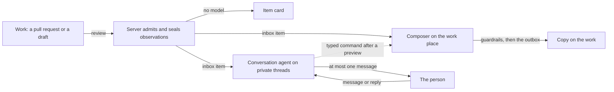

> **Code decides when Hephaestus speaks and who may read it. A model only chooses the words.**

That is the thesis of the design.
Hephaestus gives each developer practice feedback on their real work.
They can discuss that work in a private conversation.

Code decides when Hephaestus speaks. It decides whether a result, a check-in or a withheld copy becomes a message, and when a notification may interrupt.
Code also decides who may read it. A turn reads only what every reader of its output may read, so private context never reaches the work or a channel.
The one stated exception is the person's own choice. At the **Full** Slack detail level, a Slack answer may also use their goals, notes and other help settings (ADR 0123).

The model writes the words inside those decisions. It never states a result that the rows do not hold.
A model also judges work in a review, and it can propose a noted record from the person's own words. Code admits each judgement and each record before anyone reads it, and a model never decides dispatch, routing or readers.

This page explains how the design helps a person develop practices.
Read it first if you review the design or build a part of it.
[Conversation core](https://github.com/hephaestus-build/Hephaestus/blob/main/docs/contributor/conversation-core.mdx) (proposed in #4864) gives the threads, turns and writes that carry these rules.
[Mentoring behavior](./mentoring-behaviour.mdx) and [mentoring evaluation](./mentoring-evaluation.mdx) give the detail of contact, tone and quality.

:::note
This page describes an accepted design. Its decisions are accepted ADRs, and the current release does not do it yet.
Each table that mixes the two has a Status column. **Exists** is in the current release. **Planned** is designed for 1.0. **Later** comes after 1.0.
:::

## The design in ten minutes

This section is for a reader who has ten minutes and no background in the code.

### What Hephaestus is

Hephaestus reads the work that people already do in GitHub, GitLab and Slack.
It checks that work against the engineering practices that their team values, such as "say how to verify a change".
It reviews pull requests, merge requests and issues. In 1.0, a workspace admin includes issues, and their feedback stays private.
It is open source, and an organization runs it on its own servers with the model that it chooses.
Hephaestus shows an "AI" label beside its name, because it is software and not a person.

One piece of feedback can appear in several places, and each appearance is a copy.
The **copy on the work** is the copy that Hephaestus posts on the pull request or merge request.

### The questions that readers ask first

| Question | Answer |
| --- | --- |
| Who do I talk to? | Hephaestus. In the architecture, the conversation agent runs on your private threads in each workspace. |
| Does a review post comments? | No. A review returns observations, and the server seals them. The review posts nothing. |
| Who writes the copy on my pull request? | The composer. It works on the shared thread of that pull request, and it cannot read your private data. |
| Does a review result interrupt my conversation? | No. A result shows on its item card at once. Your message always goes first. |
| Can my conversation change the copy on my work? | Only through a command that you confirm on a card, after a preview. The command never carries your reasons. |
| What if the model is down? | Two hours after the seal, a copy that is not posting or waiting for approval is withheld. Nothing is posted in its place. |
| Can my manager see this? | No. Hephaestus has no view of one person for admins or managers. The operator of the servers can read what they hold, and Hephaestus says so. A Slack owner can export direct messages, so Slack answers use your goals and notes only if you choose the **Full** detail level. |

### The core loop

The loop answers one question: what happens between the work and the person?
Look for the two writers. The composer writes on the work, and the conversation agent writes to the person.

1. **A review only produces observations.** The server admits each candidate when its evidence holds. The seal then stores the results in one transaction, and nothing changes them later.
2. **The result is available at once.** The item card shows it at the seal, before any model runs. In On request mode, it shows when the person asks, within what the destinations allow (ADR 0137).
3. **The composer writes the copy on the work.** It runs on the work place, the shared thread of one pull request. It reads only the data of that work.
4. **The conversation agent tells the person.** The finished review reaches the person's thread as an inbox item. A background turn, which no message started, writes at most one message, or none.
5. **The person answers or asks.** An answer streams in the app.
6. **Private context reaches the work only by the person's act.** A typed command needs a confirmed preview.

### The concepts

Each concept links to the one entry that defines it.

| Concept | Status |
| --- | --- |
| [Workspace](./practice-feedback-language.mdx#people-and-product-surfaces) | Exists |
| [Practice](./practice-feedback-language.mdx#practices) | Exists. It is the unit of learning. |
| [Observation](./practice-feedback-language.mdx#observations) | Exists |
| [Item](./practice-review-glossary.mdx#review-terms) | Exists. Issues as an opt-in kind with private delivery only are planned. |
| [Personal space](./practice-feedback-language.mdx#mentoring-planned) | Planned |
| [Conversation](./practice-feedback-language.mdx#conversation) | Planned, as a change to the current conversation |
| [Item card](./practice-feedback-language.mdx#mentoring-planned) | Planned |
| [Private check](./practice-feedback-language.mdx#mentoring-planned) | Planned |
| [Personal record](./practice-feedback-language.mdx#mentoring-planned) | Planned |
| [Check-in](./practice-feedback-language.mdx#mentoring-planned) | Planned |
| [Contact policy](./practice-review-glossary.mdx#mentoring-terms-planned) | Planned |
| [Conversation agent](./practice-review-glossary.mdx#mentoring-terms-planned) | Planned |
| [Composer](./practice-review-glossary.mdx#mentoring-terms-planned) | Planned. The feedback composer exists. |

### The trust commitments

The trust commitments hold the design. Each one names the boundary where harm is real.
[The trust rules](#the-trust-rules) give the mechanism of each one.

| Trust commitment | Boundary |
| --- | --- |
| Learning travels with the person, and evidence stays where it was made | Another workspace |
| Never a performance instrument | Staff access |
| Private never shows in public | Another person who reads the work or a channel |
| Authority is never inherited | Another person, and stale permissions |
| Feedback earns trust or it is not sent | A claim about someone's work |

Inside these boundaries, Hephaestus trusts the person, as a good human mentor does.
It answers at once, remembers what the person tells it, and shows results as soon as they exist.
It asks for a decision only when the decision is real.
Each rare event, such as a database restore, gets a clear procedure and one test.

## Decision map

Each planned rule on this page comes from one proposed ADR. This table lists every ADR of the review set.
The story column groups them: **A** who speaks and when, **B** who owns and reads data, **C** evaluation and research, **P** platform.

| ADR | Decision | Story | Pull request |
| --- | --- | --- | --- |
| 0120 | A conversation thread has one inbox and runs one turn at a time. It also decides tasks. | A | #4862 |
| 0121 | A composer on a shared thread writes feedback on the work, and it cannot read private data. | B | #4862 |
| 0122 | A copy on the work that misses its deadline is withheld. | A | #4862 |
| 0123 | Slack is a channel into the one conversation. | A | #4862 |
| 0124 | Hephaestus gives practice feedback with a conversation, and practices are the unit. | A | This one |
| 0125 | Hephaestus is never a performance instrument. | B | #4863 |
| 0126 | A person has one relationship and a personal space. | B | #4863 |
| 0127 | Every record and route resolves to concrete readers. | B | #4863 |
| 0128 | A derived record keeps its basis, and revocation travels by generation. | B | #4863 |
| 0129 | Learning travels as the person's own words to authorized workspaces. | B | #4863 |
| 0130 | A practice has a portable identity, and growth counts independent pieces of work. | A | #4863 |
| 0131 | A person has one conversation in each workspace, and its answers stream. | A | #4862 |
| 0132 | Personal records are written by the person's act or noted from their own words. | B | #4865 |
| 0133 | A check-in is an agreed contact with a scope. | A | #4865 |
| 0134 | The authorization recheck runs at three boundaries, with two authorization generations. | B | #4863 |
| 0135 | Every client and channel uses one Hephaestus API. | P | #4867 |
| 0137 | On request is a feedback mode. | A | #4863 |
| 0138 | Domain modules own rows and rules, and agent modules host runs. | P | #4867 |
| 0139 | The contact policy decides whether Hephaestus may interrupt a person now, and records each decision. | A | #4865 |
| 0140 | Privacy facts go to a journal with a copy in object storage, and a restore reapplies them. | B | #4867 |
| 0141 | Research datasets build on the research module that main already has. | C | #4868 |
| 0142 | A maintainer signs a manual release check, and an offline simulation checks contact timing. | C | #4868 |
| 0145 | Pi runs every agent loop behind the Pi runtime interface. | P | #4867 |
| 0146 | Pi is pinned to one exact version and upgraded through contract tests. | P | #4867 |
| 0147 | Load makes work wait and never switches the model. One place stays free for a person. | P | #4867 |
| 0149 | A delivery experiment draws only unprompted delivery decisions, per person and per decision. | C | #4868 |
| 0150 | An outcome renders from rows, as an item card or a citation token. | A | #4862 |
| 0151 | Each external write has one delivery key, and is read back, never retried blindly. | P | #4862 |

Pull request #4869 holds ADRs 0136, 0143, 0144, 0148 and 0152 for after 1.0. No ADR of this set depends on them.

## What mentoring contributes

A mentor is a more experienced person who helps another person grow in their work over time.
Kram found two groups of functions (Kram 1983, 1985).
Career functions are sponsorship, exposure, coaching, protection and challenging assignments.
Psychosocial functions are role modeling, acceptance, counseling and friendship.

Mentoring effects are real but small, and they accumulate over months (Eby et al. 2008).
A poor relationship is no better than none (Ragins, Cotton and Miller 2000).

Hephaestus takes only the functions that an AI can do honestly.
It coaches with feed-forward, suggests challenging next steps, explains practices in the person's own code and names real progress from evidence.
It does not offer friendship.
It cannot sponsor or protect anyone inside an organization, so it names a person who can.

| Phase | What the person meets |
| --- | --- |
| Start | A clear workspace name, a short privacy promise and the AI label. The first answer comes first. |
| Growth | Goals in the person's words. Feedback with one next step. Private checks before review. Check-ins at agreed times. |
| Separation | Help fades as a practice holds. Hephaestus says once, with evidence, that it steps back, and offers to raise the bar. |
| Next phase | A periodic review asks what comes next. The person leaves a team and keeps goals, lessons and growth. |

### Mentoring across tasks

A coach, a tutor, an assistant or a reviewer bot helps with the task in front of the person.
Five parts of the design reach past one task, and together they make the relationship that a mentor has:

| What the design does | Decided in |
| --- | --- |
| Goals in the person's own words outlive a team, and travel with the person | ADR 0132, ADR 0129 |
| Hephaestus comes back at agreed times, and never on its own wish | ADR 0133 |
| Help fades on evidence, and Hephaestus says when it steps back | ADR 0130 |
| The person sees and controls what Hephaestus keeps in mind | ADR 0132 |
| Hephaestus refers the person to people, and never seeks exclusive use | ADR 0124 |

ADR 0124 gives the rejected names and the reason for each.

### First principles

These principles come from the research above. The design keeps each one with a mechanism.

| Principle | How the design keeps it |
| --- | --- |
| The relationship is the intervention. | No engagement target. Only outcome measures, at instance level. |
| Goals belong to the person. | Only the person's act writes a goal or lets a record travel. |
| Evidence before opinion. | Observations, private check outcomes and self-reports are separate records. Admission checks every candidate observation. |
| Reach out when it helps, and never nag. | Results show at once. An agreed notification has no daily limit. |
| Scaffold, then fade. | A help mode for each practice. Help fades after independent pieces of work. |
| Grow the person's own judgment. | "Give me a hint first" is one choice away. |
| Hold on evidence, yield on evidence. | Repetition and seniority never move a correct point. A fact moves it at once. |
| A private, safe space, never a monitoring tool. | Concrete readers on every record. No staff view of one person. |
| One node in a network of people. | Hephaestus points to people and never seeks exclusive use. |
| Clearly an AI. Never manipulate. | An "AI" label. No emotion inference. No simulated feelings. |
| Remember and come back. | Memory, goal follow-up, check-ins and the periodic review |
| Learning travels with the person. | Transfer to other workspaces, and a portable download |

## What Hephaestus is not

- **Not a performance instrument.** It says nothing about a person to anyone, not even whether they use it. [Privacy](#privacy) gives the rules.
- **Not a judge of people.** Practice feedback and any assessment of a person show no score, rank, streak, badge or level. ADR 0125 (proposed in #4863) owns what Activity shows to each reader.
- **Not a friend, a therapist, a companion or an HR channel.**
- **Not a ghostwriter.** It never writes what the person submits as their own work.
- **Not an agent.** The sandboxed runtime is the agent. Hephaestus and its answers are not.
- **Not a mentor in the bare sense.** "Mentor" alone means a person. Use [Hephaestus](./practice-feedback-language.mdx#people-and-product-surfaces) for the product.

## The person's experience

### Sam's first week

Sam is a new engineer at Acme.
The Acme Web workspace uses Automatic feedback, and Sam uses the browser extension on GitHub.
This walk shows each decision that Sam makes and each wait.

| Day | Where | What happens |
| --- | --- | --- |
| Monday | Web app | At first sign-in, one screen offers a rhythm and notifications. Sam picks "Monday focus", and the check-in saves. |
| Monday | Ask Hephaestus | The header shows "Acme Web", one privacy line and the AI label. The answer starts in about two seconds and uses Acme Web's practices. |
| Monday | Ask Hephaestus | Sam says "Short answers, command first." Hephaestus saves a help setting, with no card. Every later answer is short. |
| Monday | Ask Hephaestus | Sam names a goal: small, reviewable pull requests. The entry says "Saved as a goal · Undo · Edit". |
| Monday | Ask Hephaestus | After this first useful answer, a card offers the weekly reflection once. Sam accepts and picks Friday 16:00, and the check-in saves. |
| Tuesday | Extension | Sam asks for a check of a draft. A task status card says "Checking your draft on PR #42 · about 2 minutes, up to 10 when busy". |
| Tuesday | Extension | The result shows the cited line and one next step. Only Sam sees it. A card offers once to check drafts automatically. Sam accepts. |
| Tuesday | GitHub | The review of the pull request seals. The composer posts the copy on the work with one Major problem. It holds nothing private about Sam. |
| Tuesday | Ask Hephaestus | One message from Hephaestus explains two Minor problems and links them to Sam's goal. One notification follows. |
| Wednesday | Slack | Sam read the export notice and chose the **Full** Slack detail level. So the answer to a direct message can use Sam's goal and every help setting. At **Notice** it uses only language and answer length. |
| Thursday | Item card | Sam selects **Disagree** with a reason on a wrong detail. The acknowledgement comes at once. |
| Friday | Ask Hephaestus | At 16:00 the weekly reflection names one change in the week's work and asks one question. |
| Sunday | Our work | Sam sees the goal, the check-ins and where help stepped back. Under **What Hephaestus keeps in mind**, Sam forgets one wrong item. |

Each card in the week is a real decision of Sam's, and each wait is real work.
The goal and the help setting are Sam's own words, so they save with **Undo** and need no card.
An offer comes from Hephaestus, so it shows on a card, and Sam's acceptance saves the check-in.

### Month six and year three

**Month six.** Sam's pull requests are small, and each one says how to verify it.
The practice holds in a third independent reviewed piece of work, so Hephaestus says once that it steps back.
The periodic review asks what Sam wants to learn next.

In June, Sam moves to the Acme Data team. The lessons that Sam moved to the personal space and the help settings come along.
A note that Hephaestus took about Acme Web's deploy day stays in Acme Web.

**Year three.** Sam changes employer.
Sam saves a portable download of their learning and imports it on the new employer's instance.
The goals and lessons start in Sam's personal space there, with no old evidence and no permissions.

### Where a person meets Hephaestus

The same conversation runs in every client and channel.
The web app is complete. Another place can lack a control, but never a fact.

| Place | Role | What it shows | Status |
| --- | --- | --- | --- |
| Web app | The home: Ask Hephaestus, Activity, practice pages and settings. On a phone it installs as an app. | Every message, card, thread, control and setting | Exists, extended |
| Chrome extension | The client beside the work. On an item's page it shows that item's card and work thread. | Cards, work threads, **Check before review** | Exists, extended |
| Slack direct message | A channel into the person's private threads, where the person already is | Slack-visible entries, with language and answer length at both detail levels. Other personal records only at **Full**, after the export notice. | Exists, extended |
| Slack channel thread | The team's place. A linked, active member whose AI choice allows a model may ask. | Answers from public repository data and channel-readable practices only | Planned |
| Web push | A notification channel | The notice line of one message | Planned |
| Email | The fallback notification channel | The notice line, if the person chose email | Planned |
| Native iOS and Android apps | Thin clients of the same API ([ADR 0113](https://github.com/hephaestus-build/Hephaestus/blob/main/docs/decisions/0113-the-mobile-apps-are-native-clients-of-the-server-api.md)) | Everything in the web app | Later |
| Voice | Speech-to-speech in one named workspace, with dictation and read-aloud | A call with captions and a switch to text | Later (ADR 0143, proposed in #4869) |

In a channel thread, an unlinked asker gets one ephemeral reply. Slack guests and Slack Connect people are never answered.
Three rules hold in every place:

- **The answer goes where the question was asked.** A requested result goes where it was requested, if its task kind allows that route. A private check result shows only in the app. Slack gets a fixed reply with an app link (ADR 0120).
- **Nothing typed in the app goes to Slack.** Slack shows no count or hint of app-only entries, only a fixed **Open in app** link (ADR 0123). A card reaches Slack one way, by revision.
- **Personal context never enters a place that other people read.** A Slack channel is such a place. The one exception is a Slack direct message at the **Full** detail level, after the export notice (ADR 0123).

## What a person meets

### The conversation

Today each developer has one conversation in each workspace ([ADR 0082](https://github.com/hephaestus-build/Hephaestus/blob/main/docs/decisions/0082-a-developer-has-one-heph-conversation-and-its-ledger-is-hephs-memory.md)).
The design splits it into private threads (ADR 0120 and ADR 0131, proposed in #4862).
Each account has a main thread, a message thread under any message, and one work thread for each item.

| Kind of text | How it arrives | Example |
| --- | --- | --- |
| Answer | Streamed in the app, because the person waits. In Slack, one complete message. | An answer about how to split a pull request |
| Message from Hephaestus | Written complete, never streamed. It opens with a summary and a reason line. | "Review ready: one problem on PR #42, how to verify it" |
| Correction | A new message below the wrong one. A message never changes. | "I said the check passed. It did not. Here is the result." |

Three voices never look alike: the person, Hephaestus, and the product.
Product notices come from a registry and never say "I".
Under each answer, **What Hephaestus used** lists the records and entries that the answer drew on.

### Item cards

[Observations render as item cards](./practice-review-glossary.mdx#shared-rules-planned) (ADR 0150).
The card exists from the first queued review, so "Reviewing #42" is a state of the card. An On request result is the exception (ADR 0137).

The same card shows in four places: each message that cites it, a new section of Activity, the practice page and the extension.
Only the owner reads that Activity section. It has its own owner-scoped route and cache, apart from the member-visible parts of Activity (ADR 0125).
Needs you stays as it is: the review requests and pull requests that wait for the person. A task shows on its task status card.

**Mark card done** closes a card, and its reverse opens it again. A review of a newer version with a new or changed problem also opens it. A duplicate seal never does.
**Mute card notifications** stops messages and notifications about it.

| Delivery of the copy on the work | Card text |
| --- | --- |
| Ready | "Ready · being posted to PR #42" |
| Awaiting approval | "Waiting for approval" |
| Delivered | "Posted on PR #42 · View · Withdraw" |
| Unconfirmed | "Not confirmed yet" |
| Withheld at the deadline | "Not posted: no copy in time" · **Request a new copy** |
| Withheld or rejected, other reasons | "Not posted on the work", with the reason |

A message from Hephaestus never says "posted" unless the copy was delivered when the message was stored.
The [practice pages](/user/practice-profile) exist. The design adds the item cards of the practice, its check-ins, and its help mode in words, such as "I give a hint first".

### Check-ins, goals and help settings

The [product vocabulary](./practice-feedback-language.mdx#mentoring-planned) defines the **check-in**, the **goal** and the **help settings**.
Only the person creates a check-in: in the rhythm choice at first sign-in, in the app, or by accepting an offer.
Hephaestus saves a goal at once with **Undo**, and follows up only when the person asks.
Help settings carry no employer content, so they apply in every workspace. Hephaestus sets them from the person's own words, with no card.
[Mentoring behavior](./mentoring-behaviour.mdx#check-ins) gives the templates, the follow-up and the fading rules.

### Memory

Hephaestus has four kinds of memory. The person can see and change all four.

| Kind | Who writes it | Where it lives | Can it travel? | How long it stays |
| --- | --- | --- | --- | --- |
| Help settings | Hephaestus from the person's words, or the person in Settings | The account | They apply in every workspace | Until the person changes or forgets them |
| Person-authored record | The person: typed, accepted from a card, or kept | Its workspace | Yes, by transfer | Until the person deletes it |
| Noted record | Hephaestus, from the person's own messages | That workspace only | No | Preferences until deleted. Context 120 days after its last use. |
| Kept-in-mind item | The conversation summary | That workspace only | No | 400 days. **Keep** turns it into a person-authored record. |

A noted record is never evidence about the person's work, and never about another person.
[**What Hephaestus keeps in mind**](./practice-feedback-language.mdx#mentoring-planned) lists every item.
**Forget** leaves a tombstone, so Hephaestus does not note the item again until the person says it again.

### Tasks

The [review glossary](./practice-review-glossary.mdx#mentoring-terms-planned) defines the task. A turn starts one at the person's request or at an agreed check-in.
A task status card shows its state: queued, running, then done, failed or cancelled. The person can cancel a queued or running task on the card.
The times on the card are targets, not promises. ADR 0120 (proposed in #4862) decides the lifecycle.

A review is not a task. It is its own run on the server ([ADR 0086](https://github.com/hephaestus-build/Hephaestus/blob/main/docs/decisions/0086-a-practice-review-stages-seals-then-composes-and-each-stage-records-why-it-stops.md)).

| Task | What it does | Who sees the result |
| --- | --- | --- |
| [Private check](./practice-feedback-language.mdx#mentoring-planned) | Returns a private check outcome | Only the person |
| Research task | Reads items that the person can read and returns a report | Only the person |

A private check has no copy on the work and writes no observation.
It starts only from the person's request or an agreed check-in.

### Saving, and where a card is needed

A goal, a help setting or a check-in in the person's own workspace saves at once, with **Undo**.
A card appears only where a decision is real, such as an offer, a transfer to another workspace, or anything public.
A card's consequence never changes after it shows. If the facts change, the acceptance is refused.

## The trust rules

These rules hold for every person, every workspace and every client.
Each one is the mechanism of one trust commitment.
[Conversation core](https://github.com/hephaestus-build/Hephaestus/blob/main/docs/contributor/conversation-core.mdx) (proposed in #4864) gives the mechanics that enforce them.

| Rule | What it prevents | How | Trust commitment | Decided in |
| --- | --- | --- | --- | --- |
| Staff get no path to one person. | A manager reads one person's results | No person-level view, export or impersonation for staff | Never a performance instrument | ADR 0125 |
| Every record has concrete readers. | The wrong person reads a record | Each record and route resolves to its readers. Unknown readers refuse. A guessed ID returns 404. | Private never shows in public | ADR 0127 |
| A shared place reads no private data. | A personal record appears on the work | The composer reads only the data of its place. Isolation tests prove it. | Private never shows in public | ADR 0121 |
| Only the person's act bridges private and public. | Hephaestus discloses a private reason in public | A [typed command](./practice-review-glossary.mdx#mentoring-terms-planned) crosses only after the person confirms a preview | Private never shows in public | ADR 0121 |
| Inside a workspace, records refer to sources and never copy them. | Erased content survives in a copy | Provenance references. A revocation makes every consumer stale at once. | Private never shows in public | ADR 0128 |
| Erasure survives a database restore. | A restore brings back erased data | A deny intent puts the data on hold at once. When a journal bucket is configured, local deletion runs only after the journal holds the fact. A restore reapplies the journal before it serves data. | Private never shows in public | ADR 0140 |
| Each person's rows belong to their account. | One person reads another's records through a bug in one query | PostgreSQL row-level security on every person table, on top of [workspace tenancy](./workspace-context.mdx) | Authority is never inherited | ADR 0127 |
| Access is checked again before it is used. | Stale permissions act | An authorization recheck at context read, model request and every send to another person. The [authorization context](./practice-review-glossary.mdx#shared-rules-planned) says which records carry it. | Authority is never inherited | ADR 0134 |
| A contact change is not a permission change. | A pause stops a running answer | Pause, quiet hours and **Not now** change contact only. They never stop work in progress. | Authority is never inherited | ADR 0134 |
| Learning travels only as the person's own words or closed fields. | One employer's content reaches another employer | The source workspace's export policy decides. **Closed** blocks all transfer. Noted records never travel. | Learning travels with the person | ADR 0129 |
| Claims about results come from rows. | A model writes a wrong outcome | [Observations render as item cards](./practice-review-glossary.mdx#shared-rules-planned). A citation token renders the outcome from current rows. | Feedback earns trust or it is not sent | ADR 0150 |
| Each candidate observation passes admission. | A capture failure becomes a claim about the work | A capture failure says "Could not check" | Feedback earns trust or it is not sent | ADR 0124 |

Without a journal bucket, a restore uses the hand-written manifest of the [erasure recovery](/admin/erasure-recovery), and the instance cannot turn on delivery experiments or research datasets.
The manual path covers **Forget**, a withdrawal from an experiment and the destruction of an experiment key. ADR 0140 (proposed in #4867) says how an operator gets them.

### Learning that travels

Learning moves in two steps. First the person transfers a lesson to their personal space, on a card.
Then the toggle "Use what travels with me here", on by default and off with one switch, lets it shape answers in another workspace.
Evidence never moves. The source's export policy (Open, Personal only or Closed) travels with each record. It is checked at export and at each use in the destination.

A Personal only record never reaches another employer, so the portable download leaves it out.
Context that reaches another team on its own holds only closed fields and the person's confirmed words. ADR 0129 (proposed in #4863) owns these rules.
Each record that arrives has **Keep out of this space**.

## How it decides and acts

### Three writers, one rule each

| Writer | Writes | Never writes |
| --- | --- | --- |
| A review | Candidate observations. The server admits and seals them. | Anything that another person reads |
| The composer | On a work place: the copy on the work, and replies to it. In a channel thread: one complete answer. | Anything from private data |
| The conversation agent | Answers, messages from Hephaestus, tasks, personal records, and the practice-page copy of private-only results | Anything on the work |

The eligible set is the admitted problems of the work that may go on the work.
The server projects the practice-page copy of eligible results from the composed copy. It is not a second write of the composer (ADR 0121).

Code, not the model, decides whether a finished review or task starts a turn, and whether a notification goes out.
A workspace or a person can make that policy quieter, never louder.
Unprompted guidance about a new problem also needs a current agreement qualification of its practice. ADR 0142 (proposed in #4868) owns that floor.

### Example: a review of Sam's pull request

Sam's review of pull request #412 has a Major problem and a Minor problem.
The Major problem goes on the work. The Minor problem goes only to Sam.
The feedback mode is Automatic.

1. **The review seals.** In one transaction the server records the observations and a pending copy for the work. The copy has a deadline two hours later.
2. **The result is available.** Sam's item card shows both problems at once, with no model.
3. **The composer writes the copy.** It reads the eligible problems of #412 at the reviewed version. Its guardrails pass.
4. **The outbox posts the copy.** After GitHub confirms, the card says "Posted on PR #412 · View · Withdraw".
5. **Sam writes during a background turn.** Sam's message cancels that turn, which had committed nothing.
6. **One answer takes both inputs.** It answers Sam's question and cites the Minor problem. Sam is active, so no notification goes out.

### The composer's guardrails and the copy deadline

The composer's guardrails check each tool call and the commit. They apply the destination rules and check that each cited problem is in the eligible set.
The copy holds every Critical and Major problem first, and its Markdown is sanitized.

In 1.0, only the author of an item gets a copy on the work. On a graded workspace, a fixed renderer writes every copy, with no model.
ADR 0121 (proposed in #4862) owns the guardrails. ADR 0149 (proposed in #4868) decides how graded work and a delivery experiment exclude each other.

The seal sets a deadline 2 hours later. At the deadline, every copy that is still pending and not staged is withheld, in both feedback modes.
An Automatic copy that is ready but whose first write has not started is withheld too. A staged Approve first copy expires after main's one day.
A merge or a close withholds the copy, and a newer version replaces it.
Nothing is posted in its place, the review stays complete, and the card offers **Request a new copy**.

A missed deadline, a refusal or an expired approval can withhold a copy with a Critical or Major problem. Then the author gets one private message, unless the author paused contact.
ADR 0122 (proposed in #4862) owns the deadline, and the core page shows its timeline.

### Runs and retries

Each kind of run declares its untrusted input, its personal records and its external effect. A missing declaration refuses the run.
The core page has the full table of runs.
A retry within 72 hours never creates a second object. ADR 0135 (proposed in #4867) owns client retries. ADR 0151 (proposed in #4862) owns writes to other systems, and ADR 0145 (proposed in #4867) owns model retries.

## Privacy

### Never a performance instrument

People speak honestly to a mentor only when what they say cannot reach their employer (Edmondson 1999).
Electronic monitoring of workers raises stress and does not raise performance (Ravid et al. 2023).
Under the EU AI Act, a system that evaluates the performance of workers is high-risk.
Hephaestus has no path from one person to the employer, so that it stays outside that class.

| Who | What they see | Status |
| --- | --- | --- |
| The person | Everything about themselves: conversation, memory, goals, check-ins, private checks and feedback | Planned |
| Workspace admins | Each month, one practice outcome for each practice, from observations on the work only | Planned |
| Workspace admins | Items inside an approval or a correction, with exact fields and an expiry | Planned |
| Workspace admins | Results with names when the workspace enables **Per-person results for admins** | The 1.0 cutover removes this setting. |
| Instance admins | Read-only access to permitted member pages through **View as user** | The [1.0 cutover](https://github.com/hephaestus-build/Hephaestus/blob/main/docs/decisions/0070-1-0-is-a-cutover-release.md) removes this access. |
| Support | Only a support snapshot that the person shares with a named recipient and can revoke | Planned |
| Readers of the work | The copy on the work, which names the work and its author | Exists |
| The instance operator | Whatever its servers, database, backups and model endpoints hold | A fact that no application can change |

Hephaestus has no per-person staff analytics.
The monthly practice outcome is the only staff number that the design adds, and it counts a workspace, not a person.
Every figure that staff, the steward or a research recipient sees follows one disclosure rule, with at least 5 people in each cell.
The server applies it before any figure or dataset leaves. ADR 0125 (proposed in #4863) owns the rule.

Settings show **Who runs this server**, with the operator's name and a link to its statement.
The first-screen line promises only what Hephaestus enforces: "Acme's admins and managers cannot see this in Hephaestus."
"Your employer sees nothing about you" shows only where the operator declares that it is not the employer, such as a university.

### Consent

Each consent is a separate decision, and Settings can change each one:

- Product use.
- Learning across workspaces: the person's acts, under the source and destination policies.
- The **Full** Slack detail level, and a Slack place for a check-in, after one export notice.
- A support snapshot.
- [Research use](./mentoring-evaluation.mdx#research-datasets-and-consent), only when the operator names a research organization.

Hephaestus never asks for consent in a conversation or a notification.

### Points for legal review

These items go to the operator's counsel. This page is not legal advice.

- Feedback on the work names a person's work, so the employer can read it.
- Co-determination law can apply whatever the intent.
- On an education instance, grading with Hephaestus could be high-risk. The deployer guide says not to grade with it.
- Records kept for the person's learning need an operator maximum and an inactivity notice.

## Research use

Hephaestus is also the implementation that the research studies use.
A delivery experiment compares a delivery rule by random assignment, for each enrolled person and each unprompted decision.
It can draw a copy on the work or an unprompted message silent, never a Critical problem. The item card and the practice page still show the result.
ADR 0149 (proposed in #4868) owns its rules: enrollment, the draw, the held result, the steward and the key.

Draws on the copy on the work need a workspace admin to allow them for that workspace.
Teammates who did not enroll are not subjects, and no data about them is used. A withheld copy leaves them where they would be without Hephaestus.
[Mentoring evaluation](./mentoring-evaluation.mdx#research-datasets-and-consent) gives the dataset rules and the experts-first pilot.

## Degradation

Hephaestus degrades honestly. A question is never refused for load.

| Condition | What the person sees | Decided in |
| --- | --- | --- |
| All sandbox places are busy | A sandbox place is a slot where one agent run can start. "Queued". On shared capacity, an estimate is static or comes from the person's own turns, never from other people's load. Background work waits first. | ADR 0147 |
| The answer is unread when its turn ends | If the answer is still unread 30 seconds after its turn ends, one push goes out, unless the person is active in that workspace. | [ADR 0116](https://github.com/hephaestus-build/Hephaestus/blob/main/docs/decisions/0116-a-push-is-one-web-push-message-from-the-instance.md) |
| The model provider is down | A circuit breaker stops background work. Check-ins still get their due entry, with no model. | ADR 0147 |
| No copy for the work after two hours | The copy is withheld. The card offers **Request a new copy**. | ADR 0122 |
| Slack is down | "Slack is not reachable. Answers will post when it is back." Nothing else waits. | ADR 0123 (recovery) |
| A missed check-in after an outage | It shows once, late: "This was due at 09:00." | ADR 0133 |
| The budget for paid models is spent | An honest wait. A person never sees money. | ADR 0147 |
| The database is restored from a backup | Erasures stay erased. Each person sees one notice that names the recovery point. | ADR 0140 |

One place in the turn capacity stays free for a person who waits. The next free place goes to a person, and a question is never refused for load.
The deadline of the copy on the work needs no sandbox, so a full queue never delays it.

## Trade-offs and rejected alternatives

| Decision | Rejected alternative | Why | Decided in |
| --- | --- | --- | --- |
| One relationship per account, with a personal space | Separate accounts for each employer | Learning follows a career. Only own words and closed fields travel. | ADR 0126 |
| Memory written from the person's own words, shown in one list with **Forget** | A card to confirm each fact | A card for each fact is friction. Own words only, expiry and **Forget** bound the harm. | ADR 0132 |
| A composer with no read path to private data writes the public copy | One agent that holds personal records writes everything | Isolation tests prove the boundary. A typed command is the only bridge. | ADR 0121 |
| A withheld copy after the deadline | A template comment as a fallback | A fallback claims what no model composed. The card offers a new copy. | ADR 0122 |
| A notification only when worth opening, and no count in the app | A count of messages, or a fully proactive feed | An entry in the app does not interrupt. Only a notification does. | ADR 0139 |
| Row-level security plus an authorization recheck | Permission checks in application code only | A person's data must never reach another person through one bad query. | ADR 0127, ADR 0134 |
| Manual, cheap evaluation from real failures | Continuous paid evaluation, or a simulation as the quality gate | It tests the model that ships. Simulated users are too easy to please. | ADR 0142 |
| A portable download and an import into the personal space | Federation between instances | Most employers run their own instance. Imported records have no permissions. | ADR 0129 |

## Next steps

- [Conversation core](https://github.com/hephaestus-build/Hephaestus/blob/main/docs/contributor/conversation-core.mdx) (proposed in #4864): threads, turns, the commit rule, the audience rule and the table of runs.
- [Mentoring behavior](./mentoring-behaviour.mdx): contact, check-ins, goals, tone and what Hephaestus never does.
- [Mentoring evaluation](./mentoring-evaluation.mdx): the evaluation layers, the release check, the scenario map and research datasets.
