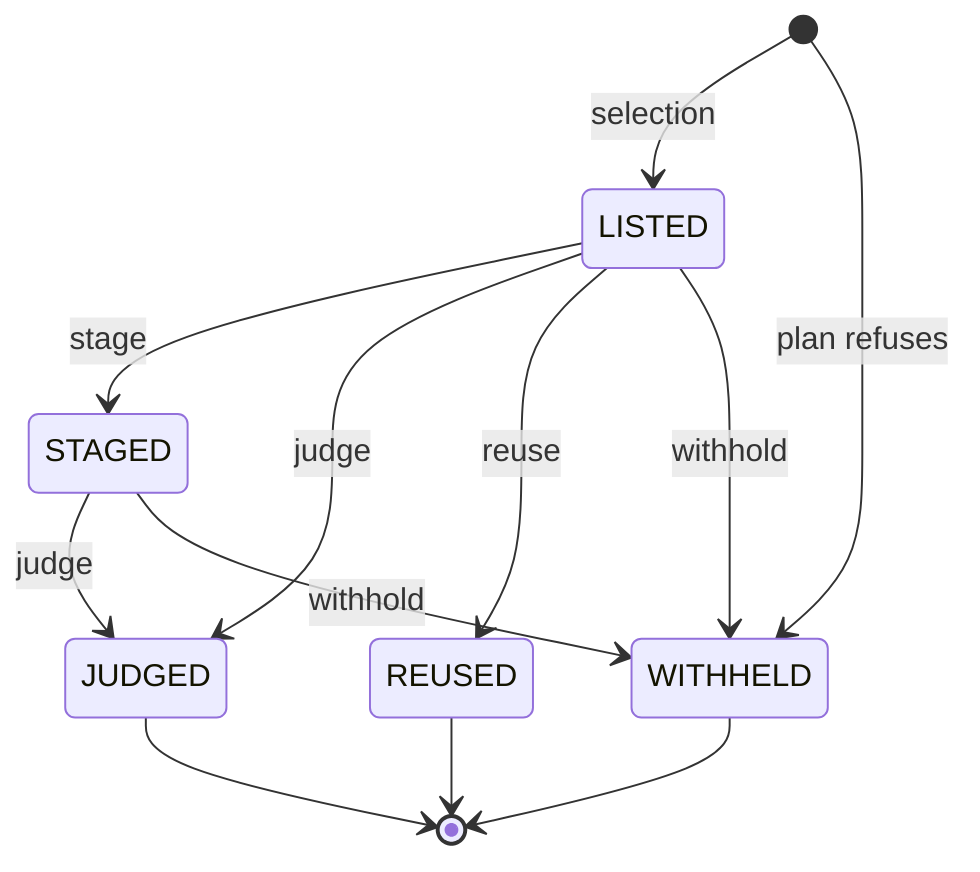

# Practice review data model

The [product vocabulary](./practice-feedback-language.md) owns result and feedback meanings.
The [review glossary](./practice-review-glossary.mdx) owns review and runtime terms.
[ADR 0056](https://github.com/hephaestus-build/Hephaestus/blob/main/docs/decisions/0056-one-practice-model-for-items-and-scans.md) records the model decision.
The [generated schema](./database-schema.mdx) owns table and key inventories.

## Definitions and identity

A practice belongs to one workspace and points to its current practice version.
Each version owns one immutable definition.
Name and review digest are database-generated projections of that definition.
Organization and feedback mode remain operational settings on the practice.

Accounts identify people. Provider identities link accounts to provider logins.
Membership joins an account to a workspace and retains its role and scope selection.
A member who leaves has `left_at`. Leaving does not erase historical work.

An item has a domain kind, a workspace and an adapter-owned identity.
A file item has a repository parent and a path.
A provider pull request review has the pull request item as its parent.
The domain owns the item's version and role semantics.

## Reviews and execution

An item event records a change to an item.
A review pins the item version and practice versions.
It records an origin independently of its ITEM or SCAN kind.
New requests need no synthetic event.
Historical origin links can be absent after migration or actor erasure.

A review can own many execution jobs.
A scan executes bounded file jobs serially.
Database indexes permit one active job per review and one active scan per workspace.
Job cleanup does not remove the product review or its results.

`review_practice` freezes the definition and complete method used for each practice.
`review_item` owns the selected practice/item pairs and their proof references.
Its stored states are LISTED, STAGED, JUDGED, REUSED and WITHHELD.
`ReviewItemState` owns the transition table, and `ReviewItem` changes its state only through `stage`, `judge`, `reuse` and `withhold`.
These methods refuse an illegal move.
The one native writer moves only a staged pair to WITHHELD when its staged payload can no longer be used.

After closure, a remaining LISTED pair is Not reviewed.
An outcome and a membership state are different facts.

Reused results keep their original producer review.
Report queries therefore join through membership rather than only through `result.review_id`.
The aggregate report contains no second copy of quotes or detailed proof.

## Results and problems

The [outcome contract](./practice-feedback-language.md#observation-outcomes) owns the four outcomes and their evidence requirements.
Admission persists the result and its problems atomically.
A refused child or citation withholds the entire candidate.
The server never deletes a problem to turn a candidate into Met.

The admission key is review, practice, item and developer.
The current claim key is practice, item and developer, with null developers treated as equal.
The newest ordered claim occupies that key until replacement, work change or removal ends it.
Ordering uses review order time, result record time and review UUID text.
An older incoming claim enters history as OUTRANKED.

A current marked result still occupies the key.
Readers exclude marked proof when appropriate. They do not resurrect an older claim.
Neither INCORRECT nor ACCEPTED changes `ended_at`.
Each mark requires a reason and has a remove-mark reverse action.

Historical evidence uses `evidence_version=0` and retains unknown fields.
New admission requires version 1.
It never constructs strict current proof from missing historical coverage, roles or quotations.
Archived proof cannot support scan reuse.

## Feedback and delivery

Feedback names one developer and one destination.
Several distinct pieces can share a review, developer and destination.
Each retains its own words, responses and UUID.

The basis joins feedback to results and optional problems.
Composite foreign keys enforce the same workspace and developer on both parents.
A problem reference must belong to the named result.
A developerless result cannot support feedback.

`review.checks.feedbackComposition` retains each feedback proposal's exact support per copy and its quiet decisions with prior-advice witness IDs.
The same record retains the primary result and any explicit conversation replacement target.
Preparation rejects a replay that changes this record.
For a public piece, the record also retains the publication context that the history read issued.
The server sets it from the preparation request, and the composer cannot set it.
These records share the review's existing JSON limit and require no additional table.

The runtime passes practice-page title, body and next step through the practices SPI.
Feedback preparation renders these fields inside the practices module.

Feedback preparation persists the basis and physical copies before provider access.
An on-work send owns lease and reconciliation state.
Copy text, anchors and write identity become immutable after a write begins.
Historical provider write keys and markers remain exact.
New copies use their UUID as their write key.

A confirmed copy records its provider reference and appearance time.
An unresolved sibling keeps the parent Unconfirmed without erasing the confirmed time.
Readback can establish FOUND, ABSENT or UNKNOWN.
Only an explicit admin retry after proved absence can reopen a write.
Unknown visibility never authorizes another POST.

Practice-page delivery uses the feedback record's first authenticated developer read time.
A view-as admin read does not create that receipt.
Conversation delivery requires actual shown words in a completed turn.
A result link alone is not delivery.

Approval binds the exact proposal before any copy write begins.
Withdrawal changes private card visibility without changing delivery history or result outcomes.
A response keeps resolution and usefulness as independent dimensions.
Its history is append-only, including a clear marker when the developer removes the response.

## Source access and erasure

A persisted row does not grant source access.
Read projections apply tenancy, owner, consent and source permissions.
Unavailable text does not mean the result has no problems.
Safe counts and outcome facts can remain visible while words and evidence are absent.

Erasure removes dependent feedback and proof before membership.
It also removes source-person proof in reviews about another developer or about no developer.
PostgreSQL records evidence erasure.
Evidence-copy receipts keep pending sandbox cleanup identities after parent deletion.
Audit actors can become null without changing their recorded action.

The [data map](/admin/dsms/personal-data-map) owns retention, export and erasure procedures.
