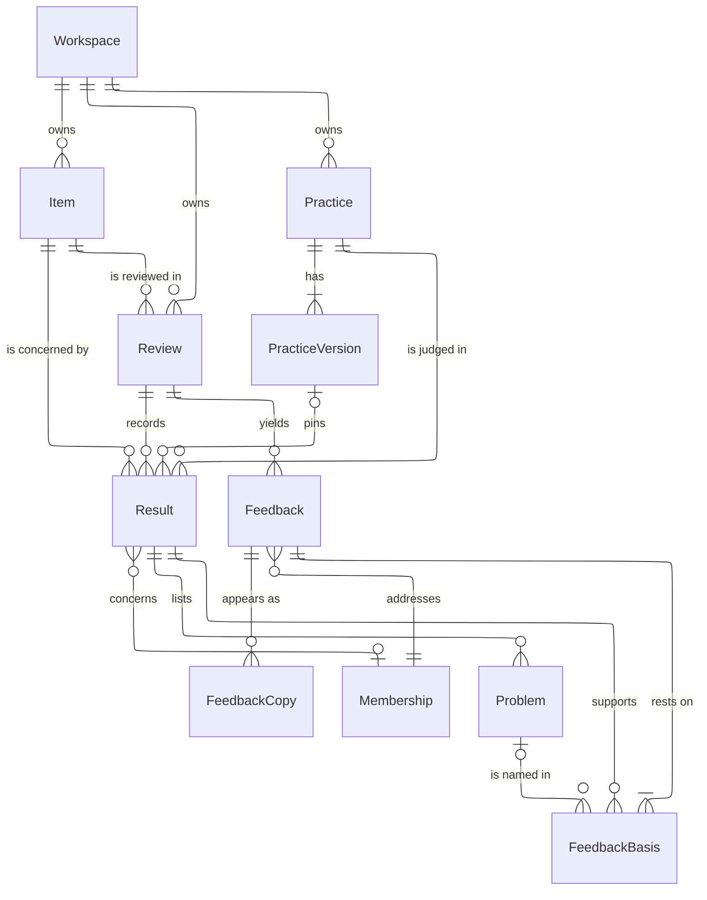

# Practice review glossary

This page owns terms for the review operation and runtime.
The [product vocabulary](./practice-feedback-language.md) owns practices, observations, problems, feedback and people.
A term has one definition in one of these pages.

## The core data model

This entity-relationship diagram is a logical overview. It shows how the records of one review relate, from the items and practices to the copies of feedback.
Each box is a table, and the entity names are the table names in PascalCase. It leaves out the columns and every foreign key that it does not draw.
Look at `FeedbackBasis`: each row links one feedback to one result, and can name one problem of that result. Feedback rests on one or more of them.

A result concerns a practice and an item of its own. In a scan, the review covers the repository, and each result concerns one item that the repository holds, such as a file.
A result of migrated history can have no pinned practice version, so that link is zero or one.

Every table here except `Workspace` carries `workspace_id NOT NULL`, so each row belongs to exactly one workspace.
The product calls a `Result` an observation, and the `Membership` that it concerns the developer ([product vocabulary](./practice-feedback-language.md#observations)).
[Database schema](./database-schema.mdx) has the full, generated schema.

## Review terms

| Term                    | Meaning                                                                                                                                                       | Identifier                                          |
| ----------------------- | ------------------------------------------------------------------------------------------------------------------------------------------------------------- | --------------------------------------------------- |
| **Item**                | One thing that an observation can concern or a review can cover. Its kind states what it is.                                                                  | item, item.kind                                     |
| **Version**             | One fixed state of an item. Its domain defines what identifies that state.                                                                                    | item_version                                        |
| **Event**               | A recorded change to an item, such as a pull request merged.                                                                                                  | item_event                                          |
| **Review**              | One operation that checks practices against an item at a version and can record observations.                                                                 | review                                              |
| **Scan**                | A review of the items held by another item at a version. The holder is a repository on its monitored default branch.                                          | review.kind = SCAN                                  |
| **Scan exclusion**      | A listed file that cannot supply scan text. It stays in the inventory and has no eligible practice/file pairs.                                                | inventory_receipt.exclusions                        |
| **Origin**              | How a review started: an event, a request, a schedule or a backfill.                                                                                          | review.origin                                       |
| **Review status**       | Where a review stands, as stored and as the API reports it. A review is Queued while it waits and nothing of it runs. It waits for capacity, for room for its sandbox, for the workspace's AI budget, or for a retry. It is Running while a claimed invocation runs or a scan prepares its inventory. Terminal states do not reopen. | ReviewStatus                                        |
| **Continuing** | A Queued review whose earlier attempts ended some of its practices. On a slow provider a review can take many attempts, and each ends some practices. The ended practices keep their results private until the last attempt admits them ([ADR 0063](https://github.com/hephaestus-build/Hephaestus/blob/main/docs/decisions/0063-each-practice-is-staged-when-it-ends.md)), so a person sees a count, not observations. | ReviewProgressDTO |
| **Practice status**     | Where one practice stands in its review. Queued until capture decides it is Ready or Withheld. A scan's practice is Running from the first file that a server captures for it. A practice that nothing measured ends Withheld with its review's stop reason, and never Done.           | review_practice.status                              |
| **Review scope**        | The repositories and people that a workspace permits Hephaestus to review.                                                                                    | review_scope_repository, membership.review_selected |
| **Role**                | The developer's role a practice concerns: author, reviewer, assignee or merger. The editor label is About.                                                    | definition.about                                    |
| **Review on**           | The events and recorded state that select a practice for automatic review.                                                                                    | definition.reviewOn                                 |
| **Applies when**        | The conditions that establish whether a practice applies on every review origin.                                                                              | definition.appliesWhen                              |
| **Reviewed by**         | Who reviews a practice: Hephaestus, people or nobody.                                                                                                         | definition.reviewedBy                               |
| **Practice script**     | Code that reviews one practice for one item and returns one candidate observation.                                                                            | definition.script                                   |
| **Candidate**           | The proposed observation that a script returns before server admission.                                                                                       | Candidate                                           |
| **Admission**           | The server checks that decide whether a candidate can become an observation.                                                                                  | result admission                                    |
| **Feedback mode**       | How the workspace permits feedback: Off, Approve first or Automatic.                                                                                          | feedback_mode                                       |
| **Publication context** | What other reviews communicated on the same work to the same developer, as one history read issued it. A public piece keeps the context it was composed from. | publicationContext                                  |
| **Evidence**            | The material that a review captured and read.                                                                                                                 | result.evidence                                     |
| **Citation**            | A pointer into captured source text at an item version, with its quote and available coordinates.                                                             | citation                                            |
| **Coverage**            | What an observation read and what it did not read.                                                                                                            | result.coverage                                     |
| **Report**              | A scan's summary and supported observations for workspace admins and exports.                                                                                 | review.report                                       |
| **Quiet window**        | The wait before the occasions of an item reach their readiness edge, so that newer occasions of the same item join them. The [operations guide](../admin/practice-review-operations#quiet-window) sets its length and its cap. | item_event.reason QUIET_WINDOW, item_event.retry_at |
| **Problem lineage**     | How a problem compares with the previous comparable result of the same practice on the same item.              | planned: problem.lineage_id                         |
| **Readiness edge**      | The moment the server decides which selected practices of an item run. It comes when the quiet window closes, or at once for an occasion that never joins a window. A milestone measures every practice it selects. Any other occasion measures only those with no current result. | item_event.reason, review_item.reason |
| **Milestone**           | An occasion that is the first or a renewed moment for feedback: opened, ready, or a request. Its readiness edge measures every practice it selects, also one with a current result. The item kind decides which of its events are milestones. | ItemEventDefinition.occasion |
| **Source fingerprint**  | A value for one source kind of an item, computed by its source contract. Equal fingerprints mean equal captured bytes. A result stays current while the fingerprints of every source its session could read do not change. | planned: result.read_fingerprints                   |

Problem lineage is decided for 1.0 and not shipped yet ([ADR 0062](https://github.com/hephaestus-build/Hephaestus/blob/main/docs/decisions/0062-the-item-is-the-review-scope.md)).
Source fingerprint and Feedback composer are decided for 1.0 and not shipped yet ([ADR 0069](https://github.com/hephaestus-build/Hephaestus/blob/main/docs/decisions/0069-practices-run-when-ready-and-stay-current-by-their-sources.md)).

Use Review as the short product name where the page establishes the practice context.
Use practice review in prose that does not establish that context.
A provider's review is always a pull request review or a merge request review.
It is an item, not a Hephaestus review.

In product text, name the concrete item kind.
Write “212 files,” not “212 items.”
Work is a plain word with no identifier or separate taxonomy.

### Origins

| Value    | Started by      | Meaning                                                               |
| -------- | --------------- | --------------------------------------------------------------------- |
| EVENT    | The named event | The adapter recorded a change that selects a review.                  |
| REQUEST  | A request       | An authorized person requested a review or scan.                      |
| SCHEDULE | A schedule      | A workspace schedule selected a review.                               |
| BACKFILL | A backfill      | An authorized batch reviews earlier work without delivering feedback. |

Origin and review kind are independent.
A requested repository review is a scan with REQUEST origin.
A backfill is not another observation outcome or another current-observation namespace.
The [pipeline](./practice-review-pipeline.mdx) owns ordering, eligibility and feedback restrictions.

### Review definition and feedback mode

A practice version holds its definition.
The editor labels Review on, Applies when, About and Reviewed by map to the fields above.
The [catalog guide](./practice-catalog.md) owns definition identity and update behavior.
The [review pipeline](./practice-review-pipeline.mdx#select-a-review) owns applicability checks and capture refusal behavior.

HEPHAESTUS permits automated review.
PEOPLE requires human review and an explanation of why.
NOBODY keeps the practice as guidance with no automated review.
A practice with a null script uses the built-in script.
A script that fails does not fall back to it.

Feedback mode is separate from Reviewed by.
Off prevents feedback at every destination but does not prevent eligible observation recording.
Approve first requires an admin decision before feedback leaves on the work.
Automatic permits that delivery after the normal policy checks.
The two active modes permit eligible practice-page and conversation feedback without public approval.

A practice can inherit feedback mode from its group, then from its workspace.
A null setting means inherit. It does not mean Off.
Changing a setting does not approve an older proposal.
Delivery pause and the developer's external-feedback preference remain separate checks.
The [operator guide](/admin/practice-review) owns their scope and controls.

## Admission reasons

`ABSENCE_NOT_SEARCHED` (`absence_not_searched`) marks a withheld candidate that says the repository lacks something, whose searches of the whole checkout do not name that thing.

`ABSENCE_HITS_UNEXPLAINED` (`absence_hits_unexplained`) marks a withheld candidate with a search for what it calls absent that found matches, and that does not say what those matches are.

`UNDECLARED_SOURCE_CITED` (`undeclared_source_cited`) marks a withheld candidate that cites or says it consulted a source outside its practice's declared Reads.
The checkout's diff and tree are always readable through Git.
A source used only to check Applies when does not become a runtime read source.
The server records no observation for the refused candidate.
This refusal establishes neither missing evidence nor a defect in the developer's work.
The [operations guide](/admin/practice-review-operations#the-trace-line) gives the operator's next step.

## Readiness reasons

An item event that waits has one of these reasons:

- `QUIET_WINDOW`: the event waits in its item's quiet window.
- `REVIEW_IN_PROGRESS`: a practice that the window selects is still measured by an earlier review of the item. The window closes again one window later, until that review ends.

A practice with the withheld membership reason `REPLACED` was in a queued review that a newer event stopped at claim. The next readiness edge of the item selects it again.

A practice with the withheld membership reason `READINESS_REFUSED` was not ready.
Its sources could not be verified at practice start or seal, its evidence was too little, or the workspace budget was spent.
The next readiness edge of the item selects it again, also an edge whose events do not select it.

`ALREADY_CURRENT` marks a withheld item event whose selected practices all have a current result.
Only a continuing occasion can end with it. A milestone measures its practices again.

A `REUSED` membership keeps an earlier result, because a requested review found that the practice and everything it reads are unchanged. It is not a new measurement.

A practice that declares the item's checks source as Required or Complete waits until the checks of the head settle.
Its membership is withheld with one of these reasons:

- `CHECKS_PENDING`: a check of the head still runs, or the provider has not listed all of them.
- `CHECKS_AWAITING_APPROVAL`: a check waits for a maintainer to approve its workflows.
- `NO_CHECKS_REPORTED`: no check reported on the head, or the provider's checks are not read.

The next readiness edge of the item selects that practice again.
The checks event of the head is such an edge.
A practice that reads the checks as Optional never waits.
These reasons establish nothing about the work.

## Currentness

Currentness tells whether an observation still describes the work: `CURRENT`, `STALE` or `UNVERIFIABLE`.
A freshness read compares the source fingerprints that the capture recorded with the work that this server stores now.
It reads the repository mirror as it is and never calls a provider.

An unverifiable observation has one of these reasons (`unverifiableReason`):

- `RECORD_MISSING`: the record of what the review read is missing, or it comes from an earlier version of the review. No later read can verify the observation. The product shows it as an unverified observation.
- `WORK_UNREADABLE`: the record exists, but this server cannot read the current work now. For example, the provider no longer has the reviewed commits, or a source is not readable. A later read can verify the observation. The product shows it as an observation that it cannot verify now.

**Captured at** (`capturedAt`) is the time when the observation's capture read the work.
The observation describes the work as of that time.
A later check that found the work unchanged is not recorded.
An observation without its record has no such time.

These reasons establish nothing about the work.

The server syncs the repository mirror with no transaction at three points: practice start, the publish of a feedback package and a send.
Thus, a server whose mirror was empty or evicted reads current data.
If that sync fails at practice start, the practice is withheld as `READINESS_REFUSED`.
The next readiness edge of the item measures it again.
If it fails when a package is published, a piece whose sources stay unreadable is withheld as `UNCORROBORATED`.
A send that cannot sync is retried by the outbox.

The practice page, a conversation and the pages that show observations never sync.
They read the mirror as it is, so an unreadable source shows as "Cannot verify now".
The practice page or a conversation can then refuse a piece as `UNCORROBORATED`.

## Legacy history reasons

These values describe rows that a release before 1.0 left. No code writes them.
They stay in the schema and on the wire, with their wording, because the rows stay.
A rewrite to a current value would claim something that nobody recorded.
They establish nothing about the work.

**Evidence version 0** marks a result from before the capture contract.
It is never current, never reused and never part of new feedback. The product shows it as an unverified observation.
A practice's standing uses it only when no current review has decided the practice, and then says that the standing is based on earlier reviews.
A trigger refuses it on a new result.

`LEGACY_FAILURE` marks a review that was cancelled before stop reasons were recorded. Why it was cancelled is unknown.

`LEGACY_SCOPE_UNKNOWN` marks a review that ran before its coverage was recorded. What it covered is unknown.

`LEGACY_AMBIGUOUS_RESULTS` marks a withheld assignment with multiple migrated results for the same review, practice and item.
Its result pointer is null. At cutover, the assignment records the producing job and the number of results.
All original results remain separate history with evidence version 0. No sibling is selected as the assignment's answer.
Existing source permissions, custody, privacy controls and retention still apply.

`LEGACY_REUSE_UNBOUND` marks a historical reuse whose reference does not identify exactly one result.
The assignment is withheld and has no result pointer.

`LEGACY_REVIEW_UNBOUND` marks a withheld item event from a release that keyed submitted reviews by the pull request head.
The event stays on its pull request with its original name, revision and times. It names no review, so it cannot start one.

**Retained occasion evidence** is the record of a pull request or submitted review that an item event keeps when it is recorded.
It holds the version, review state, roles and work record as Hephaestus stored them at that moment.
It also keeps the native identity of each person it names.

An event review of that event reads only this record.
It never reads the current work in its place.
The record expires at a fixed time after the event is recorded.
Expiry, erasure and removal of the item replace it with a statement of why it is gone.

`OCCASION_EVIDENCE_UNAVAILABLE` marks a withheld item event whose retained occasion evidence is missing, expired, erased or too large to keep.
The same name is the source capture code that causes it.

## Runtime terms

| Term                           | Meaning                                                                                                   | Identifier                     |
| ------------------------------ | --------------------------------------------------------------------------------------------------------- | ------------------------------ |
| **Job**                        | Execution of a review in a sandbox, with attempts and costs.                                              | review_job                     |
| **Agent**                      | The sandboxed runtime that executes a review.                                                             | agent runtime                  |
| **Attempt**                    | One claimed execution of a job, protected by its execution fence.                                         | attempt                        |
| **Browser fault**              | A failure that a reader met in the browser and that the browser reported, such as an error that no code caught. It is not an SCM issue, and "fault" here is not the blame in a no-fault attempt. | browser.fault, browser_faults_total |
| **Attempt token**              | The signed credential of one attempt, of a review or of a conversation turn. It names the attempt and its workspace, and nothing else. | AttemptJwt |
| **Lease**                      | A running attempt's own identity, valid until a time on the database clock. Each claim sets a new one. The active step renews it by that identity: the review loop during execution and result upload, or the server before and after the loop runs. The sandbox driver renews a turn run's lease. Every write of the attempt names it. When it expires, the server recovers the attempt. | agent_run.lease_epoch, agent_run.leased_until |
| **Model assignment**           | A workspace's choice of a model for an execution purpose and AI tier.                                     | workspace model configuration  |
| **Source contract**            | The definition of a source's identity, meaning, capture facts and permitted uses.                         | reads.contract                 |
| **Source kind**                | A stable name for a logical source of captured material.                                                  | SourceKind                     |
| **Capture**                    | The authorized collection of material and its explicit source facts for a review.                         | capture stage                  |
| **Readiness**                  | Whether the captured sources meet the practice's declared requirements.                                   | review_practice                |
| **Job folder**                 | The server's disposable files and repository copies for one execution attempt.                            | workspace ABI                  |
| **Checkout cache**             | The checkouts that a server built again from its own mirror for attempts that another server captured, kept inside the mirror. Each is verified against the recorded commit, tree and checkout digest. | checkoutKeys, review_attempt_input |
| **Runtime non-result**         | An assigned practice that stopped without a candidate. Its stop reason describes execution, not the work. | nonResults                     |
| **No-fault attempt**           | An attempt that ended for a reason that is not the review's: a server's drain or no sandbox room. It gets a new number but spends no retry. | drain_count, room_refusals, ReviewJob.spentAttempts |
| **Progressed attempt**         | An attempt that ended a practice that no earlier attempt ended, and then ran out of time. It gets a new number but spends no retry.                                                                                                                            | progressed_attempts, ReviewJob.spentAttempts        |
| **No sandbox room**            | History only: the stop reason of a review that an earlier version ended for lack of sandbox room. No code gives it now, and old reviews keep it. It describes capacity, never the work. "Hephaestus had no room to run this review in time." | NO_SANDBOX_ROOM |
| **Composition unconfirmed** | The stop reason of an admitted review whose attempts all ended before they confirmed a decision for each destination. The results stay, and the review closes as Partial. It describes the attempts, not the work. | COMPOSITION_UNCONFIRMED |
| **Composition**                | The preparation of feedback from admitted and eligible observations, by the review's sandbox in its `REVIEW_COMPOSE` run. | feedback composition           |
| **Feedback composer**          | The model with tools that composes, posts and corrects the feedback of one review at one destination. It holds no provider token. | planned                        |
| **Not composed**               | A withholding for a destination that no composed decision reached, when no more specific reason applies.  | NOT_COMPOSED                   |
| **Correction limit** | The model-call or edit budget ended the correction loop. Copies already posted stay on the work. | STEP_LIMIT |
| **Composition stop**           | The cause that left a destination without composed feedback. A passing cause hands the attempt on.        | CompositionStop                |
| **Stage**                      | The admission of one practice's candidate when the practice ends. The candidate waits on its membership row until the seal. | review_item.state = STAGED |
| **Seal**                       | The one transaction that writes a review's staged results and problems. | planned |
| **Send**                       | One leased provider post, quiet correction, readback or retraction of on-work feedback, with its reconciliation state.               | agent_action                   |
| **Review digest**              | The digest of the definition inputs that can change an observation from the same evidence.                | practice_version.review_digest |
| **Turn**                       | One run of Hephaestus for one question in a conversation, with its attempts, lease, partial answer and usage.       | mentor_turn, conversation_turn from 1.0                    |
| **Call pool**                  | Provider capacity that the models in it share, whichever workspace calls them: a learned limit of calls in flight, an interactive reserve and a cooldown. Every model has one. | llm_call_pool |
| **Learned limit**              | The calls in flight that a call pool thinks its provider serves. It rises while served calls fill it, and falls when the provider refuses or queues. | llm_call_pool.learned_limit |
| **First-token baseline**       | The fastest first token that a call pool knows from its provider. Later first tokens are compared with it to detect a queue at the provider. | llm_call_pool.baseline_first_token_ms |
| **Interactive reserve**        | The part of a call pool's limit that only interactive calls, such as a conversation turn's, may use: a quarter, rounded up. | LlmCallLimit.reserve |
| **Call permit**                | One model call's share of its call pool, held as a lease by the server that makes the call. | llm_call_permit |
| **Context folder**             | The read-only files that one agent may read for one person, in one workspace, for one purpose. | INDEX.md, inputs/context/, repos/ |
| **Context document**           | One JSON document about the developer or the workspace in the context folder of a conversation.            | inputs/context/*.json          |
| **Context loader**             | The integration part that stages a heavy item, such as a repository, into a context folder on request. | ContextLoader, load_context |
| **Sandbox namespace**          | The Kubernetes namespace that an operator creates for the sandboxes of one release alone.   | sandbox.namespace              |
| **Sandbox isolation gate** | A platform check of the installed sandbox templates against the required isolation boundary. Operators run it before enabling work. | scripts/sandbox-isolation.ts |
| **Isolation tier** | The sandbox template's runtime class and enforced security settings. | sandbox.templates.runtimeClassName |
| **Runtime attempt**            | One attempt of a review job or of a conversation turn, with a run lease and writes fenced on its epoch. A sandbox gateway connection wait stays inside this attempt. | agent_run.lease_epoch |
| **Proved search**              | A search that the loop confirmed by searching the same files itself. Only a proved search can show that the work lacks something. | pi-verified-search.ts |
| **Subject**                    | The thing that one sandbox serves: a review or a conversation. Its key, such as `review:<id>`, is the concurrency key of its runs. It is not the item that a review covers. | agent_run.concurrency_key, agent_sandbox.subject_key |
| **Run**                        | One leased unit of agent work for a subject, such as the measurement of a review or one turn. One run of a subject runs at a time, and its sandbox is its only writer. | agent_run |
| **Run kind**                   | What a run drives. A `REVIEW` run measures a review. A `REVIEW_COMPOSE` run composes the review's feedback after its `REVIEW` run ended, and it continues that run's epochs. | AgentRunKind |
| **Lease epoch**                | The fencing number of a run. Each claim raises it, and the database refuses a write that names an older one. | agent_run.lease_epoch |
| **Band**                       | The priority of a run and of its model calls: interactive, batch or background. An interactive call gets a grant first, and a batch call yields at grant time. Work that waits rises one band at a time, but never into the interactive band. | agent_run.band, llm_call_permit.band |
| **Sandbox**                    | The one agent-sandbox `Sandbox` of a subject: one container with the driver, the tools and the workspace. It is a cache. The server deletes it when no run needs it, and rebuilds its context from PostgreSQL. | agent_sandbox |
| **Sandbox token**              | The credential of one sandbox. It names the workspace, the subject and the sandbox, and it expires at the sandbox's shutdown time. Only the gateway accepts it. | SandboxTokenService |
| **Gateway**                    | The server port that sandboxes can reach, and their only egress. It holds the LLM proxy, the call permits, the context and checkout, lease renewal and proposals. | server port 8081 |
| **Action**                     | One side effect that the server executes for a run or for a person, such as an email or a product-feedback issue. It has an idempotency key. Its adapter reads it back, or sends it at most once. | agent_action |

Stage and Seal are decided for 1.0 and not shipped yet ([ADR 0063](https://github.com/hephaestus-build/Hephaestus/blob/main/docs/decisions/0063-each-practice-is-staged-when-it-ends.md)).
[ADR 0079](https://github.com/hephaestus-build/Hephaestus/blob/main/docs/decisions/0079-one-agent-system.md) decides the subject, run, lease epoch, band, sandbox, sandbox token, gateway and action for 1.0.
When they ship, they replace the job, attempt, lease, attempt token and send.
They also replace the review agent Pod, tools Pod, conversation loop, conversation host and tool protocol v1.

The job folder of a review is the context folder of that review.
The [Conversation runtime](./unified-pi-runtime.mdx) owns turns, the conversation sandbox, context documents, and context loaders.
A turn is not a job: it has no job row and no review.

A job can expire without removing its review or observations.
The [runtime guide](./practice-review-runtime.mdx) owns execution, retries and retention.
The [workspace ABI](./agent/workspace-abi.mdx) owns file paths and capture records.
The [source contract](./item-source-contract.mdx) owns capture states.
The [data model](./practice-feedback-schema.md) owns durable keys and guards.

`USAGE_UNVERIFIABLE` stops a scan because the cost of earlier model calls cannot be verified.
It does not mean that the scan used up its budget.
An execution that made no model call adds no usage row.

## Standard terms

This section records conceptual correspondence, not claims of standard conformance.
External terms retain the meaning of their standard.
Product labels remain the labels defined above and in the product vocabulary.

| Hephaestus concept  | EARL / ACT                     | SARIF 2.1.0                       | OSCAL assessment results          |
| ------------------- | ------------------------------ | --------------------------------- | --------------------------------- |
| Practice            | Test criterion                 | reportingDescriptor               | Control objective                 |
| Practice version    | Criterion definition used      | Rule metadata and properties      | Objective definition used         |
| Review              | Evaluation with assertions     | run                               | Assessment activity               |
| Scan                | Evaluation of a collection     | run                               | System assessment                 |
| Item                | Test subject or test target    | artifact or logical location      | Assessment subject                |
| Version             | State under evaluation         | revisionId                        | State under assessment            |
| Observation         | Assertion and TestResult       | result or run properties          | Objective-status finding          |
| Met                 | passed                         | pass                              | Satisfied objective               |
| Not met             | failed                         | fail                              | Unsatisfied objective             |
| Does not apply      | inapplicable                   | notApplicable                     | Applicability explanation         |
| Could not determine | cantTell                       | open                              | Unresolved assessment explanation |
| Not reviewed        | untested                       | Coverage properties               | Scope and activity record         |
| Problem             | Failed expectation and pointer | fail result                       | Evidence of non-compliance        |
| Example             | Supporting evidence            | Properties or supporting location | Evidence of compliance            |
| Open question       | Reason for cantTell            | open details or properties        | Assessment explanation            |
| Citation            | pointer                        | location and snippet              | Relevant evidence                 |
| Report              | Evaluation report              | log                               | Assessment results document       |

The EARL and ACT outcome terms correspond to the four observation outcomes and the separate Not reviewed state.
This does not make a withheld candidate an untested claim.
See [EARL 1.0](https://www.w3.org/TR/EARL10-Schema/) and [ACT Rules Format](https://www.w3.org/TR/act-rules-format/).

The [SARIF specification](https://docs.oasis-open.org/sarif/sarif/v2.1.0/os/sarif-v2.1.0-os.html) defines export fields and allowed values.
The SCM export creates one fail record per visible problem and puts coverage totals in run properties.
It does not invent pass records for files it did not review.
Critical and Major map to error, Minor to warning, and Trivial to note.

The original severity stays in properties.
Trivial remains a fail. It is not the standard’s informational result kind.
Baseline values new, unchanged, updated and absent describe problem comparison.
Absent needs comparable complete proof at a changed version. Removal and admin marks do not prove absence.

The [OSCAL assessment model](https://pages.nist.gov/OSCAL/learn/concepts/layer/assessment/assessment-results/) separates evidence from objective-status conclusions.
An OSCAL observation can support compliance or non-compliance.
Despite the shared word, it is not a Hephaestus observation.
An OSCAL finding is closer to a Hephaestus observation than to one located problem.
This correspondence does not provide an OSCAL exporter.

[ISO/IEC 17000](https://www.iso.org/standard/73029.html) supplies conformity-assessment vocabulary.
A practice review corresponds to an assessment activity, not a certification of a developer or repository.
Do not claim an ISO clause mapping that the implementation does not establish.

[PROV-DM](https://www.w3.org/TR/prov-dm/) separates entities, activities and attribution.
Captured versions and practice versions correspond to entities. Reviews correspond to activities.
A provider actor and an observation's developer have different attribution roles.
This is a design comparison, not a PROV export contract.

Task, process and self-regulation are research descriptions of feedback content.
The destination alone cannot prove that content has one of these levels.
Do not derive or store a scientific level from ON_WORK, PRACTICE_PAGE or CONVERSATION.
A research evaluation must classify the actual feedback and state its method.

### Historical research records

Preserve the recorded schema and criteria of an empirical record.
A historical positive behavior label does not prove the complete practice standard was met.
Recomputing a definition digest does not reassess the old work.
Keep the original outcome and evidence qualification separate.
The [evaluation provenance contract](./evaluation-provenance.md) owns these limits.
