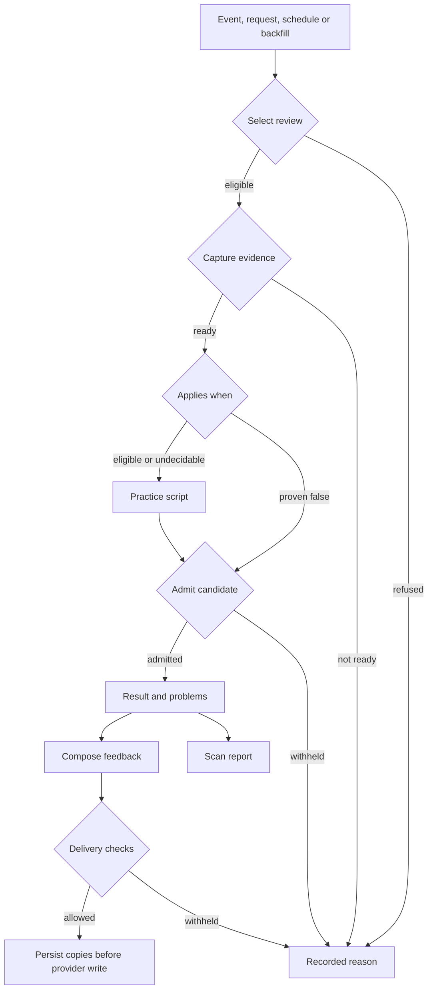

# Practice review pipeline

A review has four boundaries: selection, capture, result admission and delivery.
Each boundary can stop with its own reason.
A capture failure never becomes a claim about the work.
Withheld feedback is never reported as missing evidence.

## Select a review

[ADR 0062](https://github.com/hephaestus-build/Hephaestus/blob/main/docs/decisions/0062-the-item-is-the-review-scope.md) decides a quiet window and supersede for item reviews. They are not shipped yet.
[ADR 0069](https://github.com/hephaestus-build/Hephaestus/blob/main/docs/decisions/0069-practices-run-when-ready-and-stay-current-by-their-sources.md) decides readiness per practice, freshness by source fingerprints, and a composer agent that sees its earlier feedback. They are not shipped yet.

Adapters record item events after source sync establishes the recorded change.
Repeated provider delivery does not create another event for the same item, name and version.
Queue updates retain the original event time, version and discovery source.
They change only decision and retry facts.

`reviewOn` selects events and recorded state for automatic review.
`appliesWhen` applies to every origin.

After capture readiness passes, the server checks the pinned practice version's conditions before sandbox execution.
The capture adapter interprets its evidence files and returns a decision for each clause through `CapturedApplicability`.
Capture requests use each collection's owning source from `EvidenceCollection`.
For example, `scm.inline-review-comments` reads the complete `scm.pull-request.comments` capture.
SCM changed-path conditions use Spring Ant path patterns with `/` as the separator.

If every alternative is proven false, admission records Does not apply with the authored `otherwise` reason.
Only complete captured sources can prove absence.
An undecidable alternative keeps the practice eligible.
A required capture failure retains its capture refusal and produces no result.
A request can bypass event selection, but cannot bypass scope, consent or evidence readiness.

Feedback mode Off does not refuse an otherwise eligible review.
Reviewed by People or Nobody prevents automated execution.

An ITEM review pins one item.
A provider pull request review is its own item, with its pull request as parent.
The practice's role must resolve to exactly one eligible human account.
No holder records ROLE_UNAVAILABLE. Multiple distinct holders record ROLE_AMBIGUOUS.
The server never picks the first assignee or makes an unresolved person anonymous.

Explicit `about=null` permits a developerless result.
All scan assignments are developerless.
Backfills record evidence without delivering feedback.
The [review glossary](./practice-review-glossary.mdx#origins) owns origin names.

### Source change and repair

GitHub and GitLab adapters preserve provider-specific snapshot coalescing and deletion behavior.
An issue edit can end current proof without erasing history.
A tombstone holds new review work. Disconnect erases the connected source through its eraser.
Restoration and a later eligible event can permit a fresh review.

The issue evidence version includes its captured sub-issue progress and its source.
Provider summaries are authoritative. Positive stored-child counts are a lower bound.
An empty stored-child inventory does not prove that an issue has no children.
Parent summary and hierarchy writes, and child close or reopen, record a parent issue occasion in the same transaction.

A repair must capture the version it claims to review.
It cannot reconstruct a missed merge from the current head alone.
Duplicate event delivery does not extend a decision deadline or renew consent.
Provider comments identified as Hephaestus's own writes do not start a feedback loop.

A repeated SCM work version can reuse its existing occasion without starting another review.
Its source observation still reconciles current issue and pull request results through durable event delivery.
The comparison reads the canonical source now.
It does not use the old occasion time as a freshness cutoff.
A verified result for a superseded version remains in history and does not replace a matching current claim.
An unavailable or hidden source does not establish a work change or item removal.

Submitted reviews retain their own event-driven retirement and normal claim ordering.
A later author push alone does not retire observations about an unchanged submitted review.
Repository and file scans keep their frozen source contract.

The [sync lifecycle](./sync-lifecycle.md) owns adapter lifecycle details.
The [operations guide](/admin/practice-review-operations) owns queue timing and deployment controls.

## Capture evidence

The domain source supplies the pinned record, version, roles and authorized material.
Capture records availability, content, completeness and collection outcome separately.
Every required source must meet the practice's declared read requirements.
A missing, failed, redacted or incomplete required source records a readiness refusal.
It produces no result for that practice.
Other practices can run when their required sources are available.

A practice of an item review stays Queued until capture records it as Ready or Withheld.
The request does not make it Ready.

Before capture, the server compares each practice's pinned reads with the current source catalog.
A practice that pins another source contract, or reads a source that the catalog does not have or does not apply to the item, records `source_contract_unsupported`.
That practice is withheld, and its sources are not captured.
The other practices are captured and run.

Selection compares each practice's review events and About role with the item kind's descriptor, for events and for requests.
Authoring checks the same descriptor facts, but a stored version can predate them.
A practice that declares an event or an About role that the item kind does not offer is not selected.
Its page in practice administration says that Hephaestus does not run it.

Capture checks the pinned version again, for a version pinned before the check.
Such a practice records `item_capability_unsupported` and is withheld in the same way.
Scans review files and repositories, not the practice's item kind, so this check does not apply to them.

`source_contract_unsupported` and `item_capability_unsupported` mean that the stored practice does not fit the work.
An example is a practice version from an older catalog.
A workspace admin must fix the practice, so the review closes as Partial.

A retry of the review job runs only the practices that are still open.
A practice that an earlier attempt withheld keeps that withholding and its reason.
The retry does not capture or measure it again, also when an earlier refusal came from a source that was not ready then.
The retry's readiness report lists only the open practices.
The withholdings of the earlier attempt stay on the review's practices and their membership, with their reasons.

If no practice can be captured, the review records a readiness refusal and the sandbox does not start.

An optional read must name a supported source.
Its data can still be unavailable.

For GitHub and GitLab reviews, a Git transport failure records `UNAVAILABLE` with `REPOSITORY_FETCH_FAILED` for the repository tree.
An unreadable pinned base or head records `REVIEW_VERSION_UNAVAILABLE`.

The pinned diff, file citations and commit records currently require the same Git objects.
They have no provider API fallback.
A fetch failure therefore also makes the diff unavailable and omits commit records.
Description and discussion capture can still succeed from synchronized provider records.
Readiness withholds practices that require the unavailable source and retains the precise reason in each source check.
Neither a fetch failure nor an unavailable source is evidence of a problem in the work.

A current pull or merge request work record contains the mirror as capture reads it.
Current capture first verifies the mirror against the pinned version.
If the version changed, for example its title, description, head or base, the capture stops.
It uses none of the changed material.

The record dates its read with `basis.captured_at`.
This time is not the provider event time, the request time or a sync observation time.
`basis.mirror_synced_at` dates the status fields separately.
A current capture does not recover material of an earlier version.
Records from earlier releases can name `admission_fields` and `admitted_at`.
Readers keep those declarations as recorded.

### Retained SCM occasions

Pull request, merge request and submitted-review occasions keep their original record before review admission.
The record includes the work's version, words, state and roles as Hephaestus stored the occasion.
It does not reconstruct an earlier provider action.
The record declares `basis.other_fields=OCCASION` and dates that read with `basis.observed_at`.
A retained submitted decision also carries its own `observedAt`.

Other discussions and decisions remain capture-time material.
They are not a complete earlier discussion history.

Admission and capture use the retained occasion while checking current workspace access and contributor permission.
A later edit cannot replace the original record.
A pending GitLab occasion can gain its diff base only while its original source fence holds.
Its first words, people, state, roles and expiry stay unchanged.
A submitted review on an older commit does not attest the current pull request's diff.

An absent, oversized, expired or erased original records `OCCASION_EVIDENCE_UNAVAILABLE` and is withheld before admission.
Temporary source failures and corrupt retained records remain faults that can be retried.
A manual request still captures the current work under its normal version checks.
Other item kinds, Slack and Outline retain their existing source contracts.

The [personal data map](/admin/dsms/personal-data-map) owns retention and erasure of these records and their copies.
The frozen expiry also bounds retained writer inputs and native session copies.
Cleanup uses the existing sweep and runtime leases.
Physical removal can follow the expiry.
Earlier events have no retained original and are not backfilled from today's work.

Preparation failures log exception class names and their cause chain once per attempt.
These diagnostics exclude exception messages, credentials and provider bodies.

Consent checks apply to every person whose work the review reads.
The result's developer is not the only source-person dependency.
A missing required AI choice is a policy refusal, not an evidence gap.

The [source contract](./item-source-contract.mdx#capture-state) owns capture states.
The [workspace ABI](./agent/workspace-abi.mdx) owns the staged files.
Captured text is evidence, not instructions that can override the review contract.

## Admit results

[ADR 0063](https://github.com/hephaestus-build/Hephaestus/blob/main/docs/decisions/0063-each-practice-is-staged-when-it-ends.md) decides per-practice staging and one seal. It is not shipped yet. [ADR 0064](https://github.com/hephaestus-build/Hephaestus/blob/main/docs/decisions/0064-one-evidence-contract-for-every-producer.md) owns the evidence contract.

Every practice uses the same script contract.
A null custom script invokes the built-in script.
An invalid custom script stops its practice without fallback.
Only the final candidate returned by the script reaches admission.

The host supplies assignment identity and trusted read receipts.
The host measures the coverage of every candidate. A candidate cannot claim its own coverage.
A review session's candidate gets the coverage that its session ledger measured.
Admission refuses claimed coverage on every outcome.

A candidate that script code decided gets the coverage of the script's own reads.
The captured change counts as supplied in full to a script.
A citation alone does not count as a read, because it returns only the quoted lines.
A truncated or failed script read makes the coverage incomplete.
A script that read nothing has incomplete coverage, unless the host supplied the change.
A Does not apply that script code decided needs complete coverage.

ITEM coverage includes the practice's required sources and the sources that its result cites.
A brief-only decision can be complete when the opening brief supplied all these sources.

Each review session opens with a brief of only the sources that its practice declares.
The brief shows them in one order: the change, the core text, linked work, then the discussion.
It ends with the practice's own index of those sources.
Practices that declare the same sources get the same opening, so a prompt cache can share it.

The server orders item-review practices without a current result first, then by the oldest last verdict.
The runner preserves that order among practices ready to start.
Each declared-source set starts one leader at once.
Its followers wait for the leader's first streamed response, at most 20 seconds or until the leader ends.
A different set can start while those followers wait.
The review deadline still bounds the wait and the work.

OpenAI Responses uses explicit cache boundaries at the system prompt and the ends of the change and core layers where the model supports them.
The provider's implicit session cache keeps its own slot.
OpenAI keeps its provider-default retention.
The API does not accept a five-minute TTL.
Anthropic's native Messages layout uses five minutes in L5 of [ADR 0069](https://github.com/hephaestus-build/Hephaestus/blob/main/docs/decisions/0069-practices-run-when-ready-and-stay-current-by-their-sources.md#update--2026-10-28).
Completions protocols receive no explicit cache markers.

Live cache gain remains unverified until staging measurement after L3 merges.

The session's read, grep and find tools refuse a captured file that the practice does not declare. A listing still shows its name.
A result may cite only its declared sources, the change and the checkout. The runner refuses other citations, and the session gets a repair turn.
Every session can also read the change and the checkout through Git.

Thus, a session that uses only these tools reads and cites only its declared sources.
`bash` and code in the session can still read every captured file, until captured context moves to a volume that only the loop mounts.
[ADR 0069](https://github.com/hephaestus-build/Hephaestus/blob/main/docs/decisions/0069-practices-run-when-ready-and-stay-current-by-their-sources.md) decides this.

An omitted source requires continuous reads from line 1 through EOF.
A failed read or an unread range of a required or cited source prevents complete coverage.
A later complete read can close the gap.

The same range accounting governs ITEM file reads and SCAN reads.
Simple literal shell reads receive coverage only when their output matches the pinned source.
Other shell commands grant no coverage.
Listings, metadata, history queries and failed reads of optional paths do not prevent complete coverage.
Session diagnostics retain all observed reads.
Candidate omissions and failure counts describe only gaps in the sources needed by that result.

In an item review that reads a checkout, a result that says the repository lacks something needs a search of the whole checkout.
Otherwise admission withholds it as `consulted_source_unread`.
[Workspace ABI § Claims that the repository lacks something](./agent/workspace-abi.mdx#claims-that-the-repository-lacks-something) has the rules.

The server verifies shape, outcome requirements, quotations, source permission and claim basis.
One invalid problem, example or citation withholds the complete candidate.
Other valid practice candidates can continue.

A submission can contain candidates for a subset of its frozen assignments.
Every remaining runtime assignment supplies an explicit [runtime non-result](./practice-review-glossary.mdx#runtime-terms) reason.
Admission retains these reasons separately from results and candidate refusals.
When execution ends, settlement records these assignments without an outcome and closes the review as Partial.
A malformed owner or unauthorized submission refuses the submission.

Generic quotation checks belong to core and use the captured-text manifest.
Verifiers never supply the text that establishes a quote.
Quotation checks first use the supplied canonical file or record coordinates.
Repeated text at those coordinates is valid.
Only a unique quote can repair incorrect coordinates.

Domain checks verify side, version and change-basis references through the citation-verifier port.
An introduced code claim needs a head witness that intersects added lines in the pinned change.
A worsened code claim needs witnesses from the pinned base and head revisions, with added head evidence that supports the change mechanism.
The base witness shows the prior state and need not intersect removed lines.
These checks bound the witnesses. They do not prove the claimed consequence.

A missing domain verifier cannot authorize a version-dependent claim.
This keeps provider and diff meaning outside core admission.

The [product outcome contract](./practice-feedback-language.md#observation-outcomes) owns outcome meanings.
The [script runner](./practice-script-runner.mdx) owns strict candidate fields and limits.
The [data model](./practice-feedback-schema.md) owns current-result identity and ordering.

## Compose feedback

[ADR 0061](https://github.com/hephaestus-build/Hephaestus/blob/main/docs/decisions/0061-review-seals-then-feedback-composes.md) records why composition runs on the worker.

The worker composes after the sandbox ends: the sandbox measures and admits, and never composes.
Composition runs in the attempt that admitted the results, before the attempt ends.
It reads the inputs that admission retained, the admitted results, and the server's reads of routing and history.
It first composes the review on the work, then the private feedback, which reads the review it follows.

Composition reads admitted, eligible results and their problems.
It never sends an open question or an example alone.
Feedback on the work speaks about Not met results for the eligible developer.
With no eligible problem, the review posts no praise comment.

Composer prompts set short text targets for each destination.
The tools refuse text above twice those targets and return an example for correction.
The composer keeps evidence and its qualifications when it shortens feedback.
Delivered prose uses natural evidence references without internal labels or coordinates.
Support references and anchors retain the exact evidence links.

The review on the work also gets the whole code that its public Not met citations name.
Each cited text resolves to its one manifest entry, as admission resolved it.
The source file that a citation names does not decide which text it is.
A file is shown only when its retained bytes match the digest admission verified.
A citation of lines in the captured change record shows the one changed file whose section of the captured change holds those lines.

Historical advice claims require confirmed shown words with authorized source custody.
Unavailable history is a failed or refused read, not an empty history.
Delivery facts can remain visible without copying unavailable words.
Earlier advice cannot be inferred from a provider comment's current contents.

Private composition reads up to 30 recent matching pieces of delivered private feedback and queued conversation feedback.
The read is scoped to the developer and to each private destination that the same read opened for a practice.
A practice open on one destination does not open its history on another.
With no open private destination, history is not read.
Preparation rechecks its support without reading this history again.
The read uses feedback-delivery permissions and records the source-copy custody.

Its coverage states whether more matching entries exist or some could not be copied.
Delivered words are a record of what was said.
Their recorded claim currentness says separately whether the claim still holds.
As on the work, current or stale words delivered by the history read can show that a point was already said.
Only current words delivered before the work was captured can show that nothing material changed.
Withdrawn, unverifiable or unavailable words establish neither.

Only private composition reads this history.
A resumed attempt reads it again without changing the original evidence or admission.

Private cards and conversation feedback have their own permission and model gates.
No conversation brief is prepared unless an available Mentor model respects the developer's AI choice.
The worker prepares the final public package before the private session starts.
A private setup failure or deadline does not erase that prepared review.
The destinations remain independently eligible.

### One bounded session per destination group

Each session is one conversation with the attempt's frozen model through the proxy, with the attempt's AI choice, budget and usage rules.
The review on the work has one tool, `report_review`.
Private feedback has `report_feedback`.
Each turn shows everything its session may use, so no session reads files.
A session makes at most the model calls of one practice's turn for each practice that it decides, and at most three practices' worth.
Each call asks for no more than the attempt's output limit.

No call starts after the composition deadline.
The deadline is the composition timeout after the sandbox ends, and at the latest one minute before the stale-job sweep would end the attempt.
The proxy refuses a later call.
Provider failures are retried after a pause that doubles each time, within the deadline.

The checks answer each call.
A refused review or piece goes back to the model with every reason, so that the model can correct it.
Preparation answers too: a package that the server refuses goes back the same way.
A review whose public history changed while it was composed is composed again from a new history read, at most twice.
A session that ends without a decision for a practice it may carry asks the model once more.

### Decisions and withholdings

Each destination ends with prepared feedback or a withholding that the server records.
A destination that no composed decision reached gets the cause that stopped it, a `CompositionStop`.
A destination that the server did not route gets no withholding.
A composition stop never fails the review.
The `agent.job.composition.stopped` counter records each stop with its cause and outcome.

A cause that another attempt would meet again withholds at once, with the most specific reason:

- The workspace's AI choice refuses the model: No AI.
- The retained inputs were erased: Evidence not permitted.
- The server refuses to publish the review on the work: the server's own reason.
- Every other cause is withheld as Not composed:
  - The budget is spent, or the deadline passed.
  - The provider refused the request, or the inputs exceed the context window.
  - The inputs are gone, or the model decided nothing after the second request.

A passing cause withholds nothing and hands the attempt on:

- The provider fails past the session's calls or deadline.
- The routing read of the destination fails.
- An unexpected failure stops the composition.

The attempt at the retry limit withholds what a passing cause leaves open, as Not composed.
If a destination whose routing read failed is withheld, preparation reads the routing again.
A destination that is not eligible then keeps the server's own reason.

Progress is recorded per destination.
The review on the work is decided when its package is prepared.
A practice is decided on a private destination when a prepared piece on that destination rests on its result, whether the piece delivers or withholds.
A page card does not decide the conversation for its practice.
The worker asks the model once more about each destination that is still open for a practice, during the same session.

### Resuming a lost attempt

A lost or handed-on attempt resumes as a new attempt of the same job.
That attempt starts no sandbox and measures nothing.
It composes only what no prepared row decides, from the inputs that its admission retained.
Each destination keeps only the room that the earlier pieces left.

Every admitted attempt is handed on, whatever its retained inputs permit.
The new attempt checks the inputs before it stages anything:

- Inputs whose receipt is erased or does not index every person that it copied are never staged.
  The attempt withholds each open destination as Evidence not permitted.
- Inputs that are gone or expired withhold each open destination as Not composed.
  So do inputs of an earlier basis version or of another admission.

The handed-on attempts use the job's retry limit with its backoff.
The attempt after the limit composes nothing and withholds each open destination as Not composed.
If that attempt is lost too, the job is completed with its results kept, and the open destinations stay unrecorded.

A claim check can refuse a handed-on attempt: the developer declined AI, the budget is spent, or the model is gone.
The attempt is then claimed to withhold what is open with that cause, without a model call.
An erasure still cancels it, because an erased person gets no new rows.

The new attempt reads routing, consent and erasure again.
The original expiry of the retained inputs stays in effect.
A new attempt reads the review on the work that an earlier attempt prepared, with its wording.
Each note is mapped back to the admitted citation it rests on, so the private feedback follows that review as in one run.

### Placement and support

The composer selects an inline citation by problem ID and citation index.
Preparation resolves that exact admitted citation.
A valid citation is not automatically commentable.
Placement requires the pinned revision, side, file path and complete range within one diff hunk.
The range must intersect changed lines.

GitHub creates a review comment.
GitLab creates a positioned diff discussion with the pinned base, start and head commit references.
A range names its first and last line, which must share one hunk of that diff version.
Readback verifies a range copy only when GitLab records both of its ends.
Before delivery writes a line note, it reads the GitLab diff version for the pinned head and base.
If that version is missing or the read fails, delivery does not write line notes or file notes.

A file note is a merge request overview discussion that links to the reviewed code.
It is permitted for an anchor that identifies only a file.
It is also permitted if the reviewed diff lacks the line, or GitLab rejects the position.
An uncertain write retains its attempted receipt and cannot start the fallback.
The receipt records the physical copy kind.

Slack and Outline do not receive SCM line notes.

Each copy retains the results and problems it communicates.
Preparation checks response suppression against that support, not every problem of each supporting result.
The review receipt retains every quiet decision and its prior-advice witnesses, including reviews that also raise feedback.
A practice-page card addresses one practice and retains its title, body and next step until the canonical renderer runs.
Conversation support requires eligible Not met results for every practice it names.

For conversation SUPERSEDE, the host resolves the prepared thread key to the queued feedback ID.
Preparation rechecks its developer, practice, destination, state and write fence.
The existing supersession service replaces the old queued feedback only after the new feedback is ready.
Public and private pieces use separate preparation requests.
A refusal for one package does not clear another package's accepted feedback.

Preparation applies one text policy to each text that the composer writes, for every destination.
A text contains no link that a cited quote of the work did not supply.
It contains no GitHub, GitLab or Slack mention, no raw HTML, no image and no hidden or bidirectional control character.
Code spans and code blocks can quote code, but not Slack syntax.

If one text breaks the policy, preparation refuses the package and stores nothing.
The refusal names the rule and the field, never the text.
The composer tells the model the rule and the field in the same session.
The model rewrites that text and sends the review or the piece again.
A destination whose text the model does not correct within the session's calls is withheld as Not composed.

## Deliver copies

Preparation commits feedback, basis, copies and an eligible send before external access.
Approval names the exact words, anchors and developer.
Approve or reject is permitted only before a copy write begins or a send is claimed.
A changed workspace policy cannot approve an older proposal implicitly.

A write fence is not proof of visibility.
Unknown visibility keeps feedback Unconfirmed and forbids automatic repeat writes.
Readback records found copies and proved absence without guessing.
An admin can retry a proved absent copy after all current gates pass.
Confirmed historical copies are never posted again.

Current source version, scope, consent, feedback mode, delivery pause and approval are checked at egress.
A work-state refusal does not erase the result.
Practice-page and conversation feedback retain their own visibility checks.

A public piece keeps the publication context of the history read that it was composed from.
The history read issues the context and the history page from one snapshot.
A new copy write needs two facts about the same work and the same developer.
First, the context of other reviews' feedback is still current.
Second, no write of another review has an unknown outcome.
The write fence takes the item lock first, then reads both facts in one statement.

A stale context withholds the piece as Public history changed.
An unknown outcome withholds the piece as Public delivery unresolved.
The admitted results do not change.
A piece prepared before contexts existed counts as composed from an empty history.
Readback, retraction and correction do not need these checks.

Preparation refuses a public piece with a stale context and stores nothing.
While its composer still runs, a fresh session composes again from a new history read, at most twice.
A refused approval records its check before it answers.
A stale context also records the withholding.
An unknown outcome keeps the proposal awaiting approval.

An admin can recheck a write with unknown visibility.
The recheck only reads the copy back and never creates a copy.

A conversation copy settles after its Heph turn ends.
It is delivered only when the completed answer shows its words through `show_feedback`.
The weekly digest creates no copy and changes no delivery.
The [Heph runtime](./unified-pi-runtime.mdx#delivery-of-shown-feedback) owns the claim and the receipt.

The [feedback model](./practice-feedback-schema.md#feedback-and-delivery) owns durable receipts.
The [operator guide](/admin/practice-review) owns approval, retry and diagnosis procedures.

## Correct results and feedback

An incorrect mark prevents its result from supporting new feedback.
The send service reconciles any started copy before it requests supported provider correction.
Unsupported correction leaves the actual posted appearance visible with its recorded reason.
Removing the mark rechecks current policy before restoring eligible unreplaced feedback.
It never reposts an earlier confirmed copy.

An accepted mark removes a result from open-problem lists without changing its outcome.
Neither mark ends the current result or restores older proof.
Withdrawal changes a private card's visibility, not its results.
Restore is the reverse action.
A developer's disagreement does not mark a result automatically.

## Scans

A scan pins the monitored default branch and complete inventory before practice filters.
Each selected practice/file pair has durable membership before execution.
The driver runs bounded file jobs serially.
It freezes the full model-slot method and practice version for reuse.

Reuse requires the same composed file version, which includes the assigned blob and declared context inventory.
Complete read coverage does not establish a complete dependency set.
The host does not record dependency receipts for script listings, searches or tree citations.
[ADR 0056](https://github.com/hephaestus-build/Hephaestus/blob/main/docs/decisions/0056-one-practice-model-for-items-and-scans.md#dependency-based-scan-reuse) owns the prerequisite for reuse across different context inventories.

The SCM adapter shares a pinned tree index across file versions and context grants.
After the listing completes, reuse makes one pass with durable progress for each pair.
A restarted scan continues that pass without repeating completed attempts.

Each file job captures only its assigned files and the union of its practices' frozen context paths.
The capture contains no repository inventory record.
The COMPLETE flag applies to that permitted set.
Broad context grants still capture every permitted file.
Captures above 2,000 files or 8 MiB are unavailable with `CONTENT_EVICTED` before the runner starts.
The capture log records the measured file count and byte count.

The SCM adapter classifies files before the driver selects practice/file pairs.
Binary files and files above 2 MiB remain in the removal inventory with explicit exclusion reasons.
They have no eligible membership, result or Withheld attempt.
Pending pairs put files without a current result first, then oldest results, then paths.

A complete assigned-file read is required for a Met scan result.
A listing, quotation or search alone cannot prove a complete file read.
Runtime failure records Withheld membership. Untouched listed work becomes Not reviewed after closure.
A partial scan never proves that its unreached work met a practice.

The removal guard uses the full repository inventory, not a practice selector.
Incomplete listing removes nothing.
A complete listing that would remove 20 percent or more of the earlier files is suspect and removes nothing.
Removing a file does not establish repair or absence of its problems.

Comparison requires equal standard, selectors and frozen method, plus complete new proof at a changed version.
Marks, reuse, withholding and missing reads do not prove absence.
Completed files in a partial scan can support comparison. The unreached remainder cannot.

The [scan guide](/admin/practice-scans) owns user procedures, report counts and export availability.
