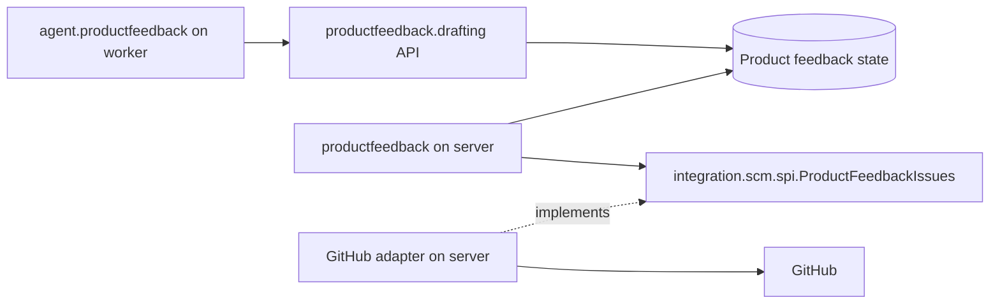
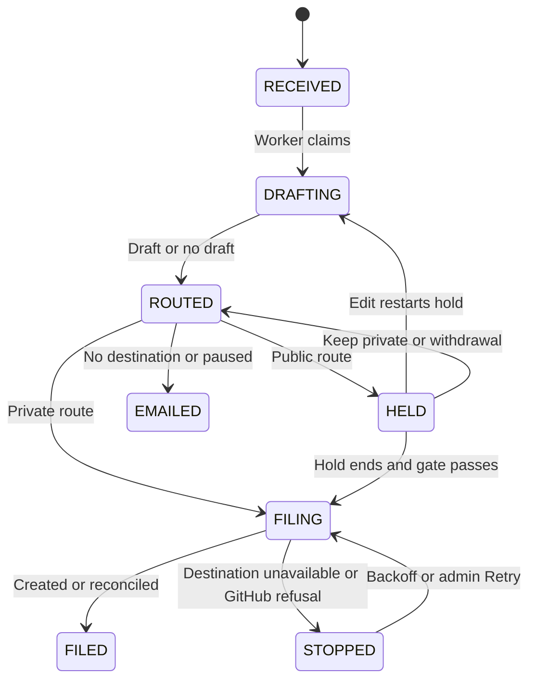

Product feedback is a report about Hephaestus, separate from practice feedback.
The instance stores the report first, drafts an issue, and files it in an operator-named GitHub repository.
Without a destination, it retains the report for instance admins and sends the admin email fallback.

The constraint is that each reporter’s effort ends at **Send**.
Code must decide what can become public before GitHub receives it.
The model supplies structured data but has no tools and no authority to publish.
[ADR 0073](https://github.com/hephaestus-build/Hephaestus/blob/main/docs/decisions/0073-product-feedback-is-worked-on-in-github.md) records the decision and rejected alternatives.

## Modules and runtime roles

The `productfeedback` module owns the lifecycle and trust decisions.
It owns input stripping, redaction, the prompt, output validation, routing, rendering, and the durable filing state.
The closed `agent` module supplies the worker-only model adapter in `agent.productfeedback`.
That adapter calls the named `productfeedback.drafting` API.
The dependency is `agent` → `productfeedback`. Product feedback never imports agent internals.



The drafting API loads in the worker role. Other product feedback services remain server-only.
The webhook role has no product feedback task.
The server refreshes issue snapshots, files issues, polls follow-up, processes `/publish`, transfers issues, and performs external cleanup.
It does not run the model call.

The `productfeedback.drafting` contract has three operations:

- `claim(workerId)` returns optional `DraftWork` with its attempt, opaque `llmModelId`, messages, schema, token cap, deadline, and lease check.
- `complete(feedbackId, attempt, rawText, usage)` submits the model output and usage.
- `fail(feedbackId, attempt, reason)` records `MODEL_UNAVAILABLE`, `TIMEOUT`, or `PROVIDER_ERROR`.

Completion checks the attempt before it changes the row.
The GitHub adapter (`integration.scm.github.app.productfeedback`) implements `integration.scm.spi.ProductFeedbackIssues` for repository lookup, snapshots, filing and reconciliation.
It implements `integration.scm.spi.ProductFeedbackIssueUpdates` for transfers, edits, comments, permissions and follow-up.
It files as the instance's GitHub App, so it carries an `EgressExempt(PRODUCT_FEEDBACK)` declaration and consults Silent Mode before each write.
Each issue operation uses the numeric repository and installation IDs frozen during routing.
GitLab, Slack, and Outline do not implement product feedback destinations.

## State machine and leases

The filing row belongs to one saved report.
Sweepers claim rows with `FOR UPDATE SKIP LOCKED` in short transactions.
They record the claimant, lease deadline, and attempt before network work starts.
Network calls run outside the transaction.
Compare-and-set transitions reject stale results after an attempt or state changes.



An expired lease returns work to its previous waiting state with backoff.
An expired or ambiguous GitHub attempt requires reconciliation before a new write or cleanup step.
The server allows up to three automatic retries before **Needs action** requires **Retry**.
Every report not on GitHub has an admin email fallback.
`MODEL_UNAVAILABLE`, `LIMIT_REACHED`, and `DRAFT_INVALID` select the no-draft route instead of stopping the report.
`DESTINATION_UNAVAILABLE` and `GITHUB_REFUSED` stop filing.

Person actions use guarded transitions on the same version.
An edit restarts the five-minute public hold and checks the outgoing revision again.
Keep private cannot cancel a write that has already started.
The saved response describes the intended route. The confirmation follows the row until it reaches its actual destination.

## Routing gate and consent

One function, `admitPublic(report, revision)`, guards every public write at dispatch.
It applies to first filing, edits, retries, and promotion.
The ordinary public route requires all these conditions:

- The reporter allows publication for this report under the current consent event.
- The report kind is `BUG` or `IDEA`.
- A public destination and a valid draft exist for the exact outgoing revision.
- The disposition is `ISSUE`, rather than `SECURITY` or `NOT_AN_ISSUE`.
- The report has no risk latch or blocking redaction finding.
- Safety checks find no abuse or named-person subject and find the report coherent.
- Confidence is `HIGH`.

Otherwise, the report goes to the private repository, or to email when no private destination exists.
`FEEDBACK`, praise, and questions therefore stay private.
Private issues record the first applicable reason: opted out, security, redaction, about a person, low confidence, abuse, or no draft.
No-draft private issues use the code-redacted original text.

A security disposition, blocking redaction finding, or `aboutNamedPerson` result on any revision sets the risk latch.
No edit or retry clears it.
Each secret, credential, email address, or known person’s name blocks public filing even after redaction removes it.

The append-only `product_feedback_consent` events record the account, choice or withdrawal, notice version, and time.
Events determine the current choice. Each report records the event used for its route.

The first choice has no selected answer.
An account withdrawal sends held public reports to the private route immediately.
A new notice version requires a new choice.
The hold catches mistakes. It does not supply consent through inactivity.

The route freezes repository and installation IDs.
Destination changes send queued reports for the previous destination to email with `DESTINATION_CHANGED`.
The server checks private visibility before each private write and stops on an unknown result.
The two destinations have distinct IDs and the same owner.

## Redaction and the renderer

Code strips raw HTML, HTML comments, invisible Unicode, and bidirectional Unicode before inference.
Deterministic redaction removes detected email addresses, secrets, and known identities before the provider receives report text.
Known identities include the reporter and the names, slugs, and members of their workspaces.
Redaction can miss personal data. It does not prove anonymity.

The model receives the report as delimited untrusted data and a bounded snapshot of public issue titles.
The snapshot contains at most 500 recently updated open issues, excludes pull requests, and refreshes every 15 minutes.
Titles have a 120-character cap and share a fixed token budget.
The model never receives private issue titles.
The draft records snapshot coverage. A new filing enters the snapshot immediately.

The model returns a disposition, issue type, title, sections, optional match, safety fields, and confidence.
It leaves absent facts empty rather than invent reproduction steps.
Code validates types, lengths, and that a proposed match exists and is open in the snapshot.
An invalid response gets one corrective retry, then no draft.

The constrained renderer escapes model fields as plain text under fixed bug or feature headings.
It rejects model-supplied HTML, images, links, headings, and comments.
Bare issue references and issue URLs become code, including references within the same repository.
Only code adds a validated “Possibly related” link.
Each report creates its own issue. A model match never causes a comment or edit on another issue.

Redaction runs again on every rendered body, including private bodies and edited drafts.
It removes detected secrets and identities, restricts URLs, and neutralizes mentions and cross-repository references.
Only code can add the reporter’s opted-in GitHub mention to the public footer.
The footer discloses that a model drafted the issue.

## Idempotent filing and pace

Each report has a stable marker across retries:

```text
<!-- hephaestus-product-feedback:<uuid> -->
```

Before a write, the attempt freezes its target, payload hash, and transport deadline.
The transport deadline is shorter than the lease.
A lease expiry cannot stop an in-flight GitHub request.
Reconciliation waits until its deadline passes before it concludes that no matching issue exists.

The lookup reads every page of the frozen repository’s issues with the app as creator, `state=all`, and the first-attempt time.
It checks the exact app identity, marker, and frozen payload hash.
An incomplete lookup, conflict, failed lookup, or live attempt is unknown, never absent.
An unknown result blocks another write. A matching issue is adopted instead of created again.

An atomic pace reservation allows one filing at a time per instance, at least ten seconds apart and at most 30 per hour.
Public filing also has a five-per-account daily cap.
The server honors `Retry-After` and reset headers.
It waits when the installation has less than 20 percent of its rate limit left.
These bounds leave headroom for practice feedback but cannot guarantee GitHub’s undisclosed limits.

## Model admission

Drafts use the instance model under `LlmCallClass.PRODUCT_FEEDBACK`, without tools or interactive reserve.
The class receives a grant only when no other class has a live waiting request.
At most one product feedback call runs per pool.
It cannot pass a queued practice-review call.

A later request can wait for that one bounded transport. Calls are not preempted.
Provider quota and cooldown remain shared.

The adapter uses `Caller(null, feedbackId, filingAttempt, instanceModelRef)` through the existing permit lifecycle.
The attempt identifies the report’s draft generation, not a review attempt.
Only product feedback omits the workspace. A model without a configured pool is unavailable.
The permit remains held until the response body is consumed or the cancelled transport closes.

Physical retries debit the same permit through `beforeRetry`.
Draft attempts record tokens and enforce the instance and account limits without the workspace usage ledger or a synthetic workspace.

## Promotion, follow-up, and cleanup

The server reads private issue comments for `/publish` every five minutes, through every page after the stored cursor.
It records each command ID durably before acting.
At dispatch, the commenter needs current `write` or `admin` permission on both repositories.
An unknown permission denies promotion. `authorAssociation` does not establish authority.

Promotion requires reporter permission and a valid redacted draft.
It overrides kind and confidence only, never consent, security, the risk latch, or abuse.
It creates a public issue with its own durable attempt marker, then closes the private issue with the public link.
It adds no private backlink to the public issue.
The no-draft fallback text cannot be promoted.

Every 30 minutes, the server polls followed issues in GraphQL batches of 100.
Cursors and notification keys prevent repeated emails.
Public comments from another actor, state changes, duplicate closure, and release evidence can produce reporter emails.
Private comments do not. Duplicate closure moves follow-up to the original issue.

Release mail requires a merged closing PR and a published release tag that contains its merge commit.
It reports release ancestry, not the behavior of the running instance.

**Pause** sends new and unfiled reports to email and holds publication commands until resume.
It leaves follow-up, withdrawal, and erasure cleanup active.
An in-flight write finishes or reconciles under the normal rules.

Erasure integrates with `PersonDataCatalog`, `AccountErasureContributor`, and `WorkspacePurgeContributor`.
Before source rows are deleted, the same transaction copies the reconciliation envelope to `product_feedback_cleanup`.
It retains repository and installation IDs, marker, payload hash, deadline, known issue number, and required actions, without report text or account identity.
External cleanup runs asynchronously after reconciliation.

It cancels held reports, moves public issues to private, replaces issue text, and closes private issues.
Issue deletion and revision removal require maintainer action.
After 30 days, incomplete cleanup becomes **Needs action** with an admin email.
Its locator stays until the steps finish or an admin confirms manual completion.

## Routing evaluation

The routing evaluation in `scripts/product-feedback-eval/` uses about 30 synthetic cases.
Its fixtures cover bugs, ideas, general feedback, security, identities, secrets, email addresses, abuse, duplicates, German text, and prompt injection.
Each case records the expected route and reason, plus strings that must not reach the output.

The unit tier runs real routing, redaction, and rendering code without provider credentials on every build.
It supplies the most permissive model answer to test that code still blocks privacy violations.
Poisoned snapshot titles must cause no write to the named issue and must not enter the rendered body.

The live tier uses the real drafter and provider under `@Tag("live")`:

```sh
cd server
./gradlew :application:liveTest
```

Any expected-private case that routes public fails the evaluation.
Any forbidden string in output also fails it.
Expected-public reports routed private count toward a separate rate.
Each run records the model ID, prompt digest, and case-set hash under the [evaluation provenance rules](./evaluation-provenance.md).
The routing evaluation reuses provenance conventions, not the practice feedback claim scorer.

## Design trade-offs

Automatic filing removes a separate publish task for the reporter.
The public gate, persistent risk latch, and hold carry that responsibility instead.
Every possible duplicate becomes a new issue because automatic comments create a harassment path and complicate withdrawal.
Polling keeps issue updates out of workspace ingestion.
GitHub issue types classify reports without labels that could start automation.
The ADR records the full alternatives and conditions for revisiting them.

The [admin guide](/admin/product-feedback) owns setup, recovery, and manual cleanup.
The [user guide](/user/product-feedback) owns the reporting flow and choices.
The [personal-data map](/admin/dsms/personal-data-map) owns export and erasure coverage.
