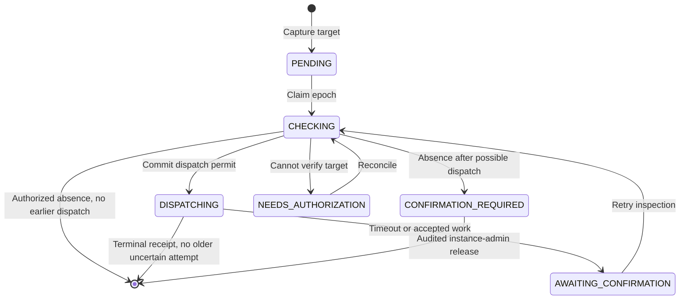

[ADR 0101](https://github.com/hephaestus-build/Hephaestus/blob/main/docs/decisions/0101-a-connection-cannot-adopt-an-upstream-resource-whose-removal-is-unresolved.md) owns this decision.
The provider event inbox still checks ACTIVE state at admission.
This repair removes upstream resources. It does not replace that admission check.

## Capture before the lifecycle change commits

`ConnectionService` captures immutable provider targets before it clears credentials or changes state.
`provider_resource_repair` keeps the pseudonymous identity without a workspace or person pointer.
`connection_provider_repair` holds each workspace's authorization reference and cascades on workspace deletion.
The [personal-data map](/admin/dsms/personal-data-map#security-retention) owns retention and its legal basis.

Every adoption and removal takes the same identity advisory locks, sorted by identity hash, before the connection row lock.
The removal does not start while another ACTIVE connection holds the resource.
A SUSPENDED GitHub or Slack connection also keeps its installation or bot identity. Suspended GitLab and Outline hooks must be removed.
Slack ownership includes the bot user, because revocation can affect a replacement token for that user.
A reconnect uses a fresh resource when the old identity remains fenced.

GitLab and Outline persist a registration marker and callback URL hash before they send a creation request.
A returned resource is adopted only by the connection version and lifecycle generation that requested it.
A late result becomes a removal target.
An unknown creation remains visible while discovery looks for its marker.

OAuth state similarly binds the connection and its lifecycle generation before redirect.
A Slack exchange commits intent before dispatch and stores the returned team, bot-user ID and token fingerprint before `auth.test`.
A crash or ambiguous error keeps that attempt for admin repair. A deterministic refusal creates no resource fence.
Successful adoption removes the attempt in the same transaction.

## Separate inspection, dispatch and completion

The dispatcher calls the provider outside a database transaction.
Uncertain and unauthorized attempts back off from one minute to one hour.
A GitHub App-scoped not-found result resolves an undispatched removal. After a possible dispatch, it requires admin confirmation and stops automatic polling.
Replacing a connection credential wakes its NEEDS_AUTHORIZATION repairs without waiting for the backoff.
If an earlier provider call is still in flight, the credential publication stays unfinished until its outcome is recorded.

An uncertain Slack exchange does not block reauthorization by the existing ACTIVE or SUSPENDED team holder. It never dispatches revocation.
Before DELETE or revocation, a short transaction records that this attempt can reach the provider.
An epoch prevents an old inspection from acquiring a new dispatch permit after a competing claim or release.
A crash after the permit is uncertain even if no request left the process.

Each retry first checks ownership.
A foreign owner or verified absence stops deletion.
It deletes the fence automatically only when no removal was ever dispatched.
After an uncertain attempt, absence cannot prove that a late DELETE is spent.
That fence requires confirmation from an instance admin or a terminal receipt for that exact attempt.
A later successful retry cannot settle an older uncertain request.

GitHub's `202` remains unresolved.
GitLab requires a complete authorized listing and an exact hook ownership marker before deletion.
Outline requires a complete subscription listing and the captured callback URL hash.
Slack verifies token, team and bot-user identity before revocation.
Unreadable ownership, a hidden `404` and credential expiry never prove completion.

## Repair a lost wake

The Modulith publication wakes the dispatcher. Persisted intent is authoritative.
The scheduled dispatcher revisits due targets and discovers late registrations.
GitLab and Outline also scan suspended connections to capture a target whose lifecycle wake was lost.
A successful terminal deletion clears matching inactive hook metadata.
It leaves an ACTIVE replacement unchanged.

Credentials expire independently of the fence.
The capture receipt prevents an old teardown wake from recreating an already resolved or manually released fence.
A pre-cutover removal or suspended-hook cleanup without that receipt counts as an earlier uncertain call.
A later absence cannot release its fence.
[Provider removals](/admin/instance-admin#provider-removals) describes confirmation and release.
[Metrics](/admin/metrics) and the [operations runbook](/admin/production-operations-runbook) describe unresolved work.
