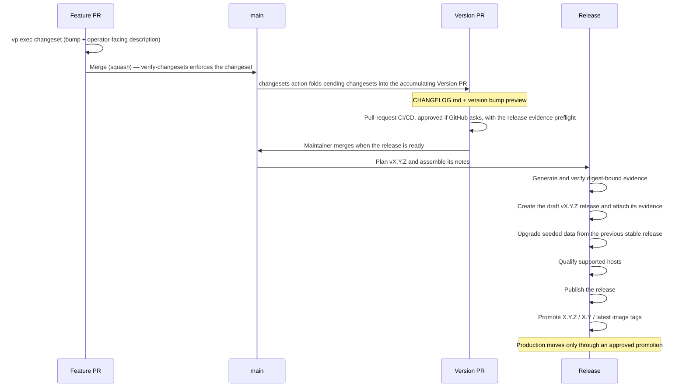

# Release Management

**Release ≠ deploy.** Development is trunk-based: all work merges to `main` (squash merge, no
`develop` branch) and every merge builds deployable images. A **release** is a deliberate act:
cutting a version of Hephaestus for self-hosters, with a tag, curated release notes, and versioned
Docker images. Staging follows `main`. Production moves to a release only through an approved
promotion. We manage releases with [changesets](https://github.com/changesets/changesets).

The [compatibility policy](https://docs.hephaestus.build/admin/compatibility-policy) defines what a released version number promises.
A change to a bundled practice also needs the acceptance in [Practice catalog curation](./practice-catalog.md#accept-a-bundled-change).

## The flow



1. **Every PR that changes shipped code carries a changeset.** `Verify changesets` fails the PR
   otherwise. [Writing changesets](#writing-changesets) has the rules.
2. **The Version PR accumulates, and is checked.** Successful CI/CD for the current `main` tip permits `version-pr.yml` to maintain the Version PR.
   Its title is `chore(release): version packages`.
   It previews the version bump, `CHANGELOG.md` section, and `MIGRATION.md` section.
   The migration section uses `.migration/` fragments at the `### Next release` anchor.
   Updates use `GITHUB_TOKEN`.
   The pull request's own CI/CD run validates its updated head, with approval when GitHub requests it.
   [The Version PR trigger contract](./ci-cd.mdx#merge-policy) owns approval, reruns and manual recovery.
   Failed main runs do not update the Version PR.
   A successful rerun or later successful tip resumes maintenance.
   Overtaken completions stop before versioning, so release validation does not start beside the same commit's main validation.

   Every CI/CD run on that branch includes the **release evidence preflight** below, regardless of its start event.
   `CI Status Gate` fails unless the same run's preflight succeeds.
   More than one run can report the gate for a Version PR head, and either satisfies the ruleset.
   Thus, a green gate proves preflight success only if no run can pass without it.

   Every run on that branch publishes the whole release image set on both architectures.
   An ordinary pull request builds only changed `linux/amd64` candidates and aliases the rest from `main`.
   The preflight captures evidence for each image on both published platforms.
   It can capture evidence only for images published by its own run.

3. **The merge is checked again.** The merge commit's push runs CI/CD in full.
   It reuses the verified images that its merge group built for the same commit, and builds any that are missing.
   See [Merge-queue image reuse](./ci-cd.mdx#merge-queue-image-reuse).
   A `main` push repeats source-validation legs only when it changes the version.
   CI compares the version with the tip that the push replaced.
   Later commits in the same push cannot hide the bump.
   `release.yml` starts only after that run succeeds.
4. **Merging the Version PR cuts the release.** The workflow resolves release image digests, then runs the evidence gate.
   Only then does it create the draft at the merge commit and attach evidence.
   After seeded-upgrade and supported-host gates also pass, it publishes the release and verifies its immutable state.
   The seeded-upgrade gate also runs the previous release on the new and a partly migrated schema.
   [Previous release on the new schema](./database-migration#previous-release-on-the-new-schema) has the checks.
   Then it promotes CI-built images to `X.Y.Z`, `X.Y`, and `latest`.
   A numbered release candidate publishes only its own version alias. See [Release candidates](#release-candidates).
   Publication deploys nothing. See [Deploys](#deploys).

### When a release fails

Release images are promoted **by digest and never rebuilt**.
A commit rejected by the evidence gate cannot pass on retry.
Only a new commit can pass.
Thus, the gate runs before anything is created.
A rejected release leaves no draft or tag, so cleanup is unnecessary.
A draft itself creates no tag.

Recovery uses a forward fix.
`scripts/plan-release.ts` cuts an unpublished version only when its validated source has no pending changesets.
A shipped fix carries a changeset and waits for the Version PR to consume it.
This keeps the fix's release note and version together.
A fix with no pending changesets can recut the same unpublished version from its validated commit.

Alternatively, merge the next Version PR.
A release follows the latest *published* release, not the version its parent commit carried.
The upgrade seed skips unpublished intermediate versions.

The release notes start from the same published release.
They contain every `CHANGELOG.md` section above that release, newest first, as the released commit has them.
Thus, the notes of an unpublished version appear in the next published release.
The draft is not created when these sections are missing, repeated, out of order, or not supported release versions.

The complete notes are also a release asset, covered by the signed evidence checksums.
If the description exceeds GitHub's size limit, it links to that asset and the changelog at the released commit.
The schema-migration notice stays in the description.

An ordinary merge of an already-published version does not cut a release.

The resume path covers failures *after* draft creation: seeded-upgrade, supported-host, or publication failures.
While the release is a draft, a workflow rerun at the same commit regenerates evidence and replaces assets.

A draft pins its version to its commit.
A later commit refuses to recut over it.
Each step that writes or publishes the release checks this again under the promotion lock.
It stops at a draft or Git tag of another commit, even one that appeared after planning.
If a draft can never pass, delete it manually.
The fixed source must have no pending changesets before it can cut a release.

If image alias promotion fails after publication, select **Re-run failed jobs** on that release workflow run.
The publication job verifies the published evidence again and compares its host smoke records with the qualified artifacts from that run.
Missing or different records stop the retry.
The job keeps the immutable assets and retries image aliases by digest.

Immediately before alias writes, the release planner checks the semantic newest published stable release under the promotion lock.
An older release cannot move aliases after a newer stable release publishes, regardless of GitHub's latest marker.
A full workflow rerun still skips an already-published version.

Version-commit reverts are no longer part of recovery, but their exemption remains.
`verify-changesets` normally freezes `MIGRATION.md` in feature PRs and prevents deletion of pending changesets or migration fragments.
A **verified revert** lifts these restrictions.
`scripts/verify-revert.ts` checks each added commit structurally.
It must record `This reverts commit <sha>.`, name an ancestor of the base, and exactly reverse that commit's patch.
Otherwise, the restrictions remain.

## Supported-host qualification

Every release boots its signed, immutable image lock through the self-hosted topology on native Ubuntu
24.04 `amd64` and `arm64` hosts. The gate enforces the [published support matrix](../admin/install#supported-host-matrix),
waits for stack readiness, and exercises HTTPS ingress. Either cell can block publication.

The release workflow attaches each cell's status record to the immutable GitHub release. This qualification covers a
clean boot. The seeded-upgrade gate separately proves the supported migration path.

Every release also installs its draft assets with the Helm chart on native Ubuntu 24.04 `amd64` and `arm64` runners.
`release-host-smoke.yml` follows [Install on one host (k3s)](/admin/kubernetes#install-on-one-host-k3s).
It verifies the signed `k3s-*` assets. The installer verifies the release chart as [Verify the release chart](/admin/kubernetes#verify-the-release-chart) describes.
Then `scripts/kubernetes-cluster.ts release-smoke` runs the release's `k3s-install.sh`, the command of the docs, with a local CA and without the DNS and clock checks. A runner of 16 GiB installs with the `small-16gib.yaml` profile.

The smoke disables swap on its disposable runner. It explicitly passes `--allow-unqualified-host`, because a hosted runner label does not pin its kernel.
This qualification override retains the effective kubelet policy and allocatable checks. It does not establish loaded-host capacity.

It runs the command a second time, which must keep the release Secret, and then an upgrade that rolls every role except PostgreSQL and NATS. The upgrade fails if it replaced their Pods.
It waits for the migration Job, every role, and each worker's isolation probe, and it sends requests through the Gateway.
It also checks that the kubelet and logind run with the configured shutdown budget. It does not reboot.
Publication waits for both cells of this smoke and of the Compose boot.

`Let's Encrypt` cannot reach a runner, so a local CA issues the Gateway certificate in the k3s smoke.
The k3s smoke runs only at a release, or by a dispatch of `release-host-smoke.yml` with a release tag and its commit.
A change to `deploy/platform/` runs the k3d jobs of `ci-kubernetes.yml` in pull requests, not the k3s smoke.

The release job copies the files of `deploy/platform/`, `k3s-install.sh` included, as release assets.
It signs each of these assets, attests them with the release, and uploads them beside the release locks.
`deploy/platform/k3s-platform.yaml` holds every platform pin: k3s, Traefik, and cert-manager.
k3s brings the Gateway API definitions with its bundled `gateway-api-crd` chart.
The clusters of `ci-kubernetes.yml` run no cert-manager: only the k3s smoke tests that pin.

A pull request that can change fresh-installation bindings gets the Compose boot before merge.
`Supported-host boot smoke` in `cicd.yml` runs `docker/self-host/setup.sh`.
It starts PostgreSQL, NATS, and the application server from that run's images, on `amd64` only and without the edge.
Both jobs fill blank installer settings through `scripts/prepare-host-smoke-env.ts`.
Thus, pre-merge and release boots answer the same operator questions.
[CI/CD § Path filters](./ci-cd.mdx#path-filters) lists the selection paths.

## Supply-chain evidence

No release exists until every image in `security/release-images.json` passes the evidence gate.
It remains a draft until later gates pass.
For each image, the gate resolves the index and `linux/amd64` and `linux/arm64` manifests to digests.
It reads each platform manifest from the registry and generates a Syft inventory, SPDX SBOM, and CycloneDX SBOM.

The webapp preserves npm names, versions and licenses in `/usr/share/nginx/html/.vite/packages/` in the image.
Vite's native license report supplies this metadata, including lazy chunks.
Syft's JavaScript cataloger reads the package manifests from the final image.

Capture fails if the image has no bundle manifests, or if Syft or Trivy omits an identity.
New captures declare `bundledNpmSbom: 1` in the signed manifest.
Verification requires bundle manifests when that declaration is present.
Archived releases that predate it keep their original contract.

Trivy scans these packages under the release vulnerability and license policy.
Vite's report does not identify worker bundles, CSS-only packages or font source packages.
The workspace lockfile is not the runtime inventory.

The SBOM and byte-budget consumers share `bundle-metadata.json` in the `.vite` directory under the webapp build directory.
The build writes this artifact after Vite expands its preload maps.
Its `schemaVersion` is `1`.
Each `packages` entry has a `name`, `version`, and optional `license` and `licenseText`.
The build derives Syft's package manifests from these same entries.
Each `chunks` entry describes one final JavaScript chunk:

| Field | Meaning |
| --- | --- |
| `fileName` | The hashed output path. Use it to resolve imports within this build. |
| `isEntry`, `isDynamicEntry` | The entry and lazy-entry flags from Vite. |
| `facadeModule` | The source module relative to `webapp/`, with its query. Shared chunks have `null`. |
| `imports`, `dynamicImports` | The static and dynamic imports, as output paths. |
| `bytes` | The UTF-8 byte count of the final code. |
| `gzipBytes` | The final code's gzip size at level 6. |
| `packages` | The sorted, distinct npm package names in this chunk. This list contains no filesystem paths. |

Consumers use `facadeModule` as the stable lazy-chunk key because content hashes change between builds.
An incompatible field change requires a new schema version.
The runtime image retains the artifact so its full license notices remain available.
The artifact covers JavaScript chunks, not emitted worker assets or CSS.

One native Trivy `vuln,license` scan supplies both vulnerability and license report paths.
This avoids duplicate image analysis and binds both evidence consumers to the same subject.
`scripts/verify-release-evidence.ts` checks every document's platform repository, digest, and architecture.
It also checks that every package survives both format conversions.

Then the release workflow attaches the SPDX predicate as a Cosign attestation and verifies image signatures and build provenance.
SBOMs, reports, policy, checksums, and `manifest.json` become release assets.

Evidence capture processes two subjects at a time and waits for both before starting the next pair.
A failed capture blocks the bundle after its in-flight peer finishes. Trivy uses its
[memory scan cache](https://trivy.dev/latest/docs/configuration/cache/) because the filesystem cache
locks out concurrent processes.

The vulnerability database and Java index remain shared and are
prepared before capture. Both workflow callers request `java-db: "true"` from `download-trivy-db`. Direct generator
invocations also need both databases prepared because capture disables their updates. Each subject
still receives the same SBOM formats and combined vulnerability/license scan.

Each subject also has a `.timings.json` diagnostic with its digest, platform and elapsed Syft and
Trivy time, including failed invocations. Timings use a monotonic clock around the existing scans.
They add no scanner work or latency threshold. They are advisory, not security evidence: failure to
save them warns without changing the scan result. The same durations appear in the job log.

The Helm chart consumes the image pins from the verified release lock.
The inventory in `security/release-images.json` defines the images that release evidence must cover.
The 0.95 Compose files still consume the proxy and volume initializer.
Their images retain release evidence until those consumers are removed.

Upstream images are versioned and digest-pinned.
They receive the same per-platform SBOM, license, vulnerability, and index-membership evidence as first-party images. Hephaestus requires its own signatures and build provenance only for
images it builds. Image publishing uses GitHub's native attestation action to record provenance and
registry storage metadata. Only publishing jobs and their reusable-workflow callers receive
`artifact-metadata: write`, alongside the signing and attestation permissions.

[Vulnerability remediation](./vulnerability-remediation.mdx) is the normative policy for blocking
findings, scheduled rescans, and exceptions.

### Nothing may fail for the first time at a release

Pre-merge validation covers the same image subjects and shared evidence checks as release publication.
`scripts/generate-release-evidence.ts` is the one generator and
`scripts/verify-release-evidence.ts` the one verifier. `release.yml` and the `Release evidence
preflight` job in `cicd.yml` both run them, and the preflight runs the verifier in its default mode,
which performs every check except signature verification.

| Release evidence check                                                           | Can a release be the first to run it?                                                                                                                                                                                                              |
| -------------------------------------------------------------------------------- | -------------------------------------------------------------------------------------------------------------------------------------------------------------------------------------------------------------------------------------------------- |
| Manifest matches `security/release-images.json`, both platforms, canonical order | No — `check-release-image-inventory.ts` validates the inventory on every pull request, and `generate-release-evidence.test.ts` feeds the real generator's manifest to the real verifier                                                            |
| Syft, SPDX and CycloneDX describe the same subject and the same packages         | No — the preflight generates the triple and validates it                                                                                                                                                                                           |
| Trivy licence report is bound to its subject                                     | No — the preflight generates and validates it                                                                                                                                                                                                      |
| Vulnerability policy, `linux/amd64`                                              | No — also the build gate in `reusable-docker-build.yml` and, for the pinned upstream digests, `Pinned upstream images`                                                                                                                             |
| Vulnerability policy, `linux/arm64`                                              | No — the build gate in `reusable-docker-build.yml` on every merge group and on a `main` push that builds the image, and, for the pinned upstream digests, `Pinned upstream images`                                                                 |
| Each platform digest is a member of its published index                          | No — the preflight resolves and checks index membership over the images its own run pushed                                                                                                                                                         |
| The validation documents re-derive unchanged                                     | No — the preflight verifies twice, the second time comparing rather than writing                                                                                                                                                                   |
| SBOM attestation matches the durable evidence                                    | **Yes, structurally.** `cosign attest` creates the attestation during the release. There is nothing to verify before it exists                                                                                                                     |
| Image index signature and build provenance carry the release's identity          | **Yes, structurally.** The Fulcio certificate identity is the release workflow's, on `refs/heads/main`, and no earlier run can produce one                                                                                                         |
| The manifest names a release version                                             | **Yes, structurally.** Only `plan-release.ts` decides the tag. The preflight substitutes the version the ref carries                                                                                                                               |
| The bundle describes the images this run built                                   | No — the preflight and `release.yml` resolve subjects through the image build's published commit tag. `ci-contract.test.ts` requires that tag for every supported event of either caller. See [CI/CD § Image identity](./ci-cd.mdx#image-identity) |

The two signature entries are the verifier's only mode-conditional behavior.
`ci-contract.test.ts` asserts this: a check gated on anything except `mode === "verify-signatures"` fails the contract test.
Otherwise, a release could be the first to perform that check.
The third structural entry is unconditional.
The verifier always requires a release version, and preflight supplies the ref's version.

Preflight runs Syft and Trivy over every image on both architectures, plus the image builds it consumes.
On the Version PR branch, it consumes the whole set on both architectures.
An ordinary pull request builds only changed images on `linux/amd64`.
Thus, preflight runs only when its result affects a decision:

- Every CI/CD run on the Version PR branch.
- A manual CI/CD dispatch with `release-preflight` selected.

It reuses images built by that run.
Thus, it judges the artifact a release of that ref would promote, not a substitute.

The Version PR deliberately checks pinned upstream images twice.
The upstream scan in `cicd.yml` uses a minute of Trivy to answer the question a digest bump can affect.
Preflight runs the complete evidence gate and answers the same question while it verifies the bundle.

They cannot disagree: they share one planner, evaluator, policy file, and `selectPlatformDigest` resolution of the same index.
The cost is a duplicate scan, not a second opinion.
Removal of the fast scan would deny the quick answer to the pull request that most needs it.
Removal of upstream evidence from the bundle would make the verifier reject it.

## Browser source maps

The webapp build emits no source maps and uploads nothing.
No image build receives an upload credential.
The webapp Dockerfile fails the build if a `.map` file appears in the output.
`scripts/ci-contract.test.ts` keeps the image workflows free of upload secrets.

### Operator verification

The [release image lock](../admin/release-image-lock) is the canonical verification procedure. It
verifies the lock signer and release identity before Compose consumes any digest. The remaining
release assets provide the per-platform SBOM, vulnerability, license, and index-membership evidence.
From v0.86.2, `SHA256SUMS` covers that evidence set and is signed with the release workflow identity.
The archived evidence reader verifies its Cosign bundle before checking the bytes or evaluating native file identities, advisory snapshots and policy.
Trusted capture validation runs before signing and does not authenticate an archive.

Each release also carries `release-vX.Y.Z.intoto.jsonl`, the Sigstore bundle of its release attestation.
The attestation is a signed in-toto statement over the image lock and every first-party image digest.
The [release image lock](../admin/release-image-lock#independent-verification) page gives the command that checks it.

### Joint lock with the chart

Before release, rehearse chart signing for the exact candidate commit:

```bash
gh workflow run chart-signing-rehearsal.yml --ref main -f candidate-sha="$SHA"
```

Set `SHA` to the full candidate commit. The workflow uses its main commit for actions and tools.
It reads the candidate chart as data, and rejects symbolic links and submodules.

It writes only to the chart rehearsal repository. It creates no release or release tag.
The rehearsal uses its own signing identity. Verify the release workflow's signatures when the release artifacts exist.

[Release assets](../admin/release-image-lock#release-assets) gives the purpose and the reader of each release asset.
A release that ships a chart provides two signed locks.

- `release-vX.Y.Z.json` stays a schema 1 lock with its name, shape, and signature identity.
  A host one release behind verifies a new release with its own strict schema 1 reader.
  It then adopts new tooling.
  A schema 1 asset that changed shape would stop every such host.
- `release-vX.Y.Z.chart.json` is the joint lock of schema version 2.
  It adds one `chart` field to the schema 1 fields: `repository`, `version`, and `digest`.

`lockFromEvidence` in `scripts/release-image-lock.ts` builds the lock once from the verified evidence manifest.
The chart values, the schema 1 lock, and the joint lock all come from that object, so no two of them can name different images.
`scripts/release-image-lock.ts write` adds the pushed chart to make the joint lock, and writes the schema 1 lock as its projection.
`scripts/release-image-lock.ts projection` refuses a schema 1 lock that is not exactly the joint lock without its chart.

The reader accepts schema 1 and schema 2 strictly, and refuses an unknown version or an extra field.
`scripts/fixtures/release-v0.94.7/release-image-lock.ts` is the v0.94.7 reader, byte for byte.
The tests run it against the schema 1 lock that the producer writes.

The `tag-images` job does these steps in this order:

1. It checks the release state with `plan-release.ts --source`.
   Only an absent release or this commit's own draft may continue, because the push writes the chart version tag.
2. It copies `deploy/chart/hephaestus` of the released commit to `RUNNER_TEMP`.
   It writes the release version, the source commit, and the five chart images into the `values.yaml` of the copy.
   `chartValues` in `scripts/kubernetes-chart.ts` is the one map from the lock to the chart images.
   It refuses a lock that does not cover the release image inventory of the checkout.
3. It packages the copy with `helm package`.
   The chart version and `appVersion` are the release version without the leading `v`.
   It refuses a package whose `helm show values` output does not hold the release lines exactly once.
4. It pushes the package to `<release namespace>/charts/hephaestus` and reads the manifest digest from the push.
5. It pulls the chart back by that digest and compares the bytes with the package.
6. It writes both locks and checks the projection.
7. It attests the chart manifest digest, the package bytes, and both locks as subjects of the release.
8. It signs both locks with `keyless-sign.ts sign-blob` and the release workflow identity.
   It signs the chart digest in the registry with `keyless-sign.ts sign` and the same identity.
9. It verifies both lock signatures, and the chart again from the joint lock with `cosign verify`.
   The pulled chart must pin exactly the images that `chartValues` makes from the joint lock and the inventory of the checkout.

The images are known before the package exists, and the joint lock that names the package digest comes after it.
Thus, the package never contains the lock that names its digest.
The chart source stays without images, so the CI cluster jobs give the images of their own run.
The chart is not an image subject of the evidence bundle.
The OCI version tag of the chart is not a release signal: operators and the verifier use the digest in the joint lock.
Every image gate stays in force.

`scripts/release-chart.ts` owns the Helm and Cosign calls of the chart.
It reads the chart metadata as four exact lines of the `helm show chart` output, without a YAML parser.
The release jobs run these scripts with Node alone: they import only `node:` and relative modules.
Before it publishes, `publish-release` verifies both lock signatures and the projection, does the chart checks of step 9, and verifies the release attestation of the chart.
Thus, both release gates prove that the chart pins the images of the signed joint lock.

The chart has one signature form: the registry signature of its digest.
The signature identity is the release workflow on the default branch, not one release.
The chart is bound to its release by the digest in the signed joint lock and by the version check.
Operators verify the chart without the repository tooling, as [Verify the release chart](/admin/kubernetes#verify-the-release-chart) describes.
`scripts/prepare-release-lock.ts` reads only the schema 1 lock for Compose hosts.

The release jobs use the Helm CLI that the [shared installer](https://github.com/hephaestus-build/Hephaestus/blob/main/.github/actions/setup-helm/action.yml) pins.
Commit channels and the native apply path do not carry a chart yet.

The manual `chart-signing-rehearsal.yml` workflow rehearses this signing and steps 2 to 4 of [Verify the release chart](/admin/kubernetes#verify-the-release-chart) on the scratch repository `charts-rehearsal/hephaestus`.
Dispatch it twice before the first release with the chart.
The first run creates the package, and the second run proves that `GITHUB_TOKEN` can push to it again.
Helm sets the `org.opencontainers.image.source` annotation from the first `sources` entry of `Chart.yaml`, so GitHub can link the package to this repository.
Each run adds one version to the scratch package.
Delete old versions by hand.

## Current migration-guide instructions

Edit `scripts/templates/migration-guide.md` for current operator instructions, not `MIGRATION.md`.
`vp run release:version` renders the template in the Version PR. Keep its single
`<!-- VERSION_HISTORY -->` marker. Released entries retain their original text, image namespaces
and signing identities. Add new version-specific actions through [migration fragments](#writing-changesets).

Run `vp run gate:changesets` to verify generation and history preservation.

## Writing changesets

A changeset summary becomes the `CHANGELOG.md` entry **verbatim** — write it in the operator/user's voice:

- Lead with what an operator or user can now do, or the symptom a fix removes. No class names, hook
  names, or file paths. If operators must act, add a line: `**Operators:** …`.
- **One changeset per user-visible change** — a PR that ships two unrelated visible changes ships two
  changeset files. Unsure whether it is visible? Add one. A reviewer can delete a superfluous note, but a
  missing one is invisible.
- Once a changeset reaches `main`, revise it in place. If it should not become a release note, convert it to an explained empty changeset.
  Do not delete or rename it.
- **Do not mention automatic migrations** — release notes automatically show a "back up before upgrading" banner for schema migrations.
  This applies when a release touches `server/application/src/main/resources/db/changelog/`.
  Thus, the changeset stays user-facing.
  The notes record the same fact in an invisible `<!-- hephaestus:schema-migrations=… -->` comment.
  An instance's update check reads it to flag the newer release in the admin overview.
  Only a migration that requires operator action belongs in the summary.
  Use `**Operators:** …` plus a `.migration/<changeset-slug>.md` fragment.
- **Bump = the operator's upgrade cost**, not code semantics:
  - `patch` — upgrade needs no action (bug fix, internal change, additive auto-applied migration).
  - `minor` — new capability, still zero-action. Note any new *optional* env var / flag in the summary.
  - `major` — operator must act first (required new env var, removed/renamed config, destructive/manual
    migration, dropped API). State the action and add a `.migration` fragment.

No TTY (agents, CI)? `vp exec changeset` is interactive — write the file by hand instead: create
`.changeset/<slug>.md` with frontmatter `"hephaestus": <bump>` and the summary as the body (see
`.changeset/README.md`). When action is required, add `.migration/<slug>.md` with the complete
`#### 🔴 …` guide entry. CI requires the matching slug and `**Operators:**` marker. Never hand-edit
`CHANGELOG.md` or `MIGRATION.md`. Versioning generates both.

A fragment whose heading starts with `#### 🔴 Stop every role` waives the rule that the previous release runs on the new schema.
The waiver covers the whole release: the changelog guard and the seeded-upgrade gate then skip that proof and write a warning to the job summary.
Add it only for a release that an ADR or the maintainer allows to stop every role.
[Expand and contract](./database-migration#expand-and-contract) owns the rule.

:::caution[Pre-1.0]
Never pick a `major` bump while the version is `0.x`.
It would cut 1.0.0, and CI accepts that only from the planned changeset in [Cut 1.0.0](#cut-100).
Breaking changes use `minor` instead.

Thus, a pre-1.0 `minor` does **not** guarantee zero-action upgrades.
If operator action is required, state it in the summary.
Add a migration fragment exactly as for a `major`.
:::

### Release candidate policy

Use a release candidate for every major release.
Also use one for a stopped cutover or an irreversible migration.
Other patches and minor releases ship directly through the normal release gates.
Promote a qualified candidate by its signed image digests, without a rebuild.
`latest`, the stable image aliases and stable release channels must never point at a release candidate.

### Release candidates

All releases use `main`. A release candidate has the version `X.Y.Z-rc.N`.
Before the first candidate, install the stable release that supports candidate channels and signed release charts.

The first public candidate is `rc.1`. Later candidates increase the number.
GitHub marks each candidate as a prerelease. It does not become the latest release.
Only its complete version image alias moves.

1. Before the cutover merges, run `vp exec changeset pre enter rc` in a pull request.
   Commit the prerelease state file that the command creates. For 1.0, also follow [Cut 1.0.0](#cut-100).
2. Merge the changes for the candidate, each with its changeset and required migration fragment.
   Wait for the Version PR. The version generator changes Changesets' first `rc.0` to `rc.1`.
   It preserves published history. Changesets archives consumed notes in its prerelease directory.
   Those notes do not count as pending changesets.
3. Merge the Version PR. Normal main CI and `release.yml` publish the candidate with all release gates.
   Verify its signed images, chart and evidence. Promote it to staging, then production through the normal deployment approval.
4. For a correction, add a changeset and repeat steps 2–3. Qualify each new candidate before deployment.
   The release gate seeds from the last stable release. Also run **Release / Seeded upgrade** with the previous candidate tag when that candidate is installed.

### Promote the qualified candidate

Freeze `main` at the last qualified candidate's source commit.
Do not exit prerelease mode or merge a stable Version PR before promotion.
If `main` advances, publish and qualify another candidate.

Run **Release / Publish** manually on `main` with `promote-candidate` set to the complete tag, for example `v1.0.0-rc.2`.
A repository writer can request this publication. The candidate has already passed the reviewed main merge and every release gate.

This request changes the release identity, chart release metadata and stable aliases. It cannot change the qualified source or images.
It grants no deployment approval. Production deployment retains its protected environment gate.

The workflow requires the latest immutable published candidate, its exact Git tag and the same current main commit.
It refuses pending changesets and a newer candidate, including a draft.
It verifies the candidate's signed joint lock and takes image index and platform digests from that lock.
It pulls and verifies the candidate chart, then packages the same source with stable release metadata.
The templates and image pins come from that exact candidate commit.

The normal policy, signatures, SBOM, provenance, seeded-upgrade and host gates run again against the same images and the promoted chart.
Before signing the stable joint lock, the workflow checks that its source commit, image digests and chart repository equal the candidate's lock.
It publishes the stable tag at the same commit and then moves the stable image aliases.

Fresh evidence and signatures describe the stable release.
The complete release notes retain their candidate headings from the qualified source.
A stable draft from another source blocks promotion. Delete only that unpublished draft after checking its source and failed run, then qualify the new candidate.

The stable lock names the new chart digest and stable chart version.
Image build metadata keeps the candidate version.
The stable chart's values name the stable release and source commit.

After stable publication succeeds, run `vp exec changeset pre exit` in a pull request.
Let the Version PR consume the archived notes and set the stable package version.
This synchronizes source metadata. It does not cut another release or replace its artifacts.
A stable Version PR cannot bypass candidate promotion and rebuild the images.

### Cut 1.0.0

1.0.0 is the one release that a `major` changeset cuts from `0.x`.
`verify-changesets` accepts a `major` changeset before 1.0 only under the slug `release-1-0-0`.
The usual rules still apply: the summary needs `**Operators:**`, and a migration fragment of the same slug must exist.
After 1.0.0, a `major` changeset is ordinary.
Only review stops an early `release-1-0-0`: it decides when 1.0 ships.

1. Make sure that every action before the first candidate in the 1.0 tracking issue is done.
2. Enter prerelease mode as described in [Release candidates](#release-candidates).
3. In one pull request, add the changeset `release-1-0-0` with `"hephaestus": major`.
   Its summary states what 1.0 promises.
   Its `**Operators:**` line points to [Upgrade from 0.x to 1.0](/admin/upgrade-to-1-0).
4. In the same pull request, add the migration fragment `release-1-0-0` with the `#### 🔴 …` entry that points to the same page.
5. In the same pull request, replace each pre-1.0 statement with the 1.x statement.
   Find them with `git grep -n -i 'pre-1\.0\|before 1\.0'`.
   Skip release history: `CHANGELOG.md`, the version sections of `MIGRATION.md`, decision records and archives.
   `MIGRATION.md` is generated from `scripts/templates/migration-guide.md`, so change the template.
   A skill in `.claude/skills/` and its mirror in `.agents/skills/` must stay byte-identical.
6. Merge that pull request. From this merge until stable publication, no 0.x release can ship from `main`.
   The docs publish from `main`, so the 1.x statements are live from this merge.
7. Publish and qualify `1.0.0-rc.1`, then further candidates as required.
   Promote the last qualified candidate's exact artifacts to `1.0.0` as described above.
8. After `v1.0.0` is published, exit prerelease mode and remove the 1.0 exception from `scripts/verify-changesets.ts` and its test.

We version the whole app as one product. Changesets target only the root `hephaestus` package.
We never version `webapp` and `docs` individually.

## Deploys

Publication does not deploy a release.
Hosts follow a signed channel and apply it themselves.
To change an environment, run **Release / Promote** for that environment and release.
The Production environment's required reviewer gates this deliberate step.
The host applies it on its next reconcile.

[Pull-Based Deployment](../admin/pull-based-deployment) explains the mechanics.
[CI/CD](./ci-cd.mdx#environments) lists the environments.
Verify staging before production promotion.
Hotfixes use the normal process: PR → changeset → merge → merge the Version PR.

### Deployment history

Each promotion that moves an environment records one GitHub deployment of the release or commit that its channel names.
`scripts/record-deployment.ts` records it before the channel is published.
Thus, a promotion that fails still leaves its record.
If GitHub refuses the record, the promotion continues, and its run shows the error.
The signed channel, not the record, decides what a host runs.

| Field         | Value                                                                             |
| ------------- | --------------------------------------------------------------------------------- |
| `ref`, `sha`  | The promoted release tag and its commit, or the promoted commit                   |
| `environment` | `Staging` or `Production`. Only `Production` is a production environment          |
| `payload`     | `release` or `commit`, `allow_rollback`, `refresh_database_image`, `requested_by` |
| `log_url`     | The promotion run                                                                 |

`requested_by` is the account that started the promotion.
For continuous staging, it is `github-actions[bot]`.

The final state claims only what the workflow observed:

- `success`: the public webapp reports the promoted version. Host metrics report the other services.
- `failure`: the channel is published, but the public webapp did not report the version in time.
- `error`: the workflow did not confirm that it published the channel.

In Staging, a success makes the previous successful deployment `inactive`.
GitHub does not do this in a production environment, so the Production history keeps every success.

A deployment records what was promoted to an environment, and when.
The `deploy-state` history records what each host was told.
Each channel commit names the action and links the run that signed it.

To list the promotions to production:

```bash
gh api --paginate 'repos/hephaestus-build/Hephaestus/deployments?environment=Production' \
  --jq '.[] | [.created_at, .ref, .sha, .payload.requested_by] | @tsv'
```

## Version management

Source manifests keep placeholder versions: `webapp/package.json` and `server/build.gradle.kts` use `0.0.0-development`.
The source version lives in root `package.json`.
Only the Version PR bumps it. At deploy time the release
lock sets `IMAGE_TAG`, which `docker/compose.app.yaml` passes as `APP_VERSION`. `application.yml`
exposes it as `spring.application.version`.

For the latest published release, see
[GitHub Releases](https://github.com/hephaestus-build/Hephaestus/releases).
For the running release, follow the [runtime identity handoff](/admin/release-image-lock#runtime-identity-handoff).

## Dependency management

Renovate policy is in [Supply-chain security in CI](./supply-chain-security.md). `Verify changesets`
skips bot-authored pull requests. When a dependency bump is user-facing, a maintainer adds the
changeset.
