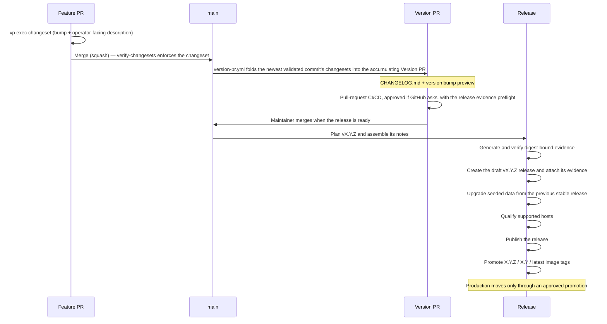

# Release Management

**Release ≠ deploy.** Development is trunk-based: all work merges to `main` (squash merge, no
`develop` branch) and every merge builds deployable images. A **release** is a deliberate act:
cutting a version of Hephaestus for self-hosters, with a tag, curated release notes, and versioned
Docker images. Staging follows `main`. Production moves to a release only through an approved
promotion. We manage releases with [changesets](https://github.com/changesets/changesets).

The [compatibility policy](https://docs.hephaestus.build/admin/compatibility-policy) defines what a released version number promises.
A change to a bundled practice also needs the acceptance in [Practice catalog curation](./practice-catalog.md#accept-a-bundled-change).

:::note[Chart-only release]
These instructions describe the chart-only release.
For a 0.95.x deployment, use that release's versioned instructions and signed assets.
The [0.x upgrade path](/admin/upgrade-to-1-0) requires 0.95.1 and its installed reconciler tooling before the cutover.
:::

## The flow



1. **Every PR that changes shipped code carries a changeset.** `Verify changesets` fails the PR
   otherwise. [Writing changesets](#writing-changesets) has the rules.
2. **The Version PR accumulates, and is checked.** `version-pr.yml` maintains the Version PR from the newest `main` commit whose push CI/CD succeeded.
   Its title is `chore(release): version packages`, with the prerelease tag in pre mode.
   It previews the version bump, `CHANGELOG.md` section, and `MIGRATION.md` section.
   The migration section uses `.migration/` fragments at the `### Next release` anchor.
   A cut that fails after its Version PR merged leaves a number that no release carries.
   After the next release publishes, the Version PR moves that section of both files into it.
   The entries keep their text.
   From 1.0.0-rc.1 on, the release planner refuses a cut while either file still has such a section.
   It also refuses a cut while `CHANGELOG.md` lacks the section of a published release.
   Updates use `GITHUB_TOKEN`.
   The pull request's own CI/CD run validates its updated head, with approval when GitHub requests it.
   [The Version PR trigger contract](./ci-cd.mdx#merge-policy) owns approval, reruns and manual recovery.
   [Merge policy](./ci-cd.mdx#merge-policy) owns which commit it versions and how a failed run is reported.

   Every CI/CD run on that branch includes the **release evidence preflight** below, regardless of its start event.
   `CI Status Gate` fails unless the same run's preflight succeeds.
   The preflight also requires a passing nightly Kubernetes run on `main` ([Two verification tiers](./ci-cd.mdx#two-verification-tiers)).
   More than one run can report the gate for a Version PR head, and either satisfies the ruleset.
   Thus, a green gate proves preflight success only if no run can pass without it.

   Every run on that branch publishes the whole release image set on both architectures.
   An ordinary pull request builds only changed `linux/amd64` candidates and aliases the rest from `main`.
   The preflight captures evidence for each image on both published platforms.
   It can capture evidence only for images published by its own run.

3. **The merge is checked again.** The merge commit's push runs CI/CD in full.
   It reuses the verified images that its merge group built for the same commit, and builds any that are missing.
   See [Merge-queue image reuse](./ci-cd.mdx#merge-queue-image-reuse).
   A `main` push repeats source-validation legs only when it changes the version.
   CI compares the version with the tip that the push replaced.
   Later commits in the same push cannot hide the bump.
   `release.yml` starts only after that run succeeds.
4. **Merging the Version PR cuts the release.** The workflow resolves release image digests, then runs the evidence gate.
   Only then does it create the draft at the merge commit and attach evidence.
   After seeded-upgrade and k3s host gates also pass, it publishes the release and verifies its immutable state.
   The seeded-upgrade gate also runs the previous release on the new and a partly migrated schema.
   [Previous release on the new schema](./database-migration#previous-release-on-the-new-schema) has the checks.
   Then it promotes CI-built images to `X.Y.Z`, `X.Y`, and `latest`.
   A numbered release candidate publishes only its own version alias. See [Release candidates](#release-candidates).
   Publication deploys nothing. See [Deploys](#deploys).

### When a release fails

For a release that is already published, use [Recover from a bad published release](./recover-a-published-release).

Release images are promoted **by digest and never rebuilt**.
A commit rejected by the evidence gate cannot pass on retry.
Only a new commit can pass.
Thus, the gate runs before anything is created.
A rejected release leaves no draft or tag, so cleanup is unnecessary.
A draft itself creates no tag.

Recovery uses a forward fix.
`scripts/plan-release.ts` cuts an unpublished version only when its validated source has no pending changesets.
A shipped fix carries a changeset and waits for the Version PR to consume it.
This keeps the fix's release note and version together.
A fix with no pending changesets can recut the same unpublished version from its validated commit.

Alternatively, merge the next Version PR.
A release follows the latest *published* release, not the version its parent commit carried.
The upgrade seed skips unpublished intermediate versions.

The release notes start from the same published release.
They contain every `CHANGELOG.md` section above that release, newest first, as the released commit has them.
Thus, the notes of an unpublished version appear in the next published release.
The draft is not created when these sections are missing, repeated, out of order, or not supported release versions.

The complete notes are also a release asset, covered by the signed evidence checksums.
If the description exceeds GitHub's size limit, it links to that asset and the changelog at the released commit.
The schema-migration notice stays in the description.

An ordinary merge of an already-published version does not cut a release.

### Release qualification and recovery

Before final publication, `Kubernetes eviction` runs the roll and eviction cluster on the candidate source and the four captured image digests.
It rebuilds no server or images and resolves no mutable image tag.
Failure, cancellation or a skipped qualification job blocks `publish-release`.
Before it writes release evidence, a chart or a draft, `tag-images` checks that the candidate source has the captured-image verifier.
An older candidate without it fails before those writes and needs a new qualified candidate.

The resume path covers failures *after* draft creation: seeded-upgrade, k3s host, eviction, or publication failures.
While the release is a draft, a workflow rerun at the same commit regenerates evidence and replaces assets.

A draft pins its version to its commit.
A later commit refuses to recut over it.
Each step that writes or publishes the release checks this again under the promotion lock.
It stops at a draft or Git tag of another commit, even one that appeared after planning.
If a draft can never pass, delete it manually before cutting a new candidate from fixed source.
The fixed source must have no pending changesets before it can cut a release.

If image alias promotion fails after publication, select **Re-run failed jobs** on that release workflow run.
The publication job verifies the published evidence again and compares its k3s host smoke records with the qualified artifacts from that run.
Missing or different records stop the retry.
The job keeps the immutable assets and retries image aliases by digest.

Immediately before alias writes, the release planner checks the semantic newest published stable release under the promotion lock.
An older release cannot move aliases after a newer stable release publishes, regardless of GitHub's latest marker.
A full workflow rerun still skips an already-published version.

Version-commit reverts are no longer part of recovery, but their exemption remains.
`verify-changesets` normally freezes `MIGRATION.md` in feature PRs and prevents deletion of pending changesets or migration fragments.
A **verified revert** lifts these restrictions.
`scripts/verify-revert.ts` checks each added commit structurally.
It must record `This reverts commit <sha>.`, name an ancestor of the base, and exactly reverse that commit's patch.
Otherwise, the restrictions remain.

## Supported-host qualification

Every release installs its signed, immutable Helm chart on native Ubuntu 24.04 `amd64` and `arm64` runners.
Either architecture can block publication.
The seeded-upgrade gate separately proves the supported migration path.

`release-host-smoke.yml` follows [Install on one host (k3s)](/admin/k3s).
It verifies the signature of the signed k3s bundle and unpacks it, as the operator does. The installer verifies the release chart as [Verify the release chart](/admin/kubernetes#verify-the-release-chart) describes.
Then `scripts/kubernetes-cluster.ts release-smoke` runs the `k3s-install.sh` of the unpacked bundle, the command of the docs, with a local CA and without the DNS and clock checks. A runner of 16 GiB installs with the `small.yaml` profile.

The smoke disables swap on its disposable runner. It explicitly passes `--allow-unqualified-host`, because a hosted runner label does not pin its kernel.
This qualification override retains the effective kubelet policy and allocatable checks. It does not establish loaded-host capacity.

It runs the command a second time, which must keep the release Secret, and then an upgrade that rolls every role except PostgreSQL. The upgrade fails if it replaced their Pods.
It waits for the migration Job, every role, and the platform isolation gate, and it sends requests through the Gateway.
It also checks that the kubelet and logind run with the configured shutdown budget. It does not reboot.
Publication waits for both native k3s smokes and their matching `host-smoke-k3s-<architecture>.json` receipts.

`Let's Encrypt` cannot reach a runner, so a local CA issues the Gateway certificate in the k3s smoke.
The k3s smoke runs only at a release, or by a dispatch of `release-host-smoke.yml` with a release tag and its commit.
A change to `deploy/platform/` runs the k3d jobs of `ci-kubernetes.yml` in pull requests, not the k3s smoke.

The release job packs the files of `deploy/platform/`, `k3s-install.sh` included, into one bundle, `hephaestus-k3s-<version>.tar.gz`, with `scripts/package-k3s-bundle.ts`.
The same files and commit time give the same tar bytes.
The compressed bytes also depend on the zlib of the Node.js that packs them.
It signs the bundle, attests it with the release, and uploads it and its signature beside the release locks.
A release has no other k3s asset.

A new `k3s-*` or `hephaestus-*` file in `deploy/platform/` joins the bundle with no change to the workflow.
The packer refuses any other name, because the bundle unpacks into the installer's state directory.
A dispatch of `release-host-smoke.yml` needs a release that has the bundle.
Releases before the bundle cannot be smoked again that way.

### Extension package

The release job that packages the extension builds the production Chrome extension once, from the released commit, with `vp run build:extension`.
It runs with read-only access, because it installs and runs the dependencies.
It writes the release version into the root `package.json` of its checkout first, because the manifest takes its version from there.
A promoted candidate thus ships its source with the stable version.

`scripts/check-extension-package.ts` then holds the ZIP's manifest to the release.
The job reports the package's SHA-256 as a job output.
`tag-images` downloads the package into its own folder and refuses other bytes.
It attests the package with the release, signs it, verifies the signature, and uploads `hephaestus-chrome-extension-<version>.zip` and its signature beside the k3s bundle.
`publish-release` verifies the downloaded package's signature and attestation, as it does for the k3s bundle.

The source SBOMs cover the extension's dependencies through the pnpm lockfile.
Submission to the Chrome Web Store is a manual step: [Releasing to the Chrome Web Store](./browser-extension#releasing-to-the-chrome-web-store).

### Platform pins

After a k3s, cert-manager, Traefik or agent-sandbox pin change, run `node scripts/scan-platform-images.ts --policy`.
Regenerate its exceptions with `node scripts/write-platform-exceptions.ts` and review the summary.
See [Platform image exceptions](./vulnerability-remediation#platform-image-exceptions).

`deploy/platform/k3s-platform.yaml` holds the pins of k3s, Traefik, and cert-manager.
k3s brings the Gateway API definitions with its bundled `gateway-api-crd` chart.
The clusters of `ci-kubernetes.yml` run no cert-manager: only the k3s smoke tests that pin.

`deploy/platform/k3s-agent-sandbox.yaml` holds the pin of the agent-sandbox controller.
Upstream publishes the controller as a release manifest, `sandbox-with-extensions.yaml`, and not as a chart.
The file is that manifest with four changes to the controller's Deployment:

- The image names the digest of its multi-platform index.
- `priorityClassName: system-cluster-critical`, as Traefik and cert-manager have, so that no role of the release preempts it.
- Requests and a memory limit, so that it is not the first Pod that the kubelet evicts.
- A restricted `securityContext`. The image runs as a non-root user, and upstream states no context.

The clusters of `ci-kubernetes.yml` apply the same file in `prepare`, and the one-host installer gives it to k3s.
Renovate opens a pull request in the one-host platform group when agent-sandbox publishes a release.

To upgrade the controller:

1. Read the release notes of each agent-sandbox release after the pinned one.
   Do the steps of each "Action Required" item that applies to the controller, the CRDs, or a `SandboxTemplate`.
2. Download `sandbox-with-extensions.yaml` of the new release, and record its SHA-256.
3. Resolve the digest of the image index of `registry.k8s.io/agent-sandbox/agent-sandbox-controller:<version>`.
4. Replace the manifest below the header of `k3s-agent-sandbox.yaml` with the new one.
   Make the four changes again, and write the new version and SHA-256 on the `pin: agent-sandbox` line.
5. Run `node scripts/scan-platform-images.ts --check-pins`.
   It downloads the release manifest and checks its SHA-256, and it refuses any other change to it.
   It also checks that the digest is the image index of the release tag.
6. Set `sandbox.controller.image` in the chart's `values.yaml` to the same image.
   On a managed cluster, the chart runs this controller in the release namespace (`templates/agent-sandbox-controller.yaml`).
7. Run `node scripts/cluster-admin-bundle.ts`. It copies the new CRDs into the admin bundle, `hephaestus-cluster-admin.yaml`.
   The chart render tests compare the bundle with its sources, and the chart's controller image with the pinned one.
8. Compare the upstream ClusterRoles with the controller's Roles in `templates/agent-sandbox-controller.yaml`.
   Also compare them with the read-only ClusterRole of the bundle.
   Add each new kind or verb that the controller writes to the Role of the sandbox namespace.
   If the controller watches a new kind, add it to the read-only ClusterRole.

`deploy/platform/k3s-containerd.toml.tmpl` holds the pin of gVisor: the release and the SHA-512 of the `x86_64` and `aarch64` archives.
To upgrade gVisor, download `gvisor.tar.bz2` of the new release for both architectures.
Compute their SHA-512 yourself, and compare them with the `SHA512SUMS` asset of the GitHub release.
Then write the release and both values on the `pin: gvisor` line.

`scan-platform-images.ts --check-pins` compares the pin with that `SHA512SUMS` too.
A change to the file restarts k3s on each one-host installation at its next installer run.
The k3d leg of the latest minor on `amd64` runs the sandbox templates on that gVisor, and the release smoke runs them on k3s.

The upgrade issues of agent-sandbox 1.0 ([#2122](https://github.com/kubernetes-sigs/agent-sandbox/issues/2122), [#2123](https://github.com/kubernetes-sigs/agent-sandbox/issues/2123)) apply only to an upgrade from a `v0.x` release.
Hephaestus started at `v1.0.10`, so no installation has `v1alpha1` objects or a conversion webhook to remove.

A pull request that can change fresh-installation bindings runs the Kubernetes cluster qualification.
It starts the chart with that run's images, waits for every role and the platform isolation gate, and checks HTTPS through the Gateway.
The latest amd64 k3s leg also runs the sandbox live suite from the compiled server artifact.
[CI/CD § Path filters](./ci-cd.mdx#path-filters) lists the selection paths.

## Supply-chain evidence

No release exists until every image in `security/release-images.json` passes the evidence gate.
It remains a draft until later gates pass.
For each image, the gate resolves the index and `linux/amd64` and `linux/arm64` manifests to digests.
It reads each platform manifest from the registry and generates a Syft inventory, SPDX SBOM, and CycloneDX SBOM.

The webapp preserves npm names, versions and licenses in `/usr/share/nginx/html/.vite/packages/` in the image.
Vite's native license report supplies this metadata, including lazy chunks.
Syft's JavaScript cataloger reads the package manifests from the final image.

Capture fails if the image has no bundle manifests, or if Syft or Trivy omits an identity.
New captures declare `bundledNpmSbom: 1` in the signed manifest.
Verification requires bundle manifests when that declaration is present.
Archived releases that predate it keep their original contract.

Trivy scans these packages under the release vulnerability and license policy.
Vite's report does not identify worker bundles, CSS-only packages or font source packages.
The workspace lockfile is not the runtime inventory.

The SBOM and byte-budget consumers share `bundle-metadata.json` in the `.vite` directory under the webapp build directory.
The build writes this artifact after Vite expands its preload maps.
Its `schemaVersion` is `1`.
Each `packages` entry has a `name`, `version`, and optional `license` and `licenseText`.
The build derives Syft's package manifests from these same entries.
Each `chunks` entry describes one final JavaScript chunk:

| Field | Meaning |
| --- | --- |
| `fileName` | The hashed output path. Use it to resolve imports within this build. |
| `isEntry`, `isDynamicEntry` | The entry and lazy-entry flags from Vite. |
| `facadeModule` | The source module relative to `webapp/`, with its query. Shared chunks have `null`. |
| `imports`, `dynamicImports` | The static and dynamic imports, as output paths. |
| `bytes` | The UTF-8 byte count of the final code. |
| `gzipBytes` | The final code's gzip size at level 6. |
| `packages` | The sorted, distinct npm package names in this chunk. This list contains no filesystem paths. |

Consumers use `facadeModule` as the stable lazy-chunk key because content hashes change between builds.
An incompatible field change requires a new schema version.
The runtime image retains the artifact so its full license notices remain available.
The artifact covers JavaScript chunks, not emitted worker assets or CSS.

`source.syft.json`, `source.spdx.json` and `source.cdx.json` list the release source's npm, Gradle and GitHub Actions inputs, including development dependencies and build plugins.
This source inventory is separate from the packages installed in each image.
It covers inputs such as CSS, fonts and worker packages whose identities can disappear from browser assets.
The generator scans a Git archive of the exact release commit, not the installed checkout.

Syft's native Gradle cataloger recognizes only the `gradle.lockfile` basename.
The archive therefore includes exact copies of the native buildscript and settings locks under `gradle-inputs/<kind>/gradle.lockfile`.
The generator reads those copies from the same commit.

New captures declare `sourceSbom: 1` in the signed manifest.
Verification requires all three source files when that declaration is present.
Archived releases that predate it keep their original contract.
Verification checks the repository and commit labels, catalogers, ecosystem coverage, buildscript-lock coverage and remote Action pins.
It requires both standard formats to preserve every native package identity.

The source CycloneDX SBOM also lists owned code and declared static assets.
Each component identifies the file and its SHA-256, license expression and upstream source URL.
Its `pedigree.ancestors` records the upstream package URL, and `pedigree.notes` records the changes.
The native and SPDX source inventories list package-manager inputs.
The owned-source additions are in CycloneDX.

The `gate:owned-code` task checks headers on each shipped-code quality leg before merge.
Release capture reads those files from the exact commit.
Run both capture-verification passes from the repository checkout.
They compare the written CycloneDX file with a fresh scan of that commit.
They require exactly the detected entries in the `owned:` namespace.
A malformed header, missing or stale component, changed license, changed pedigree or changed content hash fails verification.

Archived verification uses the signed checksums and does not require a source checkout.

One native Trivy `vuln,license` scan supplies both vulnerability and license report paths.
This avoids duplicate image analysis and binds both evidence consumers to the same subject.
`scripts/verify-release-evidence.ts` checks every document's platform repository, digest, and architecture.
It also checks that every package survives both format conversions.

Then the release workflow attaches the SPDX predicate as a Cosign attestation and verifies image signatures and build provenance.
SBOMs, reports, policy, checksums, and `manifest.json` become release assets.

Evidence capture processes two subjects at a time and waits for both before starting the next pair.
A failed capture blocks the bundle after its in-flight peer finishes. Trivy uses its
[memory scan cache](https://trivy.dev/latest/docs/configuration/cache/) because the filesystem cache
locks out concurrent processes.

The vulnerability database and Java index remain shared and are
prepared before capture. Both workflow callers request `java-db: "true"` from `download-trivy-db`. Direct generator
invocations also need both databases prepared because capture disables their updates. Each subject
still receives the same SBOM formats and combined vulnerability/license scan.

Each subject also has a `.timings.json` diagnostic with its digest, platform and elapsed Syft and
Trivy time, including failed invocations. Timings use a monotonic clock around the existing scans.
They add no scanner work or latency threshold. They are advisory, not security evidence: failure to
save them warns without changing the scan result. The same durations appear in the job log.

The Helm chart consumes the image pins from the verified release lock.
The inventory in `security/release-images.json` defines the images that release evidence must cover.
The chart is the only application image consumer in the release inventory.

Upstream images are versioned and digest-pinned.
They receive the same per-platform SBOM, license, vulnerability, and index-membership evidence as first-party images. Hephaestus requires its own signatures and build provenance only for
images it builds. Image publishing uses GitHub's native attestation action to record provenance and
registry storage metadata. Only publishing jobs and their reusable-workflow callers receive
`artifact-metadata: write`, alongside the signing and attestation permissions.

[Vulnerability remediation](./vulnerability-remediation.mdx) is the normative policy for blocking
findings, scheduled rescans, and exceptions.

[Release artifact provenance](./release-artifact-provenance) gives the per-artifact Build assessment and consumer checks.

### Nothing may fail for the first time at a release

Pre-merge validation covers the same image subjects and shared evidence checks as release publication.
`scripts/generate-release-evidence.ts` is the one generator and
`scripts/verify-release-evidence.ts` the one verifier. `release.yml` and the `Release evidence
preflight` job in `cicd.yml` both run them, and the preflight runs the verifier in its default mode,
which performs every check except signature verification.

| Release evidence check                                                           | Can a release be the first to run it?                                                                                                                                                                                                              |
| ------------- | --------------------------------------------------------------------------------- |
| Manifest matches `security/release-images.json`, both platforms, canonical order | No — `check-release-image-inventory.ts` validates the inventory on every pull request, and `generate-release-evidence.test.ts` feeds the real generator's manifest to the real verifier                                                            |
| Syft, SPDX and CycloneDX describe the same subject and the same packages         | No — the preflight generates the triple and validates it                                                                                                                                                                                           |
| Trivy licence report is bound to its subject                                     | No — the preflight generates and validates it                                                                                                                                                                                                      |
| Vulnerability policy, `linux/amd64`                                              | No — also the build gate in `reusable-docker-build.yml` and, for the pinned upstream digests, `Pinned upstream images`                                                                                                                             |
| Vulnerability policy, `linux/arm64`                                              | No — the build gate in `reusable-docker-build.yml` on every merge group and on a `main` push that builds the image, and, for the pinned upstream digests, `Pinned upstream images`                                                                 |
| Each platform digest is a member of its published index                          | No — the preflight resolves and checks index membership over the images its own run pushed                                                                                                                                                         |
| The validation documents re-derive unchanged                                     | No — the preflight verifies twice, the second time comparing rather than writing                                                                                                                                                                   |
| SBOM attestation matches the durable evidence                                    | **Yes, structurally.** `cosign attest` creates the attestation during the release. There is nothing to verify before it exists                                                                                                                     |
| Image index signature and build provenance match the release subjects | **Yes, structurally.** The index signature names the reusable image workflow on `refs/heads/main`. Native SLSA v1 build provenance names that workflow and the full source commit, and excludes self-hosted runners. A reused digest can retain its merge-group build provenance. |
| The manifest names a release version                                             | **Yes, structurally.** Only `plan-release.ts` decides the tag. The preflight substitutes the version the ref carries                                                                                                                               |
| The bundle describes the images this run built                                   | No — the preflight and `release.yml` resolve subjects through the image build's published commit tag. `ci-contract.test.ts` requires that tag for every supported event of either caller. See [CI/CD § Image identity](./ci-cd.mdx#image-identity) |
| The verifiers of earlier releases accept the chart images, the lock schema and the evidence manifest | No — the preflight runs the same verifiers and accepted breaks as `publish-release` on the joint lock that the release would sign ([Joint lock with the chart](#joint-lock-with-the-chart)) |
| The verifiers of earlier releases accept the asset names, the signing identity, the chart digest and the packaged chart's metadata | **Yes, structurally.** The signed lock, the chart and its signature exist only after `release.yml` creates the draft |
| The one-host install from the signed k3s bundle passes `release-smoke` on both architectures | **Yes, structurally.** `k3s-install.sh` verifies the bundle and the chart by the release workflow's signing identity. The preflight has no signed bundle and no release identity |

The two signature entries are the verifier's only mode-conditional behavior.
`ci-contract.test.ts` asserts this: a check gated on anything except `mode === "verify-signatures"` fails the contract test.
Otherwise, a release could be the first to perform that check.
The third structural entry is unconditional.
The verifier always requires a release version, and preflight supplies the ref's version.

Preflight runs Syft and Trivy over every image on both architectures, plus the image builds it consumes.
On the Version PR branch, it consumes the whole set on both architectures.
An ordinary pull request builds only changed images on `linux/amd64`.
Thus, preflight runs only when its result affects a decision:

- Every CI/CD run on the Version PR branch.
- A manual CI/CD dispatch with `release-preflight` selected.

It reuses images built by that run.
Thus, it judges the artifact a release of that ref would promote, not a substitute.

The Version PR deliberately checks pinned upstream images twice.
The upstream scan in `cicd.yml` uses a minute of Trivy to answer the question a digest bump can affect.
Preflight runs the complete evidence gate and answers the same question while it verifies the bundle.

They cannot disagree: they share one planner, evaluator, policy file, and `selectPlatformDigest` resolution of the same index.
The cost is a duplicate scan, not a second opinion.
Removal of the fast scan would deny the quick answer to the pull request that most needs it.
Removal of upstream evidence from the bundle would make the verifier reject it.

## Browser source maps

The webapp build emits no source maps and uploads nothing.
No image build receives an upload credential.
The webapp Dockerfile fails the build if a `.map` file appears in the output.
`scripts/ci-contract.test.ts` keeps the image workflows free of upload secrets.

### Operator verification

The [release image lock](../admin/release-image-lock) is the canonical verification procedure. It
verifies the lock signer and release identity before Helm consumes any digest. The remaining
release assets provide the per-platform SBOM, vulnerability, license, and index-membership evidence.
From v0.86.2, `SHA256SUMS` covers that evidence set and is signed with the release workflow identity.
The archived evidence reader verifies its Cosign bundle before checking the bytes or evaluating native file identities, advisory snapshots and policy.
Trusted capture validation runs before signing and does not authenticate an archive.

Each release also carries `release-vX.Y.Z.intoto.jsonl`, the Sigstore bundle of its release attestation.
The attestation is a signed in-toto statement over the image lock and every first-party image digest.
The [release image lock](../admin/release-image-lock#independent-verification) page gives the command that checks it.

### Joint lock with the chart

[Release assets](../admin/release-image-lock#release-assets) gives the purpose and reader of each asset.
A release publishes one signed joint lock, `release-vX.Y.Z.chart.json`, with schema version 2.
It contains the release identity, source commit, image pins and chart repository, version and digest.

`lockFromEvidence` in `scripts/release-image-lock.ts` builds the image lock from the verified evidence manifest.
The packaged chart values and the joint lock use these same image pins.
`scripts/release-image-lock.ts write` adds the pushed chart and emits the joint lock.
The reader rejects unknown schema versions and extra fields.

The `tag-images` job does these steps in this order:

1. It checks the release state with `plan-release.ts --source`.
   Only an absent release or this commit's own draft may continue, because the push writes the chart version tag.
2. It copies `deploy/chart/hephaestus` of the released commit to `RUNNER_TEMP`.
   It writes the release version, the source commit, and the chart images into the `values.yaml` of the copy.
   `chartValues` in `scripts/kubernetes-chart.ts` is the one map from the lock to the chart images.
   It refuses a lock that does not cover the release image inventory of the checkout.
3. It packages the copy with `helm package`.
   The chart version and `appVersion` are the release version without the leading `v`.
   It refuses a package whose values, as Helm parses them, are not the release's version, commit, and images.
4. It pushes the package to `<release namespace>/charts/hephaestus` and reads the manifest digest from the push.
5. It pulls the chart back by that digest and compares the bytes with the package.
6. It writes the joint lock.
7. It attests the chart manifest digest, the package bytes, and the joint lock as subjects of the release.
8. It signs the joint lock with `keyless-sign.ts sign-blob` and the release workflow identity.
   It signs the chart digest in the registry with `keyless-sign.ts sign` and the same identity.
9. It verifies the lock signature, and the chart again from the joint lock with `cosign verify`.
   The pulled chart must pin exactly the images that the joint lock names.

The `publish-release` job then runs `scripts/check-previous-verifier.ts` against the signed draft.
It runs the verifiers of the nearest published release and the latest stable release, from a tree with no installed packages.
Only an immutable published release from 1.0.0-rc.5 on counts, so a pushed tag runs no code in this job.
Older tooling follows the manual steps in [Upgrade](../admin/upgrade#hosts-with-reconciler-tooling-from-before-100-rc4).
Those steps end with 1.0.0-rc.5.
A host adopts new tooling only after it applies a release, so an older verifier decides.
The job stops before publication if one refuses.

The Version PR's release evidence preflight runs the same verifiers and accepted breaks first, with `check-previous-verifier.ts --preflight`.
No signed draft exists yet, so each verifier gets the joint lock that the release would sign.
Its chart has the repository and version that the release pushes, and a zero digest.
`scripts/previous-verifier-probe.ts` calls the lock, evidence and chart-value checks of that verifier's own tree, which its `prepare-release-chart.ts` calls too.
In place of the pulled chart, it compares that verifier's chart values with the values that this tree packages, as the verifier's chart check does.
It skips the download, the signature checks and the chart pull.

Thus, these changes fail the Version PR, not the release:

- A change to the lock schema, including the names of the chart fields.
- A change to the evidence manifest.

These changes still show only at publication: the asset names, the signing identity, the chart digest and the packaged chart's metadata.

A digest or tag change in the same image set does not trip this check.
An added, removed, or renamed chart image does not trip it either.
The verifiers from 1.0.0-rc.5 on read the images from the signed lock.
Only tooling up to 1.0.0-rc.4 refuses such a change, and the manual steps move a host off that tooling.
A change to the lock schema, the evidence manifest, the asset names, or the signing identity does, for any older verifier.

To release a planned break, add entries to `security/accepted-verifier-breaks.json` in a reviewed pull request, before the Version PR:

```json
[{ "release": "v1.1.0", "verifier": "v1.0.0", "reason": "Changes the lock schema. Hosts follow <upgrade guide section>." }]
```

An entry covers one release and one verifier, and the job prints the failure as a warning.
A break against the latest stable release needs one entry for each candidate and one for the stable release, in the same commit.
Ship the operator step in the same pull request.

The images are known before the package exists, and the joint lock that names the package digest comes after it.
Thus, the package never contains the lock that names its digest.
The chart source stays without images, so the CI cluster jobs give the images of their own run.
The chart is not an image subject of the evidence bundle.
The OCI version tag of the chart is not a release signal: operators and the verifier use the digest in the joint lock.
Every image gate stays in force.

`scripts/release-chart.ts` owns the Helm and Cosign calls of the chart.
It reads the chart metadata as four exact lines of the `helm show chart` output, without a YAML parser.
The release jobs run these scripts with Node alone: they import only `node:` and relative modules.
Before it publishes, `publish-release` verifies the joint lock signature, does the chart checks of step 9, and verifies the release attestation of the chart.
Thus, both release gates prove that the chart pins the images of the signed joint lock.

The chart has one signature form: the registry signature of its digest.
The signature identity is the release workflow on the default branch, not one release.
The chart is bound to its release by the digest in the signed joint lock and by the version check.
Operators verify the chart without the repository tooling, as [Verify the release chart](/admin/kubernetes#verify-the-release-chart) describes.

The release jobs use the Helm CLI that the [shared installer](https://github.com/hephaestus-build/Hephaestus/blob/main/.github/actions/setup-helm/action.yml) pins.
Commit channels render the source chart with verified image pins. Release channels apply the signed package.

## Current migration-guide instructions

Edit `scripts/templates/migration-guide.md` for current operator instructions, not `MIGRATION.md`.
`vp run release:version` renders the template in the Version PR. Keep its single
`<!-- VERSION_HISTORY -->` marker. Released entries retain their original text, image namespaces
and signing identities. A section whose number no release carries moves under the release that shipped it, as [The flow](#the-flow) step 2 describes. Add new version-specific actions through [migration fragments](#writing-changesets).

Run `vp run gate:changesets` to verify generation and history preservation.

## Writing changesets

A changeset summary becomes the `CHANGELOG.md` entry **verbatim** — write it in the operator/user's voice:

- Lead with what an operator or user can now do, or the symptom a fix removes. No class names, hook
  names, or file paths. If operators must act, add a line: `**Operators:** …`.
- **One changeset per user-visible change** — a PR that ships two unrelated visible changes ships two
  changeset files. Unsure whether it is visible? Add one. A reviewer can delete a superfluous note, but a
  missing one is invisible.
- Once a changeset reaches `main`, revise it in place. If it should not become a release note, convert it to an explained empty changeset.
  Do not delete or rename it.
- **Do not mention automatic migrations** — release notes automatically show a "back up before upgrading" banner for schema migrations.
  This applies when a release touches `server/application/src/main/resources/db/changelog/`.
  Thus, the changeset stays user-facing.
  The notes record the same fact in an invisible `<!-- hephaestus:schema-migrations=… -->` comment.
  An instance's update check reads it to flag the newer release in the admin overview.
  Only a migration that requires operator action belongs in the summary.
  Use `**Operators:** …` plus a `.migration/<changeset-slug>.md` fragment.
- **Bump = the operator's upgrade cost**, not code semantics:
  - `patch` — upgrade needs no action (bug fix, internal change, additive auto-applied migration).
  - `minor` — new capability, still zero-action. Note any new *optional* env var / flag in the summary.
  - `major` — operator must act first (required new env var, removed/renamed config, destructive/manual
    migration, dropped API). State the action and add a `.migration` fragment.

No TTY (agents, CI)? `vp exec changeset` is interactive — write the file by hand instead: create
`.changeset/<slug>.md` with frontmatter `"hephaestus": <bump>` and the summary as the body (see
`.changeset/README.md`). When action is required, add `.migration/<slug>.md` with the complete
`#### 🔴 …` guide entry. CI requires the matching slug and `**Operators:**` marker. Never hand-edit
`CHANGELOG.md` or `MIGRATION.md`. Versioning generates both.

A fragment whose heading starts with `#### 🔴 Stop every role` waives the rule that the previous release runs on the new schema.
The waiver covers the whole release: the changelog guard and the seeded-upgrade gate then skip that proof and write a warning to the job summary.
Add it only for a release that an ADR or the maintainer allows to stop every role.
[Expand and contract](./database-migration#expand-and-contract) owns the rule.

:::caution[Before 1.0.0]
The [changeset README](https://github.com/hephaestus-build/Hephaestus/blob/main/.changeset/README.md) owns the rule for `major`.
Until 1.0.0 is out, a breaking change uses `minor` and states the operator action.
It adds a migration fragment exactly as for a `major`.
:::

### Release candidate policy

Use a release candidate for every major release.
Also use one for a stopped cutover or an irreversible migration.
Other patches and minor releases ship directly through the normal release gates.
Promote a qualified candidate by its signed image digests, without a rebuild.
`latest`, the stable image aliases and stable release channels must never point at a release candidate.

### Release candidates

All releases use `main`. A release candidate has the version `X.Y.Z-rc.N`.
Before the first candidate, install the stable release that supports candidate channels and signed release charts.

The first public candidate is `rc.1`. Later candidates increase the number.
GitHub marks each candidate as a prerelease. It does not become the latest release.
Only its complete version image alias moves.

1. Before the cutover merges, run `vp exec changeset pre enter rc` in a pull request.
   Commit the prerelease state file that the command creates. For 1.0, also follow [Cut 1.0.0](#cut-100).
2. Merge the changes for the candidate, each with its changeset and required migration fragment.
   Wait for the Version PR. The version generator changes Changesets' first `rc.0` to `rc.1`.
   It preserves published history. Changesets archives consumed notes in its prerelease directory.
   Those notes do not count as pending changesets.
3. Merge the Version PR. Normal main CI and `release.yml` publish the candidate with all release gates.
   Verify its signed images, chart and evidence. Promote it to staging, then production through the normal deployment approval.
4. For a correction, add a changeset and repeat steps 2–3. Qualify each new candidate before deployment.
   The release gate seeds from the last stable release. Also run **Release / Seeded upgrade** with the previous candidate tag when that candidate is installed.

### Feedback quality evidence

Before qualifying a candidate, run the [release feedback eval](./feedback-quality-evals.md#release-feedback-eval) through the existing validation path.
Attach its `results.json` file to the release evidence.
Check that its commit is the candidate source commit and that its model is the configured release model.
Require complete outputs and AI-drafted labels bound to those outputs.
Read every finding and each unmeasured destination before deciding whether to qualify the candidate.

A failed, skipped or incomplete eval does not establish feedback quality.
Record the decision with the release evidence. Do not change a check or label to obtain a passing result.

### Promote the qualified candidate

Freeze `main` at the last qualified candidate's source commit.
Do not exit prerelease mode or merge a stable Version PR before promotion.
If `main` advances, publish and qualify another candidate.

Before stable publication, the workflow runs `:application:releaseRatchetTest` against the candidate source with `-Phephaestus.releaseVersion=<planned stable version>`.
The task runs the architecture tests tagged `release-ratchet`. Any remaining allowlist entry blocks publication.
The task requires the explicit version and refuses empty test discovery.
It compiles verification classes without repackaging the candidate JAR or images. The candidate manifest keeps its prerelease version.

A candidate source tree without this task cannot pass the preflight. Publish and qualify a new candidate that includes it.
An allowlist failure needs the same remedy: remove the debt and qualify a new candidate.

Run **Release / Publish** manually on `main` with `promote-candidate` set to the complete tag, for example `v1.0.0-rc.2`.
A repository writer can request this publication. The candidate has already passed the reviewed main merge and every release gate.

This request changes the release identity, chart release metadata and stable aliases. It cannot change the qualified source or images.
It grants no deployment approval. Production deployment retains its protected environment gate.

The workflow requires the latest immutable published candidate, its exact Git tag and the same current main commit.
It refuses pending changesets and a newer candidate, including a draft.
It verifies the candidate's signed joint lock and takes image index and platform digests from that lock.
It pulls and verifies the candidate chart, then packages the same source with stable release metadata.
The templates and image pins come from that exact candidate commit.

The normal policy, signatures, SBOM, provenance, seeded-upgrade and host gates run again against the same images and the promoted chart.
Before signing the stable joint lock, the workflow checks that its source commit, image digests and chart repository equal the candidate's lock.
It publishes the stable tag at the same commit and then moves the stable image aliases.

Fresh evidence and signatures describe the stable release.
The complete release notes retain their candidate headings from the qualified source.
A stable draft from another source blocks promotion. Delete only that unpublished draft after checking its source and failed run, then qualify the new candidate.

The stable lock names the new chart digest and stable chart version.
Image build metadata keeps the candidate version.
The stable chart's values name the stable release and source commit.

After stable publication succeeds, run `vp exec changeset pre exit` in a pull request.
Let the Version PR consume the archived notes and set the stable package version.
This synchronizes source metadata. It does not cut another release or replace its artifacts.
A stable Version PR cannot bypass candidate promotion and rebuild the images.

### Cut 1.0.0

1.0.0 is the one release that a `major` changeset cuts from `0.x`.
Before 1.0.0, in 0.x and in its release candidates, `verify-changesets` accepts a `major` changeset only under the slug `release-1-0-0`.
The usual rules still apply: the summary needs `**Operators:**`, and a migration fragment of the same slug must exist.
From the first stable 1.0.0 version on, a `major` changeset is ordinary, without a code change.
Only review stops an early `release-1-0-0`: it decides when 1.0 ships.

1. Make sure that every action before the first candidate in the 1.0 tracking issue is done.
2. Enter prerelease mode as described in [Release candidates](#release-candidates).
3. In one pull request, add the changeset `release-1-0-0` with `"hephaestus": major`.
   Its summary states what 1.0 promises.
   Its `**Operators:**` line points to [Upgrade to 1.0](/admin/upgrade-to-1-0).
4. In the same pull request, add the migration fragment `release-1-0-0` with the `#### 🔴 …` entry that points to the same page.
5. In the same pull request, replace each pre-1.0 statement with the 1.x statement.
   Find them with `git grep -n -i 'pre-1\.0\|before 1\.0'`.
   Skip release history: `CHANGELOG.md`, the version sections of `MIGRATION.md`, decision records and archives.
   `MIGRATION.md` is generated from `scripts/templates/migration-guide.md`, so change the template.
   A skill in `.claude/skills/` and its mirror in `.agents/skills/` must stay byte-identical.
6. Merge that pull request. From this merge until stable publication, no 0.x release can ship from `main`.
   The docs publish from `main`, so the 1.x statements are live from this merge.
7. Publish and qualify `1.0.0-rc.1`, then further candidates as required.
   Promote the last qualified candidate's exact artifacts to `1.0.0` as described above.
8. After `v1.0.0` is published, exit prerelease mode. The 1.0 exception in `scripts/verify-changesets.ts` then no longer applies.
   Remove it and its test in the same pull request.

We version the whole app as one product. Changesets target only the root `hephaestus` package.
We never version `webapp` and `docs` individually.

## Deploys

Publication does not deploy a release.
Hosts follow a signed channel and apply it themselves.
To change an environment, run **Release / Promote** for that environment and release.
The Production environment's required reviewer gates this deliberate step.
The host applies it on its next reconcile.

[Pull-Based Deployment](../admin/pull-based-deployment) explains the mechanics.
[CI/CD](./ci-cd.mdx#environments) lists the environments.
Verify staging before production promotion.
Hotfixes use the normal process: PR → changeset → merge → merge the Version PR.

### Operator actions on the project's hosts

The project's staging host follows `main`.
Thus, a merged `.migration/` fragment reaches staging at the next automatic promotion, not at the next release.
The release manager owns the action of each fragment on the project's hosts:

1. Before a pull request with a `#### 🔴` fragment enters the merge queue, read the fragment.
   Compare it with the site values, the Secret, and the platform files of each host.
2. Do the staging action when the pull request merges, before its first promotion applies.
   If the old chart and the new chart refuse each other's values, pause the staging reconciler before the merge.
   Change the values after the merge, then resume the reconciler ([Settings for the chart](../admin/pull-based-deployment#settings-for-the-chart)).
3. For a host that runs releases, record the action in that host's operations record.
   Do it in the stopped window of the next release that carries the fragment.
4. After a change on a host, copy the changed file to its operations record.

A host whose values the chart refuses keeps its last release.
Each later promotion then fails, so do not wait for the next release candidate.

### Deployment history

Each promotion that moves an environment records one GitHub deployment of the release or commit that its channel names.
`scripts/record-deployment.ts` records it before the channel is published.
Thus, a promotion that fails still leaves its record.
If GitHub refuses the record, the promotion continues, and its run shows the error.
The signed channel, not the record, decides what a host runs.

| Field         | Value                                                                             |
| ------------- | --------------------------------------------------------------------------------- |
| `ref`, `sha`  | The promoted release tag and its commit, or the promoted commit                   |
| `environment` | `Staging` or `Production`. Only `Production` is a production environment          |
| `payload`     | `release` or `commit`, `allow_rollback`, `refresh_database_image`, `requested_by` |
| `log_url`     | The promotion run                                                                 |

`requested_by` is the account that started the promotion.
For continuous staging, it is `github-actions[bot]`.

The final state claims only what the workflow observed:

- `success`: the public webapp reports the promoted version. Host metrics report the other services.
- `failure`: the channel is published, but the public webapp did not report the version in time.
- `error`: the workflow did not confirm that it published the channel.

In Staging, a success makes the previous successful deployment `inactive`.
GitHub does not do this in a production environment, so the Production history keeps every success.

A deployment records what was promoted to an environment, and when.
The `deploy-state` history records what each host was told.
Each channel commit names the action and links the run that signed it.

To list the promotions to production:

```bash
gh api --paginate 'repos/hephaestus-build/Hephaestus/deployments?environment=Production' \
  --jq '.[] | [.created_at, .ref, .sha, .payload.requested_by] | @tsv'
```

## Version management

Source manifests keep placeholder versions: `webapp/package.json` and `server/build.gradle.kts` use `0.0.0-development`.
The source version lives in root `package.json`.
Only the Version PR bumps it. At deploy time the release
chart gives each role `APP_VERSION` from its release metadata. `application.yml`
exposes it as `spring.application.version`.

For the latest published release, see
[GitHub Releases](https://github.com/hephaestus-build/Hephaestus/releases).
For the running release, follow the [runtime identity handoff](/admin/release-image-lock#runtime-identity-handoff).

## Dependency management

Renovate policy is in [Supply-chain security in CI](./supply-chain-security.md). `Verify changesets`
skips bot-authored pull requests. When a dependency bump is user-facing, a maintainer adds the
changeset.
