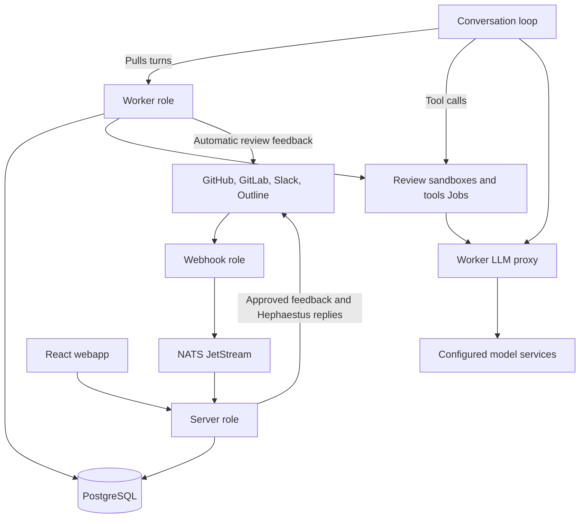
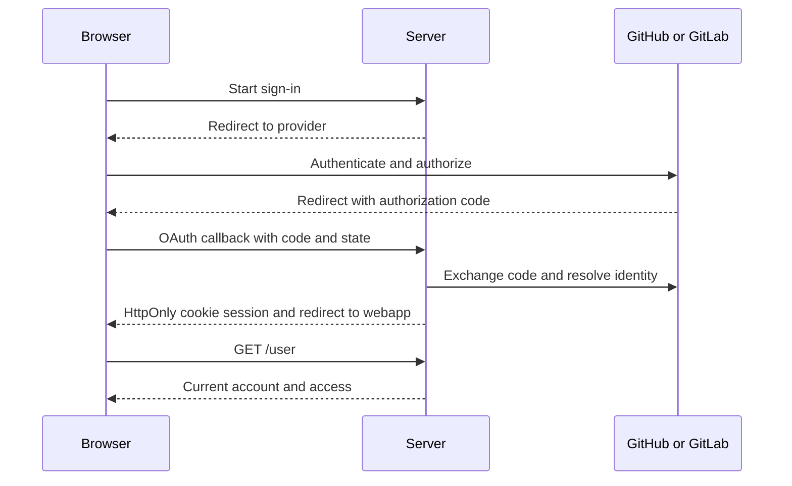
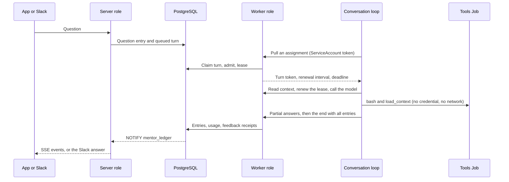

## Runtime topology

One JAR boots in the server, worker, and webhook roles. The Helm chart runs each in its own Deployment.
Only the worker can create sandbox Pods and Jobs. The conversation loop is a separate Deployment that
runs the agent image. Conversation turns need a running worker and a running conversation loop, even
when server and worker roles share a JVM.
There is no direct server-side sandbox fallback.

[Runtime roles](/admin/runtime-roles) owns role configuration, capacity, and drain behavior.
[Observability](/admin/observability#scrape-metrics) owns the private management listener on port 9090.

### Several server replicas

Only the server role runs `@Scheduled` methods (`ServerSchedulingConfig`).
Two server replicas run each schedule on their own clock.
Every `@Scheduled` method therefore does one of these:

- It acts on shared state and holds a ShedLock `@SchedulerLock` (JDBC, database clock, `ShedLockConfig`).
  A lock gives "never at the same time", not "once per period".
  Set `lockAtMostFor` well above the longest run and `lockAtLeastFor` above the clock skew between replicas.
  The timers of a fixed-delay job differ between replicas.
  Such a job must therefore tolerate a second pass in one period.
- It claims or locks its rows (`FOR UPDATE SKIP LOCKED`, a conditional `UPDATE`, a lease), so a second pass finds no work.
- It acts only on the memory, gauges or streams of its own process, so it must run on every replica.

`ScheduledWorkAcrossReplicasIntegrationTest` lists each unlocked job with its reason.
It also checks every lock between two application contexts on one database.
Then it runs one real job while the other context holds its lock.
A new `@Scheduled` method fails that test until it holds a lock or has a reason.

The scheduler is a pool of `spring.task.scheduling.pool.size` threads.
A long job holds one thread.
`application.yml` sizes the pool above the number of jobs that can run long at the same time, so the other jobs keep their schedule.

No server migrates at start: the [migrate run mode](/admin/runtime-roles#database-migrations) migrates once per release.

Two server replicas are not safe yet.
Two servers pull from the same durable consumer of a scope (`IntegrationNatsConsumer`).
Thus, they can process the events of one scope at the same time and out of order.

## Module boundaries

`integration` adapters own provider identity, source sync, and provider-side operations. GitHub,
GitLab, Slack, and Outline each have their own adapter. A deployment syncs one configured GitLab
instance.
Additional login providers do not create additional GitLab sync instances.

`agent` owns execution jobs and sandbox orchestration.
`practices` owns definitions, durable reviews, assignments, results, problems and feedback.
Core uses neutral item, capture and citation-verifier ports.
Domain modules own kind, version, role and evidence meaning.
Provider adapters own APIs, roster sync, capture and external writes.
Core imports neither provider persistence nor an SCM diff shape.

Integration modules are [open](https://docs.spring.io/spring-modulith/reference/fundamentals.html#modules.open).
Modulith verification therefore does not enforce their persistence encapsulation.
The architecture tests enforce the core, domain and provider boundary.
[Workspace context](./workspace-context) owns tenant enforcement.

## Sign-in

Spring Security `oauth2Login` federates sign-in.
Hephaestus issues its own cookie-session JWTs.
Keycloak is not part of the deployment. Slack and Outline are link-only identity providers.
[ADR 0017](https://github.com/hephaestus-build/Hephaestus/blob/main/docs/decisions/0017-replace-keycloak-with-spring-native-auth.md)
records native auth. [Instance administration](./instance-admin) owns recent-sign-in and user-view implementation.

## Practice reviews

The webhook role verifies and durably buffers provider events. Server consumers sync the work and
record item events. Eligible reviews create PostgreSQL-backed execution jobs.
Workers claim these jobs and execute them in isolated sandboxes. The worker admits the results of a review through the shared Java admission service
before composition and feedback delivery.

Feedback on the work awaits workspace-admin approval by default. Delivery rechecks policy and
silent mode independently from measurement.

The [review pipeline](./practice-review-pipeline) owns selection, capture, result admission, composition,
and delivery. [Review runtime](./practice-review-runtime) owns execution and retry boundaries.
[Workspace ABI](./agent/workspace-abi.mdx) owns the job folder, capture manifest, and output contract.
Missing required capture produces no result.

## Conversation

PostgreSQL holds the whole conversation in three workspace-scoped tables.
The server role owns the HTTP API, the live stream, Slack ingress and posts, submission, and the weekly digest.
A worker owns the claim, admission, the tools Jobs, and the turn endpoints that the loop calls.
The conversation loop owns the Pi session of each running turn and holds no model or provider credential.
No conversation state outlives a turn in a process, so any worker can serve any pull.
[Conversation runtime](./unified-pi-runtime) owns the turn lifecycle, the loop, and the context of a turn.

The UI uses shadcn components over Base UI.
It renders the stored messages and the partial answer from the generated client, with no assistant runtime.

Each account has one [Conversation](./practice-feedback-language.md#conversation) per workspace, with one level of threads.
The app shows the whole conversation. Slack shows what was asked there.

Hephaestus is available to workspace members only, within their account-wide AI choice. It uses permitted
recent work, review requests, assigned issues, the conversation itself, practices, and connected
context. [Conversation runtime](./unified-pi-runtime#delivery-of-shown-feedback) owns how a turn delivers feedback.
[Ask Hephaestus](/user/ask-hephaestus) owns the member-facing behavior.

## Member pages

A workspace that reviews practices opens on the member's private Practice profile. Other workspaces
open on Activity. Activity and Workspace activity count and list work without ranking developers.
Members read reviews of their own work from the Practice profile. Workspace admins inspect the wider
history under Practice reviews. Workspace review history does not grant access to a member's private Practice profile or Hephaestus feedback.

## Repository scans

Scans pin a monitored default branch and keep durable practice/file membership.
Serial execution jobs can expire while report membership and product history remain.
Reports have separate recorded totals and current open-problem counts.
The [scan guide](/admin/practice-scans) owns procedures and export availability.
