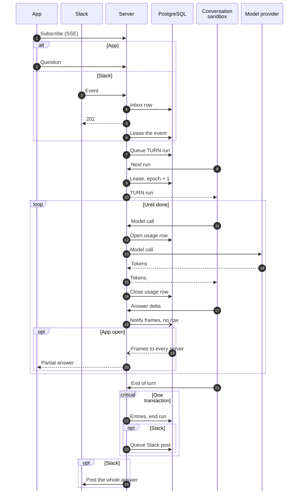

import SystemDiagram from "@site/src/components/SystemDiagram";

Hephaestus is one server that runs as several replicas, with PostgreSQL as its only truth.
The server receives provider events, syncs the work, and runs practice reviews and conversation turns in sandboxes.
A sandbox runs the agent's code. It holds no application secret, only a token for its own subject, and it reaches only the server's gateway.
The server delivers feedback, Hephaestus's Slack answers, email, and product feedback issues through one outbox.

The container view also shows one decided change that `main` does not have yet. The text below it names it.
[Runtime roles](/admin/runtime-roles) describes what runs today.

## Containers and trust boundaries

This logical view shows the parts of Hephaestus that run on their own, and what each part reaches.
Each arrow points from the side that opens the connection. Its label names what crosses it and the credential.
A connection with no protocol in its label uses HTTPS.

`«upstream»` marks a part that a release deploys but does not build: the agent-sandbox controller.
Look at the sandbox. It is marked `«untrusted»` because it runs the agent's code. It holds a token for one subject, and it reaches only the server's sandbox gateway, on port 8081.

The server and the agent-sandbox controller never connect to each other. Both use the Kubernetes API server: the server writes a `SandboxClaim`, and the controller watches the claims and creates the Pods.
[Helm chart reference § Where each part runs on a managed cluster](/admin/helm-chart#where-each-part-runs-on-a-managed-cluster) shows where each part runs, and who deploys and runs it.

<SystemDiagram name="containers" title="Container view: Hephaestus and its trust boundaries" alt="Container diagram: the web app, extension, server, PostgreSQL, the untrusted sandbox, the controller and the services they reach, with each credential.">

| From | To | What crosses, and the credential |
| --- | --- | --- |
| Web app | Server | HTTPS: the SPA and the API, with the JWT cookie |
| Browser extension | Server | HTTPS: the API, with a bearer token |
| GitHub, GitLab, Slack, Outline | Server | HTTPS: webhooks, each verified as the next table shows |
| Server | GitHub, GitLab, Slack, Outline | HTTPS: reads and writes, with a provider token |
| Server | Model provider | HTTPS: model calls, with an API key |
| Server | Email server | SMTP, with the SMTP login |
| Server | Kubernetes API server | HTTPS: `SandboxClaim` writes, with the server's ServiceAccount |
| agent-sandbox controller | Kubernetes API server | HTTPS: watches the claims and creates the Pods, with the controller's ServiceAccount |
| agent-sandbox controller | Sandbox | Creates it, through the Kubernetes API server |
| Server | PostgreSQL | TCP 5432, with the database login |
| Sandbox | Server | HTTP on port 8081, with the sandbox token |

</SystemDiagram>

The view shows one decided change that `main` does not have yet. The rest of the view is on `main`.
The server serves the SPA ([ADR 0100](https://github.com/hephaestus-build/Hephaestus/blob/main/docs/decisions/0100-the-server-serves-the-web-app.md)). Until that change lands, a webapp container with nginx serves it.
PostgreSQL notifications carry the sync-status hints to the open browsers.

| Container | What it is | Code |
| --- | --- | --- |
| Web app | The React SPA. The server serves it, and it runs in the browser. It calls the server through the generated OpenAPI client, with the `__Host-HEPHAESTUS_AT` cookie ([ADR 0100](https://github.com/hephaestus-build/Hephaestus/blob/main/docs/decisions/0100-the-server-serves-the-web-app.md)). | `webapp/` |
| Browser extension | The Chrome extension. It signs in with PKCE and sends a bearer token ([ADR 0048](https://github.com/hephaestus-build/Hephaestus/blob/main/docs/decisions/0048-installed-clients-sign-in-with-a-pkce-handoff.md)). | `extension/` |
| Server | One JAR in one runtime role, as several replicas. It serves the SPA and owns the API, provider events, reviews, conversations, agent control, the sandbox gateway and the outbox. | `server/application/` |
| PostgreSQL | The only truth. A server process or a sandbox is a cache. | `server/application/src/main/resources/db/changelog/` |
| Sandbox | One agent-sandbox `Sandbox` for each subject, with one container: the driver, the tools and the workspace. | `docker/agents/pi/`, `agent.sandbox` |
| agent-sandbox controller | The upstream controller. It turns a `SandboxClaim` into a `Sandbox` and its Pod. | platform manifest |

Each provider verifies its webhooks in its own way. Only some of them sign the body:

| Provider | How the server verifies a webhook |
| --- | --- |
| GitHub | The `X-Hub-Signature-256` HMAC of the body, with the app's webhook secret |
| GitLab | The route credential in `X-Gitlab-Token`. Its signature covers the route, not the body. |
| Slack | The `X-Slack-Signature` HMAC of the timestamp and the body, with the signing secret |
| Outline | The `Outline-Signature` HMAC of the timestamp and the body, with the webhook secret |

The server holds the application secrets: the provider tokens, the model API keys and the SMTP login.
The agent-sandbox controller holds only its own ServiceAccount. A sandbox holds only its token for one subject.
The agent proposes and the server acts. A sandbox cannot write to a provider or send a message.
The sandbox gateway accepts a sandbox token only for the token's own subject, and only on port 8081 ([ADR 0079](https://github.com/hephaestus-build/Hephaestus/blob/main/docs/decisions/0079-one-agent-system.md)).

Tenancy has no box of its own, because SQL enforces it.
Every workspace-owned table carries `workspace_id`, and every workspace endpoint is a `@WorkspaceScopedController`.
`DataIsolationArchitectureTest` checks both. [Workspace context](./workspace-context) gives the rules.

## Components of the server

This view opens the server box. It is a UML component diagram: it shows which part owns which work, and which interface wires two parts.

A ball is an interface that a part provides. A socket is an interface that a part requires, so the socket is on the calling side.
A socket on a ball, or a dashed arrow from a socket to a ball, is one connection.

An event is an interface too: the part that listens to it provides it, and the part that publishes it requires it.
A small square on the frame is a port. It passes a request from outside to the part that handles it.

Each interface carries the name of its Java type or route. "Provider SPI" is the neutral `integration.core.spi` package. The order of the steps is in the sequences: [one review](./practice-review-pipeline.mdx#one-review-from-event-to-feedback) and [one turn](#conversation).

<SystemDiagram name="system-components" title="Component view: the server of Hephaestus" alt="Component diagram of the server: eight parts wired by their provided and required interfaces, with the ports /api, /webhooks, /internal/agent and /internal/llm.">

| Part | Requires | From |
| --- | --- | --- |
| Web API, through the port `/api` | `MentorConversationService`, `ReviewService` | Conversation, review pipeline |
| Provider events, through the port `/webhooks` | `IntegrationMessageHandler` | Integration adapters |
| Integration adapters | `MentorConversationService`, `ItemEventRecorded` (an event that sync publishes). Provider APIs, through a port. | Conversation, review pipeline |
| Review pipeline | The provider SPI (`ItemSource`, `SummaryWriter`, `LineNoteWriter`), `AgentActions`, `AgentRuns` | Integration adapters, action outbox, agent control |
| Conversation | `AgentActions`, `AgentRuns` | Action outbox, agent control |
| Action outbox | `ActionAdapter` | Review pipeline (feedback copies), integration adapters (Slack posts) |
| Sandbox gateway, through the ports `/internal/agent` and `/internal/llm` | `AgentRuns`, `SandboxRunKind`. The model API, through a port. | Agent control, review pipeline, conversation |
| Agent control | The Kubernetes API, through a port | — |

</SystemDiagram>

| Part | What it owns | Code |
| --- | --- | --- |
| Web API | The `/api` endpoints in `server/openapi.yaml`, the live stream of server-sent events, and sign-in. Review requests and feedback approvals reach the review pipeline here. | each module's controllers, `core.auth`, `agent.mentor.web` |
| Provider events | The `/webhooks/**` endpoints, the `provider_event` inbox, and the event consumer that leases the oldest open event of each scope ([ADR 0080](https://github.com/hephaestus-build/Hephaestus/blob/main/docs/decisions/0080-provider-events-go-to-a-postgresql-inbox.md)). | `integration.core.webhook`, `integration.core.consumer` |
| Integration adapters | One for each provider: GitHub, GitLab, Slack and Outline. Each owns sync and implements the provider SPI: the capture reads behind `ItemSource`, and the feedback writes behind `SummaryWriter` and `LineNoteWriter`. Slack posts its answers behind `ActionAdapter`. Sync records item events and publishes `ItemEventRecorded`. | `integration.scm`, `integration.slack`, `integration.outline` |
| Review pipeline | Selection, capture, admission, composition and delivery ([Practice review pipeline](./practice-review-pipeline.mdx)). It captures each item through `ItemSource`. Its `FeedbackSendAdapter` delivers each copy for the outbox and reads it back. | `practices`, `agent.practice` |
| Conversation | The conversation of each account, its turns and its digests ([Conversation runtime](./unified-pi-runtime)). | `mentor`, `agent.mentor` |
| Agent control | The run queue behind `AgentRuns`, the sandbox of each subject and the reapers ([Agent runs](./agent-runs.mdx)). It writes the `SandboxClaim` to the Kubernetes API. | `agent.run`, `agent.sandbox` |
| Sandbox gateway | Port 8081, for sandbox tokens only. `/internal/agent` serves the next run, its context, the lease, the proposals and the answer deltas. Each run kind plugs in as a `SandboxRunKind`. `/internal/llm` serves the LLM proxy, which holds the model API keys and the call permits, and the staging and sealing of review results. | `agent.gateway`, `agent.proxy` |
| Action outbox | The `agent_action` table behind `AgentActions`, and its executor: every effect on the outside world ([The outbox](./outbox.md)). The view leaves out the `ActionAdapter` for email (`EmailAdapter`) and those for product feedback. | `core.action`, `notification.email` |

Every part stores its state in PostgreSQL, so the view leaves that connection out.
The view also leaves out `AgentRunHandler`: through it, the reaper moves a review or a turn together with its run ([Agent runs](./agent-runs.mdx)).

One JAR boots in the server role, which also receives provider webhooks.
Only a server with `AGENT_ENABLED` runs the agent runtime: it writes sandbox claims and serves the gateway and the LLM proxy. The chart sets it from `sandbox.enabled`.
Without it, no review and no conversation turn runs.
Each conversation sandbox uses the same driver, run lease and gateway as review sandboxes.

[Runtime roles](/admin/runtime-roles) owns role configuration, capacity, and drain behavior.
[Set up monitoring](/admin/monitoring#scrape-metrics) owns the private management listener on port 9090.

### Several server replicas

Only the server role runs `@Scheduled` methods (`ServerSchedulingConfig`).
Two server replicas run each schedule on their own clock.
Every `@Scheduled` method therefore does one of these:

- It acts on shared state and holds a ShedLock `@SchedulerLock` (JDBC, database clock, `ShedLockConfig`).
  A lock gives "never at the same time", not "once per period".
  Set `lockAtMostFor` well above the longest run and `lockAtLeastFor` above the clock skew between replicas.
  The timers of a fixed-delay job differ between replicas.
  Such a job must therefore tolerate a second pass in one period.
- It claims or locks its rows (`FOR UPDATE SKIP LOCKED`, a conditional `UPDATE`, a lease), so a second pass finds no work.
- It acts only on the memory, gauges or streams of its own process, so it must run on every replica.

`ScheduledJobLockTest` lists each unlocked job with its reason.
A new `@Scheduled` method fails that architecture test, in pull request CI and before a push, until it holds a lock or has a reason.
`ScheduledWorkAcrossReplicasIntegrationTest` checks every lock between two application contexts on one database.
Then it runs one real job while the other context holds its lock.

The scheduler is a pool of `spring.task.scheduling.pool.size` threads.
A long job holds one thread.
`application.yml` sizes the pool above the number of jobs that can run long at the same time, so the other jobs keep their schedule.

No server migrates at start: the [migrate run mode](/admin/runtime-roles#database-migrations) migrates once per release.

Servers claim provider events from the PostgreSQL inbox with fenced leases.
Events of one resource in one workspace run serially, including a replay.
All GitHub installation control events share one system scope.
[Ingest durability](./ingest-durability#claim-lease-and-order) owns the claim, renewal, retry and replay rules.

Work that must run one at a time on every server takes a `ClusterLock` ([Transactions](./transactions.md#6-concurrent-writers)).
The chart runs two servers by default.

## Module boundaries

`integration` adapters own provider identity, source sync, and provider-side operations. GitHub,
GitLab, Slack, and Outline each have their own adapter. A deployment syncs one configured GitLab
instance.
Additional login providers do not create additional GitLab sync instances.
[Provider resource repair](./provider-resource-repair.md) owns removal dispatch and adoption fencing across these adapters.

`agent` owns the run queue, the sandboxes, the gateway and the LLM proxy.
`practices` owns definitions, durable reviews, assignments, results, problems and feedback.
Core uses neutral item, capture and citation-verifier ports.
Domain modules own kind, version, role and evidence meaning.
Provider adapters own APIs, roster sync, capture and external writes.
Core imports neither provider persistence nor an SCM diff shape.

Integration modules are [open](https://docs.spring.io/spring-modulith/reference/fundamentals.html#modules.open).
Modulith verification therefore does not enforce their persistence encapsulation.
The architecture tests enforce the core, domain and provider boundary.
[Workspace context](./workspace-context) owns tenant enforcement.

## Sign-in

The server federates sign-in to GitHub or GitLab with Spring Security `oauth2Login`, then issues its own cookie-session JWT.
Slack and Outline are link-only identity providers.
[ADR 0088](https://github.com/hephaestus-build/Hephaestus/blob/main/docs/decisions/0088-a-person-signs-in-through-an-instance-login-provider-and-is-one-account.md) records the sign-in model, and [Auth architecture](https://github.com/hephaestus-build/Hephaestus/blob/main/docs/auth-architecture.md) shows the request flow.
[Instance administration](./instance-admin) describes the recent-sign-in gate and the user view.

## Practice reviews

Provider events wait in the PostgreSQL inbox. A server leases each event, syncs the work and records item events.
An eligible review becomes a `REVIEW` run in the run queue ([Agent runs](./agent-runs.mdx)).

A server with `AGENT_ENABLED` starts the review's sandbox.
The sandbox pulls the `REVIEW` run through the gateway, then the `REVIEW_COMPOSE` run that writes the feedback.
Admission checks every result before composition and delivery, and missing required capture produces no result.
[Agent runs § A review in its sandbox](./agent-runs.mdx#a-review-in-its-sandbox) gives the execution and retry boundaries.

Feedback on the work waits for a workspace admin's approval by default.
Delivery checks the feedback mode and silent mode again before it posts.
Workspace review history gives no access to a member's private Practice profile or Hephaestus feedback ([ADR 0047](https://github.com/hephaestus-build/Hephaestus/blob/main/docs/decisions/0047-the-practice-profile-has-one-reader.md)).

The [review pipeline](./practice-review-pipeline) describes selection, capture, admission, composition and delivery.
The [workspace ABI](./agent/workspace-abi.mdx) describes the job folder, the capture manifest and the output contract.

## Conversation

This sequence diagram shows one successful conversation turn, from a question in the app or in Slack to the answer.
Look at the two streams. The model's tokens go from the model provider through the sandbox gateway to the sandbox. The answer deltas go from the sandbox to the server, and only these reach the app.
Slack gets only the finished answer, through the outbox.

The sequence starts with a live sandbox. A conversation with no live sandbox gets one in the same way as a review ([One review from event to feedback](./practice-review-pipeline.mdx#one-review-from-event-to-feedback)).

These are the parts of the turn that the arrows alone do not explain:

- **Durability.** A Slack event is a row in the `provider_event` inbox before Slack gets its `202` ([Ingest durability](./ingest-durability.md)). A question from the app is a row before the server answers. A server can stop at any step, and the next one starts again from PostgreSQL.
- **The fence.** The lease raises the run's epoch. The gateway accepts a call on a run (`…/runs/{runId}/…`) only with the current epoch. A sandbox that lost its lease cannot write.
- **Two streams.** The LLM proxy forwards the model's tokens to the sandbox and accounts for them in the usage row. The answer that a person sees is a separate stream of deltas that the sandbox sends.
- **Any replica.** The server writes no row for a delta. It sends the delta to every server as PostgreSQL notification frames. Each server keeps the partial answer in memory (`MentorTurnProgress`). The live hub of the server that holds the app's stream sends it on. The sandbox and the app can therefore use different server replicas.
- **Only the end is stored.** The entries are stored once, when the turn ends. A server that misses a frame shows the partial answer again at the next whole snapshot. A whole snapshot comes at least every two seconds.
- **Slack delivery.** The answer for Slack is an `agent_action` row that the outbox executes ([The outbox](./outbox.md)). The executor confirms the post with the message timestamp that Slack returns.
- **Out of scope.** This success path leaves out a stopped turn and a retry. [Conversation runtime](./unified-pi-runtime) owns them.

Each turn is a `TURN` run in band `INTERACTIVE`, keyed to its conversation.
A conversation keeps one sandbox while it is in use, so a follow-up turn starts at once.
The reaper deletes the sandbox when it leased no run for `conversation-sandbox-idle` (15 minutes). The next question starts a new one from PostgreSQL.

PostgreSQL holds the whole conversation in three workspace-scoped tables.
The server role owns the HTTP API, the live stream, Slack ingress and posts, submission, and the schedule of the weekly digest.
A server with `AGENT_ENABLED` owns run admission, sandbox claims and the turn gateway endpoints.
The weekly digest is a `DIGEST` run in the conversation's sandbox, with the same runner, admission and fence as a turn ([Agent runs § Proactive digests](./agent-runs.mdx#proactive-digests)).
No conversation state lives in a process, so any such server serves any call of any turn.
[Conversation runtime](./unified-pi-runtime) owns the turn lifecycle, its runner and the context of a turn.

The app renders the stored messages and the partial answer from the generated client.

Each account has one [Conversation](./practice-feedback-language.md#conversation) per workspace, with one level of threads.
The app shows the whole conversation. Slack shows what was asked there.

Hephaestus is available to workspace members only, within their account-wide AI choice. It uses permitted
recent work, review requests, assigned issues, the conversation itself, practices, and connected
context. [Conversation runtime](./unified-pi-runtime#delivery-of-shown-feedback) owns how a turn delivers feedback.
[Ask Hephaestus](/user/ask-hephaestus) owns the member-facing behavior.

## Repository scans

A scan is a `SCAN` review, so it runs as `REVIEW` runs. A workspace runs one scan at a time.
It pins the default branch of a monitored repository and records which practices and files it covered.
Its report keeps the problems that it recorded and, separately, the count of problems that are still open.
After the feedback retention period, the raw proof and its exports go, and the aggregate report stays.
The [scan guide](/admin/practice-scans) describes how to run a scan and export its report.

## Diagram map

Each architecture diagram answers one question.
Every structural view uses one legend. [Documentation guide § Structural maps in HyLiMo](./documentation-guide.md#structural-maps-in-hylimo) explains it.

| Question | View | Page |
| --- | --- | --- |
| Who uses Hephaestus, and what does it connect to? | System context | [Admin overview](/admin/overview#what-a-deployment-consists-of) |
| What runs, and what may each part reach? | Containers and trust boundaries | [Containers and trust boundaries](#containers-and-trust-boundaries) |
| Where does each part run on a cluster, and who deploys and runs it? | Deployment | [Helm chart reference](/admin/helm-chart#where-each-part-runs-on-a-managed-cluster) |
| Which part of the server owns which work? | Components of the server | [Components of the server](#components-of-the-server) |
| Where can a review stop, and why? | Review stages | [Practice review pipeline](./practice-review-pipeline.mdx) |
| Who calls whom during one review? | Review sequence | [Practice review pipeline](./practice-review-pipeline.mdx#one-review-from-event-to-feedback) |
| How does one answer reach the app or Slack? | Turn sequence | [Conversation](#conversation) |
| How does a run move between states? | `agent_run` lifecycle | [Agent runs](./agent-runs.mdx#states) |
| How do the review records relate? | Core data model | [Practice review glossary](./practice-review-glossary.mdx#the-core-data-model) |

## Sync-status hints across replicas

A committed sync change sends only its workspace ID, connection ID and scope token through PostgreSQL `NOTIFY`.
Each server listens on `sync_status` and delivers received hints to its local SSE subscribers, including on the origin server.
The client reads the state through REST. It also polls, so a notification lost during reconnect does not hide the state.

The listener owns a dedicated connection and reconnect loop, as the ledger, run, evidence and permit listeners do.
It cannot hold up their dispatch. The chart connection budget includes all five listeners for every server in rolling overlap.
