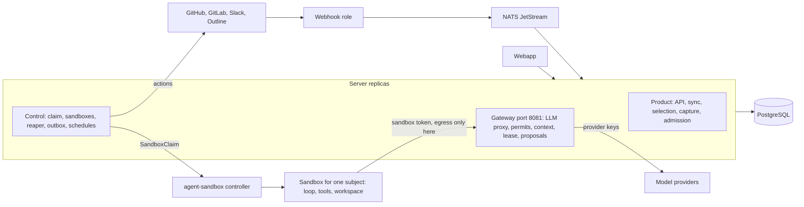
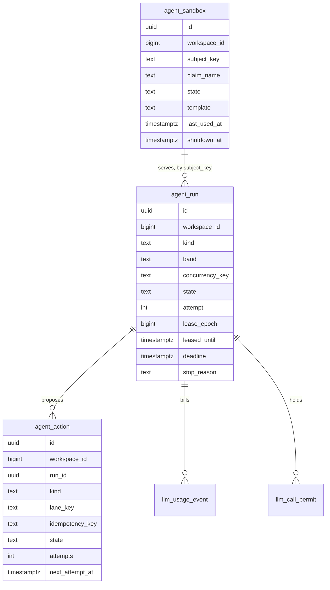
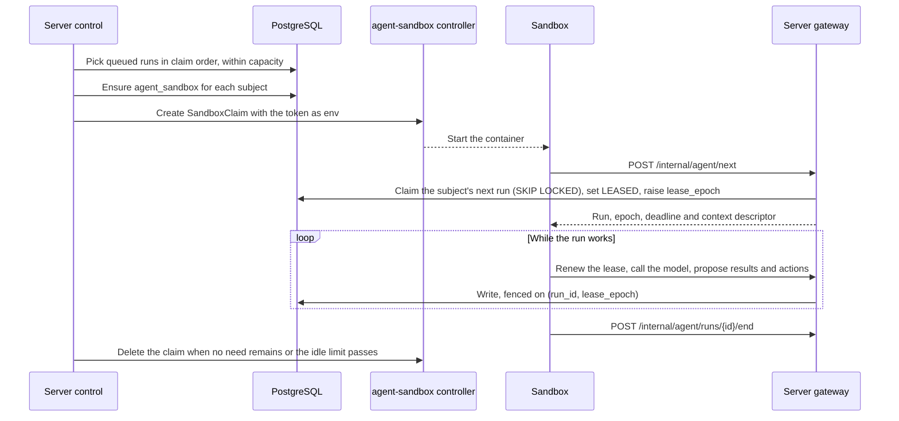

# ADR 0079: One agent system: one sandbox per subject on agent-sandbox, PostgreSQL as the only brain

**Status:** Accepted
**Date:** 2026-11-09
**Authors:** Felix T.J. Dietrich

**Supersedes:** [ADR 0007](0007-sandbox-spi-shape.md): the sandbox SPI, the Job backend and its reconciler.

**Supersedes in part:**

- [ADR 0005](0005-two-role-runtime-via-conditional-on-property.md): the worker role.
- [ADR 0006](0006-llm-proxy-on-coordinator-trust-model.md): where the proxy runs, and the turn credential.
- [ADR 0025](0025-agent-job-queue-on-postgresql.md): the form of the queue and the claim order.
- [ADR 0026](0026-per-purpose-agent-bindings-and-llm-governance.md): the worker that holds keys and admits turns.
- [ADR 0044](0044-email-is-a-notification-transport.md): where an email's delivery state lives.
- [ADR 0057](0057-one-heph-conversation-per-developer.md): the lease, usage and Slack post of a turn, one sandbox per conversation, and the Java digest.
- [ADR 0061](0061-review-seals-then-feedback-composes.md): where composition runs.
- [ADR 0063](0063-each-practice-is-staged-when-it-ends.md): the fence of a stage write.
- [ADR 0068](0068-reviews-and-heph-run-on-one-agent-runtime.md): the placement (W′), the attempt contract, coverage authority, capacity and decisions B, G and J.
- [ADR 0069](0069-practices-run-when-ready-and-stay-current-by-their-sources.md): where the feedback composer runs.
- [ADR 0073](0073-product-feedback-is-worked-on-in-github.md): the filing lease.
- [ADR 0074](0074-a-reviews-width-and-count-follow-the-provider.md): the worker and the chart in § Capacity.

**Amends:** [ADR 0070](0070-1-0-is-a-cutover-release.md): the cutover steps that name the worker.

Each ADR above has an update block, dated 2026-11-09, that names the sections that change and the sections that stay.

**Amended by:** [ADR 0097](0097-product-feedback-becomes-a-github-issue-and-only-the-reporters-tick-and-a-code-gate-make-it-public.md)
**Builds on:** [ADR 0070](0070-1-0-is-a-cutover-release.md) (1.0 is a cutover) and [ADR 0078](0078-lifecycles-are-explicit-and-rigor-follows-the-damage.md) (explicit lifecycles).

## Context

On 2026-11-09 the maintainer set the goal for 1.0: one agent system, and PostgreSQL as its only brain.
1.0 is a cutover (ADR 0070). Thus, no old path stays beside the new one.

### The split brain on main

An inventory of `origin/main` at `291b3d02b9` found one model for each kind of agent work, not one model for all of them.
Java paths below start at `server/application/src/main/java/de/tum/cit/aet/hephaestus/`.

**Six claim and lease systems, with four kinds of clock:**

| Work | Claim and lease | Clock | Renewed by |
|---|---|---|---|
| Review | `agent/job/ReviewJobRepository` (`SKIP LOCKED`), `ReviewJobClaimService`: `lease_id`, `leased_until` | Database, in SQL | The worker and the review loop |
| Conversation turn | `mentor/MentorTurnRepository` (`SKIP LOCKED`), `MentorTurnService` | A database reading plus a JVM duration | `agent/mentor/host/HephTurnDispatcher` |
| Feedback send | `practices/feedback/FeedbackSendRepository` (compare-and-set): `lease_owner`, `lease_expires_at` | JVM, 2 minutes | Nothing |
| Product feedback filing | `productfeedback/ProductFeedbackFilingRepository` (`SKIP LOCKED` and an advisory lock), `FilingService` | JVM | Nothing |
| Worker liveness | `worker_registry`: `agent/job/WorkerLivenessReporter`, `agent/sandbox/kubernetes/KubernetesLiveWorkers` | Database heartbeat | Each worker |
| Call permit | `llm_call_permit`: `agent/proxy/LlmCallPermits` | Database heartbeat | The worker that makes the call |

Composition has no lease of its own. It runs under the review's lease, and `ReviewJobExecutor.renewLeases` keeps that lease while the job composes.
`agent/composer/CompositionCapacity` is a JVM semaphore.

**Two writers of one lease.**
The worker renews a review's lease from its heartbeat (`WorkerLivenessReporter.beat` calls `ReviewJobExecutor.renewLeases`).
The review loop renews the same lease through `POST /internal/llm/runtime/{id}/lease` (`agent/proxy/ReviewAttemptLeaseController`, `docker/agents/pi/gateway-lease.ts`).
ADR 0068's update of 2026-11-08 splits the time between them.

**Seven reapers and reconcilers:**
`ReviewJobZombieSweeper` (three scheduled tasks), `MentorTurnLeaseReaper`, `SandboxReconciler`, `TurnSandboxes.reconcile`, `FeedbackSendRecovery`, `SlackMentorReconciler` and `NotificationRedeliveryJob`.

**Three loop implementations:**

- `server/application/src/main/resources/agent/heph-host.ts`: one Node process for each worker that runs every conversation turn of that worker.
- `server/application/src/main/resources/agent/pi-runner.ts`: the review loop.
- The JVM composer: `agent/composer/WorkerFeedbackComposer`, `ModelSession` and `ReviewCompositionTurn`. Product feedback drafting builds another `ModelSession` in `agent/productfeedback/ProductFeedbackModelAdapter`.

**Three outboxes, and the event publication registry for email:**

- `feedback_send`, with `FeedbackSendStateMachine` and `FeedbackSendRecovery`.
- The Slack reply state on `mentor_entry.slack_delivery`, with `MentorSlackDelivery`, `SlackMentorPoster` and `SlackMentorReconciler`.
- `product_feedback_filing`, with `FilingService` and `FilingLifecycle`.
- Email, as Spring Modulith `event_publication` rows (ADR 0044).

**Two model calls that bypass the proxy:**
`ProductFeedbackModelAdapter` calls the provider's base URL with its own `WebClient`.
`agent/catalog/LlmModelCapabilityProbe` calls it with its own `RestClient`.
`agent/proxy/ReviewModelGateway` calls the proxy service in the JVM, not over HTTP.

**Five usage tables:**
`llm_usage_event`, `review_job_attempt_usage`, `review_job_attempt_charge`, `review_job_script_usage` and `mentor_turn_attempt_usage`.
`mentor_turn` and `product_feedback_filing` also keep token counters.

**Capacity numbers in three places:**

- The chart helpers `clusterReviews`, `workerReviews`, `activeCompositions`, `concurrentCompositions` and `conversationTurns` in `deploy/chart/hephaestus/templates/_helpers.tpl`.
- The JSON tables `deploy/chart/hephaestus/turn-admission.json` and `sandbox-pod-requests.json`.
- Java: the Pod size table in `agent/sandbox/kubernetes/KubernetesPods`, the `auto` count in `agent/runtime/worker/WorkerProperties`, and the defaults in `application.yml`.

For example, the tools Pod request of 160 MiB and 25m is in the JSON table and in `KubernetesPods`.
The limit of 4 active compositions is in the chart helper, in `CompositionCapacity` and in `application.yml`.
A test (`SandboxPodRequestsTableTest`) exists only to keep two of these copies equal.

**Four sandbox shapes:**

- A review Job with a tools sidecar and a programs sidecar on Unix sockets, behind a `setpriv` seccomp filter (`KubernetesSandboxBackend`, `KubernetesPods`).
- A tools Pod for each turn attempt over TCP port 7100, with a nonce (`KubernetesToolsPods`).
- The conversation host.
- The isolation probe.

The binding of a turn to its tools Pod lives only in the worker's memory (`agent/mentor/sandbox/TurnSandboxes`).
That is state that PostgreSQL does not hold.

**One server replica.**
The chart sets `Recreate` and one replica for the server (`deploy/chart/hephaestus/templates/server.yaml`).
The server does not process provider events in order across replicas.

ADR 0068 § What went wrong on staging lists the staging defects of October.
Most had one shape: a second mechanism for a thing that one mechanism already does.
The list above is that shape at the size of the system.

### What changed in the assumptions

The maintainer gave these assumptions on 2026-11-09:

- At most 3 conversations run at the same time.
- Ask Hephaestus is also asynchronous and proactive. It writes digests on a schedule.
- Hephaestus moves to a real Kubernetes cluster, off the 16 GiB reference node.
- Cold start is a product number to optimize. A warm pool is not necessary.
- Hephaestus moves to agent-sandbox.

## Decision drivers

1. **One brain.** PostgreSQL is the only truth. A process or a sandbox is a cache that the system can replace.
   There is one of each: lease, claim, reaper, loop, sandbox shape, outbox, capacity home and model path.
2. **Deletion.** The design is measured by what it deletes. A replaced part goes in the same lane, before 1.0, with no flag and no compatibility reader.
3. **Interactive priority.** A person who waits gets the next model call. Batch work yields at grant time. Nothing stops it while it runs.
   [Borg](https://research.google/pubs/pub43438/) § 2.5 has the same rule: priority bands, and no preemption inside the production band.
4. **Cost when idle.** An idle install runs the server replicas, PostgreSQL, NATS, the webhook and the agent-sandbox controller, and no sandbox.
5. **Few conversations, a real cluster.** With at most 3 conversations at once, a sandbox for each conversation costs little memory. The earlier rejection counted 15 warm Pods at about 7.5 GiB. At 3, the same estimate is about 1.5 GiB. A real cluster can run a cluster-scoped controller.
6. **Cold start.** A cold sandbox is on the path to the first text of a conversation. The target is the first text at most 6 s after the claim of a cold sandbox. A follow-up turn in a warm sandbox starts at once.
7. **Security.**
   - A sandbox holds one internal token. The token names one subject and ends with the sandbox.
   - A sandbox's only egress is the gateway.
   - Only the server holds provider keys and SCM credentials (ADR 0006).
   - The agent proposes, and the server acts.
8. **One writer for each run.** The executor that holds the lease is the only writer. Every write carries a fencing token.
   [Kleppmann 2016](https://martin.kleppmann.com/2016/02/08/how-to-do-distributed-locking.html) defines it: a number that increases with each grant, and storage that refuses a lower one.

## Considered options

### 1. The v1 target: a shared loop host and a tools Pod for each turn (rejected)

Placement of the converged v1 target of 2026-11-08:

- A review agent Pod for each review attempt, as a Job with its tools sidecar (ADR 0068).
- A shared loop host for turns, composition and report drafts.
- A tools Pod with no credential and no egress for model-chosen code.

The contract (one lease, one claim, one reaper) was the same as the final design.

- **For it:** a shared loop pays the loop's code once. One load test ran 90 turns in 364 MiB (ADR 0068 § X). The tools never hold a token.
- **Against it:**
  - Two placements of the trusted loop, and three sandbox shapes, stay.
  - The host is one crash domain for all interactive work of the install.
  - The first tool call of a turn waits for a tools Pod, or a pool hides the wait.
  - The memory gain was the main reason. With at most 3 conversations, it is small.

### 2. A Pod for each conversation, with a split loop and tools (rejected)

The v2 target of 2026-11-09:

- One agent-sandbox `Sandbox` for each subject.
- A trusted loop container with the token, and a tools sidecar with no credential, joined by Unix sockets.
- The loop gets its assignment through a projected ServiceAccount token that is bound to an audience.

- **For it:** the token stays out of the container that runs model-chosen commands.
- **Against it:**
  - Each kind keeps two containers, the tool protocol, the `setpriv` filter and a programs container.
  - The sidecars share the Pod's network namespace, so the split depends on a seccomp filter.
  - gVisor does not separate two containers of one Pod: they share one gVisor kernel (ADR 0068 decision E).
  - A ServiceAccount token per sandbox is a Kubernetes credential in the sandbox.
  - The gain is bounded. The token reaches only the gateway and only its own subject. A stolen token buys model calls under the run's budget and proposals that the server admits. Commands in the same sandbox already see the subject's context.

The maintainer accepted the single container on 2026-11-09.

### 3. A workflow engine: Temporal, Restate or DBOS (rejected)

[Temporal](https://docs.temporal.io/temporal) and [Restate](https://docs.restate.dev/) are durable execution services. [DBOS](https://docs.dbos.dev/) is a library that keeps its durable state in PostgreSQL.

- Temporal and Restate are a second store of truth beside PostgreSQL, with their own clusters, upgrades and backups.
- Each engine journals step inputs and outputs. For agent work these hold personal data. Erasure then needs a second store (ADR 0063 rejected a step journal for the same reason).
- Our step is coarse. ADR 0063 makes one practice the step, and it already stages on its membership row.
- The tenancy rule is SQL (non-negotiable 2). An engine's history is outside `DataIsolationArchitectureTest`.
- ADR 0069 states "no plan table, no workflow engine".

### 4. Kueue (rejected)

[Kueue](https://github.com/kubernetes-sigs/kueue) v0.20.5 (2026-11-05) serves `v1beta2`. Its controller requests 512 MiB and 500m CPU.

- It is a second queue. A claimed run would wait again, suspended, in Kueue.
- It shares capacity between namespaces through LocalQueues. Our fairness is between workspaces, which are a column in the claim query.
- A person who waits must not wait in an admission queue.

ADR 0068 § Kueue stays valid.

### 5. One sandbox per subject on agent-sandbox, with one container and the server as the only brain (chosen)

See [Decision](#decision).

### Why agent-sandbox now

ADR 0068 rejected [kubernetes-sigs/agent-sandbox](https://github.com/kubernetes-sigs/agent-sandbox) on 2026-10-28. The v1 target of 2026-11-08 said "not now". Each reason has a changed fact:

| Earlier reason | What changed |
|---|---|
| A cluster-scoped controller with a ClusterRole over all namespaces | Hephaestus moves to a real cluster. A platform manifest installs the controller once, outside the chart. The CRDs are namespaced. |
| Built for stateful, idle singletons | A conversation sandbox is now such a singleton. |
| Only its warm pool was needed | No warm pool is needed. The sandbox pulls its work after it starts, so nothing waits for injection at claim time. |
| Claim-time environment slows a cold start | The only claim-time value is the token, as claim `env` (the template sets `envVarsInjectionPolicy: Allowed`). The work, the context and the checkout come after the start, from the gateway. |
| Default egress to the internet | The template sets `networkPolicyManagement: Unmanaged`. The controller then creates no policy, and our NetworkPolicy allows egress only to the gateway. |
| `sandboxd` needs ingress | The sandbox pulls. It listens on no port, and it needs no router. |
| No Java client | The server writes one kind of object, `SandboxClaim`, through the generic resource API of its Kubernetes client. |

The upstream project now has a stable shape:

- Release v1.0.10 (2026-11-06) serves `v1beta1` for `Sandbox`, `SandboxTemplate`, `SandboxClaim` and `SandboxWarmPool`.
- A claim has `spec.lifecycle.shutdownTime` and `shutdownPolicy`.
- [Agent Sandbox on GKE](https://cloud.google.com/blog/products/containers-kubernetes/bringing-you-agent-sandbox-on-gke-and-agent-substrate) is generally available with stable APIs (May 2026).

The same shape is common practice:

- [E2B](https://docs.e2b.dev/sandbox.md) and [Modal](https://modal.com/docs/guide/sandbox) give each agent a sandbox with an idle timeout.
- [Codex cloud](https://learn.chatgpt.com/docs/environments/cloud-environment) keeps a task's container for up to 12 hours.
- [Devin](https://docs.devin.ai/onboard-devin/snapshots) boots each session from a snapshot.

A conversation sandbox that is deleted when idle loses no prompt cache:

- The provider's cache is keyed by an identical prompt prefix and the organization ([Anthropic](https://platform.claude.com/docs/en/build-with-claude/prompt-caching), [OpenAI](https://developers.openai.com/api/docs/guides/prompt-caching)).
- Neither provider documents a dependency on the client process. We infer that a new sandbox that sends the same prefix gets the same hits.

**What the "wait" verdict got right.**
The controller is cluster-wide: issues [#484](https://github.com/kubernetes-sigs/agent-sandbox/issues/484) and [#1440](https://github.com/kubernetes-sigs/agent-sandbox/issues/1440), which ask for a namespace-scoped install, are open.
The project is young, and an upgrade can change behavior that we depend on.
We bound this risk:

- **Pin.** The platform manifest pins one controller version and its CRDs.
- **Platform manifest.** The controller is a platform prerequisite. The Helm chart does not install it, because Helm installs `crds/` once and never upgrades them.
- **CI-gated upgrades.** An upgrade is a pull request that changes the pin. The k3s CI cluster runs the sandbox suite and the egress and isolation gate against it before it merges.
- **One owner, one seam.** The server writes only `SandboxClaim` objects, and `agent_sandbox` owns each one. A replacement backend changes one adapter. No table and no API changes.

## Decision

**One agent system.** PostgreSQL is the only brain, and the server is its only process.
Each subject gets one sandbox. A sandbox is an agent-sandbox `Sandbox` with one container, and it is a cache.
A run leases one unit of work for a subject, and its sandbox is its only writer.
The agent proposes, and the server acts through one outbox.

### Runtime components

| Component | What it is |
|---|---|
| Webhook | The edge role. It has no database ([ADR 0066](0066-the-webhook-receiver-has-no-database.md)). |
| NATS JetStream | Provider events. |
| Server, N replicas | One JAR with three concerns. Product: the API, sync, selection, capture and admission. Control: the claim, priority, the sandbox lifecycle, the reaper, the outbox and the schedules. Gateway: a separate port, 8081, for sandboxes only. |
| PostgreSQL | The only truth. |
| agent-sandbox controller | Upstream, pinned, installed by the platform manifest. |
| Sandboxes | One for each subject that needs one. |

There is no worker role.

- **Kubernetes authority.** The server holds a Role in the [sandbox namespace](../contributor/practice-review-glossary.mdx#runtime-terms).
  The operator creates that namespace for the sandboxes of one release.
  The Role allows `SandboxClaim` objects only: create, get, list, watch and delete. It allows no `pods/exec`, no Jobs and no Secrets.
- **The gateway port.** Port 8081 has its own security chain, and it accepts only sandbox tokens. Every other path on it answers `404`.
  The public port 8080 answers `404` on every gateway path. The public ingress has no rule for port 8081.
  The server's ingress policy admits the sandbox namespace on port 8081 only.
- **A stateless gateway.** The gateway keeps no state outside PostgreSQL and the token. Any replica serves any call of any sandbox, and a sandbox dials the gateway Service, not a Pod.
- **Repository evidence.** [ADR 0039](0039-git-and-postgresql-own-evidence.md) keeps repository evidence in the clones of one worker storage node. That node goes with the worker. Before the server runs as several replicas, its layer must give the clones one home that every replica can read. See [Open items](#open-items).

### Subject and sandbox

A **subject** is the thing that a sandbox serves. Its key is the concurrency key of its runs:

| Kind | Subject key | Lifetime |
|---|---|---|
| `review` | `review:<id>` | `shutdownTime` is the review's deadline. The sandbox measures, then composes. |
| `conversation` | `conversation:<id>` | While the conversation is in use. The reaper deletes it after the idle limit. `shutdownTime` is a ceiling from the capacity home, so its token also expires. |
| `action` | `action:<id>` | Short. One action task, such as a product feedback draft. |

Each kind has one `SandboxTemplate` and one `SandboxWarmPool` with `replicas: 0`.
A v1beta1 claim requires `warmPoolRef`, so the server creates a sandbox with a `SandboxClaim` that names the pool of its kind. The pool holds no started sandbox.
The sandbox has **one container**, from the `hephaestus-agent` image. The container holds:

- The one Node loop driver, with the kind as a parameter.
- The tools: bash, git, search, practice scripts and custom programs.
- The workspace.

There are no sidecars, no Unix-socket tool protocol and no `setpriv` filter.

**Pod settings:**

- **Runtime.** The gVisor RuntimeClass is the default where the node has it. runc is the fallback.
- **User namespaces.** A runc template sets `hostUsers: false` (ADR 0068 decision C). A gVisor template omits `hostUsers`, because gVisor cannot run in a user namespace yet ([google/gvisor#13303](https://github.com/google/gvisor/issues/13303), open). On gVisor, the Sentry is the kernel boundary.
- `automountServiceAccountToken: false` and `enableServiceLinks: false`.
- The seccomp profile `RuntimeDefault`, `allowPrivilegeEscalation: false` and all capabilities dropped.
- A non-root user ID.
- No volumes. The workspace is the writable container layer, bounded by an `ephemeral-storage` limit. Two `emptyDir` volumes cost about 280 ms of the Pod start, measured.
- **A pre-pulled image.** The agent image is on every sandbox node before a claim. A claim never pulls it.

**Network:**
The template sets `networkPolicyManagement: Unmanaged`.
Our NetworkPolicy allows egress only to the server's port 8081, plus DNS for the server's Service name if the sandbox resolves it.
It allows no ingress.

**Sandbox token:**

- A JWT that the server signs with the existing attempt-key machinery (ADR 0068 § The attempt contract, the signing keys).
- It carries `workspace_id`, `subject_key`, `sandbox_id`, and an `exp` equal to the sandbox's `shutdownTime`.
- The claim delivers it as `env`.
- It works only at the gateway, and only for its own subject's runs.
- The gateway also checks that `sandbox_id` names a live `agent_sandbox` row (`REQUESTED` or `READY`) of the same subject. A deleted sandbox's token thus stops at once, before its `exp`.
- The token is plain text in the `SandboxClaim` object. Only the server's Role and cluster administrators can read claims in the sandbox namespace. The liveness check and the short life bound a copy of it.

No sandbox is started before its claim. The claim's `env` forces a cold start from the template. The sandbox **pulls** its work from the gateway. The server pushes nothing into it.

**Evidence authority.** The sandbox's files are not evidence, because a command can change them.

- Admission checks each citation against the bytes that the server captured.
- For each read and each proved search, the loop reports the path and the digest of each file.
- Admission counts a read for coverage only when its digest equals the digest that the server captured for that file.
- Admission refuses a claim of absence when any searched file's digest differs from the captured one. A search over changed files proves nothing.

**No persistent volume.** The server rebuilds the sandbox's context from PostgreSQL at each start.

**The boundary first.** The server creates no claim while the egress and isolation gate fails. `Unmanaged` fails open on a network plugin that does not enforce NetworkPolicy, so the gate proves the policy on the running cluster. ADR 0068's isolation probe becomes this gate.

### Data model

Every new table carries `workspace_id` from its first migration, with composite foreign keys.
The one exception is an instance-level action, such as an account email, which has no workspace. Its `workspace_id` is null, as on `product_feedback`.

**`agent_run`** leases one unit of agent work.

- **Columns:** `id`, `workspace_id`, `kind`, `band`, `concurrency_key` (the subject key), `state`, `attempt`, `lease_epoch`, `leased_until`, `available_at`, `deadline`, `stop_reason`, and the created, started and ended times.
- **Kinds:** `review_measure`, `review_compose`, `turn`, `report_draft` and `digest` (see [Interactive and proactive work](#interactive-and-proactive-work)). A new kind of work is a new value, not a new table.
- **Bands:** `interactive`, `batch` and `background`. The kind and the origin set the band. This is the default, and the implementation can change it:
  - `turn` and `report_draft`: `interactive`. A person waits.
  - `review_measure` and `review_compose` of an event or a request: `batch`.
  - A scheduled or backfill review, and `digest`: `background`.
- **States:** `QUEUED`, `LEASED` and `ENDED`. A claim goes from `QUEUED` to `LEASED`, and raises `attempt` and `lease_epoch`. A reap of a run that can try again goes from `LEASED` back to `QUEUED`. The database enforces the transitions (ADR 0078), and the epoch never goes down.
- **Stop reasons:** `stop_reason` is a closed list that says why a run ended, such as completed, cancelled, attempts spent or deadline. The domain row keeps its own detailed reason.
- A partial unique index on `(workspace_id, concurrency_key) WHERE state = 'LEASED'` lets one run of each subject run at a time.
- **Domain rows:** a foreign key points from each domain row to its run. The domain rows are the review job, the conversation turn, the product feedback filing and the digest.
  Their lifecycles stay on the domain rows.

**`agent_sandbox`** is the single owner of each Kubernetes claim.

- **Columns:** `id`, `workspace_id`, `subject_key` (unique among the live rows), `claim_name`, `state`, `template`, `created_at`, `last_used_at`, `shutdown_at`.
- **States:** `REQUESTED`, then `READY`, then `DELETING`, then `GONE`.
- **Start limit:** a sandbox that is not `READY` within the start limit of the capacity home is deleted and requested again. Each such start counts against the attempt budget of the subject's next run.
- **Reaper rule:** the reaper deletes the claim when the subject has no live need. A queued or leased run of the subject is a live need, for example the `review_compose` run after a seal. The reaper also deletes the claim when the sandbox is idle past the limit.
- **Erasure and access.** An erasure of a person, or a change of access to a conversation, deletes the subject's sandbox at once.

**`agent_action`** is the one outbox.

- **Columns:** `id`, `workspace_id`, `run_id` (null for an action that a person started), `kind`, `lane_key`, `idempotency_key` (unique), `state`, `attempts`, `next_attempt_at`, the lease, and a readback reference.
- **Kinds:** `deliver_feedback`, `edit_feedback`, `retract_feedback`, `slack_post`, `email`, `file_issue` and `show_feedback`. A new kind is a new value.
- **States:** `PROPOSED`, `ADMITTED`, `EXECUTING`, and then `DONE`, `UNCERTAIN`, `FAILED` or `CANCELLED`.
- One executor runs on every server replica, with no leader. It claims only the head of each lane, so the actions of a lane run in order.
- The executor records the start of a write before the provider call. No provider call runs inside a transaction (ADR 0075). Each adapter reads back by the marker of the action.
- Email is at most once. An `UNCERTAIN` email is never sent again.
- An erasure deletes the person's actions. [Update — 2026-11-09](#update--2026-11-09-erasure-deletes-the-actions-of-an-account) states the rule.

**Permits.** The call pool (`llm_call_permit`) gets a band and a fair share for each workspace.
The grant order is the band, then the workspace with the fewest granted permits in the pool, then age.
An interactive call gets a grant first. A batch call yields at grant time. Nothing stops a call that holds its grant.

The band replaces the call class. The conversation reserve becomes the reserve of the `interactive` band.

**Usage.** Each model call has one `llm_usage_event` row, keyed by `(run_id, lease_epoch, call)`.
The proxy writes the row before it sends the call to the provider, and completes it with the measured usage when the call ends.
A row that stays open, because a replica stopped during the call, records an unverifiable call under the existing ledger rules (`USAGE_UNVERIFIABLE`). It is never billed as zero.

The usage tables of each kind merge into it. A lost lease needs no billing step of its own, because each of its calls already has a row.

**Capacity.** One `@ConfigurationProperties` home, `hephaestus.agent.capacity.*`, holds every capacity value:

- The sandbox count for each kind.
- The Pod requests and limits of each sandbox kind.
- The idle limit and the `shutdownTime` ceiling of a conversation sandbox.
- The attempt budget for each run kind.
- The lease duration and the renewal interval.
- The call pool limits.

The chart sets these values directly, and it renders the three `SandboxTemplate` objects from them. No template helper derives a value, and no JSON table repeats one in Java.

### Claim, priority and reap

All three run in the server, on every replica.
There is no leader election and no registry of processes.

- **Order.** The claim order is the band, then the workspace with the fewest running runs, then age. A `NOTIFY` on each new run wakes the replicas.
- **Sandboxes.** The control concern takes the queued runs in that order, within the counts of the capacity home. It makes sure that a sandbox exists for each of their subjects. If none exists, it creates the claim.
- **Claim.** The sandbox's `next` call claims its subject's next run, with `SKIP LOCKED`. The claim sets `LEASED`, raises `attempt` and `lease_epoch`, and sets `leased_until` on the database clock. A warm sandbox's `next` waits for the next run of its subject.
- **One writer.** The sandbox that claimed the run is the only writer of its lease. Every write names `(run_id, lease_epoch)`. The database refuses the write unless the run is `LEASED` with that epoch and `leased_until` is after the database clock. Thus, a write after the lease expires fails before the reaper acts.
- **Reaper.** The reaper is a conditional update on the database clock.
  - An expired lease requeues the run, or ends it with a reason when its attempt budget is spent.
  - The reaper also deletes the claims of subjects that have no need.

### Gateway API

Every route is on the server's port 8081 and needs the sandbox token.
Each call after `next` names its run and epoch in the headers `X-Agent-Run` and `X-Agent-Epoch`.
The gateway checks that the run's `concurrency_key` equals the token's `subject_key`, and then checks the fence in PostgreSQL.

| Route | Purpose |
|---|---|
| `POST /internal/agent/next` | The sandbox asks for its subject's next run. The answer is the run, the epoch, the deadline and the context descriptor. |
| `GET /internal/agent/runs/{id}/context/...` | Documents, the checkout archive and the conversation ledger. |
| `POST /internal/agent/runs/{id}/lease` | Renew the lease. |
| The LLM proxy routes | The existing routes. Each call is checked against the run and the epoch, and it takes a permit in the run's band. |
| `POST /internal/agent/runs/{id}/results`, `/actions` and `/end` | Proposals. Admission stays in the server. |
| Turn deltas | The sandbox streams the deltas of a turn to the server's live hub, by the existing mechanism. |

Capture stays a server step. The gateway serves only captured bytes and archives that the server built with its own credentials.

### Interactive and proactive work

- **Turns.** Each turn is a `turn` run in band `interactive`, keyed to its conversation. Turns of one conversation run in order.
- **Proactive work.** Hephaestus writes proactive text with the model. The maintainer decided this on 2026-11-09.
  - Digests and nudges are `digest` runs in the conversation's sandbox. A schedule or a proactive trigger starts that sandbox as a message does.
  - A `digest` run passes the same admission as other agent output. The server checks each claim against its sources. A claim that admission refuses is not sent.
  - The text reaches the developer through the outbox, as a reply does. The note goes as a `slack_post` or an `email` action.
  - The Java digest goes. ADR 0057's rejection of a model-written digest is superseded: admission now covers the claim that the rejection named.
- **Cold start.** The cold start is a measured product number. The target is the first text at most 6 s from a cold sandbox. A follow-up turn in a warm sandbox starts at once.
  The spike measured the time from a claim to the first model token on k3s v1.37 (n = 40).
  The image was pre-pulled, and a stub provider sent its first token after 300 ms:

  | Runtime | p50 | p95 |
  |---|---|---|
  | runc, `hostUsers: false` | 0.87 s | 1.00 s |
  | gVisor | 2.20 s | 2.83 s |

  A real provider adds its own first-token time minus 0.3 s. That is not measured yet. A cold pull of the agent image costs 6.6–7.0 s alone, so the image must be on the node before the claim.
- **Reviews.** The `review_measure` run measures and stages each practice (ADR 0063). The server admits and seals. The `review_compose` run then composes in the same sandbox, and the outbox delivers.

## Consequences

### What goes before 1.0

- The worker role, its Deployment and its chart values, `worker_registry`, `WorkerLivenessReporter`, `KubernetesLiveWorkers`, `WorkerDrainCoordinator` and `WorkerCapacityState`.
- `ReviewJobZombieSweeper`, `ReviewJobRecovery`, `MentorTurnLeaseReaper`, and the separate claim loops and leases of reviews and turns.
- The conversation host and its WebSocket, the `conversation-loop` Deployment, the tools Pods and `TurnSandboxes`.
- `SandboxReconciler`, the Job path of `KubernetesSandboxBackend`, the sidecars, the Unix-socket tool protocol and the `setpriv` filter.
- The JVM composer (`agent/composer`), `ReviewModelGateway` and `CompositionCapacity`.
- The Java weekly digest: `agent/mentor/weeklydigest/WeeklyDigestComposer` and the Java composition that it does. A `digest` run replaces it.
- The direct provider call of `ProductFeedbackModelAdapter`, the `DraftingService` loop, and the direct call of `LlmModelCapabilityProbe`. Every model call goes through the proxy.
- The lease and outbox of `FeedbackSend*`, the delivery state of `MentorSlackDelivery`, `SlackMentorPoster` and `SlackMentorReconciler`, the filing lease, and email without an idempotency key.
- The chart capacity helpers, `turn-admission.json`, the duplicated Pod size tables and the Java `auto` capacity constants.
- The AI SDK `ToolLoopAgent`, the turn-context cache of each worker, and the second loop driver of `heph-host.ts` and `pi-runner.ts`.
- `Recreate` and the single server replica.

### Good

- One lease, one claim, one reaper, one loop, one sandbox shape, one outbox, one capacity home and one model path.
- Every model call has one usage row and one permit band.
- An idle install runs no sandbox. A busy conversation keeps a warm sandbox.
- A server release cuts no run: a run's lease and epoch are in PostgreSQL, and any replica serves the gateway.

### What gets harder

- **The token shares one container with untrusted code.** A command that the model chose can read the sandbox token. We bound it and accept it:
  - The token names one subject and ends at `shutdownTime`.
  - It works only at the gateway, the only egress.
  - The sandbox has no Kubernetes token. gVisor is the default runtime where the node has it.
  - The server admits every proposal.
  - The run's budget and the permit pool bound model spend.

  The egress and isolation gate tests these bounds on each upgrade.
- **The server runs as several replicas.** That needs provider events in order for each item across replicas. Until then the server cannot leave `Recreate`.
- **A server restart cuts streams.** The loop retries a model call whose connection broke, under the replay bound of ADR 0068's update of 2026-11-08.
- **Cold start is a product number.** The spike meets the target with margin on both runtimes, but only with a pre-pulled image. A regression shows directly in a conversation.
- **The image must be on every sandbox node.** A cold pull alone breaks the target. A new release must reach each sandbox node before its first claim, and the kubelet must not remove the image.
- **gVisor runs without a user namespace.** A gVisor sandbox's root maps to a host user ID, behind the Sentry. A runc sandbox keeps the user namespace. gVisor adds about 0.4–1.3 s to the cold start. CPU contention on the node slows it more.
- **The server holds Kubernetes authority beside user sessions.** ADR 0068 kept that authority in the worker. The Role is narrow: it can only create and delete claims from the fixed templates in one namespace.
  Code execution in the server already reaches every row and every key. The Role adds little to what such an attacker holds.
- **A platform prerequisite.** An install needs cluster-admin once, to apply the platform manifest with the controller. The admin guide states it.
- **The loop's reports share the container's trust.** A command runs as the loop's user, so it can tamper with the loop's coverage report.
  Admission still checks each citation against the captured bytes. Coverage and a proved search stay claims of the loop, bounded by the digest check.
  The injection canary tests this, and a forged coverage report is a revisit trigger.
- **Commands can reach the gateway.** A command in a sandbox can call the gateway with the sandbox's own token. The gateway's limits for each sandbox and the fence bound it.
- **Conversation turns share a workspace.** ADR 0068 decision J gave each turn attempt a fresh workspace. Now the sandbox holds files across turns.
  The files go when the sandbox is idle, or when an erasure or a change of access deletes it.

### Open items

These items have an owner in the implementation program. Each must close before 1.0.

- **Ordered provider events across server replicas.** Until it ships, the server keeps one replica and `Recreate`.
- **A home for repository evidence that every replica can read** (ADR 0039, ADR 0041 § State and storage).
  There are two candidates. One is a volume that every replica mounts. The other is a clone on each replica that fetches the pinned commit before it serves it.
  If no clone can supply a pinned commit, the step ends with a named capture failure. It is never a claim about the work.
  The layer that runs the server as several replicas decides it and updates ADR 0039.
- **The stream of turn deltas** from the sandbox through the gateway to the live hub, with no loop Deployment.
- **The first-token time of a real provider,** through the gateway proxy on staging.
- **How the image reaches each sandbox node** before a claim, and stays there.
- **Run id and epoch on logs, metrics and traces** ([ADR 0071](0071-every-user-visible-failure-is-observable.md)).

## Revisit trigger

- **The cold start misses its target.** If the p95 of the first text from a cold sandbox exceeds 6 s after optimization, consider a `SandboxWarmPool` for conversations.
- **More conversations.** More than 3 conversations at once becomes normal.
  Then measure the memory of a warm sandbox, and reconsider the idle limit or a shared loop.
- **The token is misused.** The egress and isolation gate or an injection canary shows a command that used the token outside its bounds.
  A forged coverage report has the same effect.
  Then split the loop and the tools again (option 2).
- **Upstream breaks.** If two agent-sandbox upgrades in a row fail the CI gate, or the project stops releasing, replace the backend behind `agent_sandbox`.
- **Namespace mode ships.** When #484 or #1440 ships, move the controller install from the platform manifest into the chart.
- **gVisor supports user namespaces.** When google/gvisor#13303 ships, gVisor templates also set `hostUsers: false`.
- **Checkpoint and restore become stable.** Pod-level checkpoint and restore ([KEP-5823](https://www.kubernetes.dev/resources/keps/5823/)) can replace a cold start of a conversation.
- **A self-hoster cannot install a cluster-scoped controller.** Then consider a fallback backend with plain Pods behind the same `agent_sandbox` owner.

## Update — 2026-11-09: erasure deletes the actions of an account

The first outbox kind (`email`, #3994) showed that a cancelled row is not needed. Erasure deletes the row.

- Account purge and the instance-admin person job delete the `agent_action` rows of the erased account.
  They delete each row in every state, and `subject_account_id` names the account.
- A pending action is then never carried out. An attempt in flight finds no row, so its result changes nothing.
- An action that already passed its write fence still reaches the provider, as it would a moment earlier.
- A `DONE` action goes too, with its outcome and its provider reference, such as an email's Message-ID.
  The content that it delivered stays at the provider. An email cannot be recalled.
  Some provider copies can be removed, such as a comment or a Slack post.
  The domain row records such a copy, and the domain's erasure removes it.
  The outbox never holds the only reference to a provider copy.
- Without an erasure, an action clears its payload when it ends, and the ended row goes 30 days later.

## Update — 2026-11-09: a tool may hold the sandbox token

This update changes § Subject and sandbox (Sandbox token). The other sections stay.

The loop and the tools run as one user in one container, and model-chosen code runs there.
A process of that user can read the loop's environment and its memory. Thus, every tool can hold the sandbox token.
The design does not hide the token from the tools. Hiding it in one place leaves it in another, and it suggests a boundary that does not exist.

Instead, the token never permits more than the loop itself can do:

1. It names one subject. The gateway serves only that subject's runs.
2. Its `exp` is the sandbox's `shutdownTime`, and it stops when its `agent_sandbox` row is no longer live.
3. The sandbox's egress reaches only the gateway port. The token is of no use anywhere else.
4. The server enforces every guardrail of a gateway write.
   The guardrails are the fence (an unexpired lease with its epoch), admission, the budget and publish-once.
   The loop enforces none of them. A check in the loop is a convenience, not a control.

The isolation gate proves item 4 from a tool process in a real sandbox.
The process uses the sandbox's own token for writes out of turn:

- A write with a stale epoch.
- A write for another run or another subject.
- A write after `/end`.
- A model call over the budget.

The gateway must refuse each of them.

## Update — 2026-11-09: the review run kinds are REVIEW and REVIEW_COMPOSE

This update changes the names of two run kinds in § Data model and § Interactive and proactive work. The other sections stay.

- The measuring run kind is `REVIEW`. No kind is named `review_measure`.
- The compose run kind is `REVIEW_COMPOSE`.
- A rename of `REVIEW` would need a data migration around the trigger that keeps a run's kind fixed. It would also change the `kind` label of the run metrics that the review alerts read.
- A `REVIEW_COMPOSE` run continues the `REVIEW` run of the same review (`AgentRuns.continueAs`). Its epochs go on, and it spends no attempt.

## Update — 2026-11-10: provider events go to a PostgreSQL inbox

[ADR 0080](0080-provider-events-go-to-a-postgresql-inbox.md) amends § Runtime components and the diagram in § Decision.
There is no webhook role and no NATS JetStream. The server receives provider deliveries into the `provider_event` inbox.
Events use the same claim, lease and reaper model as runs and actions, and the order is one leased event per scope.
The open item "Ordered provider events across server replicas" closes with that claim.

## Update — 2026-11-10: the JVM composer is gone

The JVM composer, `ReviewModelGateway` and `CompositionCapacity` are removed, as § Decision says. A review's feedback is composed only in a `REVIEW_COMPOSE` run in the review's sandbox. [ADR 0061](0061-review-seals-then-feedback-composes.md), update of 2026-11-10, has the details. `ModelSession` stays for product feedback drafting only.

## Update — 2026-11-11: compose deadlines and expired-run continuation

A composition run gets a deadline when it is created.
Its work window starts after the retry delay, and its run reserves one minute after the work deadline to record its stop and close.
Model calls, composer tools and provider readback share the work deadline.
A free requeue keeps the deadline.
A charged retry or lost lease continues on a new run with the same attempt budget.

The reaper's handler returns an explicit `Requeue`, `End` or `Continued(next)` outcome.
For a continuation, `AgentRuns.continueExpired` conditionally ends the expired lease as `CANCELLED`, settles its open calls and creates the successor.
The domain relink is in that transaction.
A stale conditional write rolls it all back as an expected no-op.
Other failures keep their failure signal.
[Agent runs](../contributor/agent-runs.mdx#reaper) owns the contract.

[PostgreSQL's read committed rules](https://www.postgresql.org/docs/current/transaction-iso.html#XACT-READ-COMMITTED) state that a concurrent update rechecks its condition after the earlier writer commits.
That makes the workspace, id, epoch and expired-state condition the winner check.
[Java 21's sealed interfaces and record cases](https://docs.oracle.com/en/java/javase/21/language/sealed-classes-and-interfaces.html) keep the three outcomes explicit and carry the successor reference without a second state flag.

## Sources

Fetched 2026-11-09.

- [google/gvisor#13303](https://github.com/google/gvisor/issues/13303): gVisor with user namespaces, open.
- [kubernetes-sigs/agent-sandbox](https://github.com/kubernetes-sigs/agent-sandbox): release v1.0.10, `v1beta1`, `networkPolicyManagement`, `envVarsInjectionPolicy`, `spec.lifecycle.shutdownTime`. Issues [#484](https://github.com/kubernetes-sigs/agent-sandbox/issues/484) and [#1440](https://github.com/kubernetes-sigs/agent-sandbox/issues/1440).
- [Agent Sandbox on GKE is now available for everyone](https://cloud.google.com/blog/products/containers-kubernetes/bringing-you-agent-sandbox-on-gke-and-agent-substrate), May 2026.
- [Kueue](https://github.com/kubernetes-sigs/kueue): v0.20.5, `v1beta2`, a controller request of 512 MiB and 500m CPU.
- [Kubernetes user namespaces are stable in v1.36](https://kubernetes.io/blog/2026/04/23/kubernetes-v1-36-userns-ga/).
- [KEP-5823, Pod-level checkpoint and restore](https://www.kubernetes.dev/resources/keps/5823/): implementable, alpha targeted at v1.38.
- [Verma et al., Large-scale cluster management at Google with Borg, EuroSys 2015](https://research.google/pubs/pub43438/), § 2.5.
- [Kleppmann, How to do distributed locking, 2016](https://martin.kleppmann.com/2016/02/08/how-to-do-distributed-locking.html).
- [Temporal](https://docs.temporal.io/temporal), [Restate](https://docs.restate.dev/), [DBOS](https://docs.dbos.dev/).
- [E2B sandboxes](https://docs.e2b.dev/sandbox.md), [Modal Sandboxes](https://modal.com/docs/guide/sandbox), [Codex cloud environments](https://learn.chatgpt.com/docs/environments/cloud-environment), [Devin snapshots](https://docs.devin.ai/onboard-devin/snapshots).
- [Anthropic prompt caching](https://platform.claude.com/docs/en/build-with-claude/prompt-caching), [OpenAI prompt caching](https://developers.openai.com/api/docs/guides/prompt-caching).
